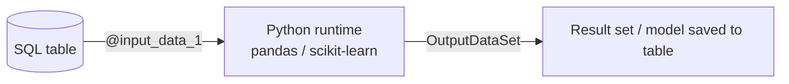

# Session 15: PolyBase, Query Store and Machine Learning in SQL Server

> Module: Effective Data Solutions with SQL Server · Term 3 (HDSE I) · ⏱ ~2 hours

## 🎯 Learning Objectives

- Describe PolyBase and its features for querying external data with T-SQL
- Create external data sources, file formats and external tables
- Explain Query Store and use it to find and fix regressed queries
- Describe Intelligent Query Processing (IQP) and Parameter Sensitive Plan (PSP) optimization
- Explain SQL Server Machine Learning Services and run a Python script inside SQL Server
- Train and use a simple linear regression model to predict future values

## 📖 Concepts Explained

### 1. PolyBase — Query Data Where It Lives

**PolyBase** lets SQL Server read data stored outside it (CSV/Parquet files in Azure Blob or S3-compatible storage, other SQL Servers, Oracle, MongoDB, etc.) using normal T-SQL, **without copying it first** (*data virtualization*).

| Object | Purpose |
|---|---|
| Database scoped credential | Secret used to reach the source |
| External data source | Where the data is (`s3://`, `abs://`, `sqlserver://`) |
| External file format | How files are structured (CSV, Parquet, Delta) |
| External table | A table definition pointing at external data |
| `OPENROWSET` | Ad-hoc query of a file without creating a table |

**Advantages:** one query language for many sources, join external and local data, less ETL, predicate push-down to the source.

### 2. Query Store — The Flight Recorder

**Query Store** captures query text, execution plans and runtime statistics over time, inside each database. It is **on by default** for new databases in SQL Server 2022.

Uses:

- Find the top resource-consuming queries
- Detect **plan regressions** (a query suddenly got slower because its plan changed)
- **Force** a known good plan
- Apply **Query Store hints** (2022) such as `MAXDOP` without changing application code

SSMS reports: *Regressed Queries*, *Top Resource Consuming Queries*, *Tracked Queries*, *Query Wait Statistics*.

### 3. Intelligent Query Processing (IQP)

IQP is a family of automatic optimizer improvements enabled by compatibility level (150 for 2019, 160 for 2022):

| Feature | What it does |
|---|---|
| Adaptive joins | Chooses hash or nested loop at run time |
| Memory grant feedback | Adjusts memory for repeat executions |
| Table variable deferred compilation | Uses real row counts |
| Scalar UDF inlining | Turns simple UDFs into expressions |
| **PSP optimization** (2022) | Caches several plans for one parameterised query |
| DOP feedback, CE feedback (2022) | Tunes parallelism and cardinality estimates over time |

**PSP** solves *parameter sniffing*: if `@City = 'Karachi'` returns 1 million rows but `'Gwadar'` returns 50, one plan cannot suit both. SQL Server 2022 keeps plan variants for different parameter value ranges.

### 4. Machine Learning Services

**SQL Server Machine Learning Services** runs Python (and R) scripts inside the database server using `sp_execute_external_script`, so data does not leave the server.



Install steps (SQL Server 2022):

1. Run Setup → *Machine Learning Services and Language Extensions* → tick **Python**.
2. Install Python 3.10 and the `revoscalepy` package as described in Microsoft's 2022 install guide, then register the runtime.
3. Enable: `EXEC sp_configure 'external scripts enabled', 1; RECONFIGURE;` and restart the service.
4. Test with a "hello" script.

### 5. Linear Regression in One Minute

Linear regression fits a straight line `y = a + b·x` through past data so you can predict `y` for new `x`. Example: predict next month's sales from month number.

## 💻 Code Examples

File: `polybase_csv.sql`

```sql
-- Enable PolyBase (once per server)
EXEC sp_configure 'polybase enabled', 1; RECONFIGURE;
GO
USE CampusDB;
GO
CREATE MASTER KEY ENCRYPTION BY PASSWORD = 'Str0ng!MasterKey#2026';
CREATE DATABASE SCOPED CREDENTIAL S3Cred
WITH IDENTITY = 'S3 Access Key', SECRET = '<access_key_id>:<secret_key_id>';

CREATE EXTERNAL DATA SOURCE SalesFiles
WITH (LOCATION = 's3://my-bucket.s3.example.com/sales', CREDENTIAL = S3Cred);

CREATE EXTERNAL FILE FORMAT CsvFormat
WITH (FORMAT_TYPE = DELIMITEDTEXT,
      FORMAT_OPTIONS (FIELD_TERMINATOR = ',', FIRST_ROW = 2));

CREATE EXTERNAL TABLE dbo.ExtSales (
    SaleDate DATE, City NVARCHAR(40), Amount DECIMAL(12,2)
) WITH (LOCATION = '/2026/', DATA_SOURCE = SalesFiles, FILE_FORMAT = CsvFormat);

SELECT City, SUM(Amount) AS Total FROM dbo.ExtSales GROUP BY City;
```

**How it works**

- The credential holds the storage key; the data source points to the bucket; the file format describes CSV.
- `dbo.ExtSales` stores no data — every query reads the files at that location.
- Replace the placeholder bucket and keys with your own; this needs network storage to run.

File: `query_store.sql`

```sql
ALTER DATABASE AdventureWorks2022 SET QUERY_STORE = ON (OPERATION_MODE = READ_WRITE);
GO
USE AdventureWorks2022;
GO
SELECT TOP (10) qt.query_sql_text, rs.avg_duration / 1000.0 AS AvgMs, rs.count_executions
FROM sys.query_store_query_text qt
JOIN sys.query_store_query q        ON q.query_text_id = qt.query_text_id
JOIN sys.query_store_plan p         ON p.query_id = q.query_id
JOIN sys.query_store_runtime_stats rs ON rs.plan_id = p.plan_id
ORDER BY rs.avg_duration DESC;

-- Force a good plan / add a hint (replace ids with values from the report)
-- EXEC sp_query_store_force_plan @query_id = 42, @plan_id = 7;
-- EXEC sys.sp_query_store_set_hints @query_id = 42, @query_hints = N'OPTION (MAXDOP 1)';
```

**How it works**

- Query Store catalog views join text → query → plan → runtime stats.
- `avg_duration` is in microseconds, so divide by 1000 for milliseconds.

File: `ml_linear_regression.sql`

```sql
EXEC sp_configure 'external scripts enabled', 1; RECONFIGURE;
GO
USE CampusDB;
GO
DROP TABLE IF EXISTS dbo.MonthlySales;
CREATE TABLE dbo.MonthlySales (MonthNo INT, Sales FLOAT);
INSERT INTO dbo.MonthlySales VALUES (1,120),(2,135),(3,150),(4,149),(5,170),(6,182),(7,195),(8,210);
GO
EXEC sp_execute_external_script
  @language = N'Python',
  @script = N'
from sklearn.linear_model import LinearRegression
import pandas as pd
model = LinearRegression().fit(InputDataSet[["MonthNo"]], InputDataSet["Sales"])
future = pd.DataFrame({"MonthNo": [9, 10, 11, 12]})
future["PredictedSales"] = model.predict(future[["MonthNo"]]).round(1)
OutputDataSet = future',
  @input_data_1 = N'SELECT MonthNo, Sales FROM dbo.MonthlySales'
WITH RESULT SETS ((MonthNo INT, PredictedSales FLOAT));
```

**How it works**

- `@input_data_1` becomes the pandas DataFrame `InputDataSet` inside Python.
- scikit-learn fits `Sales = a + b × MonthNo` and predicts months 9–12.
- Whatever is assigned to `OutputDataSet` returns to SQL Server as a result set described by `WITH RESULT SETS`.

## 🧪 Lab Practice

1. Check whether PolyBase is installed: `SELECT SERVERPROPERTY('IsPolyBaseInstalled');`.
2. Use `OPENROWSET(BULK ...)` with a local CSV through a data source of your choice, or review the external table script line by line and explain each object.
3. Enable Query Store on AdventureWorks, run a heavy query 20 times, and find it in the *Top Resource Consuming Queries* report.
4. Run a "hello Python" script with `sp_execute_external_script` that returns `SELECT 1` doubled.
5. Run the regression script and add month 13 to the prediction list.

## 📝 Assignment

Write a short report (markdown) comparing PolyBase, Query Store and ML Services: what problem each solves, one real example for a Pakistani e-commerce company, and the T-SQL objects or procedures involved. Include output screenshots of Query Store and the regression prediction.

## ❓ Quick Quiz

1. Does an external table store data inside SQL Server?
2. What problem does Parameter Sensitive Plan optimization address?
3. Which system procedure runs Python inside SQL Server?
4. Name two things Query Store lets you do.
5. Which server option must be enabled for ML scripts?

<details>
<summary>Show answers</summary>

1. No, it only stores metadata; data stays at the source.
2. Parameter sniffing (one cached plan that suits some parameter values but not others).
3. `sp_execute_external_script`.
4. Any two: find top queries, detect regressions, force plans, apply hints, view wait stats.
5. `external scripts enabled`.

</details>

## 💼 Interview Questions

1. **What is data virtualization?** Querying data in place across sources through one engine without moving it, e.g. PolyBase external tables.
2. **How would you fix a query that became slow after a deployment?** Use Query Store's Regressed Queries report, compare plans, force the previous good plan, then investigate statistics or indexes.
3. **Why run ML inside the database?** Avoid moving large data, reuse SQL security, and score data where it lives.

## ✅ Summary

- PolyBase queries external files and databases with T-SQL through external tables.
- Query Store records plans and runtime stats so you can find and fix regressions.
- IQP features (including PSP in 2022) make the optimizer adapt automatically.
- ML Services runs Python next to the data; linear regression predicts future values.

---

[⬅ Previous](../Session-14-Transactions-and-Error-Handling/README.md) · [🏠 Module Home](../README.md) · [Next ➡](../Session-16-Lab-Review-Programming-Transactions-Performance/README.md)

Prepared by Zeeshan Abbas · Aptech Learning North Nazimabad
