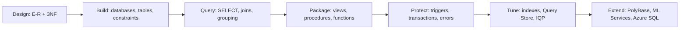

# Session 16: Lab and Review: Programming, Transactions and Performance

> Module: Effective Data Solutions with SQL Server · Term 3 (HDSE I) · ⏱ ~2 hours

## 🎯 Learning Objectives

- Revise T-SQL programming, UDFs, window functions, transactions, error handling, PolyBase, Query Store and ML Services (Sessions 13–15)
- Build a small but complete stored-procedure-driven application database
- Combine window functions and UDFs in analytical reports
- Write robust procedures with transactions and `TRY...CATCH`
- Review the whole module before the practical exam

## 📖 Concepts Explained

### 1. Recap Table

| Topic | Key syntax | Exam tip |
|---|---|---|
| Control flow | `IF/ELSE`, `WHILE`, `BREAK`, `CONTINUE` | Prefer set-based code |
| Functions | `TRY_CAST`, `COALESCE`, `DATEADD`, `STRING_AGG` | Know which are new in 2022 |
| UDFs | Scalar, inline TVF, multi-statement TVF | Inline TVF = fastest |
| Window functions | `ROW_NUMBER/RANK/DENSE_RANK`, `LAG/LEAD`, `SUM() OVER` | Rows are not collapsed |
| Transactions | `BEGIN TRAN`, `COMMIT`, `ROLLBACK`, `SAVE TRAN` | Use `XACT_ABORT ON` |
| Isolation | READ COMMITTED default; SNAPSHOT uses versions | Know dirty / non-repeatable / phantom |
| Errors | `TRY...CATCH`, `ERROR_*()`, `THROW` | `THROW;` rethrows inside CATCH |
| PolyBase | External data source, file format, table | Data stays external |
| Query Store | Regressions, forced plans, hints | On by default in 2022 |
| ML Services | `sp_execute_external_script` | `InputDataSet` / `OutputDataSet` |

### 2. Whole-Module Map



## 💻 Code Examples

File: `fee_management_lab.sql` — a **fee collection** system for a training centre.

```sql
CREATE OR ALTER PROCEDURE dbo.usp_CollectFee
    @StudentId INT, @Amount DECIMAL(10,2), @ReceiptNo INT OUTPUT
AS
BEGIN
    SET NOCOUNT ON; SET XACT_ABORT ON;
    BEGIN TRY
        DECLARE @Due DECIMAL(10,2) =
            (SELECT FeeDue FROM dbo.Learner WHERE LearnerId = @StudentId);
        IF @Due IS NULL      THROW 50100, 'Learner not found.', 1;
        IF @Amount > @Due    THROW 50101, 'Payment exceeds outstanding fee.', 1;

        BEGIN TRAN;
            INSERT INTO dbo.Payment (LearnerId, Amount) VALUES (@StudentId, @Amount);
            SET @ReceiptNo = SCOPE_IDENTITY();
            UPDATE dbo.Learner SET FeeDue -= @Amount WHERE LearnerId = @StudentId;
        COMMIT;
    END TRY
    BEGIN CATCH
        IF XACT_STATE() <> 0 ROLLBACK;
        INSERT INTO dbo.ErrorLog (Num, Msg, ProcName)
        VALUES (ERROR_NUMBER(), ERROR_MESSAGE(), ERROR_PROCEDURE());
        THROW;
    END CATCH;
END;
```

**How it works**

- Validation happens **before** the transaction opens, so failed checks lock nothing.
- Payment insert and balance update commit together or not at all.
- The CATCH block logs **after** rolling back, so the log row is not undone with the transaction.

```sql
-- Analytical report: monthly collection with running total and rank
SELECT FORMAT(PaidOn, 'yyyy-MM') AS Month,
       SUM(Amount) AS Collected,
       SUM(SUM(Amount)) OVER (ORDER BY FORMAT(PaidOn, 'yyyy-MM')) AS RunningTotal,
       RANK() OVER (ORDER BY SUM(Amount) DESC) AS BestMonthRank
FROM dbo.Payment
GROUP BY FORMAT(PaidOn, 'yyyy-MM');
```

**How it works**

- Window functions can wrap aggregates: `SUM(SUM(Amount)) OVER (...)` gives a running total across grouped months.

## 🧪 Lab Practice

1. Run `fee_management_lab.sql`, then call `usp_CollectFee` with a valid payment, an overpayment and an unknown learner. Check `ErrorLog`.
2. Write an inline TVF `fn_Defaulters(@MinDue)` and use it with `CROSS APPLY` or in `FROM`.
3. Use `LAG` to show each learner's previous payment and the gap in days between payments.
4. Enable Query Store on the database, run the report 10 times, and find it in Query Store views.
5. (If ML Services is installed) predict next month's collection with the regression pattern from Session 15.

## 📝 Assignment

**Module mini-project checkpoint:** finish the module mini-project (see the module README) and submit the full script set: schema, sample data, three views, three procedures with transactions and error handling, two functions, one trigger, two indexes with before/after statistics, and one window-function report.

## ❓ Quick Quiz

1. Why validate input before `BEGIN TRAN`?
2. Why is the error logged after `ROLLBACK` in the CATCH block?
3. Can a window function be applied to an aggregate?
4. Which function returns the new identity value in the procedure?
5. What is stored in Query Store: data rows or query plans and statistics?

<details>
<summary>Show answers</summary>

1. To avoid holding locks and opening transactions for requests that will be rejected anyway.
2. Otherwise the log insert would be rolled back along with the failed work.
3. Yes, e.g. `SUM(SUM(x)) OVER (...)` after `GROUP BY`.
4. `SCOPE_IDENTITY()`.
5. Query text, plans and runtime statistics.

</details>

## 💼 Interview Questions

1. **How do you design a stored procedure for reliability?** Validate early, `SET NOCOUNT ON` and `XACT_ABORT ON`, short transaction, `TRY...CATCH` with rollback, logging and rethrow.
2. **Running total in SQL Server — how?** `SUM(col) OVER (ORDER BY ... ROWS UNBOUNDED PRECEDING)`.
3. **What tools would you use to diagnose a slow production database?** Query Store, execution plans, DMVs (`sys.dm_exec_requests`, `sys.dm_os_wait_stats`), index usage stats.

## ✅ Summary

- Programmable T-SQL objects turn a database into a reliable application backend.
- Window functions and UDFs produce rich reports with little code.
- Transactions + `TRY...CATCH` keep data consistent under failure.
- PolyBase, Query Store, IQP and ML Services are SQL Server 2022's modern extras.

---

[⬅ Previous](../Session-15-PolyBase-Query-Store-and-ML/README.md) · [🏠 Module Home](../README.md) · [Next Module ➡](../../02-Proficient-Programming-with-CSharp/README.md)

Prepared by Zeeshan Abbas · Aptech Learning North Nazimabad
