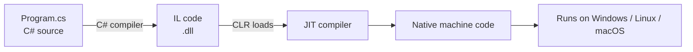

# Session 01: Getting Started with C# and .NET

> Module: Proficient Programming with C# · Term 3 (HDSE I) · ⏱ ~2 hours

## 🎯 Learning Objectives

- Explain what C# is and what the .NET platform provides
- Describe the roles of the CLR, JIT compiler and Base Class Library (BCL)
- Install the .NET 8 SDK and create a console project with the `dotnet` CLI
- Understand top-level statements and the structure of a `.csproj` file
- Read input and print output with the `Console` class

## 📖 Concepts Explained

### 1. C# and .NET in one picture

**C#** (pronounced "C sharp") is a modern, type-safe, object-oriented language made by Microsoft. **.NET** is the free, open-source platform that compiles and runs C# programs on Windows, Linux and macOS.

Think of it like this: C# is the *language you speak*, and .NET is the *country* with its roads, rules and services that let your words turn into action.



### 2. Key parts of .NET

| Part | Full name | What it does |
|---|---|---|
| **CLR** | Common Language Runtime | Runs your program: memory, garbage collection, security, exceptions |
| **IL** | Intermediate Language | CPU-independent code produced by the compiler |
| **JIT** | Just-In-Time compiler | Converts IL to native code while the program runs |
| **BCL** | Base Class Library | Ready-made classes: `Console`, `Math`, `DateTime`, `List<T>`, files, networking |
| **SDK** | Software Development Kit | The `dotnet` command, compilers and templates |

### 3. .NET Framework vs modern .NET

| .NET Framework 4.x | .NET 5, 6, 7, **8** |
|---|---|
| Windows only | Cross-platform |
| Closed, old releases | Open source, yearly releases |
| Still used in legacy apps | Recommended for all new work (.NET 8 is LTS) |

### 4. Your first project with the CLI

```bash
dotnet --version              # check the SDK is installed (8.x)
dotnet new console -n HelloDotNet
cd HelloDotNet
dotnet run                    # build + run
```

The project file `HelloDotNet.csproj` tells .NET how to build:

```xml
<Project Sdk="Microsoft.NET.Sdk">
  <PropertyGroup>
    <OutputType>Exe</OutputType>
    <TargetFramework>net8.0</TargetFramework>
    <ImplicitUsings>enable</ImplicitUsings>
    <Nullable>enable</Nullable>
  </PropertyGroup>
</Project>
```

- `OutputType Exe` → a runnable console app.
- `TargetFramework net8.0` → use .NET 8.
- `ImplicitUsings` → common namespaces (`System`, `System.IO`, `System.Linq`…) are imported automatically.
- `Nullable` → the compiler warns you about possible `null` values.

### 5. Top-level statements

Old C# needed `class Program { static void Main() { ... } }`. Since C# 9 you can write statements directly in `Program.cs`; the compiler creates `Main` for you. Perfect for beginners.

## 💻 Code Examples

File: `Program.cs`

```csharp
// Session 01: First C# program on .NET 8 (top-level statements)
using System.Runtime.InteropServices;

Console.Title = "Hello .NET";
Console.WriteLine("Assalam-o-Alaikum! Welcome to C# on .NET 8");

Console.Write("What is your name? ");
string? name = Console.ReadLine();
if (string.IsNullOrWhiteSpace(name)) name = "Student";

Console.WriteLine($"Nice to meet you, {name}!");
Console.WriteLine($"Runtime : {RuntimeInformation.FrameworkDescription}");
Console.WriteLine($"OS      : {RuntimeInformation.OSDescription}");
Console.WriteLine($"64-bit  : {Environment.Is64BitProcess}");
Console.WriteLine($"Today   : {DateTime.Now:dddd, dd MMMM yyyy}");
```

**How it works**

1. `using System.Runtime.InteropServices;` brings in the `RuntimeInformation` class.
2. `Console.WriteLine` prints a line; `Console.Write` prints without a new line.
3. `Console.ReadLine()` returns the typed text as `string?` — the `?` means it *might* be `null`.
4. `string.IsNullOrWhiteSpace` protects us from empty input.
5. `$"..."` is an **interpolated string**: values inside `{ }` are inserted.
6. `{DateTime.Now:dddd, dd MMMM yyyy}` uses a **format string** after the colon.

Sample output:

```text
Assalam-o-Alaikum! Welcome to C# on .NET 8
What is your name? Hina
Nice to meet you, Hina!
Runtime : .NET 8.0.x
OS      : Microsoft Windows 10.0.22631
64-bit  : True
Today   : Saturday, 24 October 2026
```

## 🧪 Lab Practice

1. Install the .NET 8 SDK and run `dotnet --info`. Note your SDK version and OS.
2. Create a project with `dotnet new console -n MyFirstApp` and run it.
3. Replace `Program.cs` with the example above and run it again.
4. Add a question "Which city do you live in?" and print it back.
5. Open the `bin/Debug/net8.0` folder and find the `.dll` — this is your IL code.

## 📝 Assignment

Write a program **ProfileCard** that asks for name, age and favourite subject, then prints a neat card using `new string('=', 30)` borders and today's date.

## ❓ Quick Quiz

1. What does the JIT compiler do?
2. Which command creates a new console project?
3. What is the type returned by `Console.ReadLine()`?
4. What do top-level statements remove from your code?
5. Name two classes from the BCL.

<details>
<summary>Show answers</summary>

1. Converts IL into native machine code at run time.
2. `dotnet new console -n Name`
3. `string?` (a string that may be null).
4. The need to write `class Program` and `static void Main` yourself.
5. Any two, e.g. `Console`, `Math`, `DateTime`, `List<T>`.

</details>

## 💼 Interview Questions

1. What is the difference between the CLR and the BCL?
2. Why is C# code compiled to IL first instead of directly to machine code?
3. What is the difference between .NET Framework and .NET 8?

## ✅ Summary

- C# is the language; .NET is the cross-platform runtime and library.
- Source → IL → JIT → native code, managed by the CLR.
- `dotnet new`, `dotnet build` and `dotnet run` are your daily commands.
- Top-level statements keep small programs short and readable.

---

[⬅ Previous Module](../../01-Effective-Data-Solutions-with-SQL-Server/README.md) · [🏠 Module Home](../README.md) · [Next ➡](../Session-02-Basic-Building-Blocks/README.md)

Prepared by Zeeshan Abbas · Aptech Learning North Nazimabad
