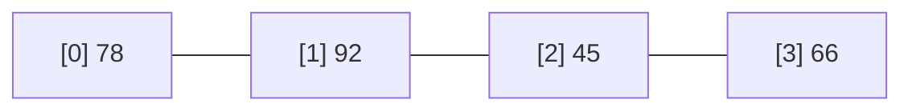

# Session 03: Programming Constructs and Arrays

> Module: Proficient Programming with C# · Term 3 (HDSE I) · ⏱ ~2 hours

## 🎯 Learning Objectives

- Make decisions with `if`, `else if`, `switch` statements and `switch` expressions
- Repeat work with `for`, `while`, `do-while` and `foreach`
- Control loops with `break` and `continue`
- Create and use single-dimensional, multi-dimensional and jagged arrays
- Use helpful `Array` methods: `Sort`, `BinarySearch`, `Exists`, `FindAll`

## 📖 Concepts Explained

### 1. Selection (decision making)

```csharp
if (marks >= 50) Console.WriteLine("Pass");
else Console.WriteLine("Fail");
```

A **switch expression** (C# 8+) is a neat way to turn a value into another value:

```csharp
string grade = marks switch { >= 85 => "A", >= 70 => "B", >= 50 => "C", _ => "F" };
```

`_` is the "anything else" case, like `default`.

### 2. Loops

| Loop | Use when | Runs at least once? |
|---|---|---|
| `for` | you know how many times | no |
| `while` | repeat while a condition is true | no |
| `do-while` | menus — show first, then check | **yes** |
| `foreach` | visit every item of a collection | no |

**Jump statements:** `break` leaves the loop; `continue` skips to the next round; `return` leaves the method.

### 3. Arrays

An **array** is a fixed-size row of boxes of the same type, numbered from **0**.



| Kind | Declaration | Picture |
|---|---|---|
| Single-dimensional | `int[] marks = {78, 92, 45};` | one row |
| Multi-dimensional (rectangular) | `int[,] table = new int[3, 2];` | grid, every row same length |
| Jagged (array of arrays) | `string[][] batches;` | rows of different lengths |

Useful members: `Length`, `GetLength(dimension)`, `Array.Sort`, `Array.Reverse`, `Array.IndexOf`, `Array.BinarySearch` (array must be sorted), `Array.Exists`, `Array.FindAll`.

**Index from end and ranges (C# 8):** `marks[^1]` is the last item; `marks[1..3]` gives items 1 and 2.

## 💻 Code Examples

File: `Program.cs`

```csharp
// Session 03: Selection, loops, jump statements and arrays
int[] marks = { 78, 92, 45, 66, 85, 59, 100, 38 };

foreach (int m in marks)
{
    string grade = m switch { >= 85 => "A", >= 70 => "B", >= 50 => "C", _ => "F" };
    Console.Write($"{m}:{grade}  ");
}
Console.WriteLine();

int sumPassed = 0;
for (int i = 0; i < marks.Length; i++)
{
    if (marks[i] < 50) continue;
    if (marks[i] == 100) { Console.WriteLine("Perfect score found, stop."); break; }
    sumPassed += marks[i];
}
Console.WriteLine($"Sum of passed (until perfect score): {sumPassed}");

int[] sorted = (int[])marks.Clone();
Array.Sort(sorted);
Console.WriteLine($"Sorted: {string.Join(", ", sorted)}");
Console.WriteLine($"Highest: {sorted[^1]}, Lowest: {sorted[0]}, Top 3: {string.Join(",", sorted[^3..])}");
Console.WriteLine($"Index of 66 in sorted: {Array.BinarySearch(sorted, 66)}");
Console.WriteLine($"Any below 40? {Array.Exists(marks, m => m < 40)}");

int[,] table = { { 80, 70 }, { 90, 60 }, { 55, 75 } };
for (int r = 0; r < table.GetLength(0); r++)
    Console.WriteLine($"Student {r + 1}: SQL={table[r, 0]}, C#={table[r, 1]}");

string[][] batches =
{
    new[] { "Ali", "Sana" },
    new[] { "Bilal", "Hira", "Usman" },
    new[] { "Zoya" }
};
for (int b = 0; b < batches.Length; b++)
    Console.WriteLine($"Batch {b + 1} ({batches[b].Length}): {string.Join(", ", batches[b])}");

int choice;
do
{
    Console.Write("1) Average  2) Count passed  0) Exit : ");
    int.TryParse(Console.ReadLine(), out choice);
    switch (choice)
    {
        case 1: Console.WriteLine($"Average = {marks.Average():F1}"); break;
        case 2: Console.WriteLine($"Passed = {Array.FindAll(marks, m => m >= 50).Length}"); break;
        case 0: Console.WriteLine("Allah Hafiz!"); break;
        default: Console.WriteLine("Invalid choice"); break;
    }
} while (choice != 0);
```

**How it works**

1. `foreach` visits every mark and a switch expression converts it to a grade.
2. The `for` loop skips failing marks with `continue` and stops at 100 with `break`.
3. `Clone()` copies the array so the original order is kept; `Array.Sort` sorts the copy.
4. `sorted[^1]` is the highest mark; `sorted[^3..]` is the top three.
5. `table[r, 0]` reads a cell of a 2-D array; `GetLength(0)` gives the number of rows.
6. The jagged array `batches` has rows of length 2, 3 and 1.
7. The `do-while` menu keeps running until the user types `0`.

## 🧪 Lab Practice

1. Print the multiplication table of any number using a `for` loop.
2. Add grade `"A+"` for marks of 95 and above in the switch expression.
3. Count how many marks are between 60 and 80 using `foreach`.
4. Add a third subject column to `table` and print the average per student.
5. Add menu option `3) Show highest` to the `do-while` menu.

## 📝 Assignment

Write **TemperatureWeek**: store 7 daily temperatures in an array, then print the hottest day, coldest day, average, and how many days were above 30 °C. Show a small menu with `do-while` to pick each report.

## ❓ Quick Quiz

1. What is the index of the first element in a C# array?
2. Which loop always runs at least once?
3. What does `continue` do?
4. What is the difference between `int[,]` and `int[][]`?
5. What does `marks[^1]` return?

<details>
<summary>Show answers</summary>

1. `0`
2. `do-while`
3. Skips the rest of the current iteration and moves to the next one.
4. `int[,]` is a rectangular grid; `int[][]` is jagged — each row can have a different length.
5. The last element.

</details>

## 💼 Interview Questions

1. When would you use a `switch` instead of `if-else if`?
2. Why must an array be sorted before calling `Array.BinarySearch`?
3. What happens if you access `marks[marks.Length]`?

## ✅ Summary

- Use `if`/`switch` to decide and loops to repeat.
- `break` exits, `continue` skips.
- Arrays have fixed size and zero-based indexes; jagged arrays allow uneven rows.
- The `Array` class has ready-made methods for sorting and searching.

---

[⬅ Previous](../Session-02-Basic-Building-Blocks/README.md) · [🏠 Module Home](../README.md) · [Next ➡](../Session-04-Lab-Review-CSharp-Fundamentals/README.md)

Prepared by Zeeshan Abbas · Aptech Learning North Nazimabad
