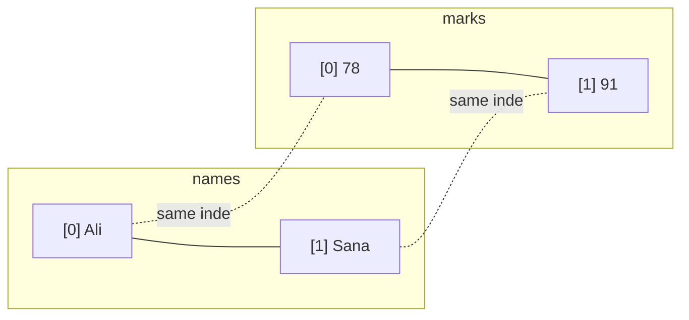

# Session 04: Lab and Review — C# Fundamentals

> Module: Proficient Programming with C# · Term 3 (HDSE I) · ⏱ ~2 hours

## 🎯 Learning Objectives

- Revise data types, operators, selection, loops and arrays from Sessions 01–03
- Combine these basics into one menu-driven console application
- Validate user input with loops and `TryParse`
- Write small reusable **local functions**
- Practise debugging with breakpoints

## 📖 Concepts Explained

### 1. Quick revision table

| Topic | Remember |
|---|---|
| Variables | `int`, `double`, `decimal` (money), `bool`, `char`, `string` |
| Input | `Console.ReadLine()` returns `string?` |
| Conversion | `int.TryParse(text, out int value)` |
| Decisions | `if`, `switch`, switch expressions |
| Loops | `for`, `while`, `do-while`, `foreach` |
| Arrays | fixed size, index from 0, `Length`, `Array.Sort` |

### 2. Parallel arrays

When we do not know classes yet, we can keep related data in two arrays with the **same index**: `names[2]` and `marks[2]` belong to the same student. A `count` variable tells us how many slots are used.



### 3. Local functions

A **local function** is a method written inside `Program.cs` (or inside another method). It keeps repeated logic in one place:

```csharp
static string Grade(int m) => m switch { >= 85 => "A", >= 70 => "B", >= 50 => "C", _ => "F" };
```

`=>` here is an **expression-bodied** method: one expression, no braces.

### 4. Input validation loop

```csharp
do { Console.Write(prompt); }
while (!int.TryParse(Console.ReadLine(), out value) || value < min || value > max);
```

Keep asking until the input is a number *and* inside the allowed range.

### 5. Debugging basics

| Action | Visual Studio | VS Code |
|---|---|---|
| Set breakpoint | click left margin / F9 | click left margin |
| Start debugging | F5 | F5 |
| Step over / into | F10 / F11 | F10 / F11 |
| Watch a variable | hover or Watch window | Variables panel |

## 💻 Code Examples

File: `Program.cs` — **Student Marks Manager**

```csharp
// Session 04: Lab and Review - Student Marks Manager
const int Max = 10;
string[] names = new string[Max];
int[] marks = new int[Max];
int count = 0;

while (true)
{
    Console.WriteLine("\n=== Marks Manager ===");
    Console.WriteLine("1) Add student  2) List  3) Statistics  4) Search  0) Exit");
    Console.Write("Choice: ");
    string? input = Console.ReadLine();
    if (input is null) return;   // end of input stream

    switch (input)
    {
        case "1":
            if (count == Max) { Console.WriteLine("List is full."); break; }
            Console.Write("Name: ");
            names[count] = Console.ReadLine() ?? "";
            marks[count] = ReadInt("Marks (0-100): ", 0, 100);
            count++;
            break;
        case "2":
            for (int i = 0; i < count; i++)
                Console.WriteLine($"{i + 1,2}. {names[i],-15} {marks[i],3}  {Grade(marks[i])}");
            break;
        case "3":
            if (count == 0) { Console.WriteLine("No data."); break; }
            int[] copy = marks[..count];
            Array.Sort(copy);
            Console.WriteLine($"Avg {copy.Average():F1} | Min {copy[0]} | Max {copy[^1]}");
            break;
        case "4":
            Console.Write("Name to find: ");
            string target = Console.ReadLine() ?? "";
            int pos = Array.FindIndex(names, 0, count,
                      n => n.Equals(target, StringComparison.OrdinalIgnoreCase));
            Console.WriteLine(pos >= 0 ? $"{names[pos]} has {marks[pos]}" : "Not found");
            break;
        case "0":
            return;
        default:
            Console.WriteLine("Invalid option.");
            break;
    }
}

static int ReadInt(string prompt, int min, int max)
{
    int value;
    do { Console.Write(prompt); }
    while (!int.TryParse(Console.ReadLine(), out value) || value < min || value > max);
    return value;
}

static string Grade(int m) => m switch { >= 85 => "A", >= 70 => "B", >= 50 => "C", _ => "F" };
```

**How it works**

1. Two arrays of size 10 hold names and marks; `count` tracks how many are filled.
2. `while (true)` shows the menu forever; option `0` uses `return` to end the program.
3. Option 1 refuses new students when the arrays are full, then uses `ReadInt` to validate marks.
4. Option 2 prints a table using alignment: `{names[i],-15}` left-aligns in 15 characters.
5. Option 3 copies only the used part with a range `marks[..count]`, sorts it and shows min/avg/max.
6. Option 4 uses `Array.FindIndex` with a lambda to search names, ignoring upper/lower case.

## 🧪 Lab Practice

1. Run the app, add 4 students, list them and view statistics.
2. Add option `5) Delete student` that shifts the remaining items left.
3. Add option `6) Show toppers` that prints students with marks ≥ 85.
4. Put a breakpoint inside `case "3"` and inspect the `copy` array while debugging.
5. Change `Max` to 3 and test the "List is full" message.

## 📝 Assignment

Build **ShopBill**: a menu to add up to 20 items (name, price, quantity) into parallel arrays, show the bill table, apply 5% discount if the total is above Rs 10,000, and print the grand total.

## ❓ Quick Quiz

1. Why do we need a `count` variable with fixed-size arrays?
2. What does `marks[..count]` return?
3. What is a local function?
4. Which key starts debugging in Visual Studio?
5. What does `{name,-15}` do in an interpolated string?

<details>
<summary>Show answers</summary>

1. The array always has 10 slots; `count` tells how many are actually used.
2. A new array with the first `count` elements.
3. A method declared inside another method or in the top-level statements file.
4. F5
5. Left-aligns the value in a 15-character column.

</details>

## 💼 Interview Questions

1. What are the drawbacks of parallel arrays, and what would you use instead?
2. How do you prevent a crash when a user types letters instead of a number?
3. What is the difference between `break` inside `switch` and `break` inside a loop?

## ✅ Summary

- Real programs combine variables, decisions, loops and arrays.
- Validate every input; never trust the user.
- Local functions remove duplicated code.
- Breakpoints let you watch your program think.

---

[⬅ Previous](../Session-03-Programming-Constructs-and-Arrays/README.md) · [🏠 Module Home](../README.md) · [Next ➡](../Session-05-Classes-and-Methods/README.md)

Prepared by Zeeshan Abbas · Aptech Learning North Nazimabad
