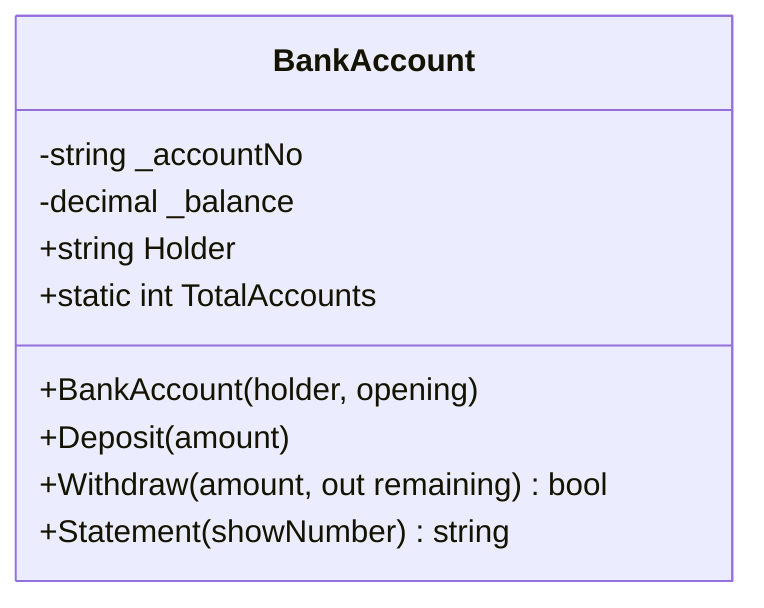

# Session 05: Classes and Methods

> Module: Proficient Programming with C# · Term 3 (HDSE I) · ⏱ ~2 hours

## 🎯 Learning Objectives

- Explain classes and objects using real-life analogies
- Write fields, properties, methods and constructors
- Use access modifiers (`public`, `private`) to protect data (encapsulation)
- Apply method overloading, optional/named parameters, `params`, `ref` and `out`
- Understand `static` members, static constructors and destructors (finalizers)

## 📖 Concepts Explained

### 1. Class vs object

A **class** is a blueprint; an **object** is a real thing built from it. The class `BankAccount` describes *what every account has and does*; `new BankAccount("Hina", 10000)` creates one actual account.



### 2. Members of a class

| Member | Purpose | Example |
|---|---|---|
| Field | stores data (usually `private`) | `private decimal _balance;` |
| Property | safe public access to data | `public string Holder { get; }` |
| Method | an action | `public void Deposit(decimal amount)` |
| Constructor | runs once when the object is created | `public BankAccount(string holder)` |
| Static member | belongs to the class, shared by all objects | `TotalAccounts` |

### 3. Access modifiers

| Modifier | Visible to |
|---|---|
| `public` | everyone |
| `private` | only inside the same class (default for members) |
| `protected` | the class and its child classes |
| `internal` | the same project/assembly |

**Encapsulation** = hide the data (`private _balance`) and expose safe methods (`Deposit`, `Withdraw`) that check the rules.

### 4. Special parameter types

| Feature | Meaning | Example |
|---|---|---|
| Overloading | same name, different parameters | `Deposit(decimal)` and `Deposit(params decimal[])` |
| Optional parameter | has a default value | `Statement(bool showNumber = true)` |
| Named argument | pass by name | `Statement(showNumber: false)` |
| `params` | any number of arguments | `Deposit(2000, 3500, 500)` |
| `ref` | caller's variable is passed and can change | `AddBonus(ref bonus)` |
| `out` | method must assign it; returns extra value | `Withdraw(15000, out decimal left)` |

### 5. Constructor chaining, static constructor, finalizer

- `: this(holder, 0m)` calls another constructor of the same class — no duplicate code.
- `static BankAccount()` runs **once**, before the class is first used.
- `~BankAccount()` is a **finalizer**; the garbage collector may call it. You rarely need one in .NET.

## 💻 Code Examples

File: `BankAccount.cs`

```csharp
// Session 05: Classes, methods, overloading and constructors
public class BankAccount
{
    private static int _nextNumber = 1001;
    public static int TotalAccounts { get; private set; }

    private readonly string _accountNo;
    private decimal _balance;
    public string Holder { get; }

    static BankAccount() => Console.WriteLine("[Bank system loaded]");

    public BankAccount(string holder, decimal opening)
    {
        Holder = holder;
        _accountNo = $"PK-{_nextNumber++}";
        _balance = opening;
        TotalAccounts++;
    }

    public BankAccount(string holder) : this(holder, 0m) { }

    public void Deposit(decimal amount)
    {
        if (amount <= 0) throw new ArgumentException("Amount must be positive.");
        _balance += amount;
    }

    public bool Withdraw(decimal amount, out decimal remaining)
    {
        if (amount > _balance) { remaining = _balance; return false; }
        _balance -= amount;
        remaining = _balance;
        return true;
    }

    public void Deposit(params decimal[] amounts)
    {
        foreach (var a in amounts) Deposit(a);
    }

    public string Statement(bool showNumber = true) =>
        showNumber ? $"{_accountNo} | {Holder,-10} | Rs {_balance:N0}" : $"{Holder}: Rs {_balance:N0}";

    ~BankAccount() { /* finalizer: rarely needed; runs during garbage collection */ }
}
```

**How it works**

1. `_nextNumber` is `static`, so each new account gets the next number (PK-1001, PK-1002…).
2. `_balance` is private; only `Deposit` and `Withdraw` can change it, and they check the rules.
3. The second constructor chains to the first with an opening balance of 0.
4. `Withdraw` returns `true/false` **and** gives back the remaining balance through `out`.
5. `Statement` uses an optional parameter and an expression-bodied method (`=>`).

File: `Program.cs`

```csharp
// Session 05: Using the BankAccount class
var a1 = new BankAccount("Hina", 10_000);
var a2 = new BankAccount("Omar");
a2.Deposit(2000, 3500, 500);

if (a1.Withdraw(15_000, out decimal left))
    Console.WriteLine("Withdrawn");
else
    Console.WriteLine($"Insufficient funds. Balance stays {left:N0}");

Console.WriteLine(a1.Statement());
Console.WriteLine(a2.Statement(showNumber: false));
Console.WriteLine($"Accounts opened: {BankAccount.TotalAccounts}");

int bonus = 100;
AddBonus(ref bonus);
Console.WriteLine($"Bonus after ref call: {bonus}");

static void AddBonus(ref int value) => value += 50;
```

**How it works:** we create two objects, deposit three amounts in one call using `params`, try an over-limit withdrawal, print statements (one with a named argument) and show that `ref` changes the caller's `bonus` from 100 to 150.

## 🧪 Lab Practice

1. Run the program and explain each line of output to a partner.
2. Add a `Transfer(BankAccount to, decimal amount)` method.
3. Add a read-only property `Balance` that returns `_balance`.
4. Try `a1._balance = 0;` in `Program.cs` — read the compiler error and explain it.
5. Write a method `Swap(ref int a, ref int b)` and test it.

## 📝 Assignment

Create a class **Rectangle** with private width/height, two constructors (square and rectangle), methods `Area()` and `Perimeter()`, a static `Count` of rectangles created, and an overloaded `Scale(int factor)` / `Scale(int wFactor, int hFactor)`.

## ❓ Quick Quiz

1. What is the difference between a class and an object?
2. What is the default access modifier of a class member?
3. Difference between `ref` and `out`?
4. When does a static constructor run?
5. What is method overloading?

<details>
<summary>Show answers</summary>

1. A class is the blueprint; an object is an instance created with `new`.
2. `private`
3. `ref` must be assigned before the call; `out` must be assigned inside the method.
4. Once, automatically, before the class is used for the first time.
5. Several methods with the same name but different parameter lists.

</details>

## 💼 Interview Questions

1. What is encapsulation and why is it important?
2. Can a constructor be `private`? Give a use case.
3. What is the difference between a static method and an instance method?

## ✅ Summary

- Classes bundle data and behaviour; objects are created with `new`.
- Keep fields private and expose properties/methods (encapsulation).
- Constructors initialise objects; `this(...)` chains them.
- Overloading, optional, named, `params`, `ref` and `out` make methods flexible.

---

[⬅ Previous](../Session-04-Lab-Review-CSharp-Fundamentals/README.md) · [🏠 Module Home](../README.md) · [Next ➡](../Session-06-Inheritance-and-Polymorphism/README.md)

Prepared by Zeeshan Abbas · Aptech Learning North Nazimabad
