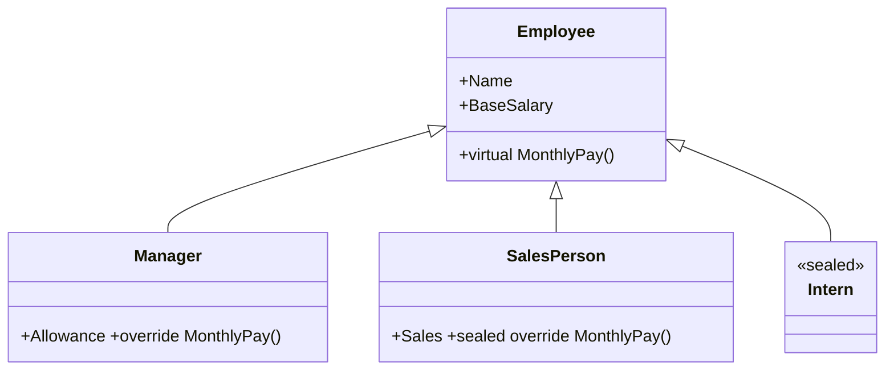

# Session 06: Inheritance and Polymorphism

> Module: Proficient Programming with C# · Term 3 (HDSE I) · ⏱ ~2 hours

## 🎯 Learning Objectives

- Explain inheritance and the "is-a" relationship
- Create base and derived classes and call base constructors with `base(...)`
- Override methods with `virtual` / `override` and stop overriding with `sealed`
- Tell the difference between overriding and hiding (`new`)
- Use run-time polymorphism and type checks with `is`

## 📖 Concepts Explained

### 1. Inheritance

**Inheritance** lets a new class reuse an existing class. A `Manager` **is an** `Employee`, so it gets `Name`, `BaseSalary` and `MonthlyPay()` for free and adds its own `Allowance`.



- C# supports **single inheritance** of classes (one parent), but a class can implement many interfaces (Session 07).
- Every class ultimately inherits from `System.Object`, which gives `ToString()`, `Equals()` and `GetHashCode()`.

### 2. Calling the parent: `base`

```csharp
public Manager(string name, decimal baseSalary, decimal allowance)
    : base(name, baseSalary) { ... }      // run Employee's constructor first
public override decimal MonthlyPay() => base.MonthlyPay() + Allowance;
```

### 3. Polymorphism ("many forms")

| Type | How | When decided |
|---|---|---|
| Compile-time | method overloading | when compiling |
| **Run-time** | `virtual` + `override` | while running, based on the real object |

A `List<Employee>` can hold managers, sales people and interns. Calling `e.MonthlyPay()` runs the **correct version for each object** — that is run-time polymorphism.

### 4. Keywords you must know

| Keyword | Meaning |
|---|---|
| `virtual` | "children may override this" |
| `override` | "I am replacing the parent's version" |
| `sealed` (on method) | "no further overriding below me" |
| `sealed` (on class) | "nobody can inherit from me" |
| `new` (on member) | hides the parent member — **not** polymorphic |
| `protected` | visible to children, hidden from outsiders |

### 5. Overriding vs hiding

With `override`, a base-type variable calls the child's method. With `new`, a base-type variable still calls the **parent's** method. The `Intern` class shows this difference.

### 6. Type checking

`if (e is Manager m)` checks the real type and, if true, gives you a variable `m` of type `Manager` (pattern matching).

## 💻 Code Examples

File: `Employees.cs`

```csharp
// Session 06: Inheritance, overriding, sealed
public class Employee
{
    public string Name { get; }
    public decimal BaseSalary { get; }

    public Employee(string name, decimal baseSalary)
    {
        Name = name;
        BaseSalary = baseSalary;
    }

    public virtual decimal MonthlyPay() => BaseSalary;

    public override string ToString() => $"{GetType().Name,-12} {Name,-10} Rs {MonthlyPay(),10:N0}";
}

public class Manager : Employee
{
    public decimal Allowance { get; }
    public Manager(string name, decimal baseSalary, decimal allowance)
        : base(name, baseSalary) => Allowance = allowance;

    public override decimal MonthlyPay() => base.MonthlyPay() + Allowance;
}

public class SalesPerson : Employee
{
    public decimal Sales { get; set; }
    public SalesPerson(string name, decimal baseSalary) : base(name, baseSalary) { }

    public sealed override decimal MonthlyPay() => BaseSalary + Sales * 0.05m;
}

public sealed class Intern : Employee
{
    public Intern(string name) : base(name, 25_000) { }
    public new string ToString() => $"Intern {Name}";
}
```

**How it works**

1. `Employee.MonthlyPay()` is `virtual`; `ToString()` overrides `Object.ToString()` and uses `GetType().Name` to print the real class name.
2. `Manager` adds the allowance on top of `base.MonthlyPay()`.
3. `SalesPerson` earns 5% commission and seals its override.
4. `Intern` is a sealed class with a fixed salary and **hides** `ToString` with `new`.

File: `Program.cs`

```csharp
// Session 06: Run-time polymorphism in a payroll
var staff = new List<Employee>
{
    new Employee("Asad", 80_000),
    new Manager("Nadia", 150_000, 40_000),
    new SalesPerson("Faraz", 60_000) { Sales = 900_000 },
    new Intern("Mahnoor")
};

decimal payroll = 0;
foreach (Employee e in staff)
{
    Console.WriteLine(e);
    payroll += e.MonthlyPay();
}
Console.WriteLine($"Total payroll: Rs {payroll:N0}");

foreach (var e in staff)
{
    if (e is Manager m)
        Console.WriteLine($"{m.Name} gets allowance Rs {m.Allowance:N0}");
}

Intern i = new Intern("Mahnoor");
Employee asBase = i;
Console.WriteLine(i.ToString());
Console.WriteLine(asBase.ToString());
```

**How it works:** the `foreach` treats everyone as `Employee`, yet each object calculates its own pay. The second loop finds managers with `is`. The last two lines show hiding: `i.ToString()` uses the `new` method, but `asBase.ToString()` uses the inherited override.

## 🧪 Lab Practice

1. Run the program and calculate the payroll by hand to check it.
2. Add a `Teacher` class with `LectureHours` and pay Rs 1,500 per hour on top of base salary.
3. Try to inherit from `Intern` and read the compiler error.
4. Remove `virtual` from `MonthlyPay` and see what breaks.
5. Change `Intern`'s `new string ToString()` to `public override string ToString()` and compare the last two lines.

## 📝 Assignment

Model **Vehicles**: base `Vehicle` (Brand, `virtual RentPerDay()`), derived `Car`, `Bike` and `Van` with different rents. Store them in a `List<Vehicle>` and print the 3-day rental cost for each using polymorphism.

## ❓ Quick Quiz

1. Does C# allow a class to inherit from two classes?
2. What does `base(...)` do in a constructor?
3. Which keyword prevents a class from being inherited?
4. What is run-time polymorphism?
5. What does `is` do in `if (e is Manager m)`?

<details>
<summary>Show answers</summary>

1. No — single class inheritance only (multiple interfaces are allowed).
2. Calls the parent class constructor.
3. `sealed`
4. The method version is chosen at run time based on the actual object type (`virtual`/`override`).
5. Checks the type and, if it matches, casts it into variable `m`.

</details>

## 💼 Interview Questions

1. What is the difference between method overriding and method hiding?
2. Why would you mark a method as `sealed override`?
3. Explain polymorphism with a real-world example.

## ✅ Summary

- Inheritance models "is-a" relationships and reuses code.
- `virtual` + `override` give run-time polymorphism.
- `base` reaches the parent; `sealed` stops inheritance or overriding.
- `new` hides a member and does not behave polymorphically.

---

[⬅ Previous](../Session-05-Classes-and-Methods/README.md) · [🏠 Module Home](../README.md) · [Next ➡](../Session-07-Abstract-Classes-and-Interfaces/README.md)

Prepared by Zeeshan Abbas · Aptech Learning North Nazimabad
