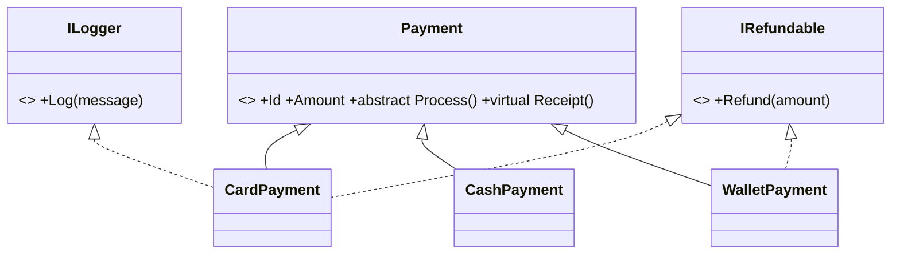

# Session 07: Abstract Classes and Interfaces

> Module: Proficient Programming with C# · Term 3 (HDSE I) · ⏱ ~2 hours

## 🎯 Learning Objectives

- Define abstract classes and abstract methods
- Create and implement interfaces, including multiple interfaces
- Use explicit interface implementation and default interface methods
- Compare abstract classes with interfaces and choose the right one
- Use primary constructors on classes (C# 12)

## 📖 Concepts Explained

### 1. Abstract classes

An **abstract class** is an incomplete blueprint. You cannot create it with `new`; you can only inherit from it. It may contain:

- normal methods with code (shared by all children), and
- **abstract methods** with no body that every child **must** override.

Analogy: "Payment" is an idea — you never pay with *just* a payment; you pay by card, cash or wallet.

### 2. Interfaces

An **interface** is a contract: "any class that signs me promises to have these members". It describes **what** a class can do, not **how**.

```csharp
public interface IRefundable
{
    bool Refund(decimal amount);
}
```

Names start with `I` by convention. A class can implement **many** interfaces.



### 3. Abstract class vs interface

| Feature | Abstract class | Interface |
|---|---|---|
| Create with `new` | No | No |
| Fields / state | Yes | No (only constants/static) |
| Constructors | Yes | No |
| Method bodies | Yes | Only default methods (C# 8+) |
| How many can a class use | **One** | **Many** |
| Use for | "is-a" family with shared code | "can-do" ability across unrelated classes |

### 4. Explicit and default implementations

- **Explicit implementation**: `bool IRefundable.Refund(...)` — the method is only visible when the object is used *as* `IRefundable`. Useful when two interfaces have the same method name.
- **Default interface method**: `ILogger.Log` has a body inside the interface; classes get it for free but must call it through the interface: `((ILogger)this).Log(...)`.

### 5. Primary constructors (C# 12)

`public class WalletPayment(decimal amount, string mobile) : Payment(amount)` declares constructor parameters right on the class line — less typing for small classes.

## 💻 Code Examples

File: `Payments.cs`

```csharp
// Session 07: Abstract classes and interfaces
public interface IRefundable
{
    bool Refund(decimal amount);
}

public interface ILogger
{
    void Log(string message) => Console.WriteLine($"[LOG {DateTime.Now:HH:mm:ss}] {message}");
}

public abstract class Payment
{
    private static int _counter;
    public int Id { get; } = ++_counter;
    public decimal Amount { get; }

    protected Payment(decimal amount)
    {
        if (amount <= 0) throw new ArgumentOutOfRangeException(nameof(amount));
        Amount = amount;
    }

    public abstract bool Process();
    public virtual string Receipt() => $"#{Id} {GetType().Name} Rs {Amount:N0}";
}

public class CardPayment : Payment, IRefundable, ILogger
{
    public string CardLast4 { get; }
    public CardPayment(decimal amount, string last4) : base(amount) => CardLast4 = last4;

    public override bool Process()
    {
        ((ILogger)this).Log($"Charging card ****{CardLast4}");
        return true;
    }

    public bool Refund(decimal amount) => amount <= Amount;
    public override string Receipt() => base.Receipt() + $" (card ****{CardLast4})";
}

public class CashPayment : Payment
{
    public decimal Tendered { get; }
    public CashPayment(decimal amount, decimal tendered) : base(amount) => Tendered = tendered;

    public override bool Process() => Tendered >= Amount;
    public override string Receipt() => base.Receipt() + $" change Rs {Tendered - Amount:N0}";
}

public class WalletPayment(decimal amount, string mobile) : Payment(amount), IRefundable
{
    public override bool Process() => mobile.StartsWith("03") && mobile.Length == 11;
    bool IRefundable.Refund(decimal amt) => amt <= Amount;
}
```

**How it works**

1. `Payment` is abstract, has a shared `Id` counter, validates the amount in a `protected` constructor and forces children to implement `Process()`.
2. `CardPayment` implements two interfaces and uses the default `Log` method.
3. `CashPayment` checks the tendered cash and shows change in its receipt.
4. `WalletPayment` uses a primary constructor and implements `Refund` **explicitly**.

File: `Program.cs`

```csharp
// Session 07: Working through abstract types and interfaces
List<Payment> payments =
[
    new CardPayment(12_500, "4421"),
    new CashPayment(3_200, 5_000),
    new WalletPayment(1_800, "03001234567")
];

foreach (Payment p in payments)
    Console.WriteLine(p.Process() ? p.Receipt() : $"#{p.Id} FAILED");

foreach (var p in payments)
{
    if (p is IRefundable r)
        Console.WriteLine($"#{p.Id} refund 1,000 allowed? {r.Refund(1_000)}");
}
```

**How it works:** all payments are stored as the abstract type `Payment`. Each one processes in its own way (polymorphism). The second loop uses `is IRefundable r` to find only the payments that support refunds.

## 🧪 Lab Practice

1. Try `new Payment(100)` and read the error.
2. Add a `BankTransferPayment` that requires an IBAN starting with `PK`.
3. Create an interface `IDiscountable { decimal Discount(); }` and implement it in `CashPayment`.
4. Call `Refund` directly on a `WalletPayment` variable — why does it fail? Fix it with a cast.
5. Draw your own class diagram for the new classes.

## 📝 Assignment

Design **Shapes**: abstract class `Shape` with abstract `Area()` and a normal `Describe()` method; classes `Circle`, `Rectangle`, `Triangle`; an interface `IDrawable` with `Draw()` implemented only by `Circle` and `Rectangle`. Print area for all shapes and draw only the drawable ones.

## ❓ Quick Quiz

1. Can you create an object of an abstract class?
2. Must a child class override an abstract method?
3. How many interfaces can a class implement?
4. What is explicit interface implementation?
5. Give one thing an abstract class can have but an interface cannot.

<details>
<summary>Show answers</summary>

1. No.
2. Yes (unless the child is also abstract).
3. As many as needed.
4. Implementing a member with the interface name prefix, so it is only accessible through the interface type.
5. Instance fields or constructors.

</details>

## 💼 Interview Questions

1. When would you choose an interface over an abstract class?
2. What problem do default interface methods solve?
3. Can an abstract class implement an interface without implementing its methods?

## ✅ Summary

- Abstract classes share code and force children to fill in the gaps.
- Interfaces are contracts; a class can sign many of them.
- Explicit implementation hides members unless used through the interface.
- Program to abstractions (`Payment`, `IRefundable`) for flexible code.

---

[⬅ Previous](../Session-06-Inheritance-and-Polymorphism/README.md) · [🏠 Module Home](../README.md) · [Next ➡](../Session-08-Lab-Review-Object-Oriented-Programming/README.md)

Prepared by Zeeshan Abbas · Aptech Learning North Nazimabad
