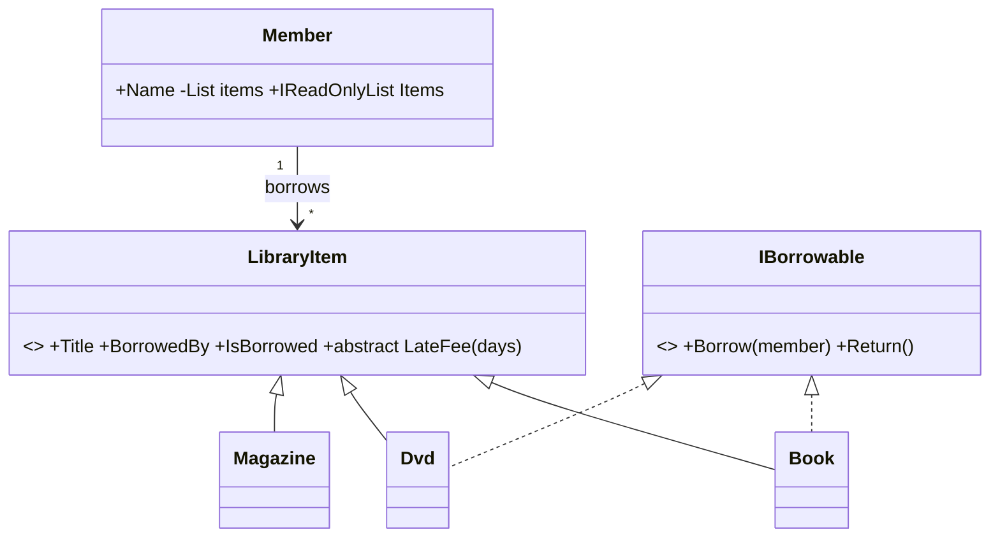

# Session 08: Lab and Review — Object-Oriented Programming

> Module: Proficient Programming with C# · Term 3 (HDSE I) · ⏱ ~2 hours

## 🎯 Learning Objectives

- Revise the four pillars of OOP: encapsulation, inheritance, polymorphism, abstraction
- Combine classes, abstract classes and interfaces in one small system
- Enforce business rules inside classes and report problems with exceptions
- Use `internal` and read-only collections to protect object state
- Practise reading and extending someone else's object model

## 📖 Concepts Explained

### 1. The four pillars at a glance

| Pillar | Simple meaning | Where you see it in the lab |
|---|---|---|
| **Encapsulation** | hide data, expose safe actions | `Member` keeps `_items` private |
| **Inheritance** | reuse a parent class | `Book`, `Dvd`, `Magazine` inherit `LibraryItem` |
| **Polymorphism** | same call, different behaviour | `LateFee()` differs per item |
| **Abstraction** | show only what matters | abstract `LibraryItem`, interface `IBorrowable` |

### 2. The library model



- Magazines are **not** borrowable — they do not implement `IBorrowable`.
- A member has a borrowing **limit** (default 2).

### 3. Protecting state

- `public Member? BorrowedBy { get; protected set; }` — anyone can read, only the class family can change.
- `IReadOnlyList<LibraryItem> Items` — outside code can loop through items but cannot `Add` or `Remove`.
- `internal void Add(...)` — only code in the same project can call it.

### 4. Rules + exceptions

When a rule is broken (item already borrowed, limit reached) the class **throws** `InvalidOperationException`. The calling code decides how to show the error using `try`/`catch`. (Exceptions are covered in depth in Session 10.)

### 5. Review checklist

- Can you explain `virtual` vs `abstract`?
- Can you say why `Magazine` cannot be cast to `IBorrowable`?
- Can you explain what a primary constructor (`class Book(string title, string author)`) generates?

## 💻 Code Examples

File: `Library.cs`

```csharp
// Session 08: Lab and Review - library model
public interface IBorrowable
{
    void Borrow(Member member);
    void Return();
}

public abstract class LibraryItem(string title)
{
    public string Title { get; } = title;
    public Member? BorrowedBy { get; protected set; }
    public bool IsBorrowed => BorrowedBy is not null;
    public abstract decimal LateFee(int daysLate);
    public override string ToString() =>
        $"{GetType().Name,-9} {Title,-28} {(IsBorrowed ? "out: " + BorrowedBy!.Name : "available")}";
}

public class Book(string title, string author) : LibraryItem(title), IBorrowable
{
    public string Author { get; } = author;
    public override decimal LateFee(int daysLate) => daysLate * 20m;
    public void Borrow(Member m)
    {
        if (IsBorrowed) throw new InvalidOperationException($"{Title} is already borrowed.");
        m.Add(this);
        BorrowedBy = m;
    }
    public void Return() { BorrowedBy?.Remove(this); BorrowedBy = null; }
}

public class Dvd(string title, int minutes) : LibraryItem(title), IBorrowable
{
    public int Minutes { get; } = minutes;
    public override decimal LateFee(int daysLate) => Math.Min(daysLate * 50m, 500m);
    public void Borrow(Member m) { m.Add(this); BorrowedBy = m; }
    public void Return() { BorrowedBy?.Remove(this); BorrowedBy = null; }
}

public class Magazine(string title) : LibraryItem(title)
{
    public override decimal LateFee(int daysLate) => 0;
}

public class Member(string name, int limit = 2)
{
    private readonly List<LibraryItem> _items = new();
    public string Name { get; } = name;
    public IReadOnlyList<LibraryItem> Items => _items;
    internal void Add(LibraryItem item)
    {
        if (_items.Count >= limit) throw new InvalidOperationException($"{Name} reached the limit of {limit}.");
        _items.Add(item);
    }
    internal void Remove(LibraryItem item) => _items.Remove(item);
}
```

**How it works**

1. `LibraryItem` stores the title and who borrowed it; `IsBorrowed` is a computed property.
2. `Book` charges Rs 20 per late day and refuses double borrowing.
3. `Dvd` charges Rs 50 per day but never more than Rs 500 (`Math.Min`).
4. `Magazine` has no late fee and cannot be borrowed.
5. `Member.Add` enforces the borrowing limit.

File: `Program.cs`

```csharp
// Session 08: Lab and Review - using the library model
var ayesha = new Member("Ayesha");
var hamza = new Member("Hamza", limit: 3);

var items = new List<LibraryItem>
{
    new Book("Clean Code", "Robert C. Martin"),
    new Book("The Pragmatic Programmer", "Hunt & Thomas"),
    new Dvd("Intro to .NET 8", 95),
    new Magazine("Spectrum Monthly")
};

((IBorrowable)items[0]).Borrow(ayesha);
((IBorrowable)items[2]).Borrow(ayesha);

try
{
    ((IBorrowable)items[1]).Borrow(ayesha);      // third item: over the limit
}
catch (InvalidOperationException ex)
{
    Console.WriteLine($"Error: {ex.Message}");
}

try
{
    ((IBorrowable)items[0]).Borrow(hamza);       // already borrowed
}
catch (InvalidOperationException ex)
{
    Console.WriteLine($"Error: {ex.Message}");
}

Console.WriteLine();
items.ForEach(Console.WriteLine);

Console.WriteLine("\nLate fee for 6 days:");
foreach (var item in items)
    Console.WriteLine($"  {item.Title,-28} Rs {item.LateFee(6),5:N0}");

((IBorrowable)items[0]).Return();
Console.WriteLine($"\nAfter return, {ayesha.Name} holds {ayesha.Items.Count} item(s).");
Console.WriteLine($"Borrowable items: {items.Count(i => i is IBorrowable)}");
```

**How it works:** Ayesha borrows a book and a DVD, then a third item fails because of her limit. Hamza tries to borrow a book that is already out. The program prints the status of every item, late fees for 6 days, and the counts after a return.

## 🧪 Lab Practice

1. Run the program and match each output line to the code that produced it.
2. Add an `EBook` class that is borrowable, has no late fee, and has no limit check.
3. Add `public decimal TotalLateFee(int days)` to `Member` that sums fees of all held items.
4. Make `Dvd.Borrow` refuse when already borrowed, like `Book`.
5. Print all available (not borrowed) items using `foreach` and `IsBorrowed`.

## 📝 Assignment

Build **HospitalStaff**: abstract `Staff` (Name, abstract `Salary()`), `Doctor`, `Nurse`, `Receptionist`; interface `IOnCall` with `CallIn()` implemented by doctors and nurses only. Keep the list private inside a `Hospital` class with `Hire()` and a read-only `Staff` list. Print salaries and call in only on-call staff.

## ❓ Quick Quiz

1. Which pillar is shown by `LateFee()` behaving differently for each item?
2. Why does `Magazine` not implement `IBorrowable`?
3. What does `IReadOnlyList<T>` protect against?
4. What does `protected set` mean?
5. What exception type is thrown when the limit is reached?

<details>
<summary>Show answers</summary>

1. Polymorphism.
2. Because magazines are reference-only and cannot be borrowed.
3. Outside code adding or removing items.
4. Only the class and its children can change the property.
5. `InvalidOperationException`.

</details>

## 💼 Interview Questions

1. Explain the four pillars of OOP with one example each.
2. Why should a class expose `IReadOnlyList<T>` instead of `List<T>`?
3. What is the difference between "is-a" and "has-a" relationships?

## ✅ Summary

- OOP organises code around objects that guard their own rules.
- Abstract classes share code; interfaces add optional abilities.
- Read-only views and access modifiers protect object state.
- Throw exceptions when rules break, and catch them where you can respond.

---

[⬅ Previous](../Session-07-Abstract-Classes-and-Interfaces/README.md) · [🏠 Module Home](../README.md) · [Next ➡](../Session-09-Properties-Indexers-and-Records/README.md)

Prepared by Zeeshan Abbas · Aptech Learning North Nazimabad
