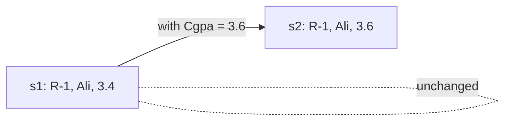

# Session 09: Properties, Indexers and Record Types

> Module: Proficient Programming with C# · Term 3 (HDSE I) · ⏱ ~2 hours

## 🎯 Learning Objectives

- Write full properties with `get`/`set` and validation logic
- Use auto-properties, read-only, `init`-only and `required` properties
- Create computed (expression-bodied) properties
- Build an **indexer** so an object can be used like an array: `book["SQL"]`
- Create `record` types and use value equality, `with` expressions and deconstruction

## 📖 Concepts Explained

### 1. Why properties?

A **field** is raw storage. A **property** looks like a field from outside but runs code when read or written — like a security guard at a gate who checks everyone going in.

```csharp
private decimal _price;                 // field (hidden)
public decimal Price                    // property (public gate)
{
    get => _price;                      // reading
    set => _price = value >= 0 ? value : throw new ArgumentOutOfRangeException(nameof(Price));
}
```

`value` is the special word for "the value being assigned".

### 2. Kinds of properties

| Kind | Syntax | Meaning |
|---|---|---|
| Auto-property | `public string Sku { get; set; }` | compiler creates the hidden field |
| Read-only | `public string Holder { get; }` | set only in constructor |
| Private set | `public int Stock { get; private set; }` | anyone reads, only the class writes |
| Init-only | `public string Sku { get; init; }` | set only while creating the object |
| Required (C# 11) | `public required string Name { get; init; }` | must be set in the object initializer |
| Computed | `public decimal StockValue => Price * Stock;` | calculated every time, no storage |

**Object initializer:** `new Product { Name = "Keyboard", Price = 3500 }` sets properties right after the constructor.

### 3. Indexers

An **indexer** lets you use `[ ]` on your own object:

```csharp
public int this[string subject] { get { ... } set { ... } }
gradebook["SQL"] = 88;
```

The parameter can be `int`, `string` or any type. Think of a dictionary-like wrapper with your own rules (here: marks are clamped between 0 and 100).

### 4. Records

A **record** is a class designed for **data**. One line gives you a constructor, properties, `ToString()`, value equality and deconstruction:

```csharp
public record Student(string RollNo, string Name, double Cgpa);
```

| Feature | Class | Record |
|---|---|---|
| `==` compares | references (same object?) | **values** (same data?) |
| `ToString()` | type name | `Student { RollNo = R-1, Name = Ali, Cgpa = 3.4 }` |
| Copy with changes | manual | `s1 with { Cgpa = 3.6 }` |
| Immutable by default | no | yes (positional properties are `init`) |



## 💻 Code Examples

File: `Product.cs` — validation, `init`, `required`, private set and computed property

```csharp
public class Product
{
    private decimal _price;
    public required string Name { get; init; }
    public string Sku { get; init; } = "N/A";
    public int Stock { get; private set; }
    public decimal Price
    {
        get => _price;
        set => _price = value >= 0 ? value : throw new ArgumentOutOfRangeException(nameof(Price));
    }
    public decimal StockValue => Price * Stock;
    public void Receive(int qty) => Stock += qty;
}
```

File: `Gradebook.cs` — a string indexer

```csharp
public class Gradebook
{
    private readonly Dictionary<string, int> _marks = new();
    public int this[string subject]
    {
        get => _marks.TryGetValue(subject, out int m) ? m : 0;
        set => _marks[subject] = Math.Clamp(value, 0, 100);
    }
    public int Count => _marks.Count;
}
```

File: `Student.cs` — a positional record

```csharp
public record Student(string RollNo, string Name, double Cgpa);
```

File: `Program.cs`

```csharp
// Session 09: Properties, indexers and records
var p = new Product { Name = "Keyboard", Sku = "KB-01", Price = 3500 };
p.Receive(12);
Console.WriteLine($"{p.Name} stock {p.Stock}, value Rs {p.StockValue:N0}");

var g = new Gradebook();
g["SQL"] = 88; g["C#"] = 140;
Console.WriteLine($"SQL {g["SQL"]}, C# {g["C#"]}, Math {g["Math"]}");

var s1 = new Student("R-1", "Ali", 3.4);
var s2 = s1 with { Cgpa = 3.6 };
Console.WriteLine(s1);
Console.WriteLine($"Equal? {s1 == new Student("R-1", "Ali", 3.4)}");
var (roll, name, _) = s2;
Console.WriteLine($"{roll} {name} improved to {s2.Cgpa}");
```

**How it works**

1. The `Product` is created with an object initializer; `Name` is `required`, so leaving it out is a compile error.
2. `Stock` can only grow through `Receive()`, because its setter is private.
3. `StockValue` is calculated from `Price * Stock` each time it is read.
4. `g["C#"] = 140` is clamped to 100; reading an unknown subject (`"Math"`) returns 0.
5. `s1 with { Cgpa = 3.6 }` creates a **new** record; `s1` stays the same.
6. `s1 == new Student("R-1", "Ali", 3.4)` is `True` because records compare values.
7. `var (roll, name, _) = s2;` deconstructs the record; `_` ignores the CGPA.

## 🧪 Lab Practice

1. Set `p.Price = -5` and observe the exception.
2. Try `p.Sku = "X"` after creation — why does the compiler refuse?
3. Add a read-only computed property `Average` to `Gradebook` using the stored marks.
4. Create `public record Course(string Code, string Title, int Hours);` and test `==` and `with`.
5. Change `Student` to a `class` and run the equality line again. Explain the difference.

## 📝 Assignment

Create a class **Employee** with a required `Name`, an `init`-only `EmployeeId`, a `Salary` property that rejects values below Rs 37,000 (minimum wage example), and a computed `AnnualSalary`. Add a class **WeekSchedule** with an indexer `this[DayOfWeek day]` that stores a task per day. Finally create a record `Leave(string EmployeeId, DateOnly From, DateOnly To)` and print a copy with a changed `To` date.

## ❓ Quick Quiz

1. What is the special keyword inside a `set` accessor?
2. What is the difference between `init` and `set`?
3. What does `required` force?
4. How does `==` behave for records?
5. What keyword creates a modified copy of a record?

<details>
<summary>Show answers</summary>

1. `value`
2. `init` can only be assigned during object creation; `set` can be assigned any time.
3. The property must be given a value in the object initializer.
4. It compares the values of all properties.
5. `with`

</details>

## 💼 Interview Questions

1. Why are properties preferred over public fields?
2. When would you design a class with an indexer?
3. What are the advantages of records for DTOs (data transfer objects)?

## ✅ Summary

- Properties are smart gates around fields; put validation in `set`.
- `init` and `required` help create safe, immutable objects.
- Indexers make objects usable with `[ ]`.
- Records give value equality, nice `ToString()` and `with` copies for data types.

---

[⬅ Previous](../Session-08-Lab-Review-Object-Oriented-Programming/README.md) · [🏠 Module Home](../README.md) · [Next ➡](../Session-10-Namespaces-and-Exception-Handling/README.md)

Prepared by Zeeshan Abbas · Aptech Learning North Nazimabad
