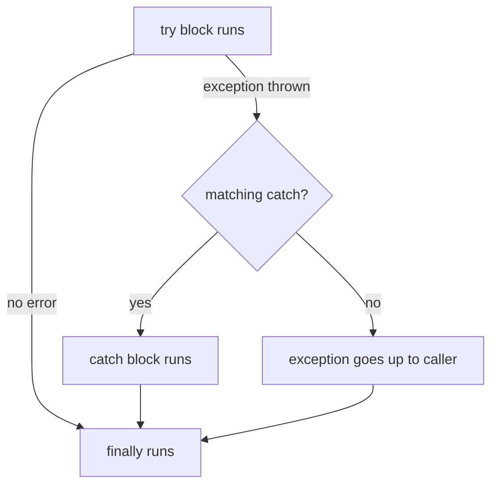

# Session 10: Namespaces and Exception Handling

> Module: Proficient Programming with C# · Term 3 (HDSE I) · ⏱ ~2 hours

## 🎯 Learning Objectives

- Organise code with namespaces, file-scoped namespaces and `using` directives
- Explain what an exception is and how the CLR handles it
- Handle errors with `try`, `catch`, `finally` and exception filters (`when`)
- Throw and re-throw exceptions, and wrap them using an inner exception
- Create your own custom exception class

## 📖 Concepts Explained

### 1. Namespaces

A **namespace** is a folder-like name that groups related types and avoids name clashes. Two classes named `Student` can live in `Aptech.Exams` and `Aptech.Fees` without conflict.

```csharp
namespace Aptech.Fees.Models;      // file-scoped namespace (C# 10) - applies to the whole file
```

| Feature | Example |
|---|---|
| Import a namespace | `using Aptech.Fees.Services;` |
| Alias | `using Svc = Aptech.Fees.Services;` |
| Global using (whole project) | `global using System.Text;` |
| Fully qualified name | `Aptech.Fees.Services.FeeService` |

A good habit: match namespaces with folders (`Models/`, `Services/`) as in this session's project.

### 2. What is an exception?

An **exception** is an object that represents an error at run time (bad input, missing file, divide by zero). If nobody catches it, the program crashes.



### 3. Common exception types

| Exception | Typical cause |
|---|---|
| `FormatException` | `decimal.Parse("abc")` |
| `ArgumentException` / `ArgumentOutOfRangeException` | bad argument value |
| `NullReferenceException` | using a `null` object |
| `IndexOutOfRangeException` | array index too big |
| `DivideByZeroException` | integer divided by 0 |
| `InvalidOperationException` | object is in the wrong state |
| `FileNotFoundException` | file missing |

All inherit from `System.Exception`, which gives `Message`, `StackTrace` and `InnerException`.

### 4. Rules for catching

- Put **specific** `catch` blocks first and general ones last.
- `catch (X ex) when (condition)` is an **exception filter** — the block runs only if the condition is true.
- `finally` **always** runs — use it for clean-up (closing files, logging).
- `throw;` re-throws the same exception and keeps the stack trace. `throw new X("msg", ex);` wraps it with extra context.
- Helper guards: `ArgumentNullException.ThrowIfNull(x)` and `ArgumentOutOfRangeException.ThrowIfNegativeOrZero(amount)` (.NET 8).

### 5. Custom exceptions

Create one when your business rule has a clear name. Inherit from `Exception`, end the name with `Exception`, and add useful data (here, `Shortfall`).

## 💻 Code Examples

File: `Models/FeeExceptions.cs`

```csharp
namespace Aptech.Fees.Models;

public class InsufficientBalanceException : Exception
{
    public decimal Shortfall { get; }
    public InsufficientBalanceException(decimal shortfall)
        : base($"Balance is short by Rs {shortfall:N0}.") => Shortfall = shortfall;
    public InsufficientBalanceException(string message, Exception inner) : base(message, inner) { }
}
```

File: `Services/FeeService.cs`

```csharp
namespace Aptech.Fees.Services;
using Aptech.Fees.Models;

public class FeeService
{
    private decimal _wallet = 20_000;
    public decimal Pay(string amountText)
    {
        decimal amount = decimal.Parse(amountText);
        ArgumentOutOfRangeException.ThrowIfNegativeOrZero(amount);
        if (amount > _wallet) throw new InsufficientBalanceException(amount - _wallet);
        _wallet -= amount;
        return _wallet;
    }
}
```

File: `Program.cs`

```csharp
// Session 10: Namespaces and exception handling
using Aptech.Fees.Models;
using Aptech.Fees.Services;

var service = new FeeService();
string[] inputs = ["5000", "abc", "-10", "50000", "8000"];

foreach (string input in inputs)
{
    try
    {
        try
        {
            decimal left = service.Pay(input);
            Console.WriteLine($"Paid {input}. Wallet: {left:N0}");
        }
        catch (FormatException ex)
        {
            throw new InvalidOperationException($"'{input}' is not a number.", ex);
        }
    }
    catch (InsufficientBalanceException ex) when (ex.Shortfall > 10_000)
    {
        Console.WriteLine($"Big shortfall: {ex.Message}");
    }
    catch (ArgumentOutOfRangeException)
    {
        Console.WriteLine($"Amount {input} must be positive.");
    }
    catch (InvalidOperationException ex)
    {
        Console.WriteLine($"{ex.Message} (inner: {ex.InnerException?.GetType().Name})");
    }
    finally
    {
        Console.WriteLine("-- attempt logged --");
    }
}
```

**How it works**

1. The project has two namespaces, `Aptech.Fees.Models` and `Aptech.Fees.Services`, imported with `using`.
2. `FeeService.Pay` can fail three ways: bad text (`FormatException`), zero/negative amount (`ArgumentOutOfRangeException`) or not enough money (our custom exception).
3. The inner `try` converts a `FormatException` into an `InvalidOperationException` with the original as `InnerException`.
4. The outer `catch` for the custom exception has a filter: it only handles shortfalls above Rs 10,000.
5. `finally` prints "attempt logged" after **every** input, success or failure.

Output:

```text
Paid 5000. Wallet: 15,000
-- attempt logged --
'abc' is not a number. (inner: FormatException)
-- attempt logged --
Amount -10 must be positive.
-- attempt logged --
Big shortfall: Balance is short by Rs 35,000.
-- attempt logged --
Paid 8000. Wallet: 7,000
-- attempt logged --
```

## 🧪 Lab Practice

1. Add `"0"` to the inputs and see which `catch` runs.
2. Add a `catch (Exception ex)` at the end and print `ex.GetType().Name`.
3. Try an input like `"12000"` after the wallet is low — is the filtered catch used? What happens?
4. Move `FeeService` into a namespace `Aptech.Billing` and fix the `using` lines.
5. Write a method that reads a file name from the user and handles `FileNotFoundException`.

## 📝 Assignment

Create **AgeValidator**: a custom `InvalidAgeException` with an `Age` property; a method `Register(string name, string ageText)` that throws it for ages outside 16–60, and throws `ArgumentException` for empty names. In `Program.cs` register five test students with `try/catch/finally` and print a summary of successes and failures.

## ❓ Quick Quiz

1. What does a file-scoped namespace look like?
2. Which block always runs?
3. Why should specific `catch` blocks come before general ones?
4. What is an exception filter?
5. What is the difference between `throw;` and `throw ex;`?

<details>
<summary>Show answers</summary>

1. `namespace Name;` at the top of a file (ends with a semicolon, no braces).
2. `finally`
3. A general `catch (Exception)` would catch everything first, so specific blocks would never run (compile error).
4. A `when (condition)` clause that decides whether the catch block handles the exception.
5. `throw;` keeps the original stack trace; `throw ex;` resets it.

</details>

## 💼 Interview Questions

1. Why should you not use exceptions for normal program flow?
2. When is it right to create a custom exception class?
3. What is the purpose of `InnerException`?

## ✅ Summary

- Namespaces organise code and prevent name clashes.
- `try/catch/finally` keeps programs running and clean when errors happen.
- Filters, re-throw and inner exceptions give precise control.
- Custom exceptions describe business rules clearly.

---

[⬅ Previous](../Session-09-Properties-Indexers-and-Records/README.md) · [🏠 Module Home](../README.md) · [Next ➡](../Session-11-Delegates-Events-and-Collections/README.md)

Prepared by Zeeshan Abbas · Aptech Learning North Nazimabad
