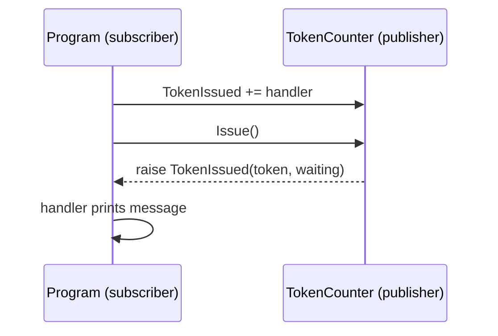

# Session 11: Delegates, Events and Collections

> Module: Proficient Programming with C# · Term 3 (HDSE I) · ⏱ ~2 hours

## 🎯 Learning Objectives

- Explain delegates as "variables that hold methods"
- Use built-in delegates `Func`, `Action` and `Predicate` with lambdas
- Combine delegates (multicast) with `+=`
- Declare, raise and subscribe to events using `EventHandler<T>`
- Choose the right collection: `List`, `Dictionary`, `Queue`, `Stack`, `HashSet`

## 📖 Concepts Explained

### 1. Delegates

A **delegate** is a type that can store a reference to a method. You can pass it around, store it and call it later — like saving a phone number and calling it when needed.

```csharp
Func<decimal, decimal> gst = amount => amount * 0.18m;   // takes decimal, returns decimal
Console.WriteLine(gst(2000));                            // 360
```

| Built-in delegate | Signature | Example |
|---|---|---|
| `Action<T>` | takes T, returns nothing | `Action<string> log = m => Console.WriteLine(m);` |
| `Func<T, TResult>` | takes T, returns TResult | `Func<int, bool> isAdult = age => age >= 18;` |
| `Predicate<T>` | takes T, returns bool | `Predicate<int> failed = m => m < 50;` |

**Multicast:** `log += anotherMethod;` — calling `log(...)` now runs both methods in order.

### 2. Events

An **event** is a delegate with protection: outside code can only **subscribe** (`+=`) or **unsubscribe** (`-=`); only the owning class can **raise** it. Analogy: a token counter at a bank announces "Token 102" — anyone listening reacts, but only the counter can announce.



Standard pattern:

```csharp
public event EventHandler<TokenIssuedEventArgs>? TokenIssued;   // declare
TokenIssued?.Invoke(this, new TokenIssuedEventArgs(...));       // raise (only if someone listens)
```

`?.` avoids a crash when there are no subscribers.

### 3. Collections (System.Collections.Generic)

| Collection | Think of | Key methods |
|---|---|---|
| `List<T>` | resizable array | `Add`, `Remove`, `Sort`, `Find`, `FindAll` |
| `Dictionary<TKey,TValue>` | phone book (key → value) | `Add`, `TryAdd`, `TryGetValue`, `ContainsKey` |
| `Queue<T>` | line at a counter (FIFO) | `Enqueue`, `Dequeue`, `TryDequeue`, `Peek` |
| `Stack<T>` | pile of plates (LIFO) — undo | `Push`, `Pop`, `Peek` |
| `HashSet<T>` | unique items, set maths | `Add`, `UnionWith`, `IntersectWith` |

Generic collections are type-safe: a `List<int>` only accepts `int`. Old non-generic `ArrayList`/`Hashtable` should be avoided in new code.

## 💻 Code Examples

File: `TokenCounter.cs` — a publisher with two events

```csharp
public class TokenIssuedEventArgs(int token, int waiting) : EventArgs
{
    public int Token { get; } = token;
    public int Waiting { get; } = waiting;
}

public class TokenCounter
{
    private readonly Queue<int> _queue = new();
    private int _next = 100;
    public event EventHandler<TokenIssuedEventArgs>? TokenIssued;
    public event Action<int>? TokenServed;

    public void Issue()
    {
        _queue.Enqueue(++_next);
        TokenIssued?.Invoke(this, new TokenIssuedEventArgs(_next, _queue.Count));
    }
    public void Serve()
    {
        if (_queue.TryDequeue(out int t)) TokenServed?.Invoke(t);
    }
}
```

File: `Program.cs`

```csharp
// Session 11: Delegates, events and collections
Func<decimal, decimal> gst = a => a * 0.18m;
Action<string> log = m => Console.WriteLine($"[log] {m}");
log += m => File.AppendAllText("log.txt", m + Environment.NewLine);
log($"GST on 2,000 = {gst(2000)}");

var counter = new TokenCounter();
counter.TokenIssued += (s, e) => Console.WriteLine($"Token {e.Token} issued, {e.Waiting} waiting");
counter.TokenServed += t => Console.WriteLine($"Now serving {t}");
counter.Issue(); counter.Issue(); counter.Issue();
counter.Serve();

var marks = new List<int> { 72, 91, 55, 38, 84 };
marks.Sort();
Predicate<int> failed = m => m < 50;
Console.WriteLine($"Sorted: {string.Join(",", marks)} | failed: {marks.FindAll(failed).Count}");

var phoneBook = new Dictionary<string, string> { ["Ali"] = "0300-1112223", ["Sana"] = "0321-4445556" };
phoneBook.TryAdd("Ali", "dup");
if (phoneBook.TryGetValue("Sana", out var num)) Console.WriteLine($"Sana: {num}");

var undo = new Stack<string>();
undo.Push("type A"); undo.Push("type B");
Console.WriteLine($"Undo: {undo.Pop()}");

var sqlBatch = new HashSet<string> { "Ali", "Sana", "Hira" };
var csBatch  = new HashSet<string> { "Sana", "Omar" };
sqlBatch.IntersectWith(csBatch);
Console.WriteLine($"In both batches: {string.Join(",", sqlBatch)}");
```

**How it works**

1. `gst` is a `Func` that calculates 18% tax; `log` is an `Action` that first prints, then (after `+=`) also appends to `log.txt` — a multicast delegate.
2. The program subscribes two handlers to `TokenCounter` events using lambdas, then issues three tokens and serves one.
3. The counter uses a `Queue<int>` — first token issued is first served.
4. `marks.FindAll(failed)` uses a `Predicate<int>` to count failures.
5. `phoneBook.TryAdd("Ali", "dup")` returns `false` because the key exists; `TryGetValue` reads safely.
6. A `Stack` gives the last action first (undo); `HashSet.IntersectWith` finds students in both batches.

## 🧪 Lab Practice

1. Add a third subscriber that beeps (`Console.Beep()` on Windows) or prints `***` when a token is issued.
2. Unsubscribe one handler with `-=` and confirm it stops printing (hint: store the lambda in a variable first).
3. Add a `TokenServed` handler that prints how many tokens are still waiting.
4. Add a "redo" stack: popping from undo pushes onto redo.
5. Use `UnionWith` to list all students in either batch.

## 📝 Assignment

Build **TemperatureSensor**: a class with a `Temperature` property that raises an event `TooHot` (with an `EventArgs` class holding the reading) whenever the value goes above 40. Subscribe two handlers (screen alert and a `List<string>` log). Feed 10 readings from an array and print the log at the end.

## ❓ Quick Quiz

1. What is a delegate?
2. Which built-in delegate returns `void`?
3. Why do we write `TokenIssued?.Invoke(...)` with `?.`?
4. Which collection works first-in-first-out?
5. What does `TryGetValue` return when the key is missing?

<details>
<summary>Show answers</summary>

1. A type-safe reference to a method.
2. `Action`
3. So nothing happens (no crash) if there are no subscribers.
4. `Queue<T>`
5. `false`, and the `out` value is set to the default.

</details>

## 💼 Interview Questions

1. What is the difference between a delegate and an event?
2. What is a multicast delegate?
3. When would you use `Dictionary` instead of `List`?

## ✅ Summary

- Delegates store methods; `Func`, `Action`, `Predicate` cover most needs.
- Events let objects announce things safely; subscribers react with `+=`.
- Pick collections by behaviour: list, key-value, FIFO, LIFO or unique set.

---

[⬅ Previous](../Session-10-Namespaces-and-Exception-Handling/README.md) · [🏠 Module Home](../README.md) · [Next ➡](../Session-12-Lab-Review-Properties-Exceptions-Collections/README.md)

Prepared by Zeeshan Abbas · Aptech Learning North Nazimabad
