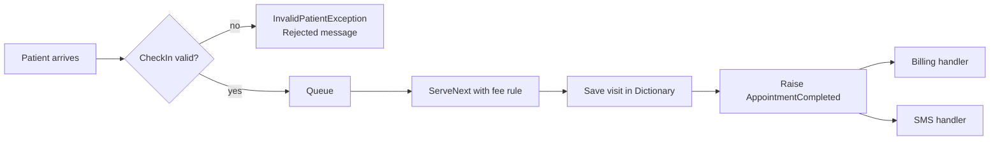

# Session 12: Lab and Review — Properties, Exceptions and Collections

> Module: Proficient Programming with C# · Term 3 (HDSE I) · ⏱ ~2 hours

## 🎯 Learning Objectives

- Revise properties, indexers and records (Session 09)
- Revise namespaces, custom exceptions and `try/catch` (Session 10)
- Revise delegates, events and collections (Session 11)
- Combine them into a working "clinic appointment desk"
- Practise reading output and tracing program flow

## 📖 Concepts Explained

### 1. What this lab combines

| Feature | Where it appears |
|---|---|
| `record` | `Patient(string Mrn, string Name, int Age)` |
| Primary-constructor exception | `InvalidPatientException(string message)` |
| `Queue<T>` | patients waiting in arrival order |
| `Dictionary<string, List<DateTime>>` | visit history per patient |
| Indexer | `clinic["MRN-1"]` returns visit dates |
| Computed property | `Waiting => _waiting.Count` |
| Event | `AppointmentCompleted` with two subscribers |
| `Func<Patient, decimal>` | the fee rule passed into `ServeNext` |
| Pattern `is < 0 or > 120` | age validation |

### 2. Program flow



### 3. Revision notes

- **Records** are ideal for patients: simple data, compared by value.
- **Custom exceptions** make rejections readable (`Rejected: Invalid age -2 for Baby Ayan.`).
- **Events** keep the clinic independent of billing and SMS — new features can subscribe without changing `Clinic`.
- **Passing a `Func`** lets the caller decide the fee policy (senior citizens get 50% off) without editing the class.
- `[]` in `: []` is a **collection expression** (C# 12) returning an empty list.

### 4. Common mistakes to avoid

| Mistake | Fix |
|---|---|
| Catching `Exception` everywhere | catch the specific type you expect |
| Exposing `Queue<T>` publicly | expose a count or read-only view |
| Forgetting `?.Invoke` | events with no subscribers are `null` |
| Using `List` when lookups by key are needed | use `Dictionary` |

## 💻 Code Examples

File: `Clinic.cs`

```csharp
public record Patient(string Mrn, string Name, int Age);

public class InvalidPatientException(string message) : Exception(message);

public class Clinic
{
    private readonly Queue<Patient> _waiting = new();
    private readonly Dictionary<string, List<DateTime>> _history = new();
    public event Action<Patient, decimal>? AppointmentCompleted;
    public int Waiting => _waiting.Count;
    public IReadOnlyList<DateTime> this[string mrn] =>
        _history.TryGetValue(mrn, out var v) ? v : [];

    public void CheckIn(Patient p)
    {
        if (p.Age is < 0 or > 120) throw new InvalidPatientException($"Invalid age {p.Age} for {p.Name}.");
        if (_waiting.Any(w => w.Mrn == p.Mrn)) throw new InvalidPatientException($"{p.Name} already waiting.");
        _waiting.Enqueue(p);
    }

    public void ServeNext(Func<Patient, decimal> feeRule)
    {
        if (!_waiting.TryDequeue(out var p)) throw new InvalidOperationException("No patients waiting.");
        if (!_history.ContainsKey(p.Mrn)) _history[p.Mrn] = new List<DateTime>();
        _history[p.Mrn].Add(DateTime.Now);
        AppointmentCompleted?.Invoke(p, feeRule(p));
    }
}
```

**How it works**

1. `CheckIn` rejects impossible ages and duplicate patients by throwing `InvalidPatientException`.
2. `ServeNext` takes the first patient from the queue, records today's visit, works out the fee using the passed-in rule and raises the event.
3. The indexer returns that patient's visit list, or an empty list.

File: `Program.cs`

```csharp
// Session 12: Lab and Review - clinic appointment desk
var clinic = new Clinic();
decimal revenue = 0;
clinic.AppointmentCompleted += (p, fee) => { revenue += fee; Console.WriteLine($"Billing: {p.Name} pays Rs {fee:N0}"); };
clinic.AppointmentCompleted += (p, _) => Console.WriteLine($"SMS: Thank you {p.Name}, get well soon.");

Patient[] arrivals =
[
    new("MRN-1", "Kashif", 34),
    new("MRN-2", "Rubina", 67),
    new("MRN-3", "Baby Ayan", -2),
    new("MRN-1", "Kashif", 34)
];

foreach (var p in arrivals)
{
    try { clinic.CheckIn(p); Console.WriteLine($"Checked in {p.Name}"); }
    catch (InvalidPatientException ex) { Console.WriteLine($"Rejected: {ex.Message}"); }
}

Func<Patient, decimal> feeRule = p => p.Age >= 60 ? 1500 * 0.5m : 1500;
while (clinic.Waiting > 0) clinic.ServeNext(feeRule);

try { clinic.ServeNext(feeRule); }
catch (InvalidOperationException ex) { Console.WriteLine($"Desk: {ex.Message}"); }

Console.WriteLine($"Revenue today: Rs {revenue:N0}");
Console.WriteLine($"Kashif visits: {clinic["MRN-1"].Count}");
```

**How it works:** four arrivals are checked in — one has a negative age and one is a duplicate, so both are rejected. The two valid patients are served; Rubina (67) pays half. The extra `ServeNext` call shows the "No patients waiting" error. Finally total revenue and Kashif's visit count are printed.

Expected output:

```text
Checked in Kashif
Checked in Rubina
Rejected: Invalid age -2 for Baby Ayan.
Rejected: Kashif already waiting.
Billing: Kashif pays Rs 1,500
SMS: Thank you Kashif, get well soon.
Billing: Rubina pays Rs 750
SMS: Thank you Rubina, get well soon.
Desk: No patients waiting.
Revenue today: Rs 2,250
Kashif visits: 1
```

## 🧪 Lab Practice

1. Add a third subscriber that writes each appointment to a `List<string>` report and print it at the end.
2. Change the fee rule so children under 12 pay Rs 1,000.
3. Add a property `TotalPatientsServed` with a private setter.
4. Check Kashif in again after he is served and serve him — his visit count should be 2.
5. Move `Patient` and the exception into a namespace `Clinic.Models` in their own files.

## 📝 Assignment

Build **ParcelCounter** for a courier office: a `record Parcel(string TrackingNo, string City, double WeightKg)`, a custom `InvalidParcelException` (weight ≤ 0 or > 30 kg), a `Queue` of parcels, a `Dictionary<string,int>` counting parcels per city, an indexer `this[string city]`, an event `ParcelDispatched` and a `Func<Parcel, decimal>` pricing rule. Test with at least 6 parcels including 2 invalid ones.

## ❓ Quick Quiz

1. Why is `Patient` a record and not a class?
2. What happens when `ServeNext` is called on an empty queue?
3. How does `Program.cs` change the fee policy without editing `Clinic`?
4. What does `clinic["MRN-9"]` return for an unknown patient?
5. Name the two subscribers of `AppointmentCompleted`.

<details>
<summary>Show answers</summary>

1. It is simple data and should be compared by value.
2. It throws `InvalidOperationException("No patients waiting.")`.
3. It passes a `Func<Patient, decimal>` fee rule.
4. An empty list.
5. The billing handler and the SMS handler.

</details>

## 💼 Interview Questions

1. How do events help follow the Open/Closed principle?
2. Why pass behaviour as a `Func` parameter instead of hard-coding it?
3. What is the time complexity of `Dictionary` lookups compared to searching a `List`?

## ✅ Summary

- Properties, records and indexers shape clean data models.
- Custom exceptions report broken rules clearly.
- Collections and events organise work and notifications.
- Passing delegates keeps classes flexible.

---

[⬅ Previous](../Session-11-Delegates-Events-and-Collections/README.md) · [🏠 Module Home](../README.md) · [Next ➡](../Session-13-Generics-and-Iterators/README.md)

Prepared by Zeeshan Abbas · Aptech Learning North Nazimabad
