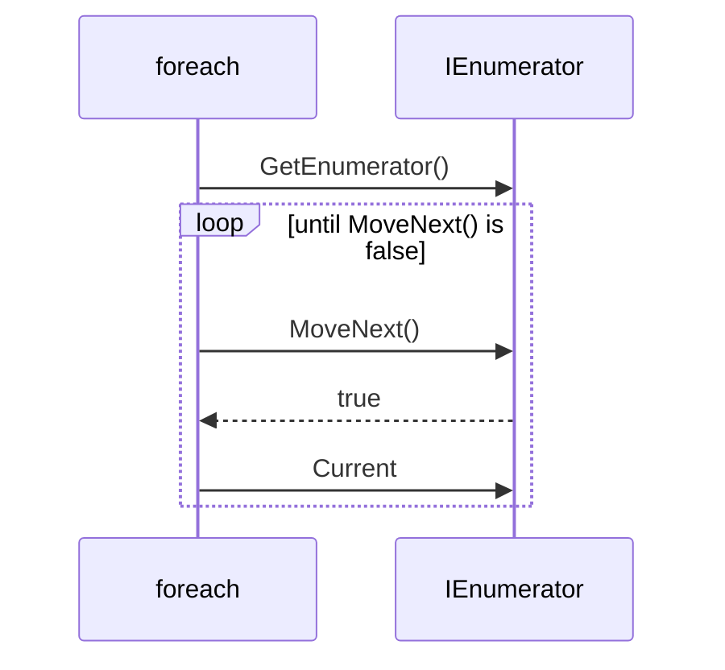

# Session 13: Generics and Iterators

> Module: Proficient Programming with C# · Term 3 (HDSE I) · ⏱ ~2 hours

## 🎯 Learning Objectives

- Explain why generics give type safety and code reuse
- Create generic classes, methods and interfaces with type parameters
- Apply constraints with `where` (`class`, `struct`, `new()`, interfaces)
- Understand `IEnumerable<T>` and `IEnumerator<T>` and how `foreach` uses them
- Write iterators with `yield return` and `yield break`

## 📖 Concepts Explained

### 1. The problem generics solve

Without generics you would write `IntBox`, `StringBox`, `StudentBox`… or use `object` and cast everywhere (slow and unsafe). **Generics** let you write the code once with a placeholder type `T`:

```csharp
public class Box<T>
{
    public T Item { get; set; }
}
var a = new Box<int> { Item = 5 };
var b = new Box<string> { Item = "Karachi" };
```

`List<T>` and `Dictionary<TKey,TValue>` from Session 11 are generic classes.

| Benefit | Meaning |
|---|---|
| Type safety | `List<int>` cannot accept a string — checked at compile time |
| Reuse | one class works for many types |
| Performance | no boxing/casting for value types |

### 2. Generic methods

```csharp
public static T Max<T>(T a, T b) where T : IComparable<T> => a.CompareTo(b) >= 0 ? a : b;
Max(14, 9);                 // T is inferred as int
Max("Karachi", "Lahore");   // T is string
```

### 3. Constraints

| Constraint | Meaning |
|---|---|
| `where T : class` | T must be a reference type |
| `where T : struct` | T must be a value type |
| `where T : new()` | T must have a parameterless constructor |
| `where T : IEntity` | T must implement the interface |
| `where T : BaseClass` | T must inherit the class |

Constraints let you use members of `T` safely (e.g. `item.Id` because `T : IEntity`).

### 4. IEnumerable and foreach

`foreach` works on anything that implements `IEnumerable<T>`. It calls `GetEnumerator()`, then repeatedly `MoveNext()` and reads `Current`.



### 5. Iterators with `yield`

Writing an enumerator class by hand is long. An **iterator** method uses `yield return` to hand back one item at a time; the compiler builds the enumerator for you.

- `yield return x;` — give one value and pause here.
- `yield break;` — stop the sequence.
- Values are produced **lazily** — only when `foreach` asks for the next one. That is why `Evens(10)` can use an endless `for` loop safely.

## 💻 Code Examples

File: `Repository.cs`

```csharp
public interface IEntity { int Id { get; } }

public class Repository<T> : IEnumerable<T> where T : class, IEntity
{
    private readonly Dictionary<int, T> _items = new();
    public void Add(T item)
    {
        if (!_items.TryAdd(item.Id, item))
            throw new InvalidOperationException($"{typeof(T).Name} {item.Id} already exists.");
    }
    public T? Find(int id) => _items.GetValueOrDefault(id);
    public IEnumerable<T> Where(Func<T, bool> predicate)
    {
        foreach (var item in _items.Values)
            if (predicate(item)) yield return item;
    }
    public IEnumerator<T> GetEnumerator() => _items.Values.GetEnumerator();
    System.Collections.IEnumerator System.Collections.IEnumerable.GetEnumerator() => GetEnumerator();
}

public record Course(int Id, string Title, int Hours) : IEntity;
public record Trainer(int Id, string Name) : IEntity;

public static class Util
{
    public static T Max<T>(T a, T b) where T : IComparable<T> => a.CompareTo(b) >= 0 ? a : b;

    public static IEnumerable<int> Evens(int limit)
    {
        for (int i = 0; ; i += 2)
        {
            if (i > limit) yield break;
            yield return i;
        }
    }
}
```

**How it works**

1. `IEntity` guarantees every stored item has an `Id`.
2. `Repository<T>` accepts only reference types that implement `IEntity` (two constraints).
3. `Add` uses `TryAdd` and throws if the Id already exists; `typeof(T).Name` prints "Course" or "Trainer".
4. `Where` is an iterator that yields only items matching the predicate.
5. Implementing `IEnumerable<T>` makes the repository usable in `foreach` and with LINQ methods.
6. `Util.Max<T>` is a generic method; `Evens` is an iterator that stops with `yield break`.

File: `Program.cs`

```csharp
// Session 13: Generics and iterators
var courses = new Repository<Course>();
courses.Add(new Course(1, "C# Programming", 36));
courses.Add(new Course(2, "SQL Server", 32));
courses.Add(new Course(3, "Angular", 24));

foreach (var c in courses) Console.WriteLine(c);
Console.WriteLine($"Long courses: {string.Join(", ", courses.Where(c => c.Hours > 30).Select(c => c.Title))}");
Console.WriteLine($"Find 2: {courses.Find(2)?.Title}");

var trainers = new Repository<Trainer> { new Trainer(7, "Sir Zeeshan") };
Console.WriteLine($"Trainers: {trainers.Count()}");

Console.WriteLine(Util.Max(14, 9));
Console.WriteLine(Util.Max("Karachi", "Lahore"));
Console.WriteLine(string.Join(" ", Util.Evens(10)));
```

**How it works:** the same `Repository<T>` stores courses and trainers. `foreach` lists all courses, `Where` + `Select` filters long courses, and `Find` looks up by Id. The collection initializer `{ new Trainer(...) }` works because the class has `Add` and implements `IEnumerable`. The last lines print `14`, `Lahore` and `0 2 4 6 8 10`.

## 🧪 Lab Practice

1. Add a `Remove(int id)` method to `Repository<T>`.
2. Try `new Repository<int>()` and explain the compiler error.
3. Write a generic method `Swap<T>(ref T a, ref T b)` and test it with ints and strings.
4. Write an iterator `Countdown(int from)` that yields from `from` down to 1.
5. Write an iterator `ReadLines()` that yields user input until they type `exit`.

## 📝 Assignment

Create a generic class **Pair<TFirst, TSecond>** with properties and a `Swap()` method that returns `Pair<TSecond, TFirst>`. Then create a generic **Stack<T>-like** class `SimpleStack<T>` using an array internally, with `Push`, `Pop`, `Peek` and an iterator that yields items from top to bottom.

## ❓ Quick Quiz

1. What is `T` in `List<T>`?
2. What does `where T : new()` require?
3. Which interface must a class implement to be used in `foreach`?
4. What does `yield return` do?
5. Why is an iterator called "lazy"?

<details>
<summary>Show answers</summary>

1. A type parameter — a placeholder replaced by a real type when used.
2. T must have a public parameterless constructor.
3. `IEnumerable` / `IEnumerable<T>`.
4. Returns one element of the sequence and pauses the method until the next element is requested.
5. It produces items only when they are asked for, not all at once.

</details>

## 💼 Interview Questions

1. What is boxing, and how do generics avoid it?
2. What is the difference between `IEnumerable<T>` and `IEnumerator<T>`?
3. Give a real example where a generic constraint is necessary.

## ✅ Summary

- Generics = write once, type-safe for many types.
- Constraints tell the compiler what `T` can do.
- `foreach` relies on `IEnumerable<T>` / `IEnumerator<T>`.
- `yield return` builds lazy sequences with very little code.

---

[⬅ Previous](../Session-12-Lab-Review-Properties-Exceptions-Collections/README.md) · [🏠 Module Home](../README.md) · [Next ➡](../Session-14-GUI-and-SQL-Server-Connectivity/README.md)

Prepared by Zeeshan Abbas · Aptech Learning North Nazimabad
