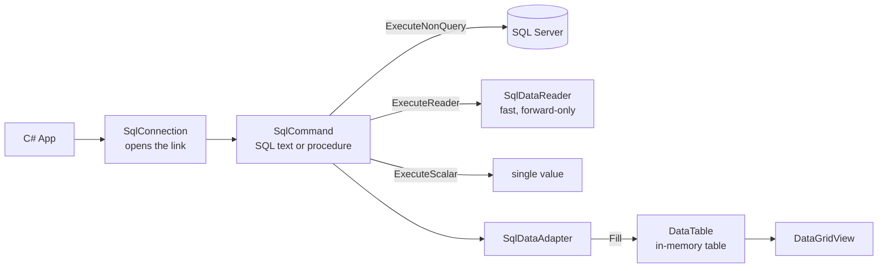

# Session 14: GUI and SQL Server Connectivity

> Module: Proficient Programming with C# · Term 3 (HDSE I) · ⏱ ~2 hours

> ⚠️ **Windows required for the GUI part.** Windows Forms runs only on Windows (Visual Studio 2022 recommended). The ADO.NET console example runs on any OS that can reach a SQL Server.

## 🎯 Learning Objectives

- Define a GUI and name the .NET tools for desktop apps (WinForms, WPF, MAUI)
- Create a Windows Forms app with Labels, TextBoxes, Buttons and a DataGridView
- Handle events such as `Load` and `Click` and validate user input
- Explain the ADO.NET architecture: connection, command, reader, adapter, DataTable
- Perform Insert, Read, Update and Delete (CRUD) on SQL Server with parameters
- Call a stored procedure with parameters from C#

## 📖 Concepts Explained

### 1. What is a GUI?

A **Graphical User Interface** lets users work with windows, buttons and text boxes instead of typing commands. GUI programs are **event-driven**: the program waits, and code runs when the user clicks, types or opens a form.

| .NET desktop technology | Platforms | Notes |
|---|---|---|
| **Windows Forms** | Windows | simplest, drag-and-drop designer — used here |
| WPF | Windows | XAML, rich styling and data binding |
| .NET MAUI | Windows, Android, iOS, macOS | cross-platform (Session 16) |

### 2. Forms, controls and events

| Control | Purpose | Key member |
|---|---|---|
| `Form` | the window | `Text`, `Load` event |
| `Label` | shows fixed text | `Text` |
| `TextBox` | user types text | `Text`, `Clear()` |
| `Button` | performs an action | `Click` event |
| `DataGridView` | shows a table | `DataSource` |
| `MessageBox` | pop-up message | `MessageBox.Show(...)` |

In Visual Studio you normally drag controls from the **Toolbox** and double-click a button to create its `Click` handler. In this session's code we create the controls **in code** so everything is visible in one file.

### 3. ADO.NET architecture

**ADO.NET** is the .NET library for talking to databases. For SQL Server we use the NuGet package `Microsoft.Data.SqlClient`.



| Method | Use for | Returns |
|---|---|---|
| `ExecuteNonQuery()` | INSERT, UPDATE, DELETE | number of rows affected |
| `ExecuteReader()` | SELECT, row by row | `SqlDataReader` |
| `ExecuteScalar()` | `COUNT(*)`, `MAX(...)` | first column of first row |
| `adapter.Fill(table)` | SELECT into memory | fills a `DataTable` |

### 4. Connection strings and safety

```text
Server=localhost;Database=AptechCollege;Trusted_Connection=True;TrustServerCertificate=True;
```

- `Server` — your instance, e.g. `localhost\SQLEXPRESS`.
- `Trusted_Connection=True` — use your Windows login. For SQL logins use `User Id=...;Password=...;`.
- Always wrap connections in `using` so they close automatically.
- **Never** build SQL by joining user text (`"... WHERE Name = '" + txt + "'"`). That allows **SQL injection**. Use **parameters** (`@name`) every time.

## 💻 Code Examples

### Step 1 — create the database: `database.sql`

```sql
-- Session 14: Database used by both examples (run in SSMS or Azure Data Studio)

-- Step 1: create the database
CREATE DATABASE AptechCollege;
GO

USE AptechCollege;
GO

-- Step 2: create a simple Students table
CREATE TABLE Students
(
    StudentId INT IDENTITY(1,1) PRIMARY KEY,   -- auto number
    FullName  NVARCHAR(100) NOT NULL,
    City      NVARCHAR(50)  NOT NULL,
    Marks     INT           NOT NULL CHECK (Marks BETWEEN 0 AND 100)
);
GO

-- Step 3: add a few sample rows
INSERT INTO Students (FullName, City, Marks) VALUES
(N'Ali Raza',   N'Karachi', 78),
(N'Sana Khan',  N'Lahore',  91),
(N'Bilal Ahmed',N'Karachi', 64);
GO

-- Step 4: a stored procedure with a parameter
CREATE PROCEDURE GetStudentsByCity
    @City NVARCHAR(50)
AS
BEGIN
    SELECT StudentId, FullName, City, Marks
    FROM Students
    WHERE City = @City
    ORDER BY FullName;
END
GO
```

Run it in SSMS (File → Open → `database.sql` → Execute).

### Step 2 — CRUD from a console app: `AdoNetConsole/Program.cs`

```csharp
// Session 14: CRUD with ADO.NET in a console app (runs on Windows, Linux and macOS)
using System.Data;
using Microsoft.Data.SqlClient;

// Step 1: the connection string tells .NET WHERE the database is.
// Change "Server=" to your own SQL Server name, e.g. "localhost\\SQLEXPRESS".
string connectionString =
    "Server=localhost;Database=AptechCollege;Trusted_Connection=True;TrustServerCertificate=True;";

// ---------- CREATE (INSERT) ----------
using (SqlConnection connection = new SqlConnection(connectionString))
{
    connection.Open();                                   // open the door to the database

    string sql = "INSERT INTO Students (FullName, City, Marks) VALUES (@name, @city, @marks)";
    using SqlCommand command = new SqlCommand(sql, connection);

    // Parameters keep us safe from SQL injection. Never join user text into SQL!
    command.Parameters.AddWithValue("@name", "Hira Noor");
    command.Parameters.AddWithValue("@city", "Karachi");
    command.Parameters.AddWithValue("@marks", 88);

    int rowsAdded = command.ExecuteNonQuery();           // used for INSERT/UPDATE/DELETE
    Console.WriteLine($"Inserted rows: {rowsAdded}");
}

// ---------- READ (SELECT with SqlDataReader) ----------
using (SqlConnection connection = new SqlConnection(connectionString))
{
    connection.Open();
    using SqlCommand command = new SqlCommand("SELECT StudentId, FullName, City, Marks FROM Students", connection);
    using SqlDataReader reader = command.ExecuteReader(); // reads row by row, forward only

    Console.WriteLine("\nAll students:");
    while (reader.Read())                                  // Read() moves to the next row
    {
        int id = reader.GetInt32(0);
        string name = reader.GetString(1);
        string city = reader.GetString(2);
        int marks = reader.GetInt32(3);
        Console.WriteLine($"{id,3}  {name,-12} {city,-8} {marks}");
    }
}

// ---------- UPDATE ----------
using (SqlConnection connection = new SqlConnection(connectionString))
{
    connection.Open();
    using SqlCommand command = new SqlCommand(
        "UPDATE Students SET Marks = @marks WHERE FullName = @name", connection);
    command.Parameters.AddWithValue("@marks", 95);
    command.Parameters.AddWithValue("@name", "Hira Noor");
    Console.WriteLine($"\nUpdated rows: {command.ExecuteNonQuery()}");
}

// ---------- READ with a STORED PROCEDURE and SqlDataAdapter ----------
using (SqlConnection connection = new SqlConnection(connectionString))
{
    using SqlCommand command = new SqlCommand("GetStudentsByCity", connection);
    command.CommandType = CommandType.StoredProcedure;    // tell ADO.NET it is a procedure
    command.Parameters.AddWithValue("@City", "Karachi");

    // The adapter opens/closes the connection by itself and fills a DataTable
    SqlDataAdapter adapter = new SqlDataAdapter(command);
    DataTable table = new DataTable();
    adapter.Fill(table);

    Console.WriteLine($"\nStudents in Karachi: {table.Rows.Count}");
    foreach (DataRow row in table.Rows)
        Console.WriteLine($" - {row["FullName"]} ({row["Marks"]})");
}

// ---------- DELETE ----------
using (SqlConnection connection = new SqlConnection(connectionString))
{
    connection.Open();
    using SqlCommand command = new SqlCommand("DELETE FROM Students WHERE FullName = @name", connection);
    command.Parameters.AddWithValue("@name", "Hira Noor");
    Console.WriteLine($"\nDeleted rows: {command.ExecuteNonQuery()}");
}

// ---------- COUNT (ExecuteScalar returns ONE value) ----------
using (SqlConnection connection = new SqlConnection(connectionString))
{
    connection.Open();
    using SqlCommand command = new SqlCommand("SELECT COUNT(*) FROM Students", connection);
    int total = (int)command.ExecuteScalar();
    Console.WriteLine($"Total students now: {total}");
}
```

**How it works**

1. Each block opens its own `SqlConnection` inside `using`, so it closes even if an error happens.
2. INSERT/UPDATE/DELETE use `ExecuteNonQuery` with **parameters**.
3. `SqlDataReader.Read()` moves row by row; `GetInt32(0)` / `GetString(1)` read columns by position.
4. For the stored procedure we set `CommandType.StoredProcedure` and let `SqlDataAdapter` fill a `DataTable`.
5. `ExecuteScalar` returns a single number for `COUNT(*)`.

Run: `cd AdoNetConsole` then `dotnet run` (the package restores automatically).

### Step 3 — a Windows Forms screen (Windows only): `WinFormsStudents/`

Project file `WinFormsStudents.csproj` targets `net8.0-windows` with `<UseWindowsForms>true</UseWindowsForms>`.

File: `WinFormsStudents/StudentForm.cs`

```csharp
// Session 14: A simple form that adds students to SQL Server and shows them in a grid.
// Controls are created in code (no designer file) so you can read everything in one place.
using System.Data;
using Microsoft.Data.SqlClient;

namespace WinFormsStudents;

public class StudentForm : Form
{
    // Change the server name to match your PC (e.g. localhost\SQLEXPRESS)
    private const string ConnectionString =
        "Server=localhost;Database=AptechCollege;Trusted_Connection=True;TrustServerCertificate=True;";

    // Step 1: declare the controls we need
    private readonly Label lblName = new() { Text = "Name", Left = 20, Top = 20, Width = 60 };
    private readonly TextBox txtName = new() { Left = 90, Top = 18, Width = 180 };
    private readonly Label lblCity = new() { Text = "City", Left = 20, Top = 55, Width = 60 };
    private readonly TextBox txtCity = new() { Left = 90, Top = 53, Width = 180 };
    private readonly Label lblMarks = new() { Text = "Marks", Left = 20, Top = 90, Width = 60 };
    private readonly TextBox txtMarks = new() { Left = 90, Top = 88, Width = 80 };
    private readonly Button btnSave = new() { Text = "Save", Left = 90, Top = 125, Width = 80 };
    private readonly Button btnRefresh = new() { Text = "Refresh", Left = 190, Top = 125, Width = 80 };
    private readonly DataGridView grid = new() { Left = 20, Top = 170, Width = 440, Height = 200, ReadOnly = true };

    public StudentForm()
    {
        // Step 2: set up the window
        Text = "Students - Aptech College";
        Width = 500;
        Height = 430;

        // Step 3: put the controls on the form
        Controls.AddRange(new Control[] { lblName, txtName, lblCity, txtCity, lblMarks, txtMarks, btnSave, btnRefresh, grid });

        // Step 4: connect events to methods (event handlers)
        Load += (sender, e) => LoadStudents();          // when the form first opens
        btnRefresh.Click += (sender, e) => LoadStudents();
        btnSave.Click += BtnSave_Click;
    }

    private void BtnSave_Click(object? sender, EventArgs e)
    {
        // Step 5: validate input before touching the database
        if (string.IsNullOrWhiteSpace(txtName.Text) || string.IsNullOrWhiteSpace(txtCity.Text))
        {
            MessageBox.Show("Name and City are required.", "Validation");
            return;
        }
        if (!int.TryParse(txtMarks.Text, out int marks) || marks < 0 || marks > 100)
        {
            MessageBox.Show("Marks must be a number from 0 to 100.", "Validation");
            return;
        }

        try
        {
            // Step 6: INSERT with parameters
            using var connection = new SqlConnection(ConnectionString);
            connection.Open();
            using var command = new SqlCommand(
                "INSERT INTO Students (FullName, City, Marks) VALUES (@name, @city, @marks)", connection);
            command.Parameters.AddWithValue("@name", txtName.Text.Trim());
            command.Parameters.AddWithValue("@city", txtCity.Text.Trim());
            command.Parameters.AddWithValue("@marks", marks);
            command.ExecuteNonQuery();

            MessageBox.Show("Student saved!", "Success");
            txtName.Clear(); txtCity.Clear(); txtMarks.Clear();
            LoadStudents();
        }
        catch (SqlException ex)
        {
            MessageBox.Show("Database error: " + ex.Message, "Error");
        }
    }

    private void LoadStudents()
    {
        try
        {
            // Step 7: SELECT into a DataTable and bind it to the grid
            using var adapter = new SqlDataAdapter("SELECT * FROM Students ORDER BY StudentId", ConnectionString);
            var table = new DataTable();
            adapter.Fill(table);
            grid.DataSource = table;   // the grid draws one row per DataRow
        }
        catch (SqlException ex)
        {
            MessageBox.Show("Could not load students: " + ex.Message, "Error");
        }
    }
}
```

`WinFormsStudents/Program.cs` simply calls `Application.Run(new StudentForm());`.

**How it works**

1. Controls are created with object initializers and positioned with `Left`/`Top`.
2. `Load` and `btnRefresh.Click` both call `LoadStudents()`, which fills a `DataTable` and binds it to the grid.
3. `BtnSave_Click` validates name, city and marks **before** touching the database, then inserts with parameters.
4. `SqlException` is caught and shown in a `MessageBox` so the app never crashes.

## 🧪 Lab Practice

1. Run `database.sql`, then run `AdoNetConsole` and compare the output with the table in SSMS.
2. Add a stored procedure `AddStudent @FullName, @City, @Marks` and call it from C#.
3. In the WinForms app, add a **Delete** button that deletes the row selected in the grid (`grid.CurrentRow.Cells["StudentId"].Value`).
4. Add a **Search** TextBox that filters by city using `GetStudentsByCity`.
5. Create the same form using the Visual Studio designer (drag-and-drop) and compare the generated `Form1.Designer.cs`.

## 📝 Assignment

Create a **Product Inventory** WinForms app: table `Products(ProductId, Name, Price, Qty)`; a form to add, update and delete products with validation (price > 0, qty ≥ 0), a grid that refreshes after every change, and a label showing total stock value using `ExecuteScalar("SELECT SUM(Price*Qty) FROM Products")`.

## ❓ Quick Quiz

1. Which method do you call for an INSERT statement?
2. What is the difference between `SqlDataReader` and `SqlDataAdapter`?
3. Why must we use parameters instead of string concatenation?
4. Which property links a `DataTable` to a `DataGridView`?
5. Which `CommandType` is used to call a stored procedure?

<details>
<summary>Show answers</summary>

1. `ExecuteNonQuery()`
2. A reader streams rows one by one while connected; an adapter fills an in-memory `DataTable` and manages the connection itself.
3. To prevent SQL injection and handle data types correctly.
4. `DataSource`
5. `CommandType.StoredProcedure`

</details>

## 💼 Interview Questions

1. Explain the connected vs disconnected model in ADO.NET.
2. What is SQL injection and how do parameterized queries stop it?
3. Why should database connections be opened late and closed early (`using`)?

## ✅ Summary

- GUI apps are event-driven; WinForms is the quickest way to build one on Windows.
- ADO.NET: `SqlConnection` → `SqlCommand` → reader / scalar / adapter.
- Always use parameters and `using`.
- `DataTable` + `DataGridView` show database rows with almost no code.

---

[⬅ Previous](../Session-13-Generics-and-Iterators/README.md) · [🏠 Module Home](../README.md) · [Next ➡](../Session-15-Advanced-Concepts-in-CSharp/README.md)

Prepared by Zeeshan Abbas · Aptech Learning North Nazimabad
