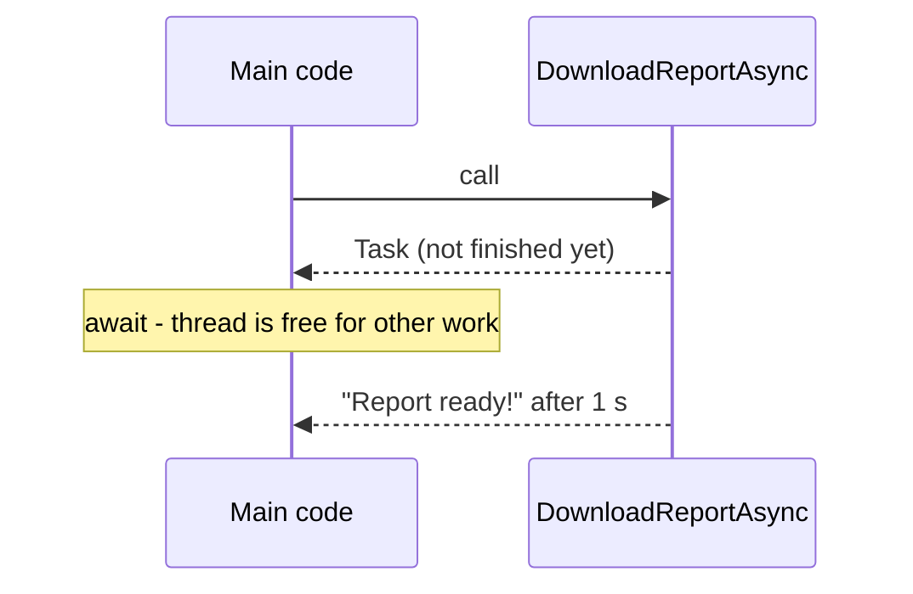

# Session 15: Advanced Concepts in C#

> Module: Proficient Programming with C# · Term 3 (HDSE I) · ⏱ ~2 hours

## 🎯 Learning Objectives

- Write anonymous methods and lambda expressions
- Use system-defined generic delegates `Func`, `Action` and `Predicate`
- Add new methods to existing types with extension methods
- Use anonymous types, partial classes and nullable types safely
- Write LINQ queries in query syntax and method syntax
- Get a first look at parallel programming, `dynamic` and `async/await`

## 📖 Concepts Explained

### 1. Anonymous methods and lambdas

Both create a method **without a name**, usually to store in a delegate.

| Style | Example |
|---|---|
| Anonymous method (C# 2) | `delegate (int x) { return x * 2; }` |
| Lambda expression | `x => x * 2` |
| Lambda with two inputs | `(a, b) => a + b` |
| Statement lambda | `x => { Console.WriteLine(x); return x; }` |

Read `=>` as "goes to": *x goes to x times x*.

### 2. Generic delegates (quick recap)

`Func<..., TResult>` returns a value, `Action<...>` returns nothing, `Predicate<T>` returns `bool`. With these you almost never need to declare your own delegate type.

### 3. Extension methods

They let you "add" a method to a type you did not write (even `string` or `int`).

Rules: **static class** + **static method** + `this` before the first parameter.

```csharp
public static bool IsPass(this int marks) => marks >= 50;
75.IsPass();   // true
```

LINQ itself (`Where`, `Select`, `OrderBy`) is a set of extension methods on `IEnumerable<T>`.

### 4. Anonymous types, partial classes, nullable types

| Feature | What it is | Example |
|---|---|---|
| Anonymous type | quick read-only object, no class needed | `new { Brand = "Dell", Ram = 16 }` |
| Partial class | one class split over several files | `public partial class Student` in two files |
| Nullable value type | value type that can be `null` | `int? bonus = null;` |
| Nullable reference type | warns when something may be `null` | `string? email` |

Null-safety operators: `?.` (call only if not null), `??` (default if null), `??=` (assign if null), `HasValue` / `Value` for `int?`.

### 5. LINQ — Language Integrated Query

LINQ lets you query collections like SQL queries a table.

| SQL idea | Query syntax | Method syntax |
|---|---|---|
| WHERE | `where s.Marks >= 50` | `.Where(s => s.Marks >= 50)` |
| ORDER BY | `orderby s.Marks descending` | `.OrderByDescending(s => s.Marks)` |
| SELECT | `select s.Name` | `.Select(s => s.Name)` |
| GROUP BY | `group s by s.City` | `.GroupBy(s => s.City)` |
| Aggregates | — | `.Count()`, `.Sum()`, `.Average()`, `.Max()` |

### 6. Parallel, dynamic and async (intro)

- **`Parallel.For`** splits loop work across CPU cores — useful for heavy calculations. Order of execution is not guaranteed.
- **`dynamic`** skips compile-time type checking; errors appear only at run time. Use rarely (e.g. COM/Office automation, JSON with unknown shape).
- **`async/await`** lets a program wait for slow work (web, files, database) **without freezing**. An `async` method returns `Task` or `Task<T>`; `await` pauses until it finishes.



## 💻 Code Examples

File: `StringExtensions.cs`

```csharp
// Session 15: Extension methods add new methods to an existing type
// Rules: a STATIC class, a STATIC method, and "this" before the first parameter.
public static class StringExtensions
{
    // Usage: "ali raza".ToTitle()  ->  "Ali Raza"
    public static string ToTitle(this string text)
    {
        string[] words = text.Split(' ', StringSplitOptions.RemoveEmptyEntries);
        for (int i = 0; i < words.Length; i++)
        {
            // first letter upper case + the rest lower case
            words[i] = char.ToUpper(words[i][0]) + words[i][1..].ToLower();
        }
        return string.Join(" ", words);
    }

    // Usage: 75.IsPass()  ->  true
    public static bool IsPass(this int marks) => marks >= 50;
}
```

Files: `Student.Info.cs` and `Student.Methods.cs` (one partial class in two files)

```csharp
// Session 15: Partial class - part 1 (data)
// The compiler joins all "partial" pieces into ONE Student class.
public partial class Student
{
    public string Name { get; set; } = "";
    public int Marks { get; set; }
    public string? Email { get; set; }      // "?" means Email is allowed to be null
}
```

```csharp
// Session 15: Partial class - part 2 (behaviour)
public partial class Student
{
    public string Grade() => Marks >= 85 ? "A" : Marks >= 70 ? "B" : Marks >= 50 ? "C" : "F";
}
```

File: `Program.cs` — eleven tiny numbered examples

```csharp
// Session 15: Advanced concepts in C# - one small example per idea

// ===== 1. Anonymous method (delegate with no name) =====
Func<int, int> doubleIt = delegate (int x) { return x * 2; };
Console.WriteLine($"1) Anonymous method: double of 7 = {doubleIt(7)}");

// ===== 2. Lambda expression (shorter way to write the same thing) =====
Func<int, int> square = x => x * x;               // input => output
Console.WriteLine($"2) Lambda: square of 6 = {square(6)}");

// ===== 3. Built-in generic delegates: Func, Action, Predicate =====
Func<int, int, int> add = (a, b) => a + b;        // takes 2 ints, RETURNS an int
Action<string> greet = name => Console.WriteLine($"3) Action says: Salam, {name}!"); // returns nothing
Predicate<int> isEven = n => n % 2 == 0;          // takes 1 value, returns bool
greet("Sana");
Console.WriteLine($"   Func add(4,5) = {add(4, 5)}, Predicate isEven(10) = {isEven(10)}");

// ===== 4. Extension methods (see StringExtensions.cs) =====
Console.WriteLine($"4) Extension: {"ali raza khan".ToTitle()}, 45 passed? {45.IsPass()}");

// ===== 5. Anonymous type (a quick object without writing a class) =====
var laptop = new { Brand = "Dell", Ram = 16, Price = 185000 };
Console.WriteLine($"5) Anonymous type: {laptop.Brand} with {laptop.Ram} GB costs Rs {laptop.Price:N0}");

// ===== 6. Partial class (see Student.Info.cs + Student.Methods.cs) =====
var student = new Student { Name = "Hira", Marks = 88 };
Console.WriteLine($"6) Partial class: {student.Name} got grade {student.Grade()}");

// ===== 7. Nullable types and null safety =====
int? bonusMarks = null;                           // a value type that can also be null
Console.WriteLine($"7) Has bonus? {bonusMarks.HasValue}, bonus or 0 = {bonusMarks ?? 0}");
string? email = student.Email;                    // may be null
Console.WriteLine($"   Email length: {email?.Length ?? 0}");  // ?. stops if null, ?? gives a default

// ===== 8. LINQ query expression vs method syntax =====
List<Student> batch =
[
    new Student { Name = "Ali", Marks = 72 },
    new Student { Name = "Sana", Marks = 91 },
    new Student { Name = "Bilal", Marks = 45 },
    new Student { Name = "Zoya", Marks = 66 }
];

// Query syntax (looks like SQL)
var passedQuery = from s in batch
                  where s.Marks >= 50
                  orderby s.Marks descending
                  select s.Name;
Console.WriteLine($"8) Passed (query syntax): {string.Join(", ", passedQuery)}");

// Method syntax (uses lambdas) - same result
var passedMethod = batch.Where(s => s.Marks >= 50).OrderByDescending(s => s.Marks).Select(s => s.Name);
Console.WriteLine($"   Passed (method syntax): {string.Join(", ", passedMethod)}");
Console.WriteLine($"   Average marks: {batch.Average(s => s.Marks):F1}");

// ===== 9. Parallel programming: use all CPU cores =====
long[] results = new long[5];
Parallel.For(0, 5, i =>
{
    results[i] = (long)i * i;                     // each i may run on a different core
});
Console.WriteLine($"9) Parallel.For squares: {string.Join(", ", results)}");

// ===== 10. dynamic: type is checked at RUN time, not compile time =====
dynamic value = 10;
Console.WriteLine($"10) dynamic as int: {value + 5}");
value = "Karachi";
Console.WriteLine($"    dynamic as string: {value.ToUpper()}");

// ===== 11. async / await (intro) =====
Console.WriteLine("11) Downloading report...");
string report = await DownloadReportAsync();      // waits WITHOUT freezing the program
Console.WriteLine($"    {report}");

// A method that pretends to do slow work (like calling a web API)
static async Task<string> DownloadReportAsync()
{
    await Task.Delay(1000);                       // simulate a 1 second wait
    return "Report ready!";
}
```

**How it works**

1. Examples 1–3 show the same idea (a method in a variable) written as an anonymous method, a lambda and the built-in delegates.
2. Example 4 calls our extension methods as if they belonged to `string` and `int`.
3. Example 5 builds an anonymous object; its properties are read-only.
4. Example 6 uses `Student`, whose data and method live in two different files.
5. Example 7: `bonusMarks ?? 0` gives 0 because it is null; `email?.Length ?? 0` avoids a `NullReferenceException`.
6. Example 8 shows identical results from query syntax and method syntax.
7. Examples 9–11 introduce `Parallel.For`, `dynamic` and `await`.

Output:

```text
1) Anonymous method: double of 7 = 14
2) Lambda: square of 6 = 36
3) Action says: Salam, Sana!
   Func add(4,5) = 9, Predicate isEven(10) = True
4) Extension: Ali Raza Khan, 45 passed? False
5) Anonymous type: Dell with 16 GB costs Rs 185,000
6) Partial class: Hira got grade A
7) Has bonus? False, bonus or 0 = 0
   Email length: 0
8) Passed (query syntax): Sana, Ali, Zoya
   Passed (method syntax): Sana, Ali, Zoya
   Average marks: 68.5
9) Parallel.For squares: 0, 1, 4, 9, 16
10) dynamic as int: 15
    dynamic as string: KARACHI
11) Downloading report...
    Report ready!
```

## 🧪 Lab Practice

1. Write an extension method `WordCount(this string text)` and test it.
2. Using LINQ, list students grouped by grade (`GroupBy(s => s.Grade())`).
3. Create an anonymous type list of `{ Name, Grade }` with `Select` and print it.
4. Assign `value = 10; value.ToUpper();` with `dynamic` — what happens at run time?
5. Write `async Task<int> CountDownAsync(int n)` that waits 300 ms per number and returns `n`.

## 📝 Assignment

Create **SalesAnalyzer**: a `List` of sales (product, city, amount) using a record; with LINQ print total sales per city, top 3 products, average sale and sales above Rs 50,000. Add an extension method `ToRupees(this decimal)` for formatting and an `async` method that "loads" the data after a 1-second delay.

## ❓ Quick Quiz

1. What are the three requirements for an extension method?
2. What is the difference between `int` and `int?`?
3. Write the method-syntax version of `from s in list where s.Marks > 80 select s.Name`.
4. What does `partial` allow?
5. What does an `async` method usually return?

<details>
<summary>Show answers</summary>

1. Static class, static method, `this` before the first parameter.
2. `int?` can also hold `null`.
3. `list.Where(s => s.Marks > 80).Select(s => s.Name)`
4. Splitting one class across multiple files.
5. `Task` or `Task<T>`.

</details>

## 💼 Interview Questions

1. What is deferred execution in LINQ?
2. When would you use `dynamic`, and what is the risk?
3. What is the difference between parallel programming and asynchronous programming?

## ✅ Summary

- Lambdas are short anonymous methods stored in `Func`/`Action`/`Predicate`.
- Extension methods, partial classes and anonymous types make code tidy.
- Nullable types and `?.`/`??` prevent null crashes.
- LINQ queries collections; `Parallel`, `dynamic` and `async` open advanced doors.

---

[⬅ Previous](../Session-14-GUI-and-SQL-Server-Connectivity/README.md) · [🏠 Module Home](../README.md) · [Next ➡](../Session-16-Cross-Platform-Apps-with-DotNet-MAUI/README.md)

Prepared by Zeeshan Abbas · Aptech Learning North Nazimabad
