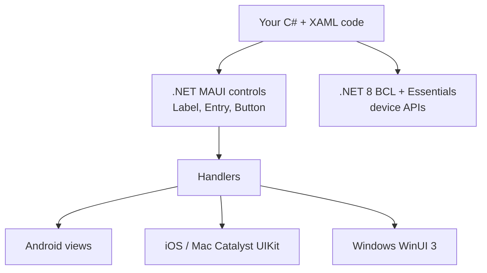

# Session 16: Cross-Platform Apps with .NET MAUI

> Module: Proficient Programming with C# · Term 3 (HDSE I) · ⏱ ~2 hours

> ⚠️ **Windows (or macOS) required.** .NET MAUI apps are built with Visual Studio 2022 on Windows (Windows + Android targets) or on a Mac (iOS/macOS targets). The files in `HelloMaui/` are meant to be dropped into a new MAUI project; they do not run as a console app.

## 🎯 Learning Objectives

- Explain what .NET MAUI is and how it evolved from Xamarin.Forms
- Describe the MAUI architecture and project structure
- Install the MAUI workload and create, run and debug a first app
- Design pages with XAML using `Label`, `Entry`, `Button` and layouts
- Navigate between pages with Shell and pass data
- Read basic device information and know how to deploy to Android, Windows and iOS

## 📖 Concepts Explained

### 1. What is .NET MAUI?

**.NET Multi-platform App UI (MAUI)** lets you write **one** C# + XAML project that runs on **Android, iOS, macOS and Windows**. It is the successor of **Xamarin.Forms** (support for Xamarin ended in May 2024).

| Xamarin.Forms | .NET MAUI |
|---|---|
| separate project per platform | **single project** with a `Platforms/` folder |
| older .NET (Mono) | modern .NET 8 |
| renderers | faster, simpler **handlers** |

### 2. Architecture



You write one `Button`; a **handler** turns it into the real native button on each platform.

### 3. Project structure (from the template)

| File / folder | Purpose |
|---|---|
| `MauiProgram.cs` | app start-up, fonts, services |
| `App.xaml` / `App.xaml.cs` | app-wide resources and the main window |
| `AppShell.xaml` | navigation frame (routes, tabs, flyout) |
| `MainPage.xaml` + `.xaml.cs` | first page: XAML layout + C# code-behind |
| `Platforms/` | Android, iOS, MacCatalyst, Windows specific code |
| `Resources/` | images, fonts, app icon, splash screen |

### 4. Installing and creating an app

1. Install **Visual Studio 2022** and tick the workload **".NET Multi-platform App UI development"**.
2. *Or* from the command line: `dotnet workload install maui`.
3. Create: **File → New → Project → .NET MAUI App**, or `dotnet new maui -n HelloMaui`.
4. Choose the target in the toolbar (**Windows Machine** or an **Android Emulator**) and press **F5**.

### 5. XAML basics

**XAML** is an XML language that describes the UI. Each tag is a control; attributes set properties.

| Control / layout | Use |
|---|---|
| `Label` | show text |
| `Entry` | one-line input |
| `Editor` | multi-line input |
| `Button` | action, `Clicked` event |
| `Image` | picture |
| `VerticalStackLayout` / `HorizontalStackLayout` | stack children |
| `Grid` | rows and columns |
| `ScrollView` | scroll long content |

`x:Name="NameEntry"` gives the control a name you can use in C#. `Clicked="OnGreetClicked"` links an event to a method in the code-behind.

### 6. Navigation and device features

- Register a route: `Routing.RegisterRoute("details", typeof(DetailsPage));`
- Go to it: `await Shell.Current.GoToAsync("details?name=Ali");`
- Go back: `await Shell.Current.GoToAsync("..");`
- Receive data with `[QueryProperty(nameof(StudentName), "name")]`.
- Device APIs (no extra package needed): `DeviceInfo`, `Battery`, `Connectivity`, `Geolocation`, `Preferences`, `MediaPicker`. Some need permissions in the platform manifest.

### 7. Deploying

| Target | How |
|---|---|
| Windows | run on "Windows Machine"; publish as MSIX |
| Android | emulator or USB phone (developer mode); `dotnet publish -f net8.0-android` creates an APK/AAB |
| iOS / macOS | needs a Mac with Xcode and an Apple developer account |

## 💻 Code Examples

Create the project with `dotnet new maui -n HelloMaui`, then **replace/add** these files from the `HelloMaui/` folder.

File: `HelloMaui/MainPage.xaml`

```xml
<?xml version="1.0" encoding="utf-8" ?>
<!-- Session 16: The home page UI written in XAML -->
<ContentPage
    x:Class="HelloMaui.MainPage"
    xmlns="http://schemas.microsoft.com/dotnet/2021/maui"
    xmlns:x="http://schemas.microsoft.com/winfx/2009/xaml"
    Title="Student Greeter">

    <ScrollView>
        <!-- VerticalStackLayout places children one below another -->
        <VerticalStackLayout Padding="30" Spacing="15">

            <Label Text="Welcome to .NET MAUI" FontSize="26" FontAttributes="Bold" />

            <!-- Entry = a one-line text box -->
            <Entry x:Name="NameEntry" Placeholder="Type your name" />

            <!-- Clicked="..." links the button to a C# method -->
            <Button x:Name="GreetButton" Text="Greet me" Clicked="OnGreetClicked" />

            <Label x:Name="ResultLabel" FontSize="18" />

            <Button Text="Open details page" Clicked="OnDetailsClicked" />

            <Label x:Name="DeviceLabel" FontSize="14" TextColor="Gray" />

        </VerticalStackLayout>
    </ScrollView>
</ContentPage>
```

File: `HelloMaui/MainPage.xaml.cs`

```csharp
// Session 16: Code-behind for MainPage.xaml (event handlers live here)
namespace HelloMaui;

public partial class MainPage : ContentPage
{
    private int clickCount = 0;

    public MainPage()
    {
        InitializeComponent();   // builds the controls written in the XAML file

        // Device feature (basic): read information about the phone/PC we are running on
        DeviceLabel.Text = $"Running on {DeviceInfo.Current.Platform} " +
                           $"({DeviceInfo.Current.Idiom}), version {DeviceInfo.Current.VersionString}";
    }

    private void OnGreetClicked(object? sender, EventArgs e)
    {
        clickCount++;

        // Read the text the user typed in the Entry control
        string name = string.IsNullOrWhiteSpace(NameEntry.Text) ? "Student" : NameEntry.Text.Trim();

        ResultLabel.Text = $"Assalam-o-Alaikum, {name}! (clicked {clickCount} times)";
    }

    private async void OnDetailsClicked(object? sender, EventArgs e)
    {
        // Navigate to the page we registered as "details" and pass the name along
        string name = NameEntry.Text ?? "Student";
        await Shell.Current.GoToAsync($"details?name={Uri.EscapeDataString(name)}");
    }
}
```

**How it works:** `InitializeComponent()` builds the XAML controls. The Greet button reads `NameEntry.Text` and updates `ResultLabel`. `DeviceInfo.Current` reports the platform (Android, WinUI…). The second button navigates to the details page and sends the name in the route.

File: `HelloMaui/AppShell.xaml.cs` (route registration)

```csharp
// Session 16: Register extra pages so we can navigate to them by name
namespace HelloMaui;

public partial class AppShell : Shell
{
    public AppShell()
    {
        InitializeComponent();

        // "details" is the route name we will use in GoToAsync
        Routing.RegisterRoute("details", typeof(DetailsPage));
    }
}
```

File: `HelloMaui/DetailsPage.xaml.cs`

```csharp
// Session 16: Receives the "name" value sent from MainPage
namespace HelloMaui;

[QueryProperty(nameof(StudentName), "name")]   // copies ?name=... into StudentName
public partial class DetailsPage : ContentPage
{
    public DetailsPage()
    {
        InitializeComponent();
    }

    private string studentName = "";

    public string StudentName
    {
        get => studentName;
        set
        {
            studentName = value;
            MessageLabel.Text = $"This page was opened by {value}.";
        }
    }

    private async void OnBackClicked(object? sender, EventArgs e)
    {
        await Shell.Current.GoToAsync("..");    // ".." means go back one page
    }
}
```

**How it works:** `QueryProperty` copies the `name` value from the route into `StudentName`, whose setter updates the label. `".."` navigates back. `AppShell.xaml` and `DetailsPage.xaml` are in the folder too.

## 🧪 Lab Practice

1. Install the MAUI workload and run the template app on **Windows Machine**.
2. Replace the pages with the files above and run again.
3. Add an `Editor` for "feedback" and show the character count live using its `TextChanged` event.
4. Add a third page "About" with a button on the main page that navigates to it.
5. Show the battery level with `Battery.Default.ChargeLevel` (try it on an Android emulator).

## 📝 Assignment

Build a **Tip & Bill Splitter** MAUI app: `Entry` for bill amount and number of people, a `Slider` for tip % (0–25), a `Label` showing tip and per-person amount that updates when values change, and a second page that shows a summary passed through Shell navigation.

## ❓ Quick Quiz

1. Which platforms can a single .NET MAUI project target?
2. What replaced Xamarin "renderers" in MAUI?
3. What does `x:Name` do in XAML?
4. Which method navigates to another page in Shell?
5. Which folder holds platform-specific code?

<details>
<summary>Show answers</summary>

1. Android, iOS, macOS (Mac Catalyst) and Windows.
2. Handlers.
3. Creates a field so the control can be used from C# code-behind.
4. `Shell.Current.GoToAsync(...)`
5. `Platforms/`

</details>

## 💼 Interview Questions

1. What is the difference between Xamarin.Forms and .NET MAUI?
2. What is the role of code-behind in a XAML page?
3. How do you pass data between pages in a Shell-based MAUI app?

## ✅ Summary

- .NET MAUI = one C#/XAML project for Android, iOS, macOS and Windows.
- Handlers map MAUI controls to native controls.
- XAML describes the UI; code-behind handles events.
- Shell routes make navigation and data passing simple.

---

[⬅ Previous](../Session-15-Advanced-Concepts-in-CSharp/README.md) · [🏠 Module Home](../README.md) · [Next ➡](../Session-17-DotNet-Development-and-the-Future/README.md)

Prepared by Zeeshan Abbas · Aptech Learning North Nazimabad
