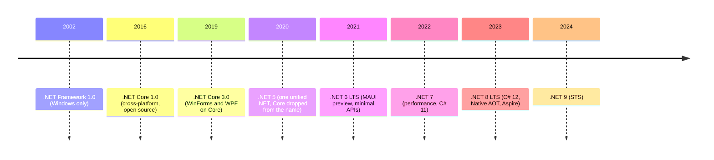

# Session 17: .NET Development and the Future

> Module: Proficient Programming with C# · Term 3 (HDSE I) · ⏱ ~2 hours

## 🎯 Learning Objectives

- Explain what .NET Core is and why it was created
- Trace the history from .NET Framework to .NET Core to unified .NET
- Compare .NET Framework with modern .NET
- Describe key features of .NET 7 and .NET 8 (LTS)
- Create, build and publish applications with Visual Studio 2022 and the `dotnet` CLI
- Use modern C# features: records, primary constructors, collection expressions, raw strings

## 📖 Concepts Explained

### 1. Why .NET Core?

The original **.NET Framework** (2002) ran only on Windows and was tied to the operating system. The cloud, Linux servers, containers and Macs needed something lighter. Microsoft rebuilt the platform as **.NET Core** (2016): open source, cross-platform, fast and installable side by side.

### 2. Timeline



- **LTS** (Long Term Support) = 3 years of updates — even-numbered releases (6, 8, 10).
- **STS** (Standard Term Support) = 18 months — odd-numbered releases.
- A new version ships every **November**. Always check the official support page before choosing a version for a real project.

### 3. .NET Framework vs modern .NET

| Topic | .NET Framework 4.8 | .NET 8 |
|---|---|---|
| Platforms | Windows | Windows, Linux, macOS, Android, iOS |
| Source | partly closed | fully open source (GitHub) |
| Deployment | machine-wide install | side-by-side, self-contained, single file, containers |
| Performance | good | much faster (JIT, GC, Span, Native AOT) |
| Web | ASP.NET (Web Forms, MVC 5) | ASP.NET Core |
| New features | maintenance only | every year |

### 4. Highlights of .NET 7 and .NET 8

| Release | Notable features |
|---|---|
| .NET 7 | big performance gains, C# 11 (raw strings, `required` members, list patterns), rate limiting, minimal API improvements |
| .NET 8 (LTS) | C# 12 (primary constructors, collection expressions), Native AOT for console/APIs, `TimeProvider`, `FrozenDictionary`, `Random.GetItems`/`Shuffle`, Blazor full-stack, .NET Aspire for cloud apps, AI libraries |

### 5. Daily CLI commands

| Command | Purpose |
|---|---|
| `dotnet new list` | see available templates |
| `dotnet new console -n App` | new console app |
| `dotnet add package Name` | add a NuGet package |
| `dotnet build` / `dotnet run` | compile / run |
| `dotnet test` | run unit tests |
| `dotnet publish -c Release -r win-x64 --self-contained` | create a deployable app |

In **Visual Studio 2022**: *Create a new project → Console App → Framework: .NET 8.0 (Long Term Support)*. Visual Studio also offers templates for ASP.NET Core, Blazor, WinForms, WPF and MAUI.

### 6. Where is .NET going?

- **Cloud-native**: containers, microservices, .NET Aspire.
- **Native AOT**: small, fast-starting apps with no JIT.
- **AI**: libraries for calling AI models and working with vectors, plus AI coding assistants in Visual Studio.
- **One platform**: web, desktop, mobile, cloud, games (Unity) and IoT all with C#.

## 💻 Code Examples

File: `Program.cs` — a tour of modern C# 12 / .NET 8 features

```csharp
// Session 17: A tour of modern .NET 8 / C# 12 features (one small example each)
using System.Collections.Frozen;
using System.Runtime.InteropServices;
using System.Text.Json;

// ===== 1. Which .NET am I running? =====
Console.WriteLine($"1) Runtime: {RuntimeInformation.FrameworkDescription}");
Console.WriteLine($"   OS     : {RuntimeInformation.OSDescription}");
Console.WriteLine($"   CPU    : {RuntimeInformation.ProcessArchitecture}, cores = {Environment.ProcessorCount}");

// ===== 2. Top-level statements (.NET 6+) =====
// This whole file has no "class Program" or "static void Main" - the compiler adds them.
Console.WriteLine("2) Top-level statements: no Main method needed!");

// ===== 3. Collection expressions (C# 12) =====
int[] marks = [78, 92, 45, 66];
List<string> cities = ["Karachi", "Lahore", "Islamabad"];
Console.WriteLine($"3) Collection expressions: {marks.Length} marks, {cities.Count} cities");

// ===== 4. Primary constructor (C# 12) - see the Course class at the bottom =====
var course = new Course("C# Programming", 36);
Console.WriteLine($"4) Primary constructor: {course.Describe()}");

// ===== 5. Records (C# 9+) - data classes with value equality =====
var s1 = new Student("R-101", "Ayesha");
var s2 = new Student("R-101", "Ayesha");
Console.WriteLine($"5) Records equal? {s1 == s2} -> {s1}");

// ===== 6. Pattern matching with switch expressions =====
string Grade(int m) => m switch
{
    >= 85 => "A",
    >= 70 and < 85 => "B",
    >= 50 => "C",
    _ => "F"
};
Console.WriteLine($"6) Pattern matching: 92 -> {Grade(92)}, 45 -> {Grade(45)}");

// ===== 7. Raw string literals (C# 11) - no escaping needed =====
string json = """
    { "name": "Ayesha", "marks": 92 }
    """;
Console.WriteLine($"7) Raw string: {json.Trim()}");

// ===== 8. Built-in JSON (System.Text.Json) =====
Student? fromJson = JsonSerializer.Deserialize<Student>("""{"RollNo":"R-202","Name":"Omar"}""");
Console.WriteLine($"8) JSON -> object: {fromJson?.Name}; object -> JSON: {JsonSerializer.Serialize(s1)}");

// ===== 9. New in .NET 8: Random.Shared.GetItems and Shuffle =====
string[] colours = ["Red", "Green", "Blue", "Yellow"];
string[] picked = Random.Shared.GetItems(colours, 2);   // pick 2 random items (an item may repeat)
Random.Shared.Shuffle(colours);                          // shuffle in place
Console.WriteLine($"9) Random picks: {string.Join(", ", picked)} | shuffled: {string.Join(", ", colours)}");

// ===== 10. New in .NET 8: FrozenDictionary (read-only, very fast lookups) =====
var cityCodes = new Dictionary<string, string>
{
    ["Karachi"] = "KHI",
    ["Lahore"] = "LHE",
    ["Islamabad"] = "ISB"
}.ToFrozenDictionary();
Console.WriteLine($"10) FrozenDictionary: Karachi = {cityCodes["Karachi"]}");

// ===== 11. New in .NET 8: TimeProvider (makes time testable) =====
TimeProvider clock = TimeProvider.System;
Console.WriteLine($"11) TimeProvider UTC now: {clock.GetUtcNow():yyyy-MM-dd HH:mm}");

// ---------- Types used above ----------
public record Student(string RollNo, string Name);

public class Course(string title, int hours)   // primary constructor parameters
{
    public string Describe() => $"{title} runs for {hours} hours";
}
```

**How it works**

1. `RuntimeInformation` shows which .NET and OS the app is running on.
2. The file has no `Main` — top-level statements.
3. `[78, 92, 45, 66]` is a collection expression that works for arrays and lists.
4. `Course(string title, int hours)` is a primary constructor; the parameters are usable inside the class.
5. Records compare by value and print nicely.
6. A local function uses a switch expression with relational patterns (`>= 70 and < 85`).
7. A raw string literal holds JSON without escaping quotes; `JsonSerializer` converts objects to/from JSON.
8. `Random.Shared.GetItems`, `Shuffle`, `FrozenDictionary` and `TimeProvider` are new in .NET 8.

Run it with `dotnet run`. Then try publishing a single file:

```bash
dotnet publish -c Release -r win-x64 --self-contained -p:PublishSingleFile=true
```

## 🧪 Lab Practice

1. Run `dotnet --list-sdks` and `dotnet --list-runtimes` and note what is installed.
2. Run the program and explain each numbered line.
3. Publish the app as a single file for your OS and run the output without `dotnet run`.
4. Create a `record Book(string Title, string Author, int Year)` and serialize a list of books to JSON.
5. Rewrite a class from an earlier session using a primary constructor.

## 📝 Assignment

Write a short report (one page, in a Markdown file) comparing .NET Framework 4.8 and .NET 8 for a company that wants to modernise an old Windows billing app. Include: platform support, performance, deployment, support lifetime, and your recommendation. Add a small .NET 8 console app that reads a JSON file of invoices and prints the total using `System.Text.Json`.

## ❓ Quick Quiz

1. In which year was .NET Core 1.0 released?
2. What does LTS stand for, and how long is it supported?
3. Name two C# 12 features.
4. What is the command to create a self-contained published app?
5. What is the main limitation of .NET Framework?

<details>
<summary>Show answers</summary>

1. 2016
2. Long Term Support — 3 years.
3. Primary constructors and collection expressions (also alias any type, default lambda parameters).
4. `dotnet publish -c Release -r <rid> --self-contained`
5. It runs only on Windows (and gets maintenance updates only).

</details>

## 💼 Interview Questions

1. Why did Microsoft drop "Core" from the name in .NET 5?
2. What is Native AOT and when is it useful?
3. How would you decide between an LTS and an STS release for a production project?

## ✅ Summary

- .NET grew from Windows-only Framework to cross-platform, open-source .NET.
- .NET 8 is the current LTS with C# 12 and big performance gains.
- The `dotnet` CLI and Visual Studio 2022 cover building, testing and publishing.
- The future is cloud-native, AOT-compiled and AI-assisted — all in C#.

---

[⬅ Previous](../Session-16-Cross-Platform-Apps-with-DotNet-MAUI/README.md) · [🏠 Module Home](../README.md) · [Next ➡](../Session-18-Lab-Review-Advanced-CSharp-and-DotNet/README.md)

Prepared by Zeeshan Abbas · Aptech Learning North Nazimabad
