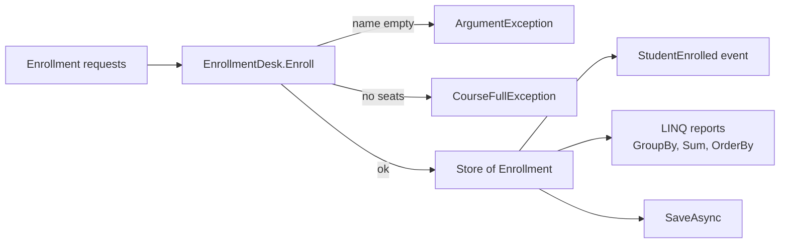

# Session 18: Lab and Review — Advanced C# and .NET

> Module: Proficient Programming with C# · Term 3 (HDSE I) · ⏱ ~2 hours

## 🎯 Learning Objectives

- Revise generics and iterators (Session 13)
- Revise GUI and SQL Server connectivity (Session 14)
- Revise lambdas, extension methods, LINQ and `async/await` (Session 15)
- Revise .NET MAUI and modern .NET (Sessions 16–17)
- Combine advanced features in one console lab and prepare for the module exam

## 📖 Concepts Explained

### 1. Revision map

| Session | Must-know ideas |
|---|---|
| 13 Generics & Iterators | `class Store<T>`, constraints `where T :`, `IEnumerable<T>`, `yield return` |
| 14 GUI & SQL | WinForms events, `SqlConnection`, `SqlCommand`, parameters, `ExecuteNonQuery/Reader/Scalar`, `DataTable` |
| 15 Advanced C# | lambdas, `Func/Action/Predicate`, extension methods, anonymous types, nullable, LINQ, `Parallel`, `dynamic`, `async/await` |
| 16 .NET MAUI | single project, handlers, XAML + code-behind, Shell navigation |
| 17 Modern .NET | .NET Framework vs .NET 8, LTS/STS, CLI, records, primary constructors, collection expressions |

### 2. The lab: Course Enrollment Desk



Features used and where:

| Feature | File |
|---|---|
| `record` types | `Models.cs` |
| custom exception with primary constructor | `Models.cs` |
| generic class `Store<T>` + `Func<T,bool>` | `Models.cs` |
| extension method `ToRupees()` | `Models.cs` |
| event `Action<Enrollment>` | `EnrollmentDesk.cs` |
| `async Task<int>` | `EnrollmentDesk.cs` |
| tuples, collection expressions, LINQ, anonymous types, `await` | `Program.cs` |

### 3. Exam tips

- Know the **output** of small snippets (records `==`, `with`, `??`, `yield`).
- Be able to write a parameterized `SqlCommand` from memory.
- Explain the difference between `IEnumerable` (lazy) and `List` (stored).
- Be clear on `Task` vs `Thread` vs `Parallel`: async waits, parallel computes.

## 💻 Code Examples

File: `Models.cs`

```csharp
// Session 18: Lab - the data types used by the enrollment desk

// A record is perfect for simple data
public record Course(int Id, string Title, decimal Fee, int Seats);

public record Enrollment(string StudentName, Course Course, DateTime Date);

// A custom exception for our business rule
public class CourseFullException(string courseTitle)
    : Exception($"Sorry, {courseTitle} has no seats left.");

// A small generic store that works for ANY type (generics, Session 13)
public class Store<T>
{
    private readonly List<T> items = [];

    public void Add(T item) => items.Add(item);

    public IReadOnlyList<T> All => items;

    // Accepts a rule as a Func (delegates, Session 11/15)
    public IEnumerable<T> Find(Func<T, bool> rule) => items.Where(rule);
}

// Extension method (Session 15)
public static class MoneyExtensions
{
    public static string ToRupees(this decimal amount) => $"Rs {amount:N0}";
}
```

File: `EnrollmentDesk.cs`

```csharp
// Session 18: Lab - the enrollment desk (events + exceptions + LINQ)
public class EnrollmentDesk
{
    private readonly Store<Enrollment> enrollments = new();

    // Event raised after every successful enrollment (Session 11)
    public event Action<Enrollment>? StudentEnrolled;

    public void Enroll(string studentName, Course course)
    {
        // Rule 1: name is required
        if (string.IsNullOrWhiteSpace(studentName))
            throw new ArgumentException("Student name is required.");

        // Rule 2: the course must have a free seat
        int taken = enrollments.Find(e => e.Course.Id == course.Id).Count();
        if (taken >= course.Seats)
            throw new CourseFullException(course.Title);

        var enrollment = new Enrollment(studentName, course, DateTime.Now);
        enrollments.Add(enrollment);
        StudentEnrolled?.Invoke(enrollment);   // tell everyone who is listening
    }

    public IReadOnlyList<Enrollment> All => enrollments.All;

    // Simulates saving to a server / database without freezing (async, Session 15)
    public async Task<int> SaveAsync()
    {
        await Task.Delay(500);
        return enrollments.All.Count;
    }
}
```

File: `Program.cs`

```csharp
// Session 18: Lab and Review - Course Enrollment Desk
// Combines: records, generics, delegates, events, exceptions, extension methods, LINQ, async.

// Step 1: the courses on offer
Course[] courses =
[
    new(1, "C# Programming", 15000m, 2),
    new(2, "Angular", 12000m, 3),
    new(3, "ASP.NET Core MVC", 18000m, 2)
];

// Step 2: create the desk and listen to its event
var desk = new EnrollmentDesk();
desk.StudentEnrolled += e => Console.WriteLine($"[OK] {e.StudentName} joined {e.Course.Title}");

// Step 3: try some enrollments (some will fail on purpose)
(string Name, int CourseId)[] requests =
[
    ("Ali", 1), ("Sana", 1), ("Bilal", 1),   // third one: C# is full
    ("Hira", 2), ("", 2),                    // empty name
    ("Omar", 3), ("Zoya", 2)
];

foreach (var request in requests)
{
    Course course = courses.First(c => c.Id == request.CourseId);
    try
    {
        desk.Enroll(request.Name, course);
    }
    catch (CourseFullException ex)
    {
        Console.WriteLine($"[FULL] {ex.Message}");
    }
    catch (ArgumentException ex)
    {
        Console.WriteLine($"[ERROR] {ex.Message}");
    }
}

// Step 4: reports with LINQ
Console.WriteLine("\n--- Students per course ---");
var perCourse = desk.All
    .GroupBy(e => e.Course.Title)
    .Select(g => new { Course = g.Key, Count = g.Count(), Income = g.Sum(e => e.Course.Fee) });

foreach (var row in perCourse)
    Console.WriteLine($"{row.Course,-18} {row.Count} student(s)  {row.Income.ToRupees()}");

decimal totalIncome = desk.All.Sum(e => e.Course.Fee);
Console.WriteLine($"Total income: {totalIncome.ToRupees()}");

var names = desk.All.Select(e => e.StudentName).OrderBy(n => n);
Console.WriteLine($"All students (A-Z): {string.Join(", ", names)}");

// Step 5: save asynchronously
Console.WriteLine("\nSaving...");
int saved = await desk.SaveAsync();
Console.WriteLine($"Saved {saved} enrollments.");
```

**How it works**

1. Three courses are created with a collection expression; C# has only 2 seats.
2. The desk's event prints a confirmation for every successful enrollment.
3. Requests are tuples `(Name, CourseId)`. Bilal fails because C# is full; an empty name fails validation.
4. `GroupBy` + `Select` into an anonymous type builds a per-course report; `ToRupees()` formats money.
5. `SaveAsync` simulates saving without blocking, then prints the count.

Output:

```text
[OK] Ali joined C# Programming
[OK] Sana joined C# Programming
[FULL] Sorry, C# Programming has no seats left.
[OK] Hira joined Angular
[ERROR] Student name is required.
[OK] Omar joined ASP.NET Core MVC
[OK] Zoya joined Angular

--- Students per course ---
C# Programming     2 student(s)  Rs 30,000
Angular            2 student(s)  Rs 24,000
ASP.NET Core MVC   1 student(s)  Rs 18,000
Total income: Rs 72,000
All students (A-Z): Ali, Hira, Omar, Sana, Zoya

Saving...
Saved 5 enrollments.
```

## 🧪 Lab Practice

1. Add a rule: the same student cannot join the same course twice (throw `InvalidOperationException`).
2. Add an iterator method `IEnumerable<string> WaitingList()` that yields names rejected because a course was full.
3. Add a LINQ report: courses with free seats remaining (`Seats - count`).
4. Replace `Store<Enrollment>` with ADO.NET: save each enrollment to a SQL Server table `Enrollments` using parameters (Session 14).
5. Sketch a MAUI page (XAML only) with an `Entry` for name, a `Picker` for course and an Enroll button.

## 📝 Assignment

**Module mini-project kick-off:** build the *Student Fee Manager* described on the module home page. Minimum for this week: models (records/classes), a generic repository, an event on payment, three LINQ reports and one `async` method. Push to GitHub with a README and sample output.

## ❓ Quick Quiz

1. What does `where T : IEntity` guarantee?
2. Which ADO.NET method returns a single value?
3. What is printed by `new { A = 1 }.A`?
4. What does `await` do inside an `async` method?
5. Which .NET version is the current LTS used in this module?

<details>
<summary>Show answers</summary>

1. Every `T` has the members of `IEntity` (e.g. `Id`).
2. `ExecuteScalar()`
3. `1`
4. Pauses the method until the awaited task finishes, without blocking the thread.
5. .NET 8

</details>

## 💼 Interview Questions

1. How would you make this enrollment desk thread-safe if many users enrolled at once?
2. Explain how LINQ `GroupBy` works and give a business example.
3. Compare WinForms, WPF and .NET MAUI — when would you choose each?

## ✅ Summary

- Generics, delegates, events, LINQ and async work best together.
- Validate early and use specific exceptions for business rules.
- Use parameters and `using` whenever you talk to SQL Server.
- You are ready for Module 03: TypeScript and Angular.

---

[⬅ Previous](../Session-17-DotNet-Development-and-the-Future/README.md) · [🏠 Module Home](../README.md) · [Next Module ➡](../../03-Building-Applications-with-TypeScript/README.md)

Prepared by Zeeshan Abbas · Aptech Learning North Nazimabad
