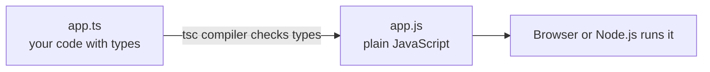

# Session 01: Introduction to TypeScript and Angular

> Module: Building Applications with TypeScript (Angular) · Term 3 (HDSE I) · ⏱ ~2 hours

This session introduces **TypeScript** (JavaScript with types) and gives you a first look at **Angular**, the framework we will use for the rest of the module.

## 🎯 Learning Objectives

- Explain what TypeScript is and why companies use it
- Install Node.js, TypeScript and the Angular CLI
- Compile and run a `.ts` file
- Use basic types, arrays, tuples, unions, enums and typed functions
- Describe what Angular is and list its main features
- Use the most common Angular CLI commands

## 📖 Concepts Explained

### 1. What is TypeScript?

TypeScript is **JavaScript + types**. You write `.ts` files, the TypeScript compiler (`tsc`) checks them for mistakes and turns them into normal `.js` files that browsers and Node.js understand.

Analogy: JavaScript is like writing a letter with no spell-checker. TypeScript is the same letter with a spell-checker that underlines mistakes **before** you post it.



| JavaScript | TypeScript |
|---|---|
| Errors appear when the program runs | Many errors appear while you type |
| No types | Optional static types |
| Runs directly | Compiled to JavaScript first |
| Fine for small scripts | Preferred for large apps (Angular is written in it) |

### 2. Setup

1. Install **Node.js LTS** (it includes `npm`).
2. Install TypeScript globally: `npm install -g typescript`
3. Check: `tsc --version`
4. Compile a file: `tsc hello.ts` → creates `hello.js`
5. Run it: `node hello.js`

> Tip: `npx tsx hello.ts` runs a TypeScript file in one step without creating a `.js` file.

### 3. Basic types

| Type | Example | Notes |
|---|---|---|
| `string` | `"Karachi"` | text |
| `number` | `42`, `3.5` | all numbers |
| `boolean` | `true` | yes/no |
| `number[]` | `[1, 2, 3]` | array |
| `[string, number]` | `["Ali", 20]` | tuple (fixed shape) |
| `string \| number` | `101` or `"A-101"` | union |
| `enum` | `Grade.A` | named constants |
| `any` | anything | turns checking off (avoid) |
| `unknown` | anything | must be checked before use |
| `void` | function returns nothing | |

**Type inference:** if you write `let x = 5`, TypeScript already knows `x` is a `number`. You only need annotations where the type is not obvious (function parameters, empty arrays).

### 4. What is Angular?

**Angular** is a free framework from Google for building **single-page applications (SPAs)**. A SPA loads one HTML page and then swaps parts of the screen without full page reloads.

Main features:

- **Components** – the screen is made of small reusable blocks
- **Templates** with data binding – show data and react to clicks
- **Dependency Injection** – share services (data, logic) between components
- **Router** – move between "pages" inside the SPA
- **Forms**, **HTTP client**, **animations** – all built in
- **Angular CLI** – one tool to create, run, test and build the project

Since Angular 17, new projects use **standalone components** (no `NgModule` needed) and the new built-in control flow (`@if`, `@for`). We use this modern style throughout.

### 5. Angular CLI commands

| Command | What it does |
|---|---|
| `npm install -g @angular/cli` | Install the CLI |
| `ng new my-app` | Create a new project |
| `ng serve -o` | Run the dev server and open the browser (http://localhost:4200) |
| `ng generate component student` (`ng g c student`) | Create a component |
| `ng g service data` | Create a service |
| `ng build` | Production build in `dist/` |
| `ng test` | Run unit tests |
| `ng version` | Show versions |

### 6. Project structure (the parts you will touch)

```
my-app/
  src/
    main.ts            starts the app
    index.html         the single HTML page
    styles.css         global styles
    app/
      app.component.ts     root component (class + template)
      app.config.ts        app-wide providers (router, http)
      app.routes.ts        route list
```

## 💻 Code Examples

Run each file with `tsc <file>.ts` then `node <file>.js` (or `npx tsx <file>.ts`).

### Example 1: Hello TypeScript

📄 File: [`hello.ts`](hello.ts)

```typescript
// hello.ts - your first TypeScript program
export {}; // makes this file a module, so its variables stay private to it

// A variable with a type annotation: name can only hold text
let studentName: string = "Ayesha";

// TypeScript can also guess (infer) the type from the value
let sessionNumber = 1; // inferred as number

// Print a message using a template string
console.log(`Welcome ${studentName}! This is session ${sessionNumber}.`);

// Uncomment the next line and run "npx tsc hello.ts" to see a type error:
// sessionNumber = "one";
```

**How it works:** the `export {}` line keeps each example file separate, so two files can both use a variable called `marks`. `studentName` has an explicit `string` annotation; `sessionNumber` is inferred as `number`. If you assign text to it, `tsc` reports an error before the program runs.

### Example 2: Data types

📄 File: [`data-types.ts`](data-types.ts)

```typescript
// data-types.ts - the basic types of TypeScript
export {}; // makes this file a module, so its variables stay private to it

// 1. Primitive types
let courseName: string = "ACCP AI";
let totalSessions: number = 12;
let isActive: boolean = true;

// 2. Arrays: a list of values of the same type
let marks: number[] = [78, 85, 91];

// 3. Tuple: fixed length, each position has its own type
let student: [string, number] = ["Bilal", 19];

// 4. Union type: the value can be one type OR another
let rollNo: string | number = 101;
rollNo = "HDSE-101"; // also allowed

// 5. Enum: a set of named constants
enum Grade { A = "A", B = "B", C = "C" }
let myGrade: Grade = Grade.A;

// 6. any (avoid it) and unknown (safer)
let anything: any = 5;      // TypeScript stops checking this variable
let input: unknown = "hi";  // you must check the type before using it
if (typeof input === "string") {
  console.log(input.toUpperCase());
}

console.log(courseName, totalSessions, isActive);
console.log("Marks:", marks, "Student:", student);
console.log("Roll No:", rollNo, "Grade:", myGrade, "Any:", anything);
```

**How it works:** each variable shows one type. Notice that `unknown` forces a `typeof` check before calling `toUpperCase()`, while `any` lets anything through (which is why we avoid it).

### Example 3: Functions

📄 File: [`functions.ts`](functions.ts)

```typescript
// functions.ts - typed functions
export {}; // makes this file a module, so its variables stay private to it

// Parameters and the return value have types
function add(a: number, b: number): number {
  return a + b;
}

// Optional parameter (?) and default parameter (= value)
function greet(name: string, city?: string, greeting: string = "Hello"): string {
  if (city) {
    return `${greeting} ${name} from ${city}`;
  }
  return `${greeting} ${name}`;
}

// Arrow function: a short way to write a function
const square = (n: number): number => n * n;

// A function that returns nothing uses the type void
function logLine(message: string): void {
  console.log("-> " + message);
}

logLine(String(add(10, 5)));          // -> 15
logLine(greet("Sara"));                // -> Hello Sara
logLine(greet("Ali", "Karachi"));      // -> Hello Ali from Karachi
logLine(greet("Omar", undefined, "Hi")); // -> Hi Omar
logLine(String(square(7)));            // -> 49
```

**How it works:** typed parameters stop you calling `add("5", 2)`. `city?` may be left out, and `greeting` falls back to `"Hello"`.

### Example 4: Loops and conditions

📄 File: [`loops-and-conditions.ts`](loops-and-conditions.ts)

```typescript
// loops-and-conditions.ts - the same constructs you know, now with types
export {}; // makes this file a module, so its variables stay private to it

const marks: number[] = [45, 72, 88, 39, 95];

// for...of loop: visit every value
for (const mark of marks) {
  // if / else if / else
  if (mark >= 80) {
    console.log(mark, "Excellent");
  } else if (mark >= 50) {
    console.log(mark, "Pass");
  } else {
    console.log(mark, "Fail");
  }
}

// switch statement
const day: string = "Sat";
switch (day) {
  case "Sat":
  case "Sun":
    console.log("Weekend class");
    break;
  default:
    console.log("Weekday class");
}
```

**How it works:** the control statements are the same as JavaScript; TypeScript only adds the types (`number[]`, `string`).

## 🧪 Lab Practice

1. Install Node.js, then run `npm install -g typescript @angular/cli`. Check with `tsc --version` and `ng version`.
2. Compile and run all four example files. Then remove the comment in `hello.ts` and read the error message.
3. Write `temperature.ts` with a function `toFahrenheit(c: number): number` and print results for 0, 25 and 40.
4. Create your first Angular app: `ng new hello-angular` (choose CSS, no SSR), then `cd hello-angular` and `ng serve -o`.
5. Open `src/app/app.component.html`, replace everything with `<h1>Hello from Karachi!</h1>` and save. The browser reloads by itself.

## 📝 Assignment

Write `student-report.ts`: store a student's name (`string`), three subject marks (`number[]`) and a grade `enum`. Write a function `average(marks: number[]): number` and print the name, the average and the grade (A ≥ 80, B ≥ 60, otherwise C).

## ❓ Quick Quiz

1. What does the TypeScript compiler produce?
2. Which type should you avoid because it turns off type checking?
3. Write the type of an array of strings.
4. Which command creates a new Angular project?
5. On which port does `ng serve` run by default?

<details><summary>Answers</summary>

1. Plain JavaScript (`.js`) files.
2. `any`.
3. `string[]` (or `Array<string>`).
4. `ng new <name>`.
5. 4200.

</details>

## 💼 Interview Questions

1. **Why use TypeScript instead of JavaScript?** It finds type errors at compile time, gives better auto-complete and refactoring, and makes large codebases easier to maintain.
2. **What is the difference between `any` and `unknown`?** Both accept any value, but `unknown` forces you to check the type before using it, so it stays type-safe.
3. **What is a single-page application?** An app that loads one HTML page and updates parts of it with JavaScript instead of reloading full pages from the server.

## ✅ Summary

- TypeScript adds static types to JavaScript and compiles to `.js`.
- Core types: `string`, `number`, `boolean`, arrays, tuples, unions, enums, `void`, `unknown`.
- Functions can have typed, optional and default parameters.
- Angular is a TypeScript framework for SPAs; the CLI (`ng`) creates, runs and builds projects.
- Modern Angular (17+) uses standalone components and `@if` / `@for` in templates.

---

[⬅ Term Home](../../README.md) · [🏠 Module Home](../README.md) · [Next ➡](../Session-02-Components-Templates-and-Lifecycle/README.md)

Prepared by Zeeshan Abbas · Aptech Learning North Nazimabad
