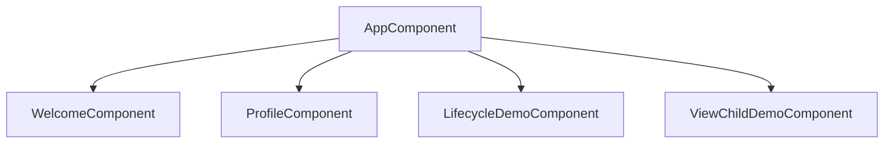
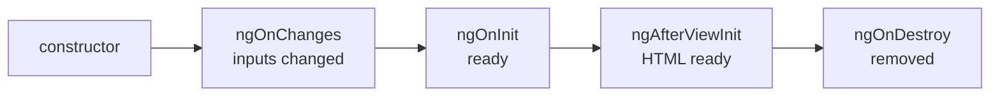

# Session 02: Angular Components, Templates and Lifecycle

> Module: Building Applications with TypeScript (Angular) · Term 3 (HDSE I) · ⏱ ~2 hours

Angular apps are built from **components**. In this session you build several small components, learn the four kinds of data binding, see how styles stay private to a component, and watch lifecycle hooks run.

## 🎯 Learning Objectives

- Explain what a component is and its three parts (class, template, styles)
- Create standalone components with the CLI and by hand
- Use interpolation, property binding, event binding and class binding
- Describe view encapsulation and its three modes
- Use the lifecycle hooks `ngOnInit`, `ngAfterViewInit` and `ngOnDestroy`
- Access a template element with `@ViewChild`

## 📖 Concepts Explained

### 1. Anatomy of a component

| Part | What it is | Where |
|---|---|---|
| **Class** | Data (properties) and behaviour (methods) | `.ts` file |
| **Template** | The HTML the user sees | `template:` or `templateUrl:` |
| **Styles** | CSS for this component only | `styles:` or `styleUrl:` |
| **Selector** | The custom HTML tag | `selector: 'app-profile'` |

The `@Component({...})` **decorator** is what turns a normal class into an Angular component. To use one component inside another, add it to the parent's `imports` array.



### 2. Data binding

| Syntax | Name | Direction | Example |
|---|---|---|---|
| `{{ value }}` | Interpolation | class → view | `{{ name }}` |
| `[prop]="value"` | Property binding | class → view | `[src]="photoUrl"` |
| `(event)="method()"` | Event binding | view → class | `(click)="addLike()"` |
| `[(ngModel)]="value"` | Two-way binding | both | covered in Session 8 |

### 3. View encapsulation

By default, CSS written in a component **only affects that component**. Angular adds hidden attributes to the elements so a `.card` rule in one component does not change `.card` in another.

| Mode | Meaning |
|---|---|
| `Emulated` (default) | Styles scoped by hidden attributes |
| `ShadowDom` | Uses the browser's real Shadow DOM |
| `None` | Styles become global (use carefully) |

Set it with `encapsulation: ViewEncapsulation.None` in the decorator.

### 4. Lifecycle hooks

Angular creates, updates and destroys components. It calls special methods at each step:



- **ngOnInit** – load data, start timers
- **ngAfterViewInit** – work with elements in the template
- **ngOnDestroy** – stop timers, unsubscribe (avoid memory leaks)

### 5. @ViewChild

Put a **template reference variable** like `#nameBox` on an element. `@ViewChild('nameBox')` gives the class a reference to it, available from `ngAfterViewInit` onwards.

## 💻 Code Examples

Setup: `ng new components-demo`, then copy these files into `src/app/` (replace the generated `app.component.*` files) and run `ng serve -o`.

### Example 1: Inline template

📄 File: [`welcome.component.ts`](welcome.component.ts)

```typescript
// welcome.component.ts - the smallest possible component
import { Component } from '@angular/core';

@Component({
  selector: 'app-welcome',        // use it in HTML as <app-welcome />
  standalone: true,               // no NgModule needed
  template: `<h2>Welcome to Angular, {{ studentName }}!</h2>`,
  styles: [`h2 { color: darkgreen; }`],
})
export class WelcomeComponent {
  // A class property; the template reads it with {{ }}
  studentName = 'Hira';
}
```

**How it works:** the whole component sits in one file. `{{ studentName }}` prints the property value.

### Example 2: Separate template and styles

📄 File: [`profile.component.ts`](profile.component.ts)

```typescript
// profile.component.ts - template and styles kept in separate files
import { Component } from '@angular/core';

@Component({
  selector: 'app-profile',
  standalone: true,
  templateUrl: './profile.component.html', // HTML lives here
  styleUrl: './profile.component.css',     // CSS lives here
})
export class ProfileComponent {
  name = 'Usman Khan';
  course = 'HDSE I';
  photoUrl = 'https://placehold.co/100x100';
  isOnline = true;
  likes = 0;

  // A method that runs when the button is clicked
  addLike(): void {
    this.likes = this.likes + 1;
  }
}
```

📄 File: [`profile.component.html`](profile.component.html)

```html
<!-- profile.component.html -->
<div class="card">
  <!-- Property binding: [src] gets its value from the class -->
  

  <!-- Interpolation: {{ }} shows a value as text -->
  <h3>{{ name }}</h3>
  <p>Course: {{ course }}</p>

  <!-- Class binding: add the class "online" only when isOnline is true -->
  <p [class.online]="isOnline">{{ isOnline ? 'Online' : 'Offline' }}</p>

  <!-- Event binding: (click) calls a method -->
  <button (click)="addLike()">Like ({{ likes }})</button>
</div>
```

**How it works:** `[src]` and `[class.online]` push values from the class into the HTML; `(click)` sends the click back to `addLike()`. Angular redraws `likes` automatically. Styles live in [`profile.component.css`](profile.component.css).

### Example 3: Lifecycle hooks

📄 File: [`lifecycle-demo.component.ts`](lifecycle-demo.component.ts)

```typescript
// lifecycle-demo.component.ts - see when Angular calls each hook
import { Component, OnInit, OnDestroy } from '@angular/core';

@Component({
  selector: 'app-lifecycle-demo',
  standalone: true,
  template: `<p>Seconds on this page: {{ seconds }}</p>`,
})
export class LifecycleDemoComponent implements OnInit, OnDestroy {
  seconds = 0;
  private timerId: any;

  // 1. constructor: the object is created (keep it light)
  constructor() {
    console.log('constructor called');
  }

  // 2. ngOnInit: the component is ready; a good place to start work
  ngOnInit(): void {
    console.log('ngOnInit called');
    this.timerId = setInterval(() => {
      this.seconds = this.seconds + 1;
    }, 1000);
  }

  // 3. ngOnDestroy: the component is removed; clean up here
  ngOnDestroy(): void {
    console.log('ngOnDestroy called');
    clearInterval(this.timerId);
  }
}
```

**How it works:** open the browser console (F12). Toggle the timer in the root component and you will see `ngOnInit` and `ngOnDestroy` run each time.

### Example 4: @ViewChild

📄 File: [`view-child-demo.component.ts`](view-child-demo.component.ts) – focuses and clears an input box through `@ViewChild('nameBox')`.

### Example 5: Root component

📄 File: [`app.component.ts`](app.component.ts)

```typescript
// app.component.ts - the root component shows all the demos
import { Component } from '@angular/core';
import { WelcomeComponent } from './welcome.component';
import { ProfileComponent } from './profile.component';
import { LifecycleDemoComponent } from './lifecycle-demo.component';
import { ViewChildDemoComponent } from './view-child-demo.component';

@Component({
  selector: 'app-root',
  standalone: true,
  // A standalone component lists the components it uses here
  imports: [WelcomeComponent, ProfileComponent, LifecycleDemoComponent, ViewChildDemoComponent],
  template: `
    <app-welcome />
    <app-profile />

    <button (click)="showTimer = !showTimer">Toggle timer</button>
    @if (showTimer) {
      <app-lifecycle-demo />
    }

    <app-view-child-demo />
  `,
})
export class AppComponent {
  showTimer = true;
}
```

**How it works:** `imports` lists the child components; `@if` shows the timer only when `showTimer` is true.

## 🧪 Lab Practice

1. Run `ng g c course-card` and look at the four files created.
2. In `course-card`, show a course title, duration and fee with interpolation.
3. Add a button that toggles a `isFavourite` flag and shows ★ or ☆.
4. Add `ngOnInit` that logs "Course card ready" and confirm it in the console.
5. Change encapsulation to `None` and notice that its styles now leak into other components.

## 📝 Assignment

Create a `digital-clock` component that shows the current time (`new Date().toLocaleTimeString()`) updated every second. Start the timer in `ngOnInit` and stop it in `ngOnDestroy`. Add a button in `AppComponent` that shows/hides the clock.

## ❓ Quick Quiz

1. Which decorator turns a class into a component?
2. What is the difference between `template` and `templateUrl`?
3. Which binding sends data from view to class?
4. Which hook is best for cleaning up timers?
5. What is the default view encapsulation mode?

<details><summary>Answers</summary>

1. `@Component`
2. `template` holds inline HTML; `templateUrl` points to a separate `.html` file.
3. Event binding `( )`.
4. `ngOnDestroy`.
5. `Emulated`.

</details>

## 💼 Interview Questions

1. **What is a standalone component?** A component with `standalone: true` that declares its own dependencies in `imports` and does not need an NgModule (default from Angular 17, and implied from Angular 19).
2. **Why fetch data in `ngOnInit` and not the constructor?** The constructor should only set up dependencies; `ngOnInit` runs after Angular has set the inputs, so the component is fully ready.
3. **What is view encapsulation?** The mechanism that keeps a component's CSS from affecting other parts of the page.

## ✅ Summary

- A component = class + template + styles + selector.
- Bindings: `{{ }}` and `[ ]` (class → view), `( )` (view → class).
- Styles are scoped to the component by default (`Emulated`).
- Lifecycle hooks let you run code at creation, after the view loads and before removal.
- `@ViewChild` gives the class access to a template element.

---

[⬅ Previous](../Session-01-Introduction-to-TypeScript-and-Angular/README.md) · [🏠 Module Home](../README.md) · [Next ➡](../Session-03-Lab-Review-TypeScript-and-Components/README.md)

Prepared by Zeeshan Abbas · Aptech Learning North Nazimabad
