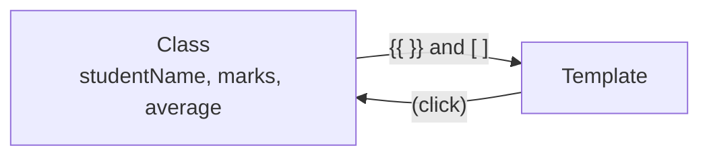

# Session 03: Lab and Review: TypeScript and Components

> Module: Building Applications with TypeScript (Angular) · Term 3 (HDSE I) · ⏱ ~2 hours

A practice session. First you revise Sessions 1–2 with short exercises, then you build a small **Result Card** component step by step.

## 🎯 Learning Objectives

- Revise TypeScript types, functions, unions and enums
- Create a standalone component with separate HTML and CSS files
- Use interpolation, property, class and event binding together
- Use a getter for a calculated value
- Repeat and hide content with `@for` and `@if`

## 📖 Concepts Explained

### 1. Quick revision

| Topic | Remember this |
|---|---|
| Type annotation | `let city: string = "Karachi";` |
| Inference | `let n = 5;` is already a `number` |
| Union | `string \| number` means either |
| Function types | `function f(a: number): string` |
| Component parts | class + template + styles + selector |
| Bindings | `{{ }}`, `[prop]`, `(event)` |
| Hooks | `ngOnInit` start, `ngOnDestroy` clean up |

### 2. Getters

A **getter** is a method that is read like a property: `get average() { ... }` is used in the template as `{{ average }}` (no brackets). It always returns a fresh value, so when `marks` change the average updates by itself.

### 3. Built-in control flow (preview)

| Block | Meaning |
|---|---|
| `@if (condition) { ... }` | show content only when true |
| `@for (item of list; track item) { ... }` | repeat content for each item |

`track` tells Angular how to recognise each item so it can update the list efficiently. You will study these fully in Session 4.

### 4. How the pieces talk



## 💻 Code Examples

### Example 1: TypeScript warm-up

📄 File: [`warmup.ts`](warmup.ts)

```typescript
// warmup.ts - TypeScript revision exercises (run: npx tsx warmup.ts)
export {}; // keep this file's variables private

// Exercise 1: a typed function that returns the larger of two numbers
function larger(a: number, b: number): number {
  return a > b ? a : b;
}
console.log("Larger:", larger(12, 30));

// Exercise 2: total of an array using a for...of loop
function total(values: number[]): number {
  let sum = 0;
  for (const value of values) {
    sum = sum + value;
  }
  return sum;
}
console.log("Total:", total([10, 20, 30]));

// Exercise 3: a union type parameter
function showId(id: string | number): string {
  if (typeof id === "number") {
    return "Numeric ID: " + id;
  }
  return "Text ID: " + id.toUpperCase();
}
console.log(showId(7));
console.log(showId("hdse-7"));

// Exercise 4: enum + switch
enum Level { Beginner, Intermediate, Advanced }
function describe(level: Level): string {
  switch (level) {
    case Level.Beginner: return "Start with the basics";
    case Level.Intermediate: return "Build real projects";
    default: return "Teach others!";
  }
}
console.log(describe(Level.Intermediate));
```

**How it works:** four small exercises revise typed functions, loops, unions (narrowed with `typeof`) and enums with `switch`.

### Example 2: The Result Card component

📄 File: [`result-card.component.ts`](result-card.component.ts)

```typescript
// result-card.component.ts - lab: a student result card
import { Component } from '@angular/core';

@Component({
  selector: 'app-result-card',
  standalone: true,
  templateUrl: './result-card.component.html',
  styleUrl: './result-card.component.css',
})
export class ResultCardComponent {
  // Step 1: data
  studentName = 'Fatima Noor';
  subjects: string[] = ['TypeScript', 'SQL Server', 'C#'];
  marks: number[] = [82, 74, 91];
  showDetails = false;

  // Step 2: a calculated value (a "getter" is read like a property)
  get average(): number {
    let sum = 0;
    for (const mark of this.marks) {
      sum = sum + mark;
    }
    return Math.round(sum / this.marks.length);
  }

  // Step 3: a method for the button
  toggleDetails(): void {
    this.showDetails = !this.showDetails;
  }
}
```

📄 File: [`result-card.component.html`](result-card.component.html)

```html
<!-- result-card.component.html -->
<div class="card">
  <h2>{{ studentName }}</h2>
  <p>Average: <strong>{{ average }}</strong></p>

  <!-- Class binding: green when passed, red when failed -->
  <p [class.pass]="average >= 50" [class.fail]="average < 50">
    {{ average >= 50 ? 'PASS' : 'FAIL' }}
  </p>

  <button (click)="toggleDetails()">
    {{ showDetails ? 'Hide' : 'Show' }} details
  </button>

  <!-- @for repeats the row for every subject; $index is the position -->
  @if (showDetails) {
    <ul>
      @for (subject of subjects; track subject; let i = $index) {
        <li>{{ subject }}: {{ marks[i] }}</li>
      }
    </ul>
  }
</div>
```

**How it works:** the class holds data and a getter. The template prints values, colours the PASS/FAIL line with class binding and toggles the subject list with `@if`. Styles are in [`result-card.component.css`](result-card.component.css) and the root component is [`app.component.ts`](app.component.ts).

## 🧪 Lab Practice

1. Run `warmup.ts` and predict each output **before** running it.
2. Create a project `ng new lab-one`, copy the four component files into `src/app/` and run `ng serve -o`.
3. Change one mark to `20` and two others so the average falls below 50. Does the card turn red?
4. Add a `rollNo` property and show it under the name.
5. Add a second button "Reset" that sets all marks to `0`.

## 📝 Assignment

Build a `product-card` component for a mobile shop: name, price, stock quantity and an image. Show "In stock" in green or "Out of stock" in red, and a "Buy" button that reduces the stock by 1 (never below 0).

## ❓ Quick Quiz

1. How do you read a getter in a template?
2. What does `track` do inside `@for`?
3. Write a union type that accepts a number or `null`.
4. Which binding adds a CSS class conditionally?
5. Which file property points to an external stylesheet?

<details><summary>Answers</summary>

1. Like a property: `{{ average }}`.
2. Gives each item an identity so Angular can update only what changed.
3. `number | null`
4. Class binding, e.g. `[class.pass]="ok"`.
5. `styleUrl` (or `styleUrls` for a list).

</details>

## 💼 Interview Questions

1. **What is type narrowing?** Checking a union value (with `typeof`, `instanceof` or `in`) so TypeScript knows the exact type inside that block.
2. **Getter vs normal method in a template?** Both run on change detection; a getter reads like a property. Keep both cheap because they may run often.
3. **Why separate HTML and CSS files?** Large templates are easier to read, edit and review in their own files with full editor support.

## ✅ Summary

- Revised TypeScript basics and component bindings.
- Built a component with data, a getter, a method, class binding, `@if` and `@for`.
- Small, focused components are easier to test and reuse.

---

[⬅ Previous](../Session-02-Components-Templates-and-Lifecycle/README.md) · [🏠 Module Home](../README.md) · [Next ➡](../Session-04-TypeScript-Features-Interaction-and-Directives/README.md)

Prepared by Zeeshan Abbas · Aptech Learning North Nazimabad
