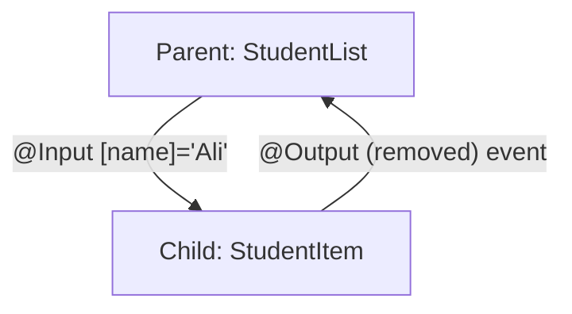

# Session 04: TypeScript Features, Component Interaction and Directives

> Module: Building Applications with TypeScript (Angular) · Term 3 (HDSE I) · ⏱ ~2 hours

This session adds the TypeScript features Angular relies on (interfaces, classes, modules, decorators, promises), shows how parent and child components talk, and explains **directives**.

## 🎯 Learning Objectives

- Use interfaces and classes with access modifiers
- Split code into modules with `export` and `import`
- Explain what a decorator is and why Angular uses them
- Handle asynchronous work with Promises and `async/await`
- Pass data between components with `@Input` and `@Output`
- Identify component, structural and attribute directives and write a custom one

## 📖 Concepts Explained

### 1. Interfaces and classes

- **Interface** = a contract for the *shape* of an object (no code runs; it disappears after compiling).
- **Class** = a blueprint that creates real objects with data and methods.
- Access modifiers: `public` (default), `private` (only inside the class), `protected` (class + child classes), `readonly`.

### 2. Modules

Every file with `import` or `export` is a **module**. Its contents are private unless exported. Angular components, services and directives are all exported classes imported where needed.

### 3. Decorators

A decorator is a function written as `@Name` above a class, property or method. It attaches extra information. `@Component`, `@Input`, `@Output`, `@Directive` and `@HostListener` are all decorators.

### 4. Promises and async/await

A **Promise** represents a result that is not ready yet: it ends as *resolved* (success) or *rejected* (failure). `await` pauses an `async` function until the promise settles. Use `try...catch` for errors.

### 5. Component interaction



| Direction | Decorator | Template syntax |
|---|---|---|
| Parent → child | `@Input()` | `[name]="value"` |
| Child → parent | `@Output()` + `EventEmitter` | `(removed)="handler($event)"` |

> Angular 17.1+ also offers signal-based `input()` and `output()` functions. The decorator style above still works everywhere and is easier to start with.

### 6. Directives

A directive is a class that changes how an element looks or behaves.

| Type | Changes | Examples |
|---|---|---|
| **Component** | a directive with its own template | `<app-student-item>` |
| **Structural** | the DOM structure (adds/removes elements) | `@if`, `@for`, `@switch` (older: `*ngIf`, `*ngFor`) |
| **Attribute** | look or behaviour of an existing element | `ngClass`, `ngStyle`, custom `appHighlight` |

## 💻 Code Examples

Run the `.ts` examples with `npx tsx <file>.ts`. Copy the component files into `src/app/` of an Angular project.

### Example 1: Interfaces and classes

📄 File: [`interfaces-and-classes.ts`](interfaces-and-classes.ts)

```typescript
// interfaces-and-classes.ts - describe the shape of data, then build objects
export {};

// An interface describes what properties an object must have
interface Student {
  id: number;
  name: string;
  email?: string;      // optional property
  readonly city: string; // cannot be changed after creation
}

const s1: Student = { id: 1, name: "Zara", city: "Karachi" };
console.log(s1.name, "from", s1.city);

// A class can "implement" an interface (promise to follow its shape)
interface Printable {
  print(): void;
}

class Course implements Printable {
  // "public" in the constructor creates and fills the property automatically
  constructor(public title: string, private fee: number) {}

  print(): void {
    console.log(`${this.title} - Rs ${this.fee}`);
  }
}

const c1 = new Course("Angular", 15000);
c1.print();
// c1.fee  <- error: fee is private
```

**How it works:** `Student` only checks shape. `Course` uses a constructor shortcut: `public title` declares and assigns the property in one step.

### Example 2: Modules

📄 Files: [`math-utils.ts`](math-utils.ts) exports `PASS_MARK` and `percentage()`; [`use-modules.ts`](use-modules.ts) imports them with `import { PASS_MARK, percentage } from "./math-utils";`. Run `npx tsx use-modules.ts`.

### Example 3: Promise with async/await

📄 File: [`promise-demo.ts`](promise-demo.ts)

```typescript
// promise-demo.ts - a Promise is a value that arrives later
export {};

// This function pretends to load data from a server (takes 1 second)
function loadStudentName(id: number): Promise<string> {
  return new Promise((resolve, reject) => {
    setTimeout(() => {
      if (id > 0) {
        resolve("Student #" + id); // success
      } else {
        reject("Invalid id");       // failure
      }
    }, 1000);
  });
}

// async/await lets us write waiting code that reads top-to-bottom
async function main(): Promise<void> {
  try {
    const name = await loadStudentName(5);
    console.log("Loaded:", name);
    await loadStudentName(0); // this one fails
  } catch (error) {
    console.log("Error:", error);
  }
}

main();
```

**How it works:** the first call resolves after one second; the second rejects, so control jumps into `catch`.

### Example 4: Decorator

📄 File: [`decorator-demo.ts`](decorator-demo.ts) – `@Logger` runs once when the class is defined and prints its name.

### Example 5: @Input and @Output

📄 File: [`student-item.component.ts`](student-item.component.ts)

```typescript
// student-item.component.ts - CHILD: receives data and sends events
import { Component, EventEmitter, Input, Output } from '@angular/core';

@Component({
  selector: 'app-student-item',
  standalone: true,
  template: `
    <li>
      {{ name }}
      <button (click)="onRemove()">Remove</button>
    </li>
  `,
})
export class StudentItemComponent {
  // @Input: the parent gives us a value
  @Input() name = '';

  // @Output: we tell the parent that something happened
  @Output() removed = new EventEmitter<string>();

  onRemove(): void {
    this.removed.emit(this.name); // send the name to the parent
  }
}
```

📄 Parent: [`student-list.component.ts`](student-list.component.ts) binds `[name]="student"` and `(removed)="removeStudent($event)"`; `$event` holds the emitted name. `@empty` shows a message when the list is empty.

### Example 6: Custom attribute directive

📄 File: [`highlight.directive.ts`](highlight.directive.ts)

```typescript
// highlight.directive.ts - a custom ATTRIBUTE directive
import { Directive, ElementRef, HostListener, Input } from '@angular/core';

@Directive({
  selector: '[appHighlight]', // used as an attribute: <p appHighlight>
  standalone: true,
})
export class HighlightDirective {
  @Input() appHighlight = 'yellow'; // colour chosen in the template

  constructor(private element: ElementRef<HTMLElement>) {}

  // Run when the mouse enters the element
  @HostListener('mouseenter') onEnter(): void {
    this.element.nativeElement.style.backgroundColor = this.appHighlight;
  }

  // Run when the mouse leaves the element
  @HostListener('mouseleave') onLeave(): void {
    this.element.nativeElement.style.backgroundColor = '';
  }
}
```

**How it works:** `@HostListener` listens to events on the element that carries the attribute. Built-in `@switch`, `ngClass` and `ngStyle` are in [`directives-demo.component.ts`](directives-demo.component.ts); [`app.component.ts`](app.component.ts) shows both demos.

## 🧪 Lab Practice

1. Create an interface `Book` (title, author, price, optional `isbn`) and an array of three books; print the total price.
2. Rewrite `promise-demo.ts` so the delay is 2 seconds and the failure message is "Student not found".
3. Run the Student List demo and add an "Add" button in the parent that pushes a new name.
4. Add a `@Input() rollNo` to the child and display it.
5. Create `appUppercase`, a directive that turns an element's text to uppercase on click.

## 📝 Assignment

Build a **Shopping Cart**: a parent `cart` component holds an array of `CartItem` objects (interface: name, price, qty). A child `cart-row` receives one item via `@Input` and emits `increase` and `decrease` events. The parent shows the grand total and uses `@switch` to show "Empty", "Small order" (< Rs 1000) or "Big order".

## ❓ Quick Quiz

1. Does an interface exist in the compiled JavaScript?
2. Which keyword makes a class member visible only inside the class?
3. What are the three states of a Promise?
4. Which decorator lets a child send events to its parent?
5. Is `ngClass` a structural or attribute directive?

<details><summary>Answers</summary>

1. No, it is removed after type checking.
2. `private`.
3. Pending, fulfilled (resolved), rejected.
4. `@Output()` with an `EventEmitter`.
5. Attribute.

</details>

## 💼 Interview Questions

1. **Interface vs class?** An interface only describes a shape at compile time; a class produces real objects at run time and can contain logic.
2. **How do sibling components share data?** Through their common parent (inputs/outputs) or, better, a shared service (Session 6).
3. **Structural vs attribute directives?** Structural ones add or remove DOM elements; attribute ones change an existing element's appearance or behaviour.

## ✅ Summary

- Interfaces describe shapes; classes build objects; modules organise code.
- Decorators attach metadata; Angular is built on them.
- Promises and `async/await` handle work that finishes later.
- `@Input` passes data down, `@Output` sends events up.
- Directives: components, structural (`@if`, `@for`, `@switch`) and attribute (`ngClass`, custom).

---

[⬅ Previous](../Session-03-Lab-Review-TypeScript-and-Components/README.md) · [🏠 Module Home](../README.md) · [Next ➡](../Session-05-Lab-Review-Interaction-and-Directives/README.md)

Prepared by Zeeshan Abbas · Aptech Learning North Nazimabad
