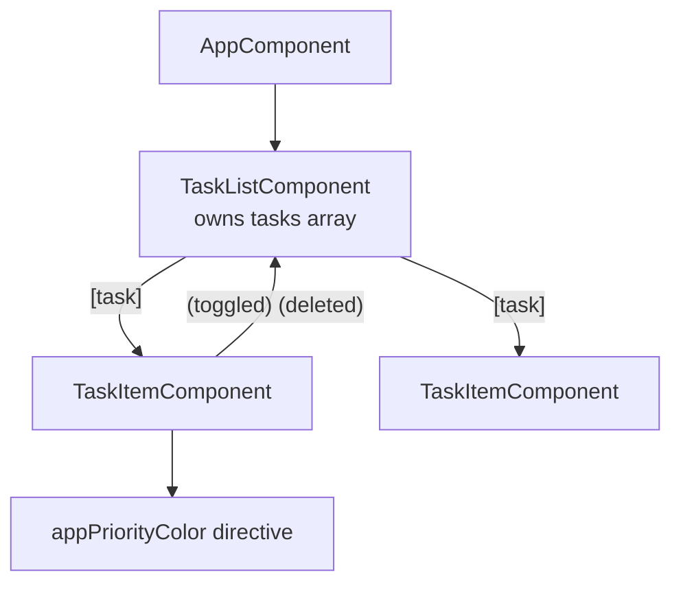

# Session 05: Lab and Review: Interaction and Directives

> Module: Building Applications with TypeScript (Angular) · Term 3 (HDSE I) · ⏱ ~2 hours

A hands-on session that revises Session 4. You build a **Task Manager** in which a parent and child component communicate and a custom directive colours each task by priority.

## 🎯 Learning Objectives

- Keep shared types in a separate `*.model.ts` file
- Pass objects to a child with a required `@Input`
- Emit several different events from a child
- Write an attribute directive that reacts to input changes (`ngOnChanges`)
- Use `@for` with `track` and `@empty`, and template reference variables

## 📖 Concepts Explained

### 1. The plan



**Rule of thumb:** data lives in **one** place (the parent). Children only *display* data and *report* user actions. This is called "smart parent, dumb child" (or container and presentational components).

### 2. Literal union types

`priority: 'low' | 'medium' | 'high'` lets only those three strings in. It is lighter than an `enum` and very common in Angular code.

### 3. Required inputs

`@Input({ required: true })` makes Angular show a compile error if the parent forgets to pass the value. The `!` in `task!: Task` tells TypeScript "this will be set by Angular, trust me".

### 4. Template reference variables

`#titleBox` gives a name to an element inside the template. You can read `titleBox.value` directly in an event binding without any extra code in the class.

### 5. Immutable updates

`this.tasks = [...this.tasks, newTask]` creates a **new array** instead of changing the old one. Angular (and later, signals and `OnPush` components) detect new references easily, so it is a good habit.

### 6. Revision table: directives

| You want to… | Use |
|---|---|
| Show/hide | `@if` |
| Repeat | `@for` (+ `@empty`) |
| Choose one of many | `@switch` |
| Toggle classes | `[class.x]` or `[ngClass]` |
| Custom look/behaviour | your own `@Directive` |

## 💻 Code Examples

Create `ng new task-lab`, copy all files into `src/app/` and run `ng serve -o`.

### Example 1: Model

📄 File: [`task.model.ts`](task.model.ts)

```typescript
// task.model.ts - the shape of one task (an interface in its own file)
export interface Task {
  id: number;
  title: string;
  priority: 'low' | 'medium' | 'high'; // only these three words are allowed
  done: boolean;
}
```

### Example 2: Child component

📄 File: [`task-item.component.ts`](task-item.component.ts)

```typescript
// task-item.component.ts - CHILD: shows one task
import { Component, EventEmitter, Input, Output } from '@angular/core';
import { Task } from './task.model';
import { PriorityColorDirective } from './priority-color.directive';

@Component({
  selector: 'app-task-item',
  standalone: true,
  imports: [PriorityColorDirective],
  template: `
    <li [class.done]="task.done">
      <input type="checkbox" [checked]="task.done" (change)="toggled.emit(task.id)" />
      <span [appPriorityColor]="task.priority">{{ task.title }}</span>
      <button (click)="deleted.emit(task.id)">✕</button>
    </li>
  `,
  styles: [`.done span { text-decoration: line-through; opacity: 0.6; }`],
})
export class TaskItemComponent {
  // "required: true" means the parent MUST give a task
  @Input({ required: true }) task!: Task;

  @Output() toggled = new EventEmitter<number>();
  @Output() deleted = new EventEmitter<number>();
}
```

**How it works:** the child never changes the task itself; it emits the task's `id`. The checkbox uses `(change)` and the delete button uses `(click)`.

### Example 3: Directive

📄 File: [`priority-color.directive.ts`](priority-color.directive.ts)

```typescript
// priority-color.directive.ts - colours text based on priority
import { Directive, ElementRef, Input, OnChanges } from '@angular/core';

@Directive({
  selector: '[appPriorityColor]',
  standalone: true,
})
export class PriorityColorDirective implements OnChanges {
  @Input() appPriorityColor = 'low';

  constructor(private element: ElementRef<HTMLElement>) {}

  // Runs every time the input value changes
  ngOnChanges(): void {
    let color = 'green';
    if (this.appPriorityColor === 'medium') {
      color = 'orange';
    } else if (this.appPriorityColor === 'high') {
      color = 'red';
    }
    this.element.nativeElement.style.color = color;
  }
}
```

**How it works:** `ngOnChanges` runs whenever `appPriorityColor` gets a new value, so the colour stays correct.

### Example 4: Parent component

📄 File: [`task-list.component.ts`](task-list.component.ts) – holds the `tasks` array, adds a task from the two template reference variables, toggles and deletes by `id`, and shows the remaining count with a getter. [`app.component.ts`](app.component.ts) simply displays it.

## 🧪 Lab Practice

1. Run the app and add three tasks with different priorities.
2. Add a "Clear completed" button to the parent that removes all done tasks.
3. Add a counter for high-priority tasks under the list.
4. Make the directive also make high-priority text **bold**.
5. Add an `@Output() edited` to the child: double-clicking the title asks `prompt('New title')` and emits the new title with the id.

## 📝 Assignment

Build a **Contact Book**: interface `Contact` (id, name, phone, `group: 'family' | 'friends' | 'work'`). A parent lists contacts with `@for`, a child shows each contact with a "Call" button (emit the phone number; the parent shows it in an alert) and a custom `appGroupBadge` directive that sets a background colour per group.

## ❓ Quick Quiz

1. Why keep the tasks array in the parent and not the child?
2. What does `@empty` do?
3. What does `required: true` add to an `@Input`?
4. Which lifecycle hook runs when a directive's input changes?
5. Why use `[...array, item]` instead of `push`?

<details><summary>Answers</summary>

1. One source of truth; children stay simple and reusable.
2. Shows its content when the `@for` list has no items.
3. A compile-time error if the parent does not bind that input.
4. `ngOnChanges`.
5. It creates a new array reference, which makes change detection simple and predictable.

</details>

## 💼 Interview Questions

1. **What are container and presentational components?** Containers own data and logic; presentational components receive inputs and emit outputs only.
2. **Why is `track` important in `@for`?** It lets Angular reuse DOM elements for items with the same identity, which improves performance and keeps input focus.
3. **When would you write a custom directive instead of a component?** When you want to add behaviour or styling to existing elements without a new template.

## ✅ Summary

- Put shared types in model files and import them.
- Parents own data; children receive `@Input` and emit `@Output`.
- Directives can react to input changes with `ngOnChanges`.
- `@for` + `track` + `@empty` handle lists cleanly.

---

[⬅ Previous](../Session-04-TypeScript-Features-Interaction-and-Directives/README.md) · [🏠 Module Home](../README.md) · [Next ➡](../Session-06-Dependency-Injection-Observables-and-HTTP/README.md)

Prepared by Zeeshan Abbas · Aptech Learning North Nazimabad
