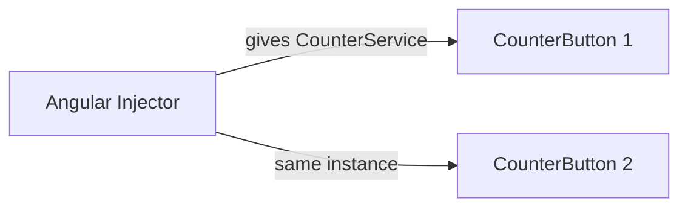
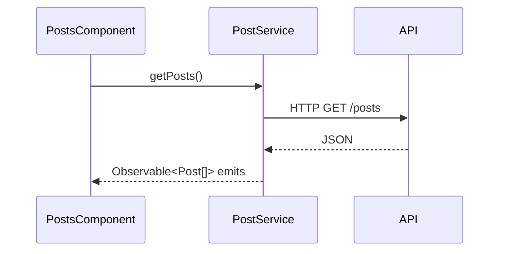

# Session 06: Dependency Injection, Observables and HTTP

> Module: Building Applications with TypeScript (Angular) · Term 3 (HDSE I) · ⏱ ~2 hours

Real apps keep data and logic out of components. This session introduces **services**, **Dependency Injection (DI)**, **Observables** from RxJS, and loading data from a web API with **HttpClient**.

## 🎯 Learning Objectives

- Explain Dependency Injection and why it makes code easier to test
- Create a service with `@Injectable` and inject it (constructor or `inject()`)
- Distinguish provider levels: root, component and app config
- Compare Observables with Promises and use basic RxJS operators
- Make GET and POST requests with `HttpClient` and handle errors

## 📖 Concepts Explained

### 1. Services and Dependency Injection

A **service** is a class for work that is not about the screen: fetching data, calculations, logging. **Dependency Injection** means a component does not create the service with `new`; it *asks* for it and Angular supplies it.

Analogy: in a restaurant you do not go into the kitchen to cook; you ask the waiter and the meal is delivered. Angular's **injector** is the waiter.



Benefits: one shared copy of data, less duplicated code, and easy testing (you can inject a fake service).

Two ways to inject:

| Style | Code |
|---|---|
| Constructor | `constructor(private counter: CounterService) {}` |
| `inject()` function (modern) | `counter = inject(CounterService);` |

### 2. Provider levels

| Where you provide | Result |
|---|---|
| `@Injectable({ providedIn: 'root' })` | One instance for the whole app (most common) |
| `providers: [...]` in `app.config.ts` | App-wide, used for things like `provideHttpClient()` |
| `providers: [...]` in a `@Component` | A new instance for each copy of that component and its children |

### 3. Observables vs Promises

| | Promise | Observable |
|---|---|---|
| Values | exactly one | zero, one or many over time |
| Starts | immediately | only when you `subscribe()` (lazy) |
| Cancel | not possible | `unsubscribe()` |
| Operators | `then` | `map`, `filter`, `take`, `switchMap`... via `pipe()` |

Angular's `HttpClient`, router events and form value changes all return Observables.

### 4. HttpClient

1. Add `provideHttpClient()` in `app.config.ts`.
2. Inject `HttpClient` in a service.
3. Call `get<Type>(url)`, `post<Type>(url, body)`, `put`, `delete`.
4. In the component, `subscribe` with `next` and `error` handlers.



## 💻 Code Examples

Copy the Angular files into `src/app/` of a new project (replace `app.config.ts`). The API used is the free test server https://jsonplaceholder.typicode.com.

### Example 1: Root service shared by two components

📄 File: [`counter.service.ts`](counter.service.ts)

```typescript
// counter.service.ts - a service shared by the whole app
import { Injectable } from '@angular/core';

@Injectable({
  providedIn: 'root', // ONE instance for the whole app (a singleton)
})
export class CounterService {
  count = 0;

  increase(): void {
    this.count = this.count + 1;
  }
}
```

📄 Component: [`counter-button.component.ts`](counter-button.component.ts) injects it in the constructor. Click either button: both show the **same** count.

### Example 2: Component-level provider

📄 Files: [`logger.service.ts`](logger.service.ts) and [`logger-panel.component.ts`](logger-panel.component.ts). Because the panel lists `providers: [LoggerService]`, each panel keeps its **own** messages.

### Example 3: Observable basics (plain TypeScript)

📄 File: [`observable-basics.ts`](observable-basics.ts)

```typescript
// observable-basics.ts - Observables with RxJS (run: npm i rxjs && npx tsx observable-basics.ts)
import { of, interval, map, filter, take } from "rxjs";

// 1. "of" emits a few values, then completes
of(10, 20, 30).subscribe({
  next: (value) => console.log("of ->", value),
  complete: () => console.log("of -> done"),
});

// 2. Operators change the stream: keep even numbers, then double them
of(1, 2, 3, 4, 5, 6)
  .pipe(
    filter((n) => n % 2 === 0), // 2, 4, 6
    map((n) => n * 10)          // 20, 40, 60
  )
  .subscribe((n) => console.log("pipe ->", n));

// 3. interval emits 0, 1, 2 ... every second; take(3) stops after 3 values
interval(1000)
  .pipe(take(3))
  .subscribe((tick) => console.log("tick", tick));
```

**How it works:** `of` emits fixed values, `pipe` chains operators, `take(3)` stops the endless `interval`.

### Example 4: HTTP service

📄 File: [`post.service.ts`](post.service.ts)

```typescript
// post.service.ts - all HTTP calls for posts live here
import { Injectable, inject } from '@angular/core';
import { HttpClient } from '@angular/common/http';
import { Observable } from 'rxjs';
import { Post } from './post.model';

@Injectable({ providedIn: 'root' })
export class PostService {
  private http = inject(HttpClient);
  private apiUrl = 'https://jsonplaceholder.typicode.com/posts';

  // GET: returns an Observable that will deliver an array of posts
  getPosts(): Observable<Post[]> {
    return this.http.get<Post[]>(this.apiUrl + '?_limit=5');
  }

  // POST: send a new post to the server
  addPost(title: string): Observable<Post> {
    const newPost = { title: title, body: 'Created from Angular', userId: 1 };
    return this.http.post<Post>(this.apiUrl, newPost);
  }
}
```

### Example 5: Component using the service

📄 File: [`posts.component.ts`](posts.component.ts) – subscribes in `ngOnInit`, sets `loading` and `errorMessage`, and uses `@if / @else if / @else` for the three states. Also see [`post.model.ts`](post.model.ts), [`app.config.ts`](app.config.ts) and [`app.component.ts`](app.component.ts).

## 🧪 Lab Practice

1. Run the app and confirm both counter buttons share one count, while the two logger panels do not.
2. Turn off Wi-Fi and refresh: the error message should appear.
3. Add `getPost(id: number)` to `PostService` and show post 1's body in a new component.
4. In `observable-basics.ts`, use `map` to turn numbers into strings like `"Item 2"`.
5. Add a `deletePost(id)` method that calls `http.delete` and removes the post from the list on success.

## 📝 Assignment

Create a `UserService` that loads users from `https://jsonplaceholder.typicode.com/users`. Show name, email and city in a `users` component with loading and error states. Add a `FavouriteService` (provided in root) that stores favourite user ids, and a "★" button on each row.

## ❓ Quick Quiz

1. Which decorator marks a class as injectable?
2. What does `providedIn: 'root'` mean?
3. Will an HTTP request run if you never subscribe?
4. Name two differences between a Promise and an Observable.
5. Where do you register `provideHttpClient()`?

<details><summary>Answers</summary>

1. `@Injectable`.
2. One shared instance for the whole application.
3. No, Observables are lazy.
4. Observables can emit many values and can be cancelled; Promises give one value and start immediately.
5. In the `providers` array of `app.config.ts`.

</details>

## 💼 Interview Questions

1. **What is Dependency Injection?** A design pattern where a class receives its dependencies from outside instead of creating them, which reduces coupling and helps testing.
2. **How do you avoid memory leaks with Observables?** Unsubscribe in `ngOnDestroy`, use `take`/`takeUntilDestroyed()`, or let the `async` pipe manage the subscription. (HTTP observables complete by themselves.)
3. **Why put HTTP calls in a service and not the component?** Reuse, single responsibility, easier testing and one place to change URLs or headers.

## ✅ Summary

- Services hold reusable logic; DI delivers them to components.
- Provider level decides whether an instance is shared or separate.
- Observables are lazy streams; operators in `pipe()` transform them.
- `HttpClient` (enabled with `provideHttpClient()`) returns Observables for GET, POST, PUT and DELETE.

---

[⬅ Previous](../Session-05-Lab-Review-Interaction-and-Directives/README.md) · [🏠 Module Home](../README.md) · [Next ➡](../Session-07-Lab-Review-Services-and-HTTP/README.md)

Prepared by Zeeshan Abbas · Aptech Learning North Nazimabad
