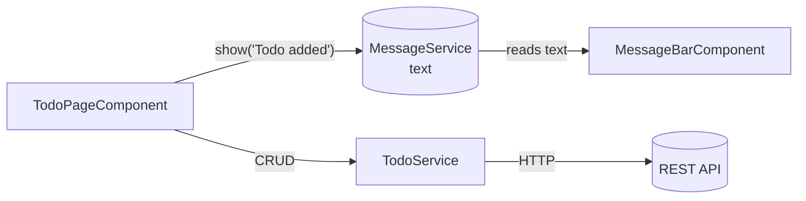

# Session 07: Lab and Review: Services and HTTP

> Module: Building Applications with TypeScript (Angular) · Term 3 (HDSE I) · ⏱ ~2 hours

A practice session on services and HTTP. You build a **Todo app** that performs all four CRUD operations against a REST API, plus a shared **MessageService** that any component can use to show notices.

## 🎯 Learning Objectives

- Map CRUD operations to HTTP methods
- Write a service with GET, POST, PATCH and DELETE calls
- Handle errors with `retry` and `catchError`
- Share state between unrelated components through a root service
- Keep components thin: they call services and update the view

## 📖 Concepts Explained

### 1. CRUD and HTTP

| Operation | HTTP method | HttpClient call | Example URL |
|---|---|---|---|
| Create | POST | `http.post(url, body)` | `/todos` |
| Read | GET | `http.get(url)` | `/todos`, `/todos/5` |
| Update (part) | PATCH | `http.patch(url, changes)` | `/todos/5` |
| Update (whole) | PUT | `http.put(url, body)` | `/todos/5` |
| Delete | DELETE | `http.delete(url)` | `/todos/5` |

> jsonplaceholder is a *fake* API: it replies as if it saved your data but does not really store it. That is why we update the local array ourselves after each call.

### 2. Error handling with RxJS

- `retry(1)` – try the request one more time if it fails.
- `catchError(() => of([]))` – if it still fails, replace the error with a safe value (an empty array) so the app keeps working.
- Or handle it in the component with `subscribe({ next, error })` as in Session 6.

### 3. Sharing state through a service

`MessageBarComponent` and `TodoPageComponent` are siblings and know nothing about each other. Both inject the **same** root `MessageService`, so when the page calls `show()`, the bar displays the text.



### 4. Layers checklist

| Layer | Job | File |
|---|---|---|
| Model | Shape of data | `todo.model.ts` |
| Service | Talk to the server | `todo.service.ts` |
| Component | Show data, react to clicks | `todo-page.component.ts` |

## 💻 Code Examples

Copy all files into `src/app/` of a new project and run `ng serve -o`.

### Example 1: The data service

📄 File: [`todo.service.ts`](todo.service.ts)

```typescript
// todo.service.ts - CRUD calls to a fake REST API
import { Injectable, inject } from '@angular/core';
import { HttpClient } from '@angular/common/http';
import { Observable, catchError, of, retry } from 'rxjs';
import { Todo } from './todo.model';

@Injectable({ providedIn: 'root' })
export class TodoService {
  private http = inject(HttpClient);
  private url = 'https://jsonplaceholder.typicode.com/todos';

  // READ: first 6 todos; retry once, and return [] if it still fails
  getTodos(): Observable<Todo[]> {
    return this.http.get<Todo[]>(this.url + '?_limit=6').pipe(
      retry(1),
      catchError(() => of([]))
    );
  }

  // CREATE
  addTodo(title: string): Observable<Todo> {
    return this.http.post<Todo>(this.url, { title: title, completed: false });
  }

  // UPDATE (PATCH changes only the fields we send)
  setCompleted(id: number, completed: boolean): Observable<Todo> {
    return this.http.patch<Todo>(`${this.url}/${id}`, { completed: completed });
  }

  // DELETE
  deleteTodo(id: number): Observable<unknown> {
    return this.http.delete(`${this.url}/${id}`);
  }
}
```

**How it works:** each method returns an Observable and does nothing until a component subscribes. `getTodos` adds `retry` and `catchError` with `pipe`.

### Example 2: The shared message service

📄 File: [`message.service.ts`](message.service.ts)

```typescript
// message.service.ts - one place to show notices from anywhere in the app
import { Injectable } from '@angular/core';

@Injectable({ providedIn: 'root' })
export class MessageService {
  text = '';

  show(message: string): void {
    this.text = message;
    // clear the message after 3 seconds
    setTimeout(() => (this.text = ''), 3000);
  }
}
```

### Example 3: The page component

📄 File: [`todo-page.component.ts`](todo-page.component.ts) – loads todos in `ngOnInit`, and for add, toggle and delete it calls the service, then updates `todos` and calls `messages.show(...)`.

Other files: [`todo.model.ts`](todo.model.ts), [`message-bar.component.ts`](message-bar.component.ts), [`app.config.ts`](app.config.ts), [`app.component.ts`](app.component.ts).

## 🧪 Lab Practice

1. Run the app, then open DevTools → **Network** and watch the GET, POST, PATCH and DELETE requests.
2. Change the URL to a wrong one (e.g. `/todoss`) and confirm the list is empty but the app does not crash.
3. Show a red message through `MessageService` when loading fails (hint: add a `type` property).
4. Add a "Show completed only" checkbox that filters the list in the component.
5. Count completed todos in a getter and show "3/6 done".

## 📝 Assignment

Build a **Comments Viewer** using `https://jsonplaceholder.typicode.com/comments?postId=1`. Create `Comment` model, `CommentService` (get + post), and a component listing name, email and body. Add a form-less "Add comment" area using template reference variables. Use `MessageService` for success and error notices.

## ❓ Quick Quiz

1. Which HTTP method updates only some fields?
2. What does `catchError` return?
3. Why does the new todo always get id 201 from jsonplaceholder?
4. How can two sibling components share data without inputs/outputs?
5. Where should HTTP URLs be written: component or service?

<details><summary>Answers</summary>

1. PATCH.
2. A replacement Observable (for example `of([])`).
3. It is a fake API that does not really save data; it always answers with the next id.
4. By injecting the same root-provided service.
5. In the service.

</details>

## 💼 Interview Questions

1. **PUT vs PATCH?** PUT replaces the whole resource; PATCH changes only the fields you send.
2. **How do you handle HTTP errors globally in Angular?** With an HTTP interceptor (`withInterceptors([...])` in `provideHttpClient`) that catches errors for every request.
3. **Is a service a good place for app state?** Yes for small and medium apps; larger apps may use signals in services or a library such as NgRx.

## ✅ Summary

- CRUD maps to POST, GET, PATCH/PUT and DELETE.
- Keep HTTP code in services; components subscribe and update the view.
- `retry` and `catchError` make requests robust.
- A root service can share state between any components.

---

[⬅ Previous](../Session-06-Dependency-Injection-Observables-and-HTTP/README.md) · [🏠 Module Home](../README.md) · [Next ➡](../Session-08-Pipes-and-Forms/README.md)

Prepared by Zeeshan Abbas · Aptech Learning North Nazimabad
