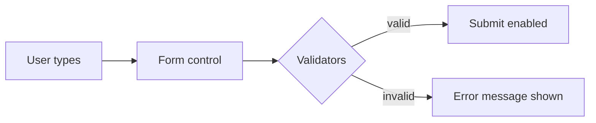

# Session 08: Pipes and Forms

> Module: Building Applications with TypeScript (Angular) · Term 3 (HDSE I) · ⏱ ~2 hours

**Pipes** format data for display, and **forms** collect data from users. Angular offers two styles of forms: template-driven and reactive. You will build one of each.

## 🎯 Learning Objectives

- Use built-in pipes (`uppercase`, `date`, `currency`, `number`, `percent`, `slice`, `json`, `async`)
- Pass parameters to pipes and chain them
- Create a custom pipe
- Build a template-driven form with `ngModel` and validation messages
- Build a reactive form with `FormBuilder` and `Validators`
- Choose between the two form styles

## 📖 Concepts Explained

### 1. Pipes

A pipe takes a value and returns a nicer version **for display only**; the original data does not change.

```
{{ value | pipeName : parameter1 : parameter2 }}
{{ today | date:'dd MMM yyyy' | uppercase }}   ← chained pipes
```

| Pipe | Input | Output |
|---|---|---|
| `uppercase` / `lowercase` / `titlecase` | `'karachi'` | `KARACHI` |
| `date:'dd/MM/yyyy'` | `Date` | `24/10/2026` |
| `currency:'PKR'` | `25000` | `PKR 25,000.00` |
| `number:'1.2-2'` | `3.14159` | `3.14` (min 1 digit, 2–2 decimals) |
| `percent` | `0.87` | `87%` |
| `slice:0:2` | array/string | first two items |
| `json` | object | JSON text (great for debugging) |
| `async` | Observable/Promise | latest value; subscribes and unsubscribes for you |

Each pipe must be added to the component's `imports`. A **custom pipe** is a class with `@Pipe` and a `transform()` method.

### 2. Template-driven forms

- Import `FormsModule`.
- Bind fields with **two-way binding** `[(ngModel)]` (the "banana in a box").
- Add HTML rules: `required`, `minlength`, `email`, `pattern`.
- Read state with reference variables: `#nameCtrl="ngModel"`, `#regForm="ngForm"`.

### 3. Reactive forms

- Import `ReactiveFormsModule`.
- Create the form **in the class** with `FormBuilder` (`group`, `control`) and `Validators`.
- Connect HTML with `[formGroup]` and `formControlName`.

### 4. Control states

| State | Meaning |
|---|---|
| `valid` / `invalid` | rules pass / fail |
| `touched` / `untouched` | user has / has not left the field |
| `dirty` / `pristine` | value changed / not changed |

Show errors only when `invalid && touched`, so users are not shouted at before typing.

### 5. Which style?

| | Template-driven | Reactive |
|---|---|---|
| Setup | `FormsModule`, `ngModel` | `ReactiveFormsModule`, `FormGroup` |
| Logic lives in | HTML | TypeScript class |
| Best for | small, simple forms | large, dynamic forms, complex validation |
| Testing | harder | easy (pure TypeScript) |



## 💻 Code Examples

Copy all files into `src/app/` and run `ng serve -o`.

### Example 1: Built-in pipes

📄 File: [`pipes-demo.component.ts`](pipes-demo.component.ts) – each line of the template shows one pipe with its expected output in a comment.

### Example 2: Custom pipe

📄 File: [`initials.pipe.ts`](initials.pipe.ts)

```typescript
// initials.pipe.ts - a custom pipe: "zeeshan abbas" -> "ZA"
import { Pipe, PipeTransform } from '@angular/core';

@Pipe({
  name: 'initials', // used in templates as  value | initials
  standalone: true,
})
export class InitialsPipe implements PipeTransform {
  transform(fullName: string): string {
    const words = fullName.trim().split(' ');
    let result = '';
    for (const word of words) {
      if (word.length > 0) {
        result = result + word[0].toUpperCase();
      }
    }
    return result;
  }
}
```

**How it works:** Angular calls `transform()` with the value before the `|`. Use it as `{{ 'zeeshan abbas' | initials }}` → `ZA`.

### Example 3: Template-driven form

📄 File: [`template-form.component.html`](template-form.component.html)

```html
<form #regForm="ngForm" (ngSubmit)="onSubmit()">
  <input name="name" [(ngModel)]="student.name" #nameCtrl="ngModel" required minlength="3" />
  @if (nameCtrl.invalid && nameCtrl.touched) {
    <small class="error">Name is required (at least 3 letters).</small>
  }
  <button type="submit" [disabled]="regForm.invalid">Register</button>
</form>
```

**How it works:** `[(ngModel)]` keeps `student.name` and the input in sync. `#nameCtrl="ngModel"` lets us check `invalid` and `touched`. The class is in [`template-form.component.ts`](template-form.component.ts).

### Example 4: Reactive form

📄 File: [`reactive-form.component.ts`](reactive-form.component.ts)

```typescript
// reactive-form.component.ts - a REACTIVE form (logic lives in the class)
import { Component, inject } from '@angular/core';
import { ReactiveFormsModule, FormBuilder, Validators } from '@angular/forms';

@Component({
  selector: 'app-reactive-form',
  standalone: true,
  imports: [ReactiveFormsModule],
  template: `
    <h2>Login (reactive)</h2>
    <form [formGroup]="loginForm" (ngSubmit)="login()">
      <input formControlName="email" placeholder="Email" />
      @if (loginForm.controls.email.invalid && loginForm.controls.email.touched) {
        <small class="error">Valid email required.</small>
      }

      <input formControlName="password" type="password" placeholder="Password" />
      @if (loginForm.controls.password.hasError('minlength')) {
        <small class="error">Password must be at least 6 characters.</small>
      }

      <button type="submit" [disabled]="loginForm.invalid">Login</button>
    </form>
    <p>Form value: {{ loginForm.value.email }}</p>
  `,
})
export class ReactiveFormComponent {
  private fb = inject(FormBuilder);

  // Build the form in code: field name -> [starting value, rules]
  loginForm = this.fb.nonNullable.group({
    email: ['', [Validators.required, Validators.email]],
    password: ['', [Validators.required, Validators.minLength(6)]],
  });

  login(): void {
    console.log('Logging in with', this.loginForm.getRawValue());
    this.loginForm.reset();
  }
}
```

**How it works:** the rules are defined in TypeScript. `nonNullable` means `reset()` returns fields to `''` instead of `null`. [`app.component.ts`](app.component.ts) shows all three demos.

## 🧪 Lab Practice

1. Show today's date in three formats: `shortDate`, `fullDate` and `'EEEE, h:mm a'`.
2. Write a `truncate` pipe: `{{ text | truncate:20 }}` cuts text to 20 characters and adds `...`.
3. Add a **phone** field to the template form with `pattern="03[0-9]{9}"` and a message.
4. Add a `confirmPassword` field to the reactive form and show a message when it does not match.
5. Log `loginForm.valueChanges` to the console with `subscribe` and watch it while typing.

## 📝 Assignment

Create a **Fee Voucher** page: a reactive form with student name (required), course (select), monthly fee (number, min 1000) and due date. When submitted, display a voucher card that uses `titlecase`, `currency:'PKR'`, `date:'longDate'` and a custom `voucherNo` pipe that turns the date and name into a code like `ZA-20261024`.

## ❓ Quick Quiz

1. Does a pipe change the original data?
2. Which pipe subscribes to an Observable for you?
3. Which module provides `ngModel`?
4. Which two directives connect HTML to a reactive form?
5. When should you show a validation error?

<details><summary>Answers</summary>

1. No, it only changes what is displayed.
2. `async`.
3. `FormsModule`.
4. `[formGroup]` and `formControlName`.
5. When the control is invalid **and** touched (or after submit).

</details>

## 💼 Interview Questions

1. **Pure vs impure pipes?** A pure pipe (default) runs only when its input reference changes; an impure pipe runs on every change detection, which can be slow.
2. **Template-driven vs reactive forms?** Template-driven puts logic in HTML with `ngModel`; reactive builds an explicit, testable form model in TypeScript.
3. **How do you write a custom validator?** A function that receives an `AbstractControl` and returns `null` when valid or an error object like `{ weak: true }`.

## ✅ Summary

- Pipes format values in templates; parameters follow `:`; pipes can be chained.
- Custom pipes implement `PipeTransform.transform()`.
- Template-driven forms use `ngModel`; reactive forms use `FormBuilder` and `Validators`.
- Use `invalid && touched` to show friendly error messages.

---

[⬅ Previous](../Session-07-Lab-Review-Services-and-HTTP/README.md) · [🏠 Module Home](../README.md) · [Next ➡](../Session-09-Lab-Review-Pipes-and-Forms/README.md)

Prepared by Zeeshan Abbas · Aptech Learning North Nazimabad
