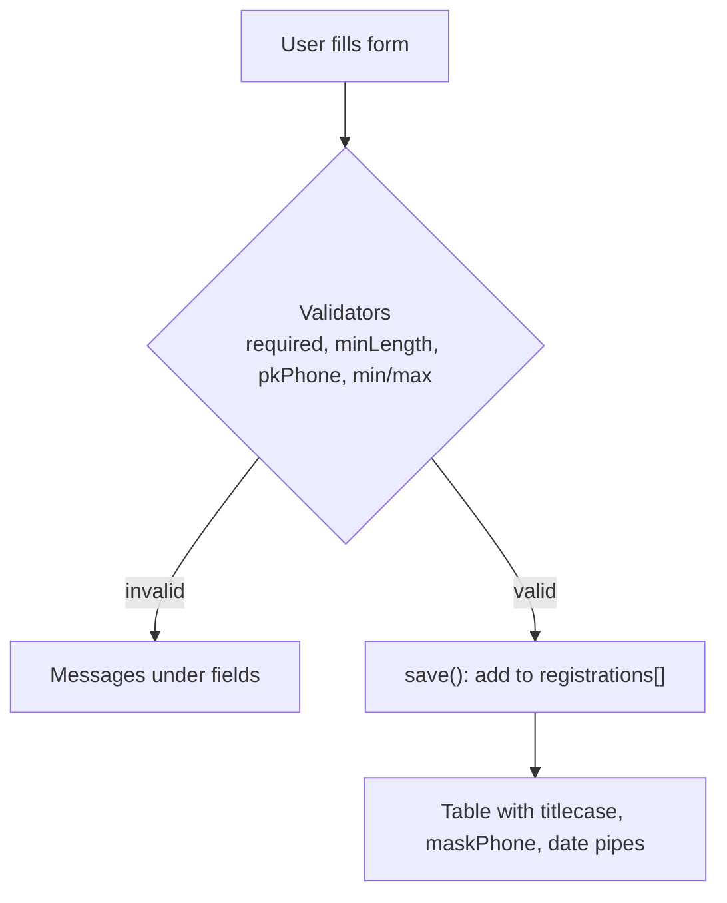

# Session 09: Lab and Review: Pipes and Forms

> Module: Building Applications with TypeScript (Angular) · Term 3 (HDSE I) · ⏱ ~2 hours

Practice for Session 8. You build a **Workshop Registration** page with a reactive form, a custom validator, a custom pipe and a results table formatted with built-in pipes.

## 🎯 Learning Objectives

- Revise built-in pipes and parameters
- Write a custom validator function
- Use `hasError`, `markAllAsTouched` and `reset`
- Create a custom pipe that masks private data
- Combine a form and a formatted table on one page

## 📖 Concepts Explained

### 1. Custom validators

A validator is just a **function**: it receives the control and returns

- `null` → the value is fine, or
- an **error object** such as `{ pkPhone: true }` → the value is wrong.

In the template, `control.hasError('pkPhone')` checks for that exact error key. Leaving an empty value to `Validators.required` keeps each validator focused on one rule.

### 2. Useful form methods

| Method | What it does |
|---|---|
| `form.invalid` / `form.valid` | overall status |
| `form.getRawValue()` | all values (typed) |
| `form.reset()` | back to the starting values |
| `form.markAllAsTouched()` | show all errors (e.g. on submit) |
| `control.hasError('key')` | check one specific rule |
| `form.patchValue({...})` | fill some fields from code |

### 3. Data flow on this page



### 4. Pipes revision

| Need | Pipe |
|---|---|
| Money with no decimals | `currency:'PKR':'symbol':'1.0-0'` |
| Nice names | `titlecase` |
| Short date-time | `date:'short'` |
| Hide sensitive text | custom `maskPhone` |

> Pipes in templates are a safe way to protect privacy on screen, but remember the full value still exists in memory. Real masking of sensitive data should also happen on the server.

## 💻 Code Examples

Copy the files into `src/app/` and run `ng serve -o`.

### Example 1: Custom validator

📄 File: [`phone.validator.ts`](phone.validator.ts)

```typescript
// phone.validator.ts - a CUSTOM validator: Pakistani mobile numbers like 03001234567
import { AbstractControl, ValidationErrors } from '@angular/forms';

export function pkPhoneValidator(control: AbstractControl): ValidationErrors | null {
  const value: string = control.value ?? '';
  const pattern = /^03[0-9]{9}$/; // starts with 03, then 9 more digits

  if (value === '' || pattern.test(value)) {
    return null;              // null means "no error"
  }
  return { pkPhone: true };   // an object means "error"
}
```

**How it works:** the regular expression `^03[0-9]{9}$` means "starts with 03 followed by exactly 9 digits".

### Example 2: Custom pipe

📄 File: [`mask-phone.pipe.ts`](mask-phone.pipe.ts)

```typescript
// mask-phone.pipe.ts - hides the middle digits: 03001234567 -> 0300****567
import { Pipe, PipeTransform } from '@angular/core';

@Pipe({ name: 'maskPhone', standalone: true })
export class MaskPhonePipe implements PipeTransform {
  transform(phone: string): string {
    if (phone.length < 7) {
      return phone;
    }
    const start = phone.slice(0, 4);   // first 4 digits
    const end = phone.slice(-3);       // last 3 digits
    return start + '****' + end;
  }
}
```

### Example 3: The form component

📄 Files: [`registration-form.component.ts`](registration-form.component.ts), [`registration-form.component.html`](registration-form.component.html), [`registration.model.ts`](registration.model.ts), [`app.component.ts`](app.component.ts).

Key lines:

```typescript
phone: ['', [Validators.required, pkPhoneValidator]],   // built-in + custom rule
seats: [1, [Validators.required, Validators.min(1), Validators.max(5)]],
```

**How it works:** `get f()` shortens `form.controls.name` to `f.name` in the template. On submit, invalid forms show all errors; valid ones are added to the top of the `registrations` list and the form resets.

## 🧪 Lab Practice

1. Try phone numbers `0300123`, `03001234567` and `04001234567`; which pass?
2. Add an **email** field with `Validators.email`.
3. Write `noNumbersValidator` that rejects names containing digits.
4. Add a "Delete" button to each table row.
5. Show the grand total of all seats sold using `currency` under the table.

## 📝 Assignment

Create a **Library Book Issue** form: member ID (custom validator: `LIB-` followed by 4 digits), book title, issue date and return date. Show issued books in a table with `date:'mediumDate'` and a custom `daysLeft` pipe that shows how many days remain until the return date (or "Overdue").

## ❓ Quick Quiz

1. What should a validator return when the value is valid?
2. How do you check a specific error in the template?
3. Which method shows all validation errors at once?
4. Write the currency pipe for PKR with no decimals.
5. Is masking in a pipe enough to protect private data?

<details><summary>Answers</summary>

1. `null`.
2. `control.hasError('errorKey')`.
3. `markAllAsTouched()`.
4. `{{ amount | currency:'PKR':'symbol':'1.0-0' }}`
5. No, it only hides it on screen; the server must protect the real data.

</details>

## 💼 Interview Questions

1. **Sync vs async validators?** Sync validators return a result immediately; async validators return an Observable/Promise (for example, checking if a username exists on the server).
2. **What is a cross-field validator?** A validator on the `FormGroup` that compares fields, such as password and confirm password.
3. **Why prefer pipes over methods in templates for formatting?** Pure pipes are cached and only rerun when input changes, while method calls run on every change detection.

## ✅ Summary

- Custom validators return `null` or an error object.
- `hasError`, `markAllAsTouched` and `reset` give full control of form UX.
- Custom pipes keep formatting logic reusable and templates clean.

---

[⬅ Previous](../Session-08-Pipes-and-Forms/README.md) · [🏠 Module Home](../README.md) · [Next ➡](../Session-10-Routing-and-Route-Guards/README.md)

Prepared by Zeeshan Abbas · Aptech Learning North Nazimabad
