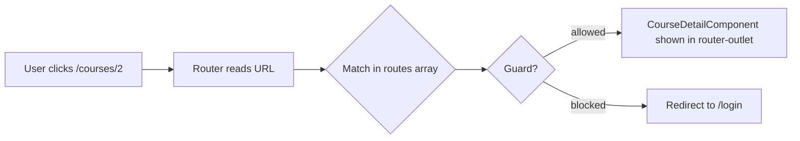

# Session 10: Routing and Route Guards

> Module: Building Applications with TypeScript (Angular) · Term 3 (HDSE I) · ⏱ ~2 hours

The **router** turns one Angular page into a multi-page experience: the URL changes, the right component appears, and the browser never reloads. Route **guards** decide who may open a route.

## 🎯 Learning Objectives

- Define routes and display them with `<router-outlet>`
- Navigate with `routerLink`, `routerLinkActive` and `Router.navigate()`
- Read route parameters such as `/courses/:id`
- Create nested (child) routes with a second outlet
- Protect routes with a functional `CanActivate` guard
- Handle unknown URLs with a wildcard route

## 📖 Concepts Explained

### 1. How routing works



| Piece | Job |
|---|---|
| `Routes` array | maps a `path` to a `component` |
| `provideRouter(routes)` | turns routing on (in `app.config.ts`) |
| `<router-outlet />` | the placeholder where the page appears |
| `routerLink="/courses"` | link that navigates without reload |
| `routerLinkActive="active"` | adds a CSS class to the current link |
| `router.navigate([...])` | navigate from TypeScript code |

### 2. Route parameters

`{ path: 'courses/:id', ... }` matches `/courses/1`, `/courses/abc` and so on. Read the value:

- **Easiest (Angular 16+):** add `withComponentInputBinding()` and an `@Input() id` in the component.
- **Classic:** inject `ActivatedRoute` and read `route.snapshot.paramMap.get('id')`.

Query parameters (`/courses?level=beginner`) work the same way with `@Input() level` or `queryParamMap`.

### 3. Nested routes

A parent route can have `children`. The parent component contains its **own** `<router-outlet />`, so `/admin/settings` shows `AdminComponent` *and*, inside it, `AdminSettingsComponent`.

### 4. Special routes

| Route | Meaning |
|---|---|
| `{ path: '', component: Home }` | the start page |
| `{ path: '', redirectTo: 'dashboard', pathMatch: 'full' }` | redirect |
| `{ path: '**', component: NotFound }` | anything else (must be last) |
| `title: 'Courses'` | sets the browser tab title |

### 5. Route guards (authentication and authorization)

**Authentication** asks *who are you?* (login). **Authorization** asks *are you allowed here?* (roles). A guard is a function the router runs before entering a route:

| Guard | Runs when |
|---|---|
| `canActivate` | entering a route |
| `canActivateChild` | entering child routes |
| `canDeactivate` | leaving a route (e.g. unsaved form) |
| `canMatch` | deciding if a route should match at all |

Return `true` to allow, or a `UrlTree` (from `router.createUrlTree`) to redirect.

> Guards only protect the **screen**. Real security must also be enforced by the server API.

## 💻 Code Examples

Create `ng new routing-demo`, copy every file into `src/app/` (replace `app.routes.ts`, `app.config.ts` and `app.component.ts`), run `ng serve -o`.

### Example 1: Route table

📄 File: [`app.routes.ts`](app.routes.ts)

```typescript
// app.routes.ts - the "map" of the app: URL path -> component
import { Routes } from '@angular/router';
import { HomeComponent } from './home.component';
import { CoursesComponent } from './courses.component';
import { CourseDetailComponent } from './course-detail.component';
import { LoginComponent } from './login.component';
import { AdminComponent } from './admin.component';
import { AdminDashboardComponent } from './admin-dashboard.component';
import { AdminSettingsComponent } from './admin-settings.component';
import { NotFoundComponent } from './not-found.component';
import { authGuard } from './auth.guard';

export const routes: Routes = [
  { path: '', component: HomeComponent, title: 'Home' },          // http://localhost:4200/
  { path: 'courses', component: CoursesComponent, title: 'Courses' },
  { path: 'courses/:id', component: CourseDetailComponent },      // :id is a parameter
  { path: 'login', component: LoginComponent, title: 'Login' },
  {
    path: 'admin',
    component: AdminComponent,
    canActivate: [authGuard],           // only logged-in users may enter
    children: [                         // nested routes: /admin/dashboard, /admin/settings
      { path: '', redirectTo: 'dashboard', pathMatch: 'full' },
      { path: 'dashboard', component: AdminDashboardComponent },
      { path: 'settings', component: AdminSettingsComponent },
    ],
  },
  { path: '**', component: NotFoundComponent },                   // any other URL
];
```

**How it works:** routes are checked top to bottom; the wildcard `**` must stay last. `admin` has a guard and two children.

### Example 2: The guard

📄 File: [`auth.guard.ts`](auth.guard.ts)

```typescript
// auth.guard.ts - a functional route guard
import { inject } from '@angular/core';
import { CanActivateFn, Router } from '@angular/router';
import { AuthService } from './auth.service';

export const authGuard: CanActivateFn = () => {
  const auth = inject(AuthService);
  const router = inject(Router);

  if (auth.isLoggedIn) {
    return true;                          // allow navigation
  }
  return router.createUrlTree(['/login']); // redirect to the login page
};
```

**How it works:** `inject()` gets the services. Not logged in → redirect to `/login`. Login state is in [`auth.service.ts`](auth.service.ts) and [`login.component.ts`](login.component.ts) logs in and calls `router.navigate(['/admin'])`.

### Example 3: Reading a parameter

📄 File: [`course-detail.component.ts`](course-detail.component.ts)

```typescript
// course-detail.component.ts - reads the :id from the URL
import { Component, Input } from '@angular/core';
import { RouterLink } from '@angular/router';

@Component({
  selector: 'app-course-detail',
  standalone: true,
  imports: [RouterLink],
  template: `
    <h2>Course #{{ id }}</h2>
    <p>Details for course number {{ id }} would be loaded here.</p>
    <a routerLink="/courses">⬅ Back to courses</a>
  `,
})
export class CourseDetailComponent {
  // Filled automatically from /courses/:id (thanks to withComponentInputBinding)
  @Input() id = '';
}
```

### Other files

[`app.config.ts`](app.config.ts) · [`app.component.ts`](app.component.ts) (menu + outlet) · [`home.component.ts`](home.component.ts) · [`courses.component.ts`](courses.component.ts) · [`admin.component.ts`](admin.component.ts) · [`admin-dashboard.component.ts`](admin-dashboard.component.ts) · [`admin-settings.component.ts`](admin-settings.component.ts) · [`not-found.component.ts`](not-found.component.ts)

## 🧪 Lab Practice

1. Click **Admin** before logging in: you should land on Login. Log in and try again.
2. Type `http://localhost:4200/xyz` in the address bar to see the 404 page.
3. Add an `about` route with its own component and a menu link.
4. In `CourseDetailComponent`, look up the course name from an array using the `id`.
5. Add a `canDeactivate` guard to a page with a text box that asks `confirm('Leave without saving?')` when the box is not empty.

## 📝 Assignment

Build a **Mini Shop** with routes: `/products`, `/products/:id`, `/cart`, `/checkout` (protected by a guard that requires at least one item in a `CartService`), and a wildcard 404. Highlight the current menu link with `routerLinkActive`.

## ❓ Quick Quiz

1. Where do routed components appear?
2. Why use `routerLink` instead of `href`?
3. Write a route that matches `/students/15`.
4. What should a guard return to redirect?
5. Why must `**` be the last route?

<details><summary>Answers</summary>

1. Inside `<router-outlet />`.
2. `href` reloads the whole app; `routerLink` changes the view inside the SPA.
3. `{ path: 'students/:id', component: StudentDetailComponent }`
4. A `UrlTree`, e.g. `router.createUrlTree(['/login'])`.
5. Routes are matched in order and `**` matches everything.

</details>

## 💼 Interview Questions

1. **What is lazy loading?** Loading a route's code only when it is first visited, using `loadComponent: () => import('./admin.component').then(m => m.AdminComponent)`. It makes the first load faster.
2. **`canActivate` vs `canMatch`?** `canActivate` runs after a route matches; `canMatch` decides whether the route matches at all, so another route can be tried.
3. **How do you pass data between routes?** Route/query parameters, a shared service, or `history.state` via `navigate(..., { state })`.

## ✅ Summary

- Routes map paths to components; `<router-outlet>` displays them.
- `routerLink` navigates; `:id` parameters can bind straight to `@Input`.
- Children routes need an outlet in the parent component.
- Functional guards (`CanActivateFn`) allow or redirect navigation.

---

[⬅ Previous](../Session-09-Lab-Review-Pipes-and-Forms/README.md) · [🏠 Module Home](../README.md) · [Next ➡](../Session-11-Angular-Material-and-Animations/README.md)

Prepared by Zeeshan Abbas · Aptech Learning North Nazimabad
