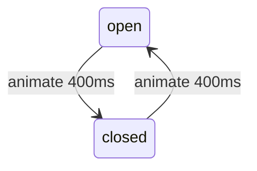

# Session 11: Angular Material and Animations

> Module: Building Applications with TypeScript (Angular) · Term 3 (HDSE I) · ⏱ ~2 hours

**Angular Material** is Google's official library of ready-made UI components that follow Material Design. **Angular animations** add smooth motion when elements change state, enter or leave.

## 🎯 Learning Objectives

- Install Angular Material with `ng add` and pick a theme
- Use Material buttons, icons, cards, form fields, select, slide toggle, snackbar and table
- Explain why a component library speeds up development and improves accessibility
- Enable animations with `provideAnimationsAsync()`
- Create state-based animations with `trigger`, `state`, `transition` and `animate`
- Animate elements entering and leaving with `:enter` and `:leave`

## 📖 Concepts Explained

### 1. Installing Angular Material

```bash
ng new material-demo        # CSS, no SSR
cd material-demo
ng add @angular/material    # choose a prebuilt theme (e.g. Azure/Blue), typography: yes
ng serve -o
```

`ng add` installs `@angular/material` and `@angular/cdk`, adds a theme to `styles.css`/`angular.json`, the Roboto font and Material Icons in `index.html`.

### 2. Using a component

Each feature has its own module to import into a standalone component:

| UI | Import | Tag / attribute |
|---|---|---|
| Button | `MatButtonModule` | `mat-button`, `mat-raised-button`, `mat-flat-button`, `mat-stroked-button`, `mat-icon-button`, `mat-fab` |
| Icon | `MatIconModule` | `<mat-icon>home</mat-icon>` |
| Card | `MatCardModule` | `<mat-card>`, `<mat-card-header>`… |
| Text field | `MatFormFieldModule`, `MatInputModule` | `<mat-form-field>` + `matInput` |
| Dropdown | `MatSelectModule` | `<mat-select>`, `<mat-option>` |
| Toggle | `MatSlideToggleModule` | `<mat-slide-toggle>` |
| Table | `MatTableModule` | `<table mat-table>` |
| Snackbar | `MatSnackBar` (service) | `snackBar.open(...)` |

Benefits: consistent design, built-in **accessibility** (keyboard and screen-reader support), theming and less CSS to write.

> Material Design itself (colours, type, tokens, states) is the topic of the next module, **Material UI**.

### 3. Angular animations



| Function | Purpose |
|---|---|
| `trigger('name', [...])` | the animation, used in HTML as `[@name]` |
| `state('open', style({...}))` | final styles of a named state |
| `transition('open <=> closed', ...)` | when to animate (`=>` one way, `<=>` both ways) |
| `animate('400ms ease-in-out')` | duration and easing |
| `:enter` / `:leave` | element added / removed (e.g. by `@if` or `@for`) |

Animate cheap properties (`opacity`, `transform`) for smooth 60 fps motion. Keep durations short (150–400 ms).

## 💻 Code Examples

Run `ng add @angular/material` first, then copy the files into `src/app/`.

### Example 1: Enable animations

📄 File: [`app.config.ts`](app.config.ts)

```typescript
// app.config.ts - animations must be enabled for Material and for our own animations
import { ApplicationConfig } from '@angular/core';
import { provideAnimationsAsync } from '@angular/platform-browser/animations/async';

export const appConfig: ApplicationConfig = {
  providers: [
    provideAnimationsAsync(), // loads the animation code lazily
  ],
};
```

### Example 2: Buttons and snackbar

📄 File: [`buttons-demo.component.ts`](buttons-demo.component.ts)

```typescript
// buttons-demo.component.ts - Material buttons, icons and a snackbar message
import { Component, inject } from '@angular/core';
import { MatButtonModule } from '@angular/material/button';
import { MatIconModule } from '@angular/material/icon';
import { MatSnackBar } from '@angular/material/snack-bar';

@Component({
  selector: 'app-buttons-demo',
  standalone: true,
  imports: [MatButtonModule, MatIconModule],
  template: `
    <h3>Buttons</h3>
    <button mat-button>Text</button>
    <button mat-raised-button>Raised</button>
    <button mat-flat-button>Flat</button>
    <button mat-stroked-button>Outlined</button>
    <button mat-icon-button aria-label="Like"><mat-icon>favorite</mat-icon></button>
    <button mat-fab aria-label="Add" (click)="showMessage()"><mat-icon>add</mat-icon></button>
  `,
})
export class ButtonsDemoComponent {
  private snackBar = inject(MatSnackBar);

  showMessage(): void {
    // a small message at the bottom of the screen for 2 seconds
    this.snackBar.open('Item added!', 'OK', { duration: 2000 });
  }
}
```

**How it works:** the attribute (`mat-raised-button` etc.) chooses the button style. `MatSnackBar` is a service, so we inject it and call `open()`.

### Example 3: Material form

📄 File: [`form-demo.component.ts`](form-demo.component.ts) – `<mat-form-field appearance="outline">` wraps a `matInput`; `<mat-error>` appears automatically when the control is invalid and touched.

### Example 4: Material table

📄 File: [`table-demo.component.ts`](table-demo.component.ts) – each `matColumnDef` describes one column; `columns` decides which are shown. Card example: [`card-demo.component.ts`](card-demo.component.ts).

### Example 5: State animation

📄 File: [`toggle-panel.component.ts`](toggle-panel.component.ts)

```typescript
// toggle-panel.component.ts - an Angular animation between two states
import { Component } from '@angular/core';
import { trigger, state, style, transition, animate } from '@angular/animations';

@Component({
  selector: 'app-toggle-panel',
  standalone: true,
  animations: [
    trigger('openClose', [
      // what "open" and "closed" look like
      state('open', style({ height: '120px', opacity: 1, backgroundColor: '#e3f2fd' })),
      state('closed', style({ height: '40px', opacity: 0.6, backgroundColor: '#eeeeee' })),
      // how to move between them
      transition('open <=> closed', [animate('400ms ease-in-out')]),
    ]),
  ],
  template: `
    <h3>Animation</h3>
    <button (click)="isOpen = !isOpen">Toggle</button>
    <div [@openClose]="isOpen ? 'open' : 'closed'" class="panel">
      The panel is {{ isOpen ? 'open' : 'closed' }}
    </div>
  `,
  styles: [`.panel { overflow: hidden; padding: 8px; margin-top: 8px; border-radius: 8px; }`],
})
export class TogglePanelComponent {
  isOpen = true;
}
```

**How it works:** `[@openClose]` is bound to `'open'` or `'closed'`; when it changes, Angular animates the styles over 400 ms.

### Example 6: Enter/leave animation

📄 File: [`fade-list.component.ts`](fade-list.component.ts) – new list items slide in, removed ones fade out. All demos are shown by [`app.component.ts`](app.component.ts).

## 🧪 Lab Practice

1. Install Material and run all demos.
2. Change the theme in `angular.json`/`styles.css` to another prebuilt theme and compare.
3. Add a "Delete" icon button column to the table.
4. Add `MatDatepickerModule` with `provideNativeDateAdapter()` to the form for a date of birth.
5. Make the toggle panel also rotate an arrow icon 180° using another trigger.

## 📝 Assignment

Create a **Course Catalogue** with Material: a toolbar (`MatToolbarModule`), a grid of `mat-card`s (title, fee, duration, "Enroll" button), a search `mat-form-field` that filters cards, and a snackbar "Enrolled in X". Cards must fade in when the filter changes.

## ❓ Quick Quiz

1. Which command installs Angular Material?
2. Which component shows a short message at the bottom of the screen?
3. Where do you show an error under a Material input?
4. What does `<=>` mean in a transition?
5. What do `:enter` and `:leave` mean?

<details><summary>Answers</summary>

1. `ng add @angular/material`.
2. Snackbar (`MatSnackBar`).
3. Inside `<mat-error>` within `<mat-form-field>`.
4. Animate in both directions.
5. The element is being added to / removed from the page.

</details>

## 💼 Interview Questions

1. **What is the Angular CDK?** The Component Dev Kit: unstyled building blocks (overlay, drag-drop, a11y, virtual scroll) that Material is built on and you can use for custom components.
2. **How do you theme Angular Material?** With a prebuilt theme or a custom Sass theme using `mat.theme()` (Material 3), defining colour, typography and density.
3. **Why prefer `transform`/`opacity` in animations?** The browser can animate them on the GPU without recalculating layout, so motion stays smooth.

## ✅ Summary

- `ng add @angular/material` sets up components, theme, font and icons.
- Import only the Material modules a component needs.
- Material gives consistent, accessible UI fast.
- Animations: `trigger` + `state` + `transition` + `animate`; `:enter`/`:leave` for lists.

---

[⬅ Previous](../Session-10-Routing-and-Route-Guards/README.md) · [🏠 Module Home](../README.md) · [Next ➡](../Session-12-Lab-Review-Routing-Material-Animations/README.md)

Prepared by Zeeshan Abbas · Aptech Learning North Nazimabad
