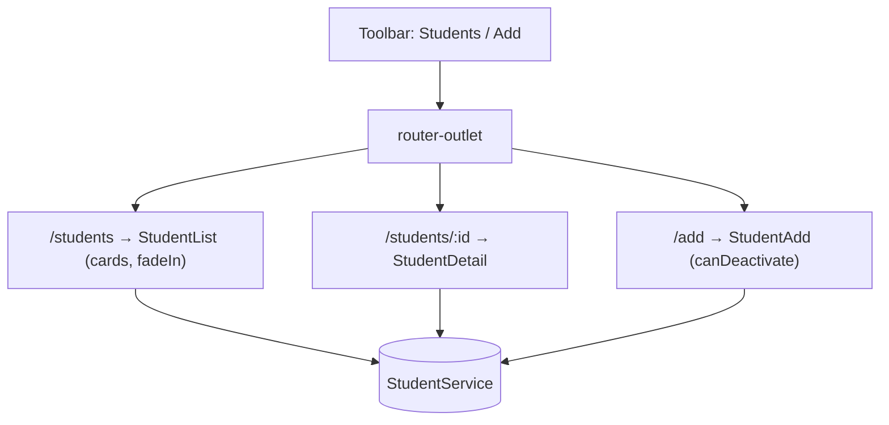

# Session 12: Lab and Review: Routing, Material and Animations

> Module: Building Applications with TypeScript (Angular) · Term 3 (HDSE I) · ⏱ ~2 hours

The final lab of the module brings together **routing**, **guards**, **lazy loading**, **Angular Material** and **animations** in a small **Student Portal**.

## 🎯 Learning Objectives

- Combine routes, a toolbar menu and Material components in one app
- Lazy-load pages with `loadComponent`
- Protect a form page with a `canDeactivate` guard
- Read a route parameter and convert it to a number
- Add enter animations to routed content

## 📖 Concepts Explained

### 1. App map



### 2. Lazy loading

`loadComponent: () => import('./student-list.component').then(m => m.StudentListComponent)` tells the build to put that page in a **separate file (chunk)** that downloads only when the user visits the route. Run `ng build` and look for extra `chunk-*.js` files in the output.

| Eager (`component:`) | Lazy (`loadComponent:`) |
|---|---|
| in the main bundle | separate chunk |
| bigger first download | faster first load |
| fine for tiny apps | recommended for most pages |

### 3. canDeactivate

`CanDeactivateFn<T>` receives the **component instance** being left, so it can call a method like `hasUnsavedChanges()`. Returning `false` keeps the user on the page.

### 4. Route parameters are strings

`/students/2` gives `id = '2'` (text). Convert with `Number(this.id)` before comparing with numeric ids.

### 5. Revision checklist

| Topic | Key API |
|---|---|
| Routing | `provideRouter`, `Routes`, `<router-outlet>`, `routerLink` |
| Parameters | `:id` + `withComponentInputBinding()` + `@Input()` |
| Guards | `CanActivateFn`, `CanDeactivateFn` |
| Material | `MatToolbarModule`, `MatCardModule`, `MatFormFieldModule`, `MatInputModule`, `MatButtonModule` |
| Animation | `trigger`, `transition(':enter')`, `animate` |

## 💻 Code Examples

Create the project, run `ng add @angular/material`, then copy all files into `src/app/`.

### Example 1: Routes with lazy loading and a guard

📄 File: [`app.routes.ts`](app.routes.ts)

```typescript
// app.routes.ts - lazy-loaded pages with a "leave page?" guard
import { Routes } from '@angular/router';
import { unsavedChangesGuard } from './unsaved-changes.guard';

export const routes: Routes = [
  { path: '', redirectTo: 'students', pathMatch: 'full' },
  {
    path: 'students',
    // loadComponent = lazy loading: the file is downloaded only when needed
    loadComponent: () => import('./student-list.component').then((m) => m.StudentListComponent),
  },
  {
    path: 'students/:id',
    loadComponent: () => import('./student-detail.component').then((m) => m.StudentDetailComponent),
  },
  {
    path: 'add',
    loadComponent: () => import('./student-add.component').then((m) => m.StudentAddComponent),
    canDeactivate: [unsavedChangesGuard],
  },
  { path: '**', redirectTo: 'students' },
];
```

### Example 2: The canDeactivate guard

📄 File: [`unsaved-changes.guard.ts`](unsaved-changes.guard.ts)

```typescript
// unsaved-changes.guard.ts - ask before leaving a page with unsaved typing
import { CanDeactivateFn } from '@angular/router';
import { StudentAddComponent } from './student-add.component';

export const unsavedChangesGuard: CanDeactivateFn<StudentAddComponent> = (component) => {
  if (component.hasUnsavedChanges()) {
    return confirm('You have unsaved changes. Leave anyway?');
  }
  return true;
};
```

**How it works:** if the add form has text and was not saved, the browser asks for confirmation.

### Example 3: Detail page

📄 File: [`student-detail.component.ts`](student-detail.component.ts)

```typescript
// student-detail.component.ts - :id arrives as an @Input (a string)
import { Component, Input, OnInit, inject } from '@angular/core';
import { RouterLink } from '@angular/router';
import { MatButtonModule } from '@angular/material/button';
import { StudentService } from './student.service';
import { Student } from './student.model';

@Component({
  selector: 'app-student-detail',
  standalone: true,
  imports: [RouterLink, MatButtonModule],
  template: `
    @if (student) {
      <h2>{{ student.name }}</h2>
      <p>Course: {{ student.course }}</p>
    } @else {
      <p>Student not found.</p>
    }
    <a mat-stroked-button routerLink="/students">Back</a>
  `,
})
export class StudentDetailComponent implements OnInit {
  @Input() id = '';
  student: Student | undefined;
  private service = inject(StudentService);

  ngOnInit(): void {
    this.student = this.service.getById(Number(this.id)); // convert text to number
  }
}
```

### Other files

[`student.model.ts`](student.model.ts) · [`student.service.ts`](student.service.ts) · [`app.config.ts`](app.config.ts) · [`app.component.ts`](app.component.ts) · [`student-list.component.ts`](student-list.component.ts) · [`student-add.component.ts`](student-add.component.ts)

## 🧪 Lab Practice

1. Run the app, add a student, and confirm you return to the list with the new card.
2. Type in the Add form, then click **Students**: the guard should ask you.
3. Run `ng build` and find the lazy chunk files in `dist/`.
4. Add a **Delete** button on the detail page that removes the student and navigates back.
5. Replace the cards with a `mat-table` and add a `mat-icon` "visibility" button per row.

## 📝 Assignment (module project warm-up)

Extend the portal: an `auth.guard` protecting `/add`, a fake login page, a `MatSnackBar` message after saving, a `MatSelect` for the course list, and a slide-in animation on the detail page. Push the project to your GitHub with a README and screenshots.

## ❓ Quick Quiz

1. What does `loadComponent` change in the build output?
2. What does a `CanDeactivateFn` receive?
3. What type is a route parameter value?
4. Which Material module gives the top app bar?
5. Which animation alias runs when an element is added?

<details><summary>Answers</summary>

1. The component is placed in its own lazily downloaded chunk.
2. The component instance being left (plus route info).
3. A string.
4. `MatToolbarModule`.
5. `:enter`.

</details>

## 💼 Interview Questions

1. **How do you preload lazy routes?** Add `withPreloading(PreloadAllModules)` to `provideRouter` so chunks download in the background after the app starts.
2. **Where should shared data for several pages live?** In a root-provided service (optionally using signals or RxJS subjects to notify changes).
3. **How would you show a loading bar during lazy navigation?** Listen to router events (`NavigationStart`, `NavigationEnd`) and toggle a `mat-progress-bar`.

## ✅ Summary

- Routing + Material + animations combine into a real app shell.
- Lazy loading with `loadComponent` speeds up the first load.
- `canDeactivate` protects unsaved work; `canActivate` protects access.
- Next module: **Material UI**, the design principles behind these components.

---

[⬅ Previous](../Session-11-Angular-Material-and-Animations/README.md) · [🏠 Module Home](../README.md) · [Next Module ➡](../../04-Material-UI/README.md)

Prepared by Zeeshan Abbas · Aptech Learning North Nazimabad
