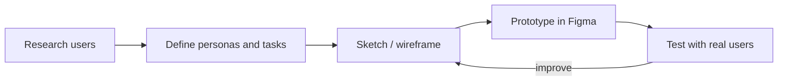

# Session 01: Introduction to UI and Material Design

> Module: Material UI · Term 3 (HDSE I) · ⏱ ~2 hours

This module explains the **design thinking** behind the components you used in Angular Material. We start with what makes a user interface good, how user experience differs from UI, and the core ideas of **Material Design**.

## 🎯 Learning Objectives

- Define UI and UX and explain why UI design matters
- Apply basic UI principles: hierarchy, consistency, feedback, accessibility
- Follow a simple user-centred design process using personas
- Describe what Material Design is and how it evolved to Material 3 (Material You)
- Explain surfaces, elevation, shape, colour, type, layout and motion in Material
- Review a screen with a checklist

## 📖 Concepts Explained

### 1. UI vs UX

| | UI (User Interface) | UX (User Experience) |
|---|---|---|
| Question | *What does it look like?* | *How does it feel to use?* |
| Includes | colours, buttons, fonts, layout, icons | research, flows, ease, speed, satisfaction |
| Example | A purple rounded "Register" button | Registering takes 3 steps instead of 8 |

Analogy: in a car, the **UI** is the dashboard and steering wheel; the **UX** is how pleasant and safe the whole drive is. A beautiful UI with a confusing flow still gives a bad experience.

### 2. Why UI design matters

- Users judge an app in seconds; a clear UI builds **trust**.
- Good UI reduces **mistakes** and support calls.
- Accessible UI includes **everyone**, including users with low vision or motor difficulties.
- Consistent UI is faster to **build** because parts are reused.

### 3. Core UI principles

| Principle | Meaning | Example |
|---|---|---|
| Visual hierarchy | Most important things are biggest/boldest | Page title > section title > body |
| Consistency | Same thing looks and works the same | All primary buttons are filled purple |
| Feedback | The system answers every action | Button changes colour when pressed |
| Simplicity | Remove what is not needed | One primary action per screen |
| Accessibility | Usable by all | 4.5:1 contrast, 48 dp tap targets |
| Proximity | Related things sit together | Label right above its field |

### 4. User-centred design process



A **persona** is a short, realistic profile of a typical user. Designing for "Sana, 19, on a slow phone" leads to better decisions than designing for "everyone".

### 5. What is Material Design?

**Material Design** is Google's open design system (2014) for building consistent, usable interfaces on Android, the web and other platforms.

| Version | Year | Key idea |
|---|---|---|
| Material 1 | 2014 | "Paper and ink": surfaces, shadows, bold colour |
| Material 2 | 2018 | Theming: brands can customise colour, type, shape |
| Material 3 (Material You) | 2021 | Personal dynamic colour, larger rounded shapes, design tokens |

### 6. Material building blocks

| Concept | Short explanation |
|---|---|
| **Surfaces** | Content sits on layers (page, card, sheet, dialog) |
| **Elevation** | Distance between surfaces, shown with shadow or tonal colour (levels 0–5) |
| **Colour** | Roles such as *primary*, *secondary*, *surface*, *error*, each with an *on-* colour for text on it |
| **Typography** | A type scale: Display, Headline, Title, Body, Label (Session 3) |
| **Shape** | Corner radius scale from none to fully rounded |
| **Layout** | 8 dp grid, responsive window sizes (compact, medium, expanded) |
| **Motion** | Short, meaningful animations that show what changed |

> **dp** (density-independent pixel) is a unit that looks the same physical size on screens of different density. On the web, 1 dp ≈ 1 CSS px.

## 💻 Code Examples

These are plain HTML files: double-click to open them in a browser.

### Example 1: Same content, two designs

📄 File: [`good-vs-bad-ui.html`](good-vs-bad-ui.html)

```css
/* BAD: light grey text and tiny button */
.bad p { color: #bbb; font-size: 12px; }
.bad button { font-size: 10px; padding: 1px; }

/* GOOD: clear title, readable text, 40px tall rounded button */
.good h2 { font-size: 22px; color: #1d1b20; }
.good button { min-height: 40px; padding: 0 24px; border-radius: 20px;
               background: #6750a4; color: #ffffff; }
```

**How it works:** both boxes have the same information. The good version uses hierarchy (big title), grouping (date/time together), contrast and a large, clearly labelled button.

### Example 2: Surfaces, elevation and shape

📄 File: [`material-surfaces.html`](material-surfaces.html) – four cards at elevation levels 0–3 and four corner sizes (8, 12, 16, 28 px). All gaps are multiples of 8 px.

### Templates

- 📄 [`ui-review-checklist.md`](ui-review-checklist.md) – review any screen in five areas.
- 📄 [`persona-template.md`](persona-template.md) – fill one per user type.

## 🧪 Lab Practice

1. Open `good-vs-bad-ui.html` and list five differences between the two boxes.
2. Pick any app on your phone. Review its home screen with `ui-review-checklist.md`.
3. Create two personas for a "College Fee Payment" app using the template.
4. In `material-surfaces.html`, add a `.level4` and `.level5` card with stronger shadows.
5. Visit https://m3.material.io and find the pages for *Elevation* and *Shape*; note two rules from each.

## 📝 Assignment

Choose a real website you use (bank, university, food delivery). Take two screenshots and write a one-page review: three things it does well and three improvements, each linked to a principle from this session. Suggest one persona the site seems designed for.

## ❓ Quick Quiz

1. Give one difference between UI and UX.
2. What is a persona?
3. Which company created Material Design, and which version introduced dynamic colour?
4. What does elevation communicate?
5. What is the minimum recommended touch target size?

<details><summary>Answers</summary>

1. UI is the look and controls; UX is the whole experience of using the product.
2. A realistic profile of a typical user, used to guide design decisions.
3. Google; Material 3 (Material You).
4. How far a surface is from the background, i.e. its importance and layering.
5. 48 × 48 dp.

</details>

## 💼 Interview Questions

1. **What makes a good user interface?** It is clear, consistent, gives feedback, is accessible and helps users finish their task with minimum effort.
2. **What is a design system?** A shared set of rules, tokens and reusable components (with documentation) that keeps products consistent; Material Design is one example.
3. **How do you check accessibility quickly?** Test colour contrast, keyboard navigation, screen-reader labels and touch target sizes.

## ✅ Summary

- UI is how a product looks; UX is how it feels to use. Both matter.
- Hierarchy, consistency, feedback, simplicity and accessibility guide good UI.
- Design for real users with personas and test early.
- Material Design (now Material 3) defines surfaces, elevation, colour, type, shape, layout and motion.

---

[⬅ Term Home](../../README.md) · [🏠 Module Home](../README.md) · [Next ➡](../Session-02-Design-Tokens-Figma-and-Input-Controls/README.md)

Prepared by Zeeshan Abbas · Aptech Learning North Nazimabad
