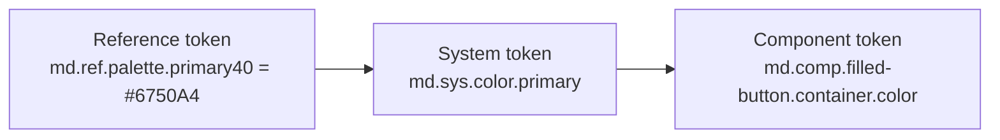

# Session 02: Design Tokens, Figma and Input Controls

> Module: Material UI · Term 3 (HDSE I) · ⏱ ~2 hours

Design teams and developers need one shared language for colours, sizes and shapes. In this session you learn **design tokens**, how Material 3 organises them, how to design a screen in **Figma**, and how to choose the right **input control**.

## 🎯 Learning Objectives

- Define a design token and explain why tokens are useful
- Describe the three Material token tiers: reference, system and component
- Map tokens to CSS custom properties and switch themes by changing tokens
- Use Figma basics: frames, auto layout, components, variants and prototyping
- Generate a theme with Material Theme Builder
- Choose the correct input control (text field, radio, checkbox, switch, slider, menu, chip)

## 📖 Concepts Explained

### 1. What is a design token?

A **design token** is a *named* design decision stored as data: `color.primary = #6750A4`, `shape.corner.small = 8px`.

Without tokens, a designer says "make it purple" and five developers type five slightly different purples. With tokens, everyone uses `primary`, and changing the brand colour once updates the whole product: web, Android and iOS.

Analogy: tokens are like **variables in a program**; you change the value in one place and every place that uses it updates.

### 2. Material 3 token tiers



| Tier | What it holds | Example | Changes when… |
|---|---|---|---|
| **Reference** (`ref`) | every raw value available (palette, fonts) | `primary40`, `neutral99` | brand palette changes |
| **System** (`sys`) | the *role* in the UI | `color.primary`, `color.surface`, `shape.corner.small` | light/dark theme switches |
| **Component** (`comp`) | which role one component part uses | `filled-button.container.color` | one component is customised |

**Colour roles** come in pairs: `primary` / `on-primary` (text on primary), `surface` / `on-surface`, `primary-container` / `on-primary-container`. Using pairs guarantees readable contrast.

### 3. Tokens in code

| Platform | How tokens appear |
|---|---|
| CSS | custom properties `--md-sys-color-primary` |
| JSON | source file read by tools like Style Dictionary |
| Angular Material | Sass theme `mat.theme(...)` generating `--mat-sys-*` CSS variables |
| Android | Compose `MaterialTheme.colorScheme.primary` |

**Material Theme Builder** turns one source colour into a full light and dark scheme and exports it as CSS, JSON, Compose or Figma styles.

### 4. Figma essentials

| Feature | Use |
|---|---|
| **Frame** (F) | a screen or container (choose a device size) |
| **Auto layout** (Shift+A) | stacks items with fixed gap and padding, like CSS flexbox |
| **Component** (Ctrl/Cmd+Alt+K) | reusable element; edit the main one and all copies update |
| **Variants** | one component with options such as state = hover/disabled |
| **Styles / Variables** | saved colours, text styles and tokens |
| **Prototype** | link frames to make a clickable demo |
| **Community kits** | e.g. Google's *Material 3 Design Kit* |

### 5. Choosing input controls

| Need | Control | Tip |
|---|---|---|
| Free text | Text field (filled or outlined) | always a visible label |
| One choice from 2–5 options | Radio buttons | show all options |
| One choice from many options | Menu / dropdown | sort options logically |
| Many choices | Checkboxes | each works independently |
| Instant on/off setting | Switch | takes effect immediately |
| Value in a range | Slider | show the current value |
| Filter or tag | Chips | compact, can be toggled |
| Main action | Filled button | only one per screen |

## 💻 Code Examples

### Example 1: Token tiers in CSS

📄 File: [`tokens.css`](tokens.css)

```css
/* tokens.css - Material 3 style design tokens as CSS custom properties */

:root {
  /* ---------- 1. REFERENCE tokens: raw values (the palette) ---------- */
  --md-ref-palette-primary40: #6750a4;
  --md-ref-palette-primary90: #eaddff;
  --md-ref-palette-primary10: #21005d;
  --md-ref-palette-neutral99: #fffbfe;
  --md-ref-palette-neutral10: #1c1b1f;
  --md-ref-palette-error40: #b3261e;
  --md-ref-typeface-brand: "Roboto", Arial, sans-serif;

  /* ---------- 2. SYSTEM tokens: roles that point to reference tokens ---------- */
  --md-sys-color-primary: var(--md-ref-palette-primary40);
  --md-sys-color-on-primary: #ffffff;
  --md-sys-color-primary-container: var(--md-ref-palette-primary90);
  --md-sys-color-on-primary-container: var(--md-ref-palette-primary10);
  --md-sys-color-surface: var(--md-ref-palette-neutral99);
  --md-sys-color-on-surface: var(--md-ref-palette-neutral10);
  --md-sys-color-outline: #79747e;
  --md-sys-color-error: var(--md-ref-palette-error40);
  --md-sys-shape-corner-full: 9999px;
  --md-sys-shape-corner-small: 8px;

  /* ---------- 3. COMPONENT tokens: one component, pointing to system tokens ---------- */
  --md-comp-filled-button-container-color: var(--md-sys-color-primary);
  --md-comp-filled-button-label-text-color: var(--md-sys-color-on-primary);
  --md-comp-filled-button-container-shape: var(--md-sys-shape-corner-full);
  --md-comp-text-field-outline-color: var(--md-sys-color-outline);
  --md-comp-text-field-focus-outline-color: var(--md-sys-color-primary);
}

/* A dark theme only changes SYSTEM tokens; components update automatically.
   It is set on the same element as the tokens (<html>), so the var() links re-calculate. */
:root.dark-theme {
  --md-sys-color-primary: #d0bcff;
  --md-sys-color-on-primary: #381e72;
  --md-sys-color-surface: #141218;
  --md-sys-color-on-surface: #e6e0e9;
  --md-sys-color-outline: #938f99;
}
```

**How it works:** components only use `--md-comp-*`, which point to `--md-sys-*`, which point to `--md-ref-*`. The `dark-theme` class on the `<html>` element overrides a few system tokens, and everything that uses them changes.

### Example 2: Tokens as JSON

📄 File: [`tokens.json`](tokens.json) – the same three tiers in a tool-friendly format; `{sys.color.primary}` is a reference to another token.

### Example 3: Input controls using tokens

📄 File: [`input-controls.html`](input-controls.html) – open it in a browser (keep `tokens.css` in the same folder). It shows a text field, dropdown, radios, checkboxes, slider, chips and a filled button. Tick **Dark theme** to swap system tokens.

```css
.filled-button {
  border-radius: var(--md-comp-filled-button-container-shape);
  background: var(--md-comp-filled-button-container-color);
  color: var(--md-comp-filled-button-label-text-color);
}
```

### Practical guide

📄 [`figma-practical.md`](figma-practical.md) – step-by-step: design a Material 3 login screen in Figma with auto layout, kit components, Theme Builder colours and a clickable prototype.

## 🧪 Lab Practice

1. In `tokens.css`, change `--md-ref-palette-primary40` to your favourite colour and reload `input-controls.html`.
2. Add a token `--md-comp-filled-button-container-shape` value of `8px` and compare the look.
3. Use Material Theme Builder to generate a scheme from a source colour; copy its light `primary`, `on-primary`, `surface` and `on-surface` values into `tokens.css`.
4. Complete Parts A–C of the Figma practical.
5. For a "Hostel Booking" form, decide which input control fits each field: room type, check-in date, number of guests, extras (Wi-Fi, laundry), terms acceptance.

## 📝 Assignment

Finish the full Figma practical (Parts A–E) and export your theme from Material Theme Builder as CSS. Then build the same login screen in HTML using **only** token variables for colour and shape. Submit the Figma share link, the HTML file and a screenshot of light and dark modes.

## ❓ Quick Quiz

1. What is a design token?
2. Name the three Material token tiers.
3. Which token tier changes between light and dark themes?
4. When should you use a switch instead of a checkbox?
5. Which Figma feature works like CSS flexbox?

<details><summary>Answers</summary>

1. A named, reusable design decision (colour, size, shape, font) stored as data.
2. Reference, system and component.
3. System tokens (e.g. `md.sys.color.surface`).
4. When the setting takes effect immediately (on/off); checkboxes are for selecting options that are submitted later.
5. Auto layout.

</details>

## 💼 Interview Questions

1. **Why do design systems use tokens?** They give designers and developers one source of truth, make theming (dark mode, brands) easy and keep platforms consistent.
2. **What is the purpose of "on-" colours?** They define the content colour (text/icons) that is readable on a given background role, ensuring accessible contrast.
3. **How does design hand-off work in Figma?** Developers use Dev Mode/Inspect to read sizes, spacing, tokens and export assets from the shared file.

## ✅ Summary

- Tokens are named design decisions; change once, update everywhere.
- Material 3 tiers: reference → system → component.
- In CSS, tokens become custom properties; themes override system tokens.
- Figma: frames, auto layout, components, variants, prototypes; use the Material 3 kit.
- Pick input controls by the type of choice the user makes.

---

[⬅ Previous](../Session-01-Introduction-to-UI-and-Material-Design/README.md) · [🏠 Module Home](../README.md) · [Next ➡](../Session-03-Type-Scale-States-and-Design-Systems/README.md)

Prepared by Zeeshan Abbas · Aptech Learning North Nazimabad
