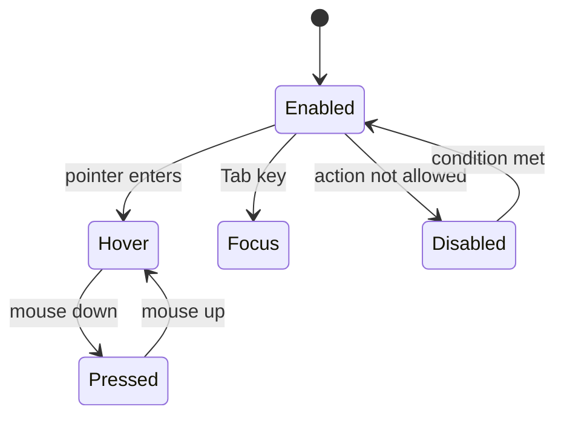
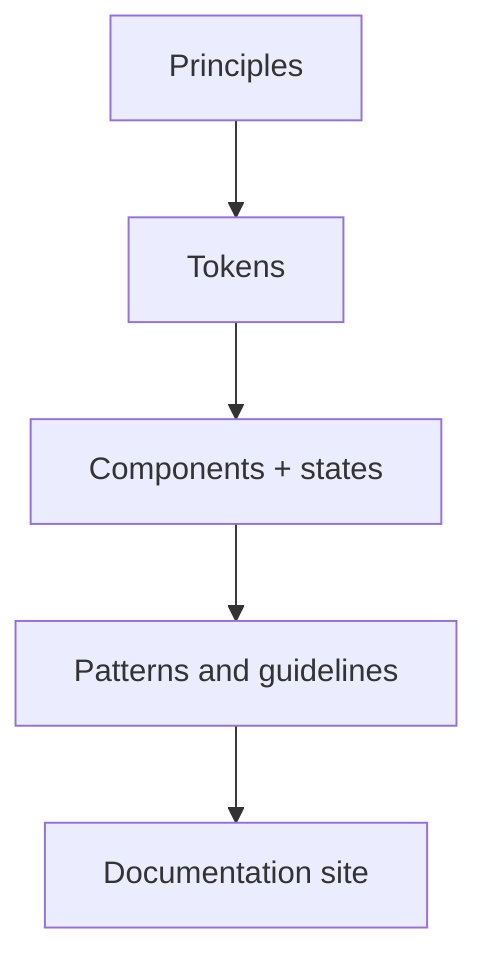

# Session 03: Type Scale, Component States and Design Systems

> Module: Material UI · Term 3 (HDSE I) · ⏱ ~2 hours

The final session covers three ideas that make an interface feel professional: a clear **type scale**, well-designed **component and interaction states**, and a documented **design system** that keeps a whole team consistent.

## 🎯 Learning Objectives

- Explain the Material 3 type scale and choose the right role for each text
- List the component and interaction states (enabled, hover, focus, pressed, dragged, selected, disabled, error)
- Apply state layers and accessible focus indicators in CSS
- Compare popular design systems (Material, Fluent, Carbon, Apple HIG)
- Document a small design system with tokens, type, components and rules

## 📖 Concepts Explained

### 1. The type scale

A **type scale** is a fixed set of text styles. Instead of choosing random font sizes, every text uses a **role**. Material 3 has 5 roles × 3 sizes = 15 styles.

| Role | Sizes (Large / Medium / Small) | Use for |
|---|---|---|
| **Display** | 57 / 45 / 36 px | very short, big text: hero numbers, splash |
| **Headline** | 32 / 28 / 24 px | page and section titles |
| **Title** | 22 / 16 / 14 px | card titles, app bar, list headers |
| **Body** | 16 / 14 / 12 px | paragraphs and descriptions |
| **Label** | 14 / 12 / 11 px | buttons, tabs, chips, captions |

Rules of thumb:

- Use **one** Display or Headline per screen to make hierarchy obvious.
- Body text should not go below 14 px on mobile for comfortable reading.
- Line height is about 1.25–1.5× the font size for readability.
- Users may enlarge text in settings; layouts should grow with it (use `rem` on the web when possible).

### 2. Component and interaction states

A **state** is how a component looks at a moment, telling the user what is possible or what just happened.

| State | When | Visual clue in Material |
|---|---|---|
| Enabled | ready to use | normal colours |
| Hover | pointer over it (desktop) | state layer 8% |
| Focus | selected by keyboard (Tab) | state layer 10% + visible focus ring |
| Pressed | being clicked/tapped | state layer 10% + ripple |
| Dragged | being moved | state layer 16% + higher elevation |
| Selected / activated | chosen or ON | filled colour, check mark |
| Disabled | cannot be used now | content at 38% opacity, container 12% |
| Error | invalid input | error colour + helpful message |

A **state layer** is a semi-transparent overlay using the component's content colour (for example `on-primary` on a primary button). It keeps state changes consistent across all components.



> Never rely on colour alone. Pair colour with an icon, text or shape change so colour-blind users also notice the state.

### 3. Design systems

A **design system** is the full package: principles + tokens + components + guidelines + documentation + governance (who approves changes).

| Design system | Company | Typical products |
|---|---|---|
| Material Design 3 | Google | Android, Google apps, Angular Material, MUI (React) |
| Fluent 2 | Microsoft | Windows, Office, Teams |
| Carbon | IBM | IBM Cloud and enterprise tools |
| Human Interface Guidelines | Apple | iOS, macOS apps |
| Atlassian Design System | Atlassian | Jira, Confluence |

Benefits: faster design and development, consistent brand, built-in accessibility, easier onboarding of new team members. Cost: it needs time to build and must be maintained.



## 💻 Code Examples

Open the HTML files in a browser; keep the CSS file in the same folder.

### Example 1: Type scale as CSS classes

📄 File: [`type-scale.css`](type-scale.css)

```css
.headline-small  { font-size: 24px; line-height: 32px; font-weight: 400; }
.title-medium    { font-size: 16px; line-height: 24px; font-weight: 500; }
.body-medium     { font-size: 14px; line-height: 20px; font-weight: 400; }
.label-large     { font-size: 14px; line-height: 20px; font-weight: 500; }
```

**How it works:** each role is one class. [`type-scale.html`](type-scale.html) shows the scale and a course card that uses Label, Headline, Title and Body roles together.

### Example 2: Interaction states with a state layer

📄 File: [`component-states.html`](component-states.html)

```html
<!DOCTYPE html>
<html lang="en">
<head>
  <meta charset="UTF-8" />
  <meta name="viewport" content="width=device-width, initial-scale=1.0" />
  <title>Component and Interaction States</title>
  <style>
    :root {
      --primary: #6750a4;
      --on-primary: #ffffff;
      --on-surface: #1d1b20;
    }
    body { font-family: Roboto, Arial, sans-serif; padding: 24px; }

    .btn {
      position: relative;            /* needed for the state layer */
      overflow: hidden;
      height: 40px; padding: 0 24px; border: none; border-radius: 20px;
      background: var(--primary); color: var(--on-primary);
      font-size: 14px; font-weight: 500; cursor: pointer; margin: 8px;
    }

    /* STATE LAYER: a see-through layer of the content colour on top of the button */
    .btn::after {
      content: ""; position: absolute; inset: 0;
      background: var(--on-primary); opacity: 0;   /* invisible when enabled */
      transition: opacity 150ms;
    }
    .btn:hover::after         { opacity: 0.08; }  /* hover: 8%  */
    .btn:focus-visible::after { opacity: 0.10; }  /* focus: 10% */
    .btn:active::after        { opacity: 0.10; }  /* pressed: 10% */

    /* FOCUS also gets a clear outline for keyboard users */
    .btn:focus-visible { outline: 3px solid var(--on-surface); outline-offset: 2px; }

    /* DISABLED: faded container (12%) and faded text (38%), no pointer */
    .btn:disabled {
      background: rgba(29, 27, 32, 0.12);
      color: rgba(29, 27, 32, 0.38);
      cursor: not-allowed;
    }
    .btn:disabled::after { display: none; }

    /* ERROR state for a text field */
    .field { display: block; margin: 16px 8px; }
    .field input { height: 44px; padding: 0 12px; border: 1px solid #79747e; border-radius: 4px; }
    .field.error input { border: 2px solid #b3261e; }
    .field.error small { color: #b3261e; display: block; }
  </style>
</head>
<body>
  <h1>Button states</h1>
  <p>Hover, press, and use the Tab key to see each state.</p>
  <button class="btn">Enabled</button>
  <button class="btn" disabled>Disabled</button>

  <h1>Selected state</h1>
  <!-- aria-pressed tells screen readers the button is ON -->
  <button class="btn" id="fav" aria-pressed="false">☆ Favourite</button>

  <h1>Error state</h1>
  <label class="field error">
    Email
    <input type="email" value="sana@" />
    <small>Enter a complete email address</small>
  </label>

  <script>
    // Toggle the SELECTED state
    const fav = document.getElementById("fav");
    fav.addEventListener("click", function () {
      const isOn = fav.getAttribute("aria-pressed") === "true";
      fav.setAttribute("aria-pressed", String(!isOn));
      fav.textContent = isOn ? "☆ Favourite" : "★ Favourite";
    });
  </script>
</body>
</html>
```

**How it works:** `::after` creates an invisible overlay whose opacity rises on `:hover`, `:focus-visible` and `:active`. `:disabled` fades the button. The favourite button toggles a **selected** state and updates `aria-pressed` for screen readers.

### Template

📄 [`design-system-starter.md`](design-system-starter.md) – fill it in to document tokens, type, components, accessibility rules and changes.

## 🧪 Lab Practice

1. In `type-scale.html`, rebuild a news article card using only scale classes (no other font sizes).
2. Add a **dragged** style (16% state layer + stronger shadow) to `component-states.html` using a `.dragging` class.
3. Press **Tab** repeatedly on the states page: is the focus always visible? Improve it if not.
4. Compare the button pages of Material 3 (https://m3.material.io) and Fluent 2 (https://fluent2.microsoft.design): list two similarities and two differences.
5. Fill sections 1–3 of `design-system-starter.md` for your Angular mini-project.

## 📝 Assignment

Create a **mini design system** for a "Campus Events" app: complete `design-system-starter.md` (all six sections), and build one HTML page that demonstrates your type scale, a filled and an outlined button in all states (enabled, hover, focus, pressed, disabled) and a text field in normal, focus and error states. Bonus: apply the same tokens to an Angular Material theme.

## ❓ Quick Quiz

1. Name the five type roles in Material 3.
2. Which role would you use for a button's text?
3. What opacity does Material use for a hover state layer?
4. Why is a visible focus indicator important?
5. Give two parts of a design system besides components.

<details><summary>Answers</summary>

1. Display, Headline, Title, Body, Label.
2. Label (usually Label Large).
3. 8%.
4. Keyboard and assistive-technology users need to see which element is active.
5. Any two of: principles, tokens, guidelines/patterns, documentation, governance.

</details>

## 💼 Interview Questions

1. **Why use a type scale instead of free font sizes?** It creates consistent hierarchy, simplifies decisions, and maps cleanly to tokens and code.
2. **How would you design a disabled state accessibly?** Reduce emphasis (opacity) but keep the label readable enough, use the native `disabled` attribute and, where helpful, explain why the action is unavailable.
3. **How do you keep a design system up to date?** Version it, keep design (Figma library) and code (component library) in sync, document changes and have an owner team review contributions.

## ✅ Summary

- A type scale gives every text a role: Display, Headline, Title, Body, Label.
- States (hover, focus, pressed, dragged, selected, disabled, error) tell users what is happening; state layers make them consistent.
- Design systems combine principles, tokens, components, guidelines and governance.
- Next: you will apply these UI skills in server-rendered apps in **ASP.NET Core MVC**.

---

[⬅ Previous](../Session-02-Design-Tokens-Figma-and-Input-Controls/README.md) · [🏠 Module Home](../README.md) · [Next Module ➡](../../05-Building-Robust-Web-Applications-with-ASPNET-Core-MVC/README.md)

Prepared by Zeeshan Abbas · Aptech Learning North Nazimabad
