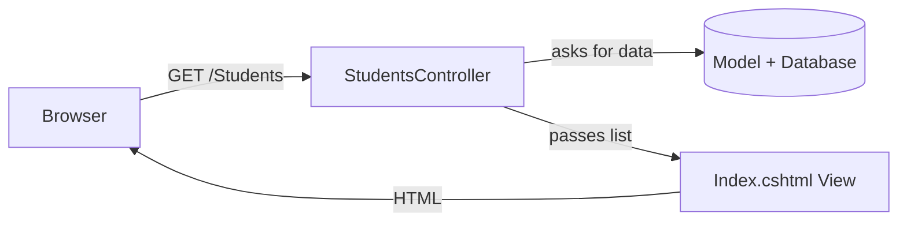

# Session 02: Web Development Models, ADO.NET and Entity Framework Core

> Module: Building Robust Web Applications with ASP.NET Core MVC · Term 3 (HDSE I) · ⏱ ~2 hours

## 🎯 Learning Objectives

- Compare the main web development models: Web Forms, MVC, Razor Pages and Web API
- Explain events and server controls in classic Web Forms
- Describe the basic idea of a Web API and common web security threats
- Read data with ADO.NET (connection, command, reader)
- Read data with Entity Framework Core using a code-first model
- Explain why an ORM saves time compared to hand-written SQL

## 📖 Concepts Explained

### 1. Web Development Models in .NET

| Model | How a page is built | Best for |
|---|---|---|
| **Web Forms** (legacy) | Drag controls, handle events like `Button_Click` | Old Windows-only intranet apps |
| **MVC** | Controller picks data (Model) and a template (View) | Medium to large sites, full control of HTML |
| **Razor Pages** | One page = `.cshtml` + its own code file | Simple page-focused sites |
| **Web API** | Returns JSON, no HTML | Mobile apps, React/Angular front ends |

**Types of Web Forms (legacy):** single-file pages (markup and code together) and code-behind pages (`Page.aspx` + `Page.aspx.cs`). Controls came in groups: **standard** (TextBox, Button, DropDownList), **validation** (RequiredFieldValidator), **data** (GridView) and **navigation** (Menu). Each control raised **events** that ran on the server after a *postback*.

### 2. MVC in One Picture



### 3. Web API and Web Security (first look)

A **Web API** is a set of URLs that return data (usually JSON) instead of HTML: `GET /api/students` returns `[{"id":1,"name":"Ayesha"}]`. You will build one in Session 06.

Top threats every web developer must know:

| Threat | Simple meaning | Defence in ASP.NET Core |
|---|---|---|
| SQL injection | User input changes your SQL | Parameters or EF Core |
| XSS | Attacker's script runs in another user's browser | Razor encodes `@value` automatically |
| CSRF | A fake form submits on the user's behalf | Anti-forgery tokens in forms |
| Plain HTTP | Data can be read on the network | HTTPS + `UseHttpsRedirection` |

### 4. ADO.NET: Talking to the Database Directly

ADO.NET is the low-level data library. You write SQL yourself.

| Object | Job |
|---|---|
| `Connection` | Opens the line to the database |
| `Command` | Holds the SQL and its parameters |
| `DataReader` | Reads rows one by one, forward only |

For SQL Server you use `Microsoft.Data.SqlClient` (`SqlConnection`); for SQLite, `Microsoft.Data.Sqlite` (`SqliteConnection`). The pattern is identical.

### 5. Entity Framework Core: an ORM

An **ORM (Object-Relational Mapper)** maps C# classes to tables, so you write LINQ instead of SQL.

| Term | Meaning |
|---|---|
| Entity | A C# class such as `Student` |
| `DbContext` | Your connection + change tracker |
| `DbSet<T>` | A table you can query |
| Code-first | Write classes first; EF creates the database |
| Migration | A versioned script that updates the schema |

Analogy: ADO.NET is cooking from raw ingredients; EF Core is a skilled cook who follows your recipe (the class).

### 6. SQLite or SQL Server LocalDB?

We use **SQLite** in examples because it is a single file and works on every OS. To switch to **SQL Server LocalDB** (Windows), install `Microsoft.EntityFrameworkCore.SqlServer` and change one line:

```csharp
options.UseSqlServer("Server=(localdb)\\MSSQLLocalDB;Database=SchoolDb;Trusted_Connection=True;");
```

## 💻 Code Examples

Folder files: `SchoolData.csproj`, `appsettings.json`, `Program.cs`, `Models/Student.cs`, `Data/SchoolContext.cs`, `Controllers/StudentsController.cs`, `Views/Students/Index.cshtml`. Run `dotnet run`, then open `/Students` and `/Students/Ado`.

### Example 1: The model (`Models/Student.cs`)

```csharp
namespace SchoolData.Models;

// A model is a plain C# class. EF Core turns it into a table.
public class Student
{
    public int Id { get; set; }               // primary key (by convention)
    public string Name { get; set; } = "";
    public int Age { get; set; }
}
```

**How it works**: A property named `Id` becomes the primary key automatically. `Name` becomes a text column and `Age` an integer column.

### Example 2: The DbContext (`Data/SchoolContext.cs`)

```csharp
using Microsoft.EntityFrameworkCore;
using SchoolData.Models;

namespace SchoolData.Data;

// The DbContext is our "session" with the database.
public class SchoolContext : DbContext
{
    public SchoolContext(DbContextOptions<SchoolContext> options) : base(options) { }

    // Each DbSet becomes a table: Students
    public DbSet<Student> Students => Set<Student>();
}
```

**How it works**: The constructor receives options (which database, which connection string) from `Program.cs`. `Students` is the table we will query.

### Example 3: Wiring it up (excerpt of `Program.cs`)

```csharp
builder.Services.AddControllersWithViews();
builder.Services.AddDbContext<SchoolContext>(options =>
    options.UseSqlite(builder.Configuration.GetConnectionString("School")));
// ...later: db.Database.EnsureCreated(); then seed three students
```

**How it works**: `AddDbContext` registers the context for dependency injection. `EnsureCreated` makes `school.db` on first run (later we will use migrations instead).

### Example 4: EF Core vs ADO.NET (`Controllers/StudentsController.cs`)

```csharp
using Microsoft.AspNetCore.Mvc;
using Microsoft.Data.Sqlite;
using SchoolData.Data;

namespace SchoolData.Controllers;

public class StudentsController : Controller
{
    private readonly SchoolContext _db;
    private readonly IConfiguration _config;

    public StudentsController(SchoolContext db, IConfiguration config)
    {
        _db = db;          // EF Core context, given to us by DI
        _config = config;  // used to read the connection string
    }

    // GET /Students  -> list students using EF Core (LINQ)
    public IActionResult Index()
    {
        var students = _db.Students.OrderBy(s => s.Name).ToList();
        return View(students);
    }

    // GET /Students/Ado  -> same data using plain ADO.NET
    public IActionResult Ado()
    {
        var names = new List<string>();

        using var connection = new SqliteConnection(_config.GetConnectionString("School"));
        connection.Open();

        using var command = connection.CreateCommand();
        command.CommandText = "SELECT Name FROM Students WHERE Age >= $minAge";
        command.Parameters.AddWithValue("$minAge", 18);   // parameter = safe from SQL injection

        using var reader = command.ExecuteReader();
        while (reader.Read())
        {
            names.Add(reader.GetString(0));
        }
        return Content("Adults (ADO.NET): " + string.Join(", ", names));
    }
}
```

**How it works**: `Index` uses one LINQ line. `Ado` does the same job by hand: open connection, build command, add a parameter, loop through the reader.

### Example 5: The view (`Views/Students/Index.cshtml`)

```cshtml
@model List<SchoolData.Models.Student>

<h1>Students (EF Core)</h1>
<table border="1" cellpadding="6">
    <tr><th>Id</th><th>Name</th><th>Age</th></tr>
    @foreach (var s in Model)
    {
        <tr><td>@s.Id</td><td>@s.Name</td><td>@s.Age</td></tr>
    }
</table>
<p><a href="/Students/Ado">See adults using ADO.NET</a></p>
```

**How it works**: `@model` tells the view what data it receives. `@foreach` loops in C#, and `@s.Name` prints a value (HTML-encoded for safety).

## 🧪 Lab Practice

1. Run the project and confirm `school.db` appears in the folder.
2. Add an `Email` property to `Student`, delete `school.db`, run again and show the email in the table.
3. Add an action `Young()` that uses LINQ to list students younger than 18.
4. Change the ADO.NET query to order names alphabetically.
5. (Windows) Switch the project to SQL Server LocalDB and view the table in SSMS.

## 📝 Assignment

Create a `Course` model (Id, Title, Fee) with its own `DbSet`, seed three courses and show them on `/Courses` using EF Core.

## ❓ Quick Quiz

1. Which ADO.NET object reads rows forward-only?
2. What does code-first mean?
3. Which EF Core class represents a table?
4. How does Razor protect against XSS?
5. Which Web Forms control type checks user input?

<details>
<summary>Show answers</summary>

1. `DataReader` (e.g. `SqliteDataReader`, `SqlDataReader`)
2. You write C# classes first and EF Core creates the database from them.
3. `DbSet<T>`
4. It HTML-encodes output written with `@`.
5. Validation controls such as `RequiredFieldValidator`.

</details>

## 💼 Interview Questions

1. **ADO.NET or EF Core: when would you choose each?** EF Core for most CRUD work and productivity; ADO.NET (or Dapper) for very tuned queries or bulk operations.
2. **How do you prevent SQL injection?** Never join user input into SQL strings; use parameters or an ORM.
3. **What is a DbContext lifetime in ASP.NET Core?** Scoped: one instance per HTTP request.

## ✅ Summary

- .NET offers Web Forms (legacy), MVC, Razor Pages and Web API models.
- ADO.NET gives full control with connections, commands and readers.
- EF Core maps classes to tables so you query with LINQ.
- Code-first starts from classes; SQLite or LocalDB both work with one-line changes.
- Always use parameters and HTTPS; Razor encodes output by default.

---

[⬅ Previous](../Session-01-Introduction-to-ASPNET-and-ASPNET-Core/README.md) · [🏠 Module Home](../README.md) · [Next ➡](../Session-03-Client-Side-Development-with-MVC/README.md)

Prepared by Zeeshan Abbas · Aptech Learning North Nazimabad
