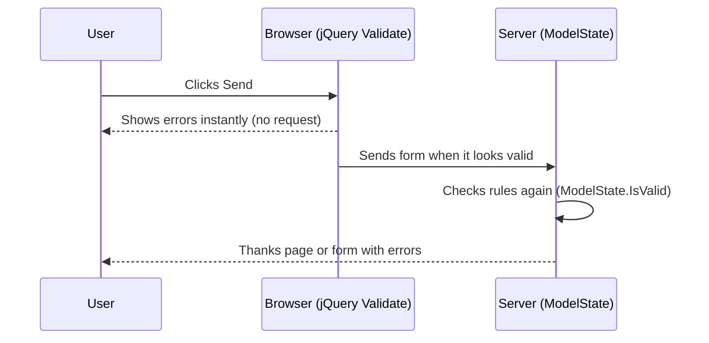

# Session 03: Client-Side Development with ASP.NET Core MVC

> Module: Building Robust Web Applications with ASP.NET Core MVC · Term 3 (HDSE I) · ⏱ ~2 hours

## 🎯 Learning Objectives

- Build a shared page frame with a **layout** (`_Layout.cshtml`) and `_ViewStart`
- Add styles with Bootstrap 5 and your own `site.css`
- Validate input with **data annotations** on the client and on the server
- Explain conventional routing and attribute routing
- Register and use a service through **dependency injection (DI)**
- Describe how a Single Page Application (SPA) connects to ASP.NET Core

## 📖 Concepts Explained

### 1. Layouts: One Frame, Many Pages

A **layout** is the common shell (head, navbar, footer). Each view fills only the middle part.

| File | Role |
|---|---|
| `Views/Shared/_Layout.cshtml` | The frame; `@RenderBody()` marks where page content goes |
| `Views/_ViewStart.cshtml` | Runs before every view; sets `Layout = "_Layout"` |
| `Views/_ViewImports.cshtml` | Shared `@using` lines and tag helpers for all views |
| `@section Scripts { }` | Lets a page add extra scripts at the bottom of the layout |

Analogy: the layout is a photo frame; each view is a different photo.

### 2. Styles

- Add **Bootstrap 5** from a CDN (or from `wwwroot/lib`) in the layout `<head>`.
- Put your own CSS in `wwwroot/css/site.css` and link it **after** Bootstrap so your rules win.
- `~/css/site.css` means "start from wwwroot".

### 3. Data Annotations

Attributes on model properties describe the rules once; MVC uses them everywhere.

| Attribute | Rule |
|---|---|
| `[Required]` | Must not be empty |
| `[StringLength(50)]` / `[MinLength(10)]` | Length limits |
| `[Range(16, 60)]` | Number range |
| `[EmailAddress]`, `[Phone]`, `[Url]` | Format checks |
| `[Display(Name = "...")]` | Label text shown in forms |

### 4. Client-Side vs Server-Side Validation



**Client validation** is for speed and comfort. **Server validation is mandatory**, because anyone can switch off JavaScript or call your URL directly.

### 5. Routing

| Type | Where defined | Example URL |
|---|---|---|
| Conventional | `MapControllerRoute` pattern `{controller=Home}/{action=Index}/{id?}` | `/Contact/Create` |
| Attribute | `[Route("about-us")]` on an action | `/about-us` |

### 6. Dependency Injection (DI)

Instead of a controller creating objects with `new`, it **asks** for them in its constructor and ASP.NET Core supplies them.

| Lifetime | One instance per… | Typical use |
|---|---|---|
| `AddSingleton` | whole app | Settings, caches, our quote list |
| `AddScoped` | HTTP request | `DbContext`, repositories |
| `AddTransient` | every request for it | Light, stateless helpers |

Benefits: easy to swap implementations (great for testing) and less coupling.

### 7. Single Page Applications

A SPA (React, Angular) loads one HTML page and then fetches JSON. ASP.NET Core supplies the **API** and can also host the built SPA files from `wwwroot`. Visual Studio 2022 has "React and ASP.NET Core" and "Angular and ASP.NET Core" templates that create both projects together.

## 💻 Code Examples

Folder files: `ClientSide.csproj`, `Program.cs`, `Services/QuoteService.cs`, `Controllers/HomeController.cs`, `Controllers/ContactController.cs`, `Models/Contact.cs`, `Views/...`, `wwwroot/css/site.css`. Run `dotnet run`, open `/`, `/about-us` and `/Contact/Create`.

### Example 1: A service and DI (`Services/QuoteService.cs`, `Controllers/HomeController.cs`)

```csharp
namespace ClientSide.Services;

// The interface says WHAT the service can do
public interface IQuoteService
{
    string GetQuote();
}

// The class says HOW it does it
public class QuoteService : IQuoteService
{
    private readonly string[] _quotes =
    {
        "Practice makes progress.",
        "Small steps every day.",
        "Read the error message first."
    };

    public string GetQuote()
    {
        int index = Random.Shared.Next(_quotes.Length);
        return _quotes[index];
    }
}
```

Registered in `Program.cs` with `builder.Services.AddSingleton<IQuoteService, QuoteService>();`

```csharp
using ClientSide.Services;
using Microsoft.AspNetCore.Mvc;

namespace ClientSide.Controllers;

public class HomeController : Controller
{
    private readonly IQuoteService _quotes;

    // DI gives us the service; we never write "new QuoteService()"
    public HomeController(IQuoteService quotes)
    {
        _quotes = quotes;
    }

    // Conventional route: /  or  /Home/Index
    public IActionResult Index()
    {
        ViewData["Quote"] = _quotes.GetQuote();
        return View();
    }

    // Attribute route: /about-us
    [Route("about-us")]
    public IActionResult About()
    {
        return Content("Aptech North Nazimabad - ASP.NET Core batch");
    }
}
```

**How it works**: The controller only knows the interface. DI creates `QuoteService` and passes it in. `[Route("about-us")]` adds a friendly URL.

### Example 2: The model with rules (`Models/Contact.cs`)

```csharp
using System.ComponentModel.DataAnnotations;

namespace ClientSide.Models;

// Data annotations = validation rules written on the model
public class Contact
{
    [Required(ErrorMessage = "Please enter your name")]
    [StringLength(50)]
    public string Name { get; set; } = "";

    [Required, EmailAddress]
    public string Email { get; set; } = "";

    [Range(16, 60, ErrorMessage = "Age must be between 16 and 60")]
    public int Age { get; set; }

    [Display(Name = "Your message")]
    [Required, MinLength(10)]
    public string Message { get; set; } = "";
}
```

**How it works**: One set of attributes drives labels, client checks and server checks.

### Example 3: Server validation (`Controllers/ContactController.cs`)

```csharp
using ClientSide.Models;
using Microsoft.AspNetCore.Mvc;

namespace ClientSide.Controllers;

public class ContactController : Controller
{
    // GET /Contact/Create  -> show the empty form
    [HttpGet]
    public IActionResult Create()
    {
        return View();
    }

    // POST /Contact/Create  -> check the data on the SERVER
    [HttpPost]
    [ValidateAntiForgeryToken]
    public IActionResult Create(Contact contact)
    {
        if (!ModelState.IsValid)
        {
            return View(contact);   // show the form again with errors
        }
        TempData["Name"] = contact.Name;
        return RedirectToAction("Thanks");
    }

    public IActionResult Thanks()
    {
        return Content($"Thank you, {TempData["Name"]}! We will reply soon.");
    }
}
```

**How it works**: On POST, model binding fills `contact` and checks the rules. If something fails, we return the same view so errors appear. On success we use **Post-Redirect-Get** to avoid double submission.

### Example 4: The form (`Views/Contact/Create.cshtml`, excerpt)

```cshtml
<label asp-for="Name" class="form-label"></label>
<input asp-for="Name" class="form-control" />
<span asp-validation-for="Name" class="text-danger"></span>
```

**How it works**: `asp-for` creates the label text, input name and the `data-val-*` attributes that jQuery Validate reads. `asp-validation-for` shows the error message. The full file also loads the three validation scripts in `@section Scripts`.

## 🧪 Lab Practice

1. Run the app, submit an empty contact form and note the instant errors. Disable JavaScript and submit again to see server errors.
2. Add a `Phone` property with `[Phone]` and show it in the form.
3. Add a footer to `_Layout.cshtml` with the current year using `@DateTime.Now.Year`.
4. Add a `[Route("quote")]` action that returns only the quote text.
5. Change `AddSingleton` to `AddTransient` and explain if the behaviour changes.

## 📝 Assignment

Build a "Course Enquiry" form (Name, Email, Course from a dropdown, Preferred time) with data annotations, both validations and a thank-you page using Post-Redirect-Get.

## ❓ Quick Quiz

1. Which method in a layout outputs the page's content?
2. Why is server validation required even with client validation?
3. Which DI lifetime suits a `DbContext`?
4. What does `asp-for` do?
5. Give the default conventional route pattern.

<details>
<summary>Show answers</summary>

1. `@RenderBody()`
2. Client checks can be skipped or switched off; only the server can be trusted.
3. Scoped
4. Generates the element's name, id, value, label text and validation attributes from a model property.
5. `{controller=Home}/{action=Index}/{id?}`

</details>

## 💼 Interview Questions

1. **Explain DI lifetimes with examples.** Singleton for shared state like config; Scoped per request like `DbContext`; Transient for lightweight stateless services.
2. **What is Post-Redirect-Get?** After a successful POST, redirect to a GET page so refreshing does not resubmit the form.
3. **Conventional vs attribute routing?** Conventional uses a central pattern; attribute routes sit on controllers/actions and are common in APIs.

## ✅ Summary

- Layouts, `_ViewStart` and `_ViewImports` keep views short and consistent.
- Bootstrap plus your own `site.css` styles the app.
- Data annotations power labels, client validation and server validation.
- Routing maps URLs to actions; DI hands services to controllers.
- SPAs talk to ASP.NET Core through JSON APIs.

---

[⬅ Previous](../Session-02-Web-Models-ADONET-and-EF-Core/README.md) · [🏠 Module Home](../README.md) · [Next ➡](../Session-04-Lab-Review-MVC-Foundations/README.md)

Prepared by Zeeshan Abbas · Aptech Learning North Nazimabad
