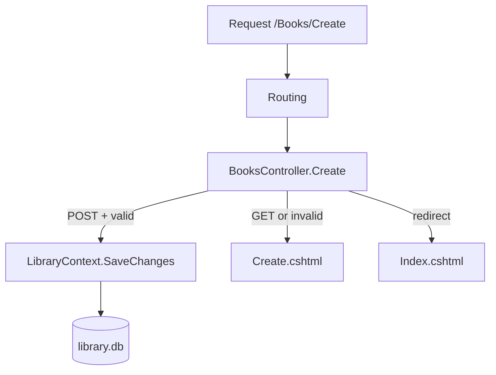

# Session 04: Lab and Review: MVC Foundations

> Module: Building Robust Web Applications with ASP.NET Core MVC · Term 3 (HDSE I) · ⏱ ~2 hours

## 🎯 Learning Objectives

- Revise ASP.NET Core basics, the pipeline, EF Core and client-side features from Sessions 01–03
- Build a small MVC app from an empty folder with a model, context, controller and views
- Save form data to a database with validation
- Debug common beginner errors in MVC projects
- Explain each part of the app in your own words

## 📖 Concepts Explained

### 1. Quick Revision Map



| Session | Key idea | One-line reminder |
|---|---|---|
| 01 | Pipeline | Middleware runs in order; static files live in `wwwroot` |
| 02 | Data | ADO.NET = SQL by hand; EF Core = LINQ + `DbContext` |
| 03 | Client side | Layouts, data annotations, routing, DI |

### 2. The Five Pieces of Every MVC Feature

1. **Model** – the class with rules (`Book`).
2. **DbContext** – the table access (`LibraryContext.Books`).
3. **Controller** – actions for GET (show) and POST (save).
4. **Views** – `Index` (list) and `Create` (form).
5. **Registration** – `AddDbContext` and the route in `Program.cs`.

### 3. Common Errors and Fixes

| Error you see | Likely cause | Fix |
|---|---|---|
| `InvalidOperationException: Unable to resolve service for type 'LibraryContext'` | Forgot `AddDbContext` | Register it in `Program.cs` |
| `The view 'Index' was not found` | Wrong folder name | View must be in `Views/Books/Index.cshtml` |
| Tag helpers render as plain text (`asp-for` visible) | Missing `_ViewImports` | Add `@addTagHelper *, Microsoft.AspNetCore.Mvc.TagHelpers` |
| `SQLite Error 1: no such table` | Old database file | Delete `library.db` and run again (or use migrations) |
| 400 Bad Request on POST | Anti-forgery token missing | Use the `<form asp-action>` tag helper |

## 💻 Code Examples

Folder files: `LibraryLab.csproj`, `Program.cs`, `Models/Book.cs`, `Data/LibraryContext.cs`, `Controllers/BooksController.cs`, `Views/_ViewImports.cshtml`, `Views/Books/Index.cshtml`, `Views/Books/Create.cshtml`. This is the **reference solution** for the lab; try the lab first.

### Example 1: Model (`Models/Book.cs`)

```csharp
using System.ComponentModel.DataAnnotations;

namespace LibraryLab.Models;

public class Book
{
    public int Id { get; set; }

    [Required, StringLength(100)]
    public string Title { get; set; } = "";

    [Required]
    public string Author { get; set; } = "";

    [Range(1900, 2100)]
    public int Year { get; set; } = DateTime.Now.Year;
}
```

**How it works**: Three rules: title required (max 100), author required, year between 1900 and 2100. A default year fills the form.

### Example 2: Controller (`Controllers/BooksController.cs`)

```csharp
using LibraryLab.Data;
using LibraryLab.Models;
using Microsoft.AspNetCore.Mvc;

namespace LibraryLab.Controllers;

public class BooksController : Controller
{
    private readonly LibraryContext _db;

    public BooksController(LibraryContext db)
    {
        _db = db;
    }

    // GET /Books
    public IActionResult Index()
    {
        var books = _db.Books.OrderBy(b => b.Title).ToList();
        return View(books);
    }

    // GET /Books/Create
    public IActionResult Create()
    {
        return View(new Book());
    }

    // POST /Books/Create
    [HttpPost, ValidateAntiForgeryToken]
    public IActionResult Create(Book book)
    {
        if (!ModelState.IsValid) return View(book);

        _db.Books.Add(book);     // Step 1: tell EF about the new row
        _db.SaveChanges();       // Step 2: run the INSERT
        return RedirectToAction(nameof(Index));
    }
}
```

**How it works**: `Index` lists books. GET `Create` shows a form with a new `Book`. POST `Create` validates, saves with two lines, then redirects to the list.

### Example 3: Form view (`Views/Books/Create.cshtml`)

```cshtml
@model Book
<h1>Add a book</h1>
<form asp-action="Create" method="post">
    <p><label asp-for="Title"></label> <input asp-for="Title" /> <span asp-validation-for="Title"></span></p>
    <p><label asp-for="Author"></label> <input asp-for="Author" /> <span asp-validation-for="Author"></span></p>
    <p><label asp-for="Year"></label> <input asp-for="Year" /> <span asp-validation-for="Year"></span></p>
    <button type="submit">Save</button>
</form>
```

**How it works**: The form tag helper adds the anti-forgery token automatically. Each `asp-validation-for` shows the server error after a failed POST.

## 🧪 Lab Practice

1. **Create the project**: `dotnet new web -n LibraryLab`, then `dotnet add package Microsoft.EntityFrameworkCore.Sqlite --version 8.0.11`.
2. **Model and context**: add `Book` and `LibraryContext`, register the context and the default route in `Program.cs`.
3. **List page**: add `BooksController.Index` and its view. Run and see an empty table.
4. **Create page**: add GET/POST `Create` and the form. Add three books, then try to save an empty form.
5. **Polish**: add the Bootstrap layout from Session 03 and a `Details(int id)` action that shows one book (return `NotFound()` if the id does not exist).

## 📝 Assignment

Extend the library with a `Member` model (Name, Phone, JoinDate) and pages to list and add members. Link both pages from a shared layout navbar.

## ❓ Quick Quiz

1. Which two lines insert a new row with EF Core?
2. Where must the `Index` view of `BooksController` be saved?
3. What does `nameof(Index)` give you over the string `"Index"`?
4. What returns a 404 from an action?
5. Why does POST redirect instead of returning the list view directly?

<details>
<summary>Show answers</summary>

1. `_db.Books.Add(book);` and `_db.SaveChanges();`
2. `Views/Books/Index.cshtml`
3. A compile-time check: renaming the method updates or breaks the build instead of failing at runtime.
4. `return NotFound();`
5. Post-Redirect-Get: refreshing the page will not insert the book again.

</details>

## 💼 Interview Questions

1. **Walk me through what happens when a user submits an MVC form.** Routing finds the POST action, model binding fills the model, validation sets `ModelState`, the action saves or re-shows the view, then redirects.
2. **Why do we pass a model to the view instead of using ViewBag?** Strong typing, IntelliSense and compile-time checks.
3. **How do you debug "service not registered" errors?** Check the DI registration in `Program.cs` and the constructor parameter types.

## ✅ Summary

- Every MVC feature needs a model, context, controller, views and registration.
- GET shows, POST validates and saves, then redirects (PRG).
- Most beginner errors are missing registrations, wrong view folders or missing `_ViewImports`.
- Build the lab from an empty folder to prove you understand each step.

---

[⬅ Previous](../Session-03-Client-Side-Development-with-MVC/README.md) · [🏠 Module Home](../README.md) · [Next ➡](../Session-05-Authorization-Helpers-Filters-Partials/README.md)

Prepared by Zeeshan Abbas · Aptech Learning North Nazimabad
