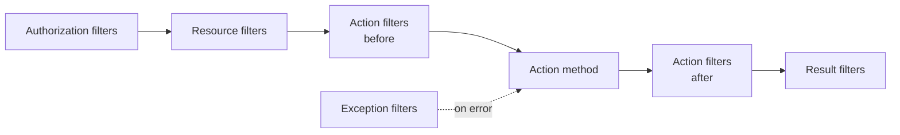

# Session 05: Authorization, Tag Helpers, Filters and Partial Views

> Module: Building Robust Web Applications with ASP.NET Core MVC · Term 3 (HDSE I) · ⏱ ~2 hours

## 🎯 Learning Objectives

- Explain authentication vs authorization and apply **role-based** authorization
- Show or hide parts of a page with **view-based** authorization
- Use action selectors such as `[HttpGet]`, `[ActionName]` and `[NonAction]`
- Compare HTML helpers and tag helpers
- Apply built-in filters and write a **custom action filter**
- Reuse markup with **partial views** and list key MVC security practices

## 📖 Concepts Explained

### 1. Authentication vs Authorization

| | Authentication | Authorization |
|---|---|---|
| Question | Who are you? | What may you do? |
| Example | Login with a cookie | Only Admins open `/Admin` |
| Code | `UseAuthentication()`, `SignInAsync` | `UseAuthorization()`, `[Authorize]` |

Analogy: the security guard checks your **ID card** (authentication); the access list decides which **rooms** you may enter (authorization).

A logged-in user is a `ClaimsPrincipal` holding **claims** such as Name and Role.

### 2. Role-Based and View-Based Authorization

- `[Authorize]` – any logged-in user.
- `[Authorize(Roles = "Admin")]` – only that role (comma-separated list = any of them).
- `[AllowAnonymous]` – opens one action inside a protected controller.
- In a view, `@if (User.IsInRole("Admin")) { ... }` hides links or buttons. This is for **display only**; always protect the action as well.

### 3. Action Selectors

| Selector | Effect |
|---|---|
| `[HttpGet]`, `[HttpPost]`, `[HttpPut]`, `[HttpDelete]` | Action answers only that HTTP verb |
| `[ActionName("contact-info")]` | URL uses a different name from the method |
| `[NonAction]` | Public method that is **not** reachable by URL |

### 4. HTML Helpers vs Tag Helpers

| HTML helper (older, C# style) | Tag helper (modern, HTML style) |
|---|---|
| `@Html.TextBoxFor(m => m.Name)` | `<input asp-for="Name" />` |
| `@Html.ActionLink("Home", "Index")` | `<a asp-action="Index">Home</a>` |
| `@Html.Partial("_Card")` | `<partial name="_Card" />` |

Both produce the same HTML. Tag helpers are easier for designers to read, so new code prefers them.

### 5. Filters

Filters run code **around** an action without repeating it in every method.



Built-in examples: `[Authorize]`, `[ValidateAntiForgeryToken]`, `[ResponseCache]`, `[RequireHttps]`. Apply a filter to one action, a whole controller, or globally with `options.Filters.Add(...)`.

### 6. Partial Views

A **partial view** is a small reusable piece of a page (a card, a table row). By convention its name starts with `_`. Render it with `<partial name="_CourseCard" model="course" />`.

### 7. MVC Security Checklist

- Protect actions with `[Authorize]`, not just hidden links.
- Keep `[ValidateAntiForgeryToken]` on POST actions.
- Never trust input; validate on the server.
- Use HTTPS and secure cookies; never store passwords in plain text (Session 17 uses Identity).

## 💻 Code Examples

Folder files: `AuthFilters.csproj`, `Program.cs`, `Controllers/AccountController.cs`, `Controllers/AdminController.cs`, `Controllers/HomeController.cs`, `Filters/LogTimeAttribute.cs`, `Models/Course.cs`, `Views/...`. Run, open `/`, login as `admin` and then as `ali`, and try `/Admin`.

### Example 1: Cookie login with roles (`Controllers/AccountController.cs`, POST action)

```csharp
string role = userName == "admin" ? "Admin" : "Student";
var claims = new List<Claim>
{
    new Claim(ClaimTypes.Name, userName),
    new Claim(ClaimTypes.Role, role)
};
var identity = new ClaimsIdentity(claims, CookieAuthenticationDefaults.AuthenticationScheme);
await HttpContext.SignInAsync(new ClaimsPrincipal(identity));
```

**How it works**: We create claims, wrap them in an identity and sign in, which writes an encrypted cookie. This demo skips the password on purpose; never do that in real apps.

### Example 2: Protecting a controller (`Controllers/AdminController.cs`)

```csharp
using Microsoft.AspNetCore.Authorization;
using Microsoft.AspNetCore.Mvc;

namespace AuthFilters.Controllers;

// Role-based authorization: only users in the Admin role
[Authorize(Roles = "Admin")]
public class AdminController : Controller
{
    public IActionResult Index()
    {
        return Content($"Welcome to the admin area, {User.Identity!.Name}.");
    }
}
```

**How it works**: A Student who opens `/Admin` is sent to `/Account/Denied`; an anonymous user is sent to the login page.

### Example 3: A custom filter (`Filters/LogTimeAttribute.cs`)

```csharp
using System.Diagnostics;
using Microsoft.AspNetCore.Mvc.Filters;

namespace AuthFilters.Filters;

// A custom action filter: measures how long an action takes
public class LogTimeAttribute : ActionFilterAttribute
{
    // Runs BEFORE the action
    public override void OnActionExecuting(ActionExecutingContext context)
    {
        context.HttpContext.Items["watch"] = Stopwatch.StartNew();
    }

    // Runs AFTER the action
    public override void OnActionExecuted(ActionExecutedContext context)
    {
        var watch = (Stopwatch)context.HttpContext.Items["watch"]!;
        string action = context.ActionDescriptor.DisplayName ?? "action";
        Console.WriteLine($"{action} took {watch.ElapsedMilliseconds} ms");
    }
}
```

**How it works**: The filter starts a stopwatch before the action and prints the time after it. We store the stopwatch in `HttpContext.Items` because one filter object can serve many requests at once.

### Example 4: Partial view + view-based authorization (`Views/Home/Index.cshtml`, excerpt)

```cshtml
@foreach (var course in Model)
{
    <partial name="_CourseCard" model="course" />
}
@if (User.IsInRole("Admin"))
{
    <p><a asp-controller="Admin" asp-action="Index">Go to Admin panel</a></p>
}
```

**How it works**: `_CourseCard.cshtml` draws one card per course. The admin link appears only for the Admin role.

## 🧪 Lab Practice

1. Run the app and check the console output from `[LogTime]` for each request.
2. Add a `Teacher` role (user name `teacher`) and a `ReportsController` open to `Admin,Teacher`.
3. Add `[AllowAnonymous]` to one action inside `AdminController` and test it logged out.
4. Rewrite the login input with a tag helper instead of `@Html.TextBox`.
5. Register `LogTimeAttribute` globally in `AddControllersWithViews(o => o.Filters.Add(new LogTimeAttribute()))` and remove the attribute from `HomeController`.

## 📝 Assignment

Write a custom `[BlockFriday]` action filter that returns `Content("Closed on Friday")` (set `context.Result`) when today is Friday, and apply it to one action.

## ❓ Quick Quiz

1. Which middleware must run first: authentication or authorization?
2. What does `[NonAction]` do?
3. Why is hiding a link not enough security?
4. Which filter type runs first in the pipeline?
5. What naming convention do partial views follow?

<details>
<summary>Show answers</summary>

1. Authentication
2. Stops a public controller method from being called by URL.
3. Users can still type the URL; the action itself must be protected with `[Authorize]`.
4. Authorization filters
5. They start with an underscore, e.g. `_CourseCard.cshtml`.

</details>

## 💼 Interview Questions

1. **What is a claim?** A key-value fact about the user (name, role, email) carried in the identity.
2. **Difference between action filters and middleware?** Middleware sees every request; filters run only around MVC actions and know about action arguments and results.
3. **How would you allow access to two roles?** `[Authorize(Roles = "Admin,Teacher")]` or a policy.

## ✅ Summary

- Authentication identifies users; authorization decides access through roles and `[Authorize]`.
- View-based checks hide UI; action-level checks enforce security.
- Selectors, helpers, filters and partial views keep controllers and views clean.
- Custom filters add cross-cutting behaviour like logging in one place.

---

[⬅ Previous](../Session-04-Lab-Review-MVC-Foundations/README.md) · [🏠 Module Home](../README.md) · [Next ➡](../Session-06-Action-Methods-Web-API-Areas-Bundling/README.md)

Prepared by Zeeshan Abbas · Aptech Learning North Nazimabad
