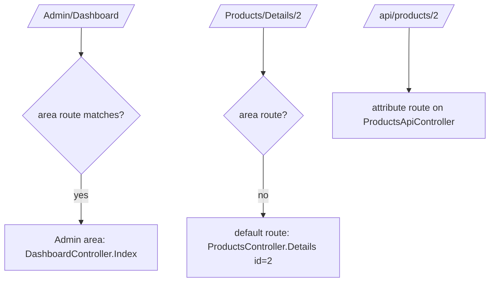

# Session 06: Action Methods, Web API, Areas and Bundling

> Module: Building Robust Web Applications with ASP.NET Core MVC · Term 3 (HDSE I) · ⏱ ~2 hours

## 🎯 Learning Objectives

- Use the main **action result** types: View, Content, Json, Redirect, NotFound
- Compare a REST **Web API** with an older **SOAP** service
- Declare conventional routes, area routes and attribute routes
- Share data with ViewData, ViewBag, TempData and strongly typed models
- Organise a large app with **Areas**
- Bundle and minify CSS/JS files

## 📖 Concepts Explained

### 1. Action Methods and Results

An **action method** is a public method on a controller. It returns an `IActionResult` that tells MVC what to send back.

| Helper | Result type | Sends |
|---|---|---|
| `View(model)` | `ViewResult` | HTML from a Razor view |
| `Content("text")` | `ContentResult` | Plain text |
| `Json(data)` | `JsonResult` | JSON |
| `RedirectToAction("Index")` | `RedirectToActionResult` | 302 redirect |
| `NotFound()` / `BadRequest()` / `Ok()` | Status code results | 404 / 400 / 200 |
| `File(bytes, "application/pdf")` | `FileContentResult` | A download |

### 2. Web API vs SOAP

| | REST Web API | SOAP service |
|---|---|---|
| Format | JSON (sometimes XML) | XML envelope only |
| Transport | HTTP verbs: GET, POST, PUT, DELETE | Usually HTTP POST |
| Contract | Optional (OpenAPI) | Required (WSDL) |
| Weight | Light, easy for JS and mobile | Heavy, strict, used in older enterprise/banking systems |

In ASP.NET Core an API controller inherits `ControllerBase` (no view support) and uses `[ApiController]`.

### 3. Route Declarations



- Put the **more specific** route (areas) before the default route.
- Route constraints limit values: `{id:int}`, `{name:alpha}`, `{area:exists}`.

### 4. Sharing Data with Views

| Way | Lifetime | Typed? | Good for |
|---|---|---|---|
| Model (`View(product)`) | This request | Yes | Main data of the page |
| `ViewData["Key"]` | This request | No (dictionary) | Page title |
| `ViewBag.Key` | This request | No (dynamic) | Same storage as ViewData |
| `TempData["Key"]` | Until read (survives one redirect) | No | "Saved successfully" messages |

### 5. Areas

An **area** is a mini-MVC inside your app with its own `Controllers` and `Views`, for example `Areas/Admin` and `Areas/Student`. Mark controllers with `[Area("Admin")]`.

### 6. Bundling and Minification

- **Bundling** joins many files into one, so the browser makes fewer requests.
- **Minification** removes spaces and comments and shortens names, so files are smaller.
- The old `BundleConfig.cs` from MVC 5 does not exist in Core. We use the free **WebOptimizer** package, which bundles at runtime. In Production, also consider a CDN.

## 💻 Code Examples

Folder files: `ActionsApi.csproj`, `Program.cs`, `Models/Product.cs`, `Data/ProductStore.cs`, `Controllers/ProductsController.cs`, `Controllers/Api/ProductsApiController.cs`, `Areas/Admin/Controllers/DashboardController.cs`, `Views/Products/Details.cshtml`, `wwwroot/...`, `requests.http`.

### Example 1: Many action results (`Controllers/ProductsController.cs`)

```csharp
using ActionsApi.Data;
using Microsoft.AspNetCore.Mvc;

namespace ActionsApi.Controllers;

public class ProductsController : Controller
{
    // 1. ContentResult: plain text
    public IActionResult Index()
    {
        return Content($"We have {ProductStore.Products.Count} products. Try /Products/Details/1");
    }

    // 2. ViewResult + sharing data with ViewData, ViewBag and the model
    public IActionResult Details(int id)
    {
        var product = ProductStore.Products.FirstOrDefault(p => p.Id == id);
        if (product == null)
        {
            return NotFound();                 // 3. 404 result
        }
        ViewData["Title"] = "Product details"; // dictionary style
        ViewBag.Shop = "Aptech Tech Store";    // dynamic style (same storage as ViewData)
        return View(product);                  // strongly typed model (best)
    }

    // 4. JsonResult
    public IActionResult AsJson()
    {
        return Json(ProductStore.Products);
    }

    // 5. TempData survives ONE redirect
    public IActionResult Buy(int id)
    {
        TempData["Message"] = $"Product {id} added to cart";
        return RedirectToAction(nameof(Thanks));   // 6. redirect result
    }

    public IActionResult Thanks()
    {
        return Content(TempData["Message"]?.ToString() ?? "Nothing in TempData");
    }
}
```

**How it works**: Each action returns a different result. Open `/Products/Details/9` to see the 404, `/Products/AsJson` for JSON, and `/Products/Buy/1` to watch TempData survive the redirect.

### Example 2: A Web API controller (`Controllers/Api/ProductsApiController.cs`)

```csharp
using ActionsApi.Data;
using ActionsApi.Models;
using Microsoft.AspNetCore.Mvc;

namespace ActionsApi.Controllers.Api;

// [ApiController] = automatic 400 for bad input + binding from JSON body
[ApiController]
[Route("api/products")]
public class ProductsApiController : ControllerBase
{
    // GET api/products
    [HttpGet]
    public ActionResult<List<Product>> GetAll()
    {
        return ProductStore.Products;
    }

    // GET api/products/2
    [HttpGet("{id:int}")]
    public ActionResult<Product> GetById(int id)
    {
        var product = ProductStore.Products.FirstOrDefault(p => p.Id == id);
        if (product == null) return NotFound();
        return product;
    }

    // POST api/products   body: { "name": "Monitor", "price": 30000 }
    [HttpPost]
    public ActionResult<Product> Create(Product product)
    {
        product.Id = ProductStore.Products.Max(p => p.Id) + 1;
        ProductStore.Products.Add(product);
        return CreatedAtAction(nameof(GetById), new { id = product.Id }, product);
    }
}
```

**How it works**: Attribute routes build `api/products` URLs. `ActionResult<T>` lets us return either data or a status code. `CreatedAtAction` returns 201 with a `Location` header. Test it with `requests.http` in VS / VS Code (change the port to yours).

### Example 3: An area controller (`Areas/Admin/Controllers/DashboardController.cs`)

```csharp
using Microsoft.AspNetCore.Mvc;

namespace ActionsApi.Areas.Admin.Controllers;

// This controller belongs to the "Admin" area: URL /Admin/Dashboard
[Area("Admin")]
public class DashboardController : Controller
{
    public IActionResult Index()
    {
        return Content("Admin area dashboard");
    }
}
```

**How it works**: `[Area("Admin")]` plus the `areas` route in `Program.cs` give the URL `/Admin/Dashboard`.

### Example 4: Bundling (excerpt of `Program.cs`)

```csharp
builder.Services.AddWebOptimizer(pipeline =>
{
    pipeline.AddCssBundle("/css/bundle.css", "css/*.css");
    pipeline.AddJavaScriptBundle("/js/bundle.js", "js/*.js");
});
app.UseWebOptimizer();   // before UseStaticFiles
```

**How it works**: Requests for `/css/bundle.css` return `base.css` + `theme.css` joined and minified. Open it in the browser to see one long line.

## 🧪 Lab Practice

1. Run the app and visit every action in `ProductsController`. Write down the HTTP status code of each (browser DevTools → Network).
2. Add `PUT api/products/{id}` and `DELETE api/products/{id}` to the API and test them in `requests.http`.
3. Create a `Student` area with a `HomeController` that returns "Student portal".
4. Add a third CSS file and confirm it appears inside `/css/bundle.css`.
5. Add a `Download` action that returns a text file using `File(bytes, "text/plain", "products.txt")`.

## 📝 Assignment

Build an `api/courses` Web API (GET all, GET by id, POST) with an in-memory list, plus an MVC page that shows a TempData success message after adding a course.

## ❓ Quick Quiz

1. Which base class do API controllers inherit?
2. How long does TempData keep a value?
3. What is the difference between ViewData and ViewBag?
4. Why is the area route registered before the default route?
5. Which status code does `CreatedAtAction` return?

<details>
<summary>Show answers</summary>

1. `ControllerBase`
2. Until it is read, so it survives one redirect.
3. Same storage; ViewData uses string keys, ViewBag uses dynamic properties.
4. Routes are matched in order; the more specific pattern must be tried first.
5. 201 Created

</details>

## 💼 Interview Questions

1. **What does `[ApiController]` add?** Attribute routing requirement, automatic 400 responses for invalid models, and smarter binding sources.
2. **REST vs SOAP?** REST is lightweight, resource-based and usually JSON over HTTP verbs; SOAP is a strict XML protocol with WSDL contracts.
3. **When would you use Areas?** When an app has separate sections (Admin, Student, Teacher) that each need their own controllers and views.

## ✅ Summary

- Actions return results: views, text, JSON, redirects, files or status codes.
- Web APIs return JSON with `ControllerBase` and `[ApiController]`; SOAP is the older XML style.
- Routes can be conventional, attribute-based or area-based; order matters.
- Share data with models first, then ViewData/ViewBag; use TempData across redirects.
- Areas organise big apps; bundling and minification make pages load faster.

---

[⬅ Previous](../Session-05-Authorization-Helpers-Filters-Partials/README.md) · [🏠 Module Home](../README.md) · [Next ➡](../Session-07-Modern-ASPNET-Core-Enhancements/README.md)

Prepared by Zeeshan Abbas · Aptech Learning North Nazimabad
