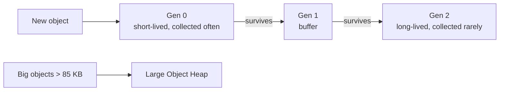

# Session 07: Modern ASP.NET Core Enhancements

> Module: Building Robust Web Applications with ASP.NET Core MVC · Term 3 (HDSE I) · ⏱ ~2 hours

## 🎯 Learning Objectives

- Describe recent enhancements to MVC, Razor Pages and Minimal APIs
- Use model binding sources (`[FromRoute]`, `[FromQuery]`, `[FromHeader]`, `[FromBody]`, `[AsParameters]`)
- Serialize and deserialize JSON with **System.Text.Json**
- Capture and analyse a memory dump with `dotnet-dump`
- Explain how the **garbage collector** manages memory in generations
- List performance improvements in modern .NET versions

## 📖 Concepts Explained

### 1. One App, Three Styles

| Style | File(s) | Use when |
|---|---|---|
| MVC controllers | `Controllers/*.cs` + `Views/` | Many related pages and APIs |
| Razor Pages | `Pages/Name.cshtml` + `.cshtml.cs` | Page-focused forms (simpler than MVC) |
| Minimal APIs | `app.MapGet(...)` in `Program.cs` | Small, fast JSON endpoints |

Recent improvements include: `[AsParameters]`, route groups (`app.MapGroup("/api")`), typed results, output caching, rate limiting middleware, keyed DI services (.NET 8) and better Native AOT support.

### 2. Model Binding

**Model binding** copies values from the HTTP request into your method parameters.

| Attribute | Reads from | Example |
|---|---|---|
| `[FromRoute]` | URL segment | `/binding/route/5` |
| `[FromQuery]` | Query string | `?city=Karachi` |
| `[FromHeader]` | HTTP header | `X-Batch: 2401` |
| `[FromBody]` | JSON body | POST data |
| `[FromForm]` | HTML form fields | MVC forms |
| `[AsParameters]` | Many sources into one object | Minimal APIs |

With `[ApiController]`, complex types come from the body and simple types from route/query automatically, but writing the attribute makes your intent clear.

### 3. System.Text.Json

The built-in, fast JSON library (no Newtonsoft needed).

| Task | Code |
|---|---|
| Object → JSON | `JsonSerializer.Serialize(obj)` |
| JSON → object | `JsonSerializer.Deserialize<T>(json)` |
| camelCase names | `PropertyNamingPolicy = JsonNamingPolicy.CamelCase` |
| Pretty print | `WriteIndented = true` |
| Rename one property | `[JsonPropertyName("full_name")]` |
| Skip a property | `[JsonIgnore]` |

### 4. Garbage Collection (GC)

C# frees memory automatically. The GC divides objects into **generations**:



Tips: create fewer temporary objects in hot code, dispose resources with `using`, and **do not** call `GC.Collect()` in real apps.

### 5. Dump Debugging

A **dump** is a snapshot of a running process's memory, used when an app hangs or uses too much memory in production.

```bash
dotnet tool install --global dotnet-dump
dotnet-dump ps                      # find the process id
dotnet-dump collect -p 12345        # write a .dmp file
dotnet-dump analyze <file.dmp>      # open the interactive analyser
> dumpheap -stat                    # which types use the most memory
> clrstack                          # what each thread is doing
```

### 6. Performance in Modern .NET

- Faster JSON, LINQ and string handling every release
- **Dynamic PGO** (on by default in .NET 8) optimises hot code while it runs
- Kestrel and HTTP/2/HTTP/3 improvements
- Lower memory with `Span<T>`, pooling and the `Server GC` mode for web apps

## 💻 Code Examples

Folder files: `Modern.csproj`, `Program.cs`, `Models/Student.cs`, `Controllers/BindingController.cs`, `Pages/_ViewImports.cshtml`, `Pages/Hello.cshtml`, `Pages/Hello.cshtml.cs`, `requests.http`.

### Example 1: Records for data (`Models/Student.cs`)

```csharp
namespace Modern.Models;

// A record: short immutable data type, perfect for JSON
public record Student(int Id, string FullName, DateOnly JoinDate);

// Used with [AsParameters] to group query-string values
public record SearchQuery(string? Name, int Page = 1, int PageSize = 10);
```

**How it works**: One line defines a type with properties, equality and a nice `ToString()`.

### Example 2: Binding sources (`Controllers/BindingController.cs`)

```csharp
using Microsoft.AspNetCore.Mvc;
using Modern.Models;

namespace Modern.Controllers;

[ApiController]
[Route("binding")]
public class BindingController : ControllerBase
{
    // /binding/route/5
    [HttpGet("route/{id}")]
    public string FromRouteDemo([FromRoute] int id) => $"id from route = {id}";

    // /binding/query?city=Karachi
    [HttpGet("query")]
    public string FromQueryDemo([FromQuery] string city) => $"city from query = {city}";

    // header "X-Batch: 2401"
    [HttpGet("header")]
    public string FromHeaderDemo([FromHeader(Name = "X-Batch")] string batch) => $"batch from header = {batch}";

    // POST JSON body: {"id":1,"fullName":"Ali","joinDate":"2026-01-10"}
    [HttpPost("body")]
    public Student FromBodyDemo([FromBody] Student student) => student;
}
```

**How it works**: Each action reads its value from a different part of the request. Try them with `requests.http`.

### Example 3: JSON by hand (excerpt of `Program.cs`)

```csharp
var student = new Student(7, "Fatima Noor", new DateOnly(2026, 3, 1));
var options = new JsonSerializerOptions { PropertyNamingPolicy = JsonNamingPolicy.CamelCase };
string json = JsonSerializer.Serialize(student, options);
Student? back = JsonSerializer.Deserialize<Student>(json, options);
```

**How it works**: Open `/json-demo`. You will see `{"id":7,"fullName":"Fatima Noor","joinDate":"2026-03-01"}` and the record printed again. `DateOnly` is supported from .NET 7.

### Example 4: A Razor Page (`Pages/Hello.cshtml.cs`)

```csharp
using Microsoft.AspNetCore.Mvc;
using Microsoft.AspNetCore.Mvc.RazorPages;

namespace Modern.Pages;

// A Razor Page: the page and its handler code live side by side
public class HelloModel : PageModel
{
    [BindProperty]                 // fill Name from the posted form
    public string Name { get; set; } = "";

    public string Message { get; set; } = "";

    public void OnGet()            // runs for GET /Hello
    {
        Message = "Type your name and press Greet.";
    }

    public void OnPost()           // runs for POST /Hello
    {
        Message = $"Assalam-o-Alaikum, {Name}!";
    }
}
```

**How it works**: Open `/Hello`. `OnGet` runs first; submitting the form runs `OnPost`, and `[BindProperty]` fills `Name`.

## 🧪 Lab Practice

1. Run the app and call every endpoint in `requests.http`. Note which attribute supplied each value.
2. Add `[JsonPropertyName("name")]` to a new `Teacher` record property and check the JSON output.
3. Group the minimal APIs with `var api = app.MapGroup("/api");` and move `/students` under it.
4. Open `/gc` several times and watch the Gen0 count grow.
5. Install `dotnet-dump`, collect a dump of the running app and run `dumpheap -stat`.

## 📝 Assignment

Create a Razor Page `Pages/Bmi.cshtml` that takes weight and height, calculates BMI in `OnPost`, and also expose the same calculation as a minimal API `GET /api/bmi?weight=70&height=1.75`.

## ❓ Quick Quiz

1. Which attribute reads a value from an HTTP header?
2. Which generation holds short-lived objects?
3. Name the method that turns JSON into an object.
4. In a Razor Page, which method handles a form POST?
5. What tool captures a memory dump of a .NET process?

<details>
<summary>Show answers</summary>

1. `[FromHeader]`
2. Generation 0
3. `JsonSerializer.Deserialize<T>()`
4. `OnPost` (or `OnPostAsync`)
5. `dotnet-dump`

</details>

## 💼 Interview Questions

1. **Razor Pages vs MVC?** Razor Pages group a page with its handler (great for form pages); MVC separates controllers and views (great for many actions and APIs).
2. **Why avoid calling `GC.Collect()`?** It pauses the app and usually makes performance worse; the GC tunes itself.
3. **System.Text.Json vs Newtonsoft.Json?** System.Text.Json is built in and faster; Newtonsoft has more features for unusual cases.

## ✅ Summary

- Modern ASP.NET Core mixes MVC, Razor Pages and Minimal APIs in one app.
- Binding attributes say exactly where each value comes from.
- System.Text.Json handles JSON quickly with simple options.
- The GC uses generations; dumps help diagnose memory and hang problems.
- Each .NET release brings real performance gains for free.

---

[⬅ Previous](../Session-06-Action-Methods-Web-API-Areas-Bundling/README.md) · [🏠 Module Home](../README.md) · [Next ➡](../Session-08-Lab-Review-Advanced-MVC/README.md)

Prepared by Zeeshan Abbas · Aptech Learning North Nazimabad
