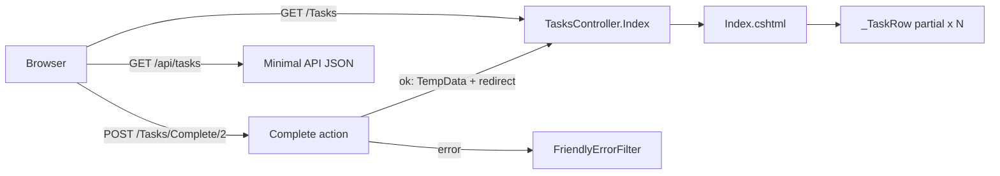

# Session 08: Lab and Review: Advanced MVC

> Module: Building Robust Web Applications with ASP.NET Core MVC · Term 3 (HDSE I) · ⏱ ~2 hours

## 🎯 Learning Objectives

- Revise authorization, selectors, helpers, filters and partial views (Session 05)
- Revise action results, Web API, areas and bundling (Session 06)
- Revise model binding, Razor Pages, JSON and GC (Session 07)
- Combine partial views, TempData, filters and an API in one small app
- Handle controller errors with an **exception filter**

## 📖 Concepts Explained

### 1. Revision Table

| Topic | Remember this | Typical mistake |
|---|---|---|
| `[Authorize(Roles="Admin")]` | Protects the action itself | Only hiding the link in the view |
| Action selectors | `[HttpPost]`, `[ActionName]`, `[NonAction]` | Two actions with same name and no verb attribute (ambiguous match) |
| Filters | Run before/after actions | Storing per-request data in filter fields |
| Partial views | `<partial name="_X" model="..." />` | Forgetting the `_` or the model type |
| Action results | `View`, `Json`, `NotFound`, `RedirectToAction` | Returning `View()` after a successful POST |
| Areas | `[Area("Admin")]` + area route | Area route placed after the default route |
| TempData | Survives one redirect | Expecting it to stay after being read |
| Model binding | `[FromRoute]`, `[FromQuery]`, `[FromBody]` | Sending JSON to a form-bound action |
| System.Text.Json | `Serialize` / `Deserialize<T>` | Property names case mismatch |

### 2. How the Lab App Fits Together



### 3. Exception Filters vs Exception Middleware

| | Exception filter (`IExceptionFilter`) | `UseExceptionHandler` middleware |
|---|---|---|
| Catches | Errors inside MVC actions | Errors anywhere in the pipeline |
| Knows about | Action and controller | Only the HTTP request |
| Best for | Turning action errors into a friendly result | A global safety net |

Real apps usually use both.

## 💻 Code Examples

Folder files: `TaskBoard.csproj`, `Program.cs`, `Models/TaskItem.cs`, `Data/TaskStore.cs`, `Filters/FriendlyErrorFilter.cs`, `Controllers/TasksController.cs`, `Views/_ViewImports.cshtml`, `Views/Tasks/Index.cshtml`, `Views/Shared/_TaskRow.cshtml`.

### Example 1: Exception filter (`Filters/FriendlyErrorFilter.cs`)

```csharp
using Microsoft.AspNetCore.Mvc;
using Microsoft.AspNetCore.Mvc.Filters;

namespace TaskBoard.Filters;

// Exception filter: catches errors thrown inside controller actions
public class FriendlyErrorFilter : IExceptionFilter
{
    public void OnException(ExceptionContext context)
    {
        Console.WriteLine($"Error: {context.Exception.Message}");   // log it
        context.Result = new ContentResult
        {
            Content = "Oops! That task could not be processed.",
            StatusCode = 500
        };
        context.ExceptionHandled = true;   // stop the error from going further
    }
}
```

**How it works**: When an action throws, `OnException` logs the message, sets a friendly result and marks the error as handled. It is registered globally in `Program.cs` with `options.Filters.Add<FriendlyErrorFilter>()`.

### Example 2: Controller with TempData (`Controllers/TasksController.cs`)

```csharp
using Microsoft.AspNetCore.Mvc;
using TaskBoard.Data;

namespace TaskBoard.Controllers;

public class TasksController : Controller
{
    // GET /Tasks
    public IActionResult Index()
    {
        ViewData["Title"] = "Task Board";
        return View(TaskStore.Tasks);
    }

    // POST /Tasks/Complete/2
    [HttpPost, ValidateAntiForgeryToken]
    public IActionResult Complete(int id)
    {
        var task = TaskStore.Tasks.FirstOrDefault(t => t.Id == id);
        if (task == null)
        {
            throw new InvalidOperationException($"Task {id} not found");  // handled by our filter
        }
        task.IsDone = true;
        TempData["Message"] = $"'{task.Title}' marked as done.";
        return RedirectToAction(nameof(Index));
    }
}
```

**How it works**: `Complete` updates the task, stores a message in TempData and redirects. An unknown id throws, which our filter turns into a friendly message.

### Example 3: Partial row with a POST form (`Views/Shared/_TaskRow.cshtml`)

```cshtml
@model TaskItem
<tr>
    <td>@Model.Title</td>
    <td>@(Model.IsDone ? "Done" : "Pending")</td>
    <td>
        @if (!Model.IsDone)
        {
            <form asp-action="Complete" asp-route-id="@Model.Id" method="post">
                <button type="submit">Mark done</button>
            </form>
        }
    </td>
</tr>
```

**How it works**: Each row is a partial. `asp-route-id` adds `/2` to the URL, and the form tag helper adds the anti-forgery token.

## 🧪 Lab Practice

1. Run the app, mark a task as done, and confirm the green TempData message disappears after a refresh.
2. Add a `Create` GET/POST pair with a `[Required]` title using a data annotation and validation messages.
3. Add cookie login from Session 05 and protect `Complete` with `[Authorize]`.
4. Add `app.MapGet("/api/tasks/{id:int}", ...)` that returns `Results.NotFound()` for a missing id.
5. Move the task pages into an `Areas/Student` area and update the routes.

## 📝 Assignment

Add a `Priority` (Low/Medium/High) to tasks, show a coloured badge in `_TaskRow`, and add a minimal API endpoint that returns tasks sorted by priority as JSON.

## ❓ Quick Quiz

1. Which interface do you implement for an exception filter?
2. What does `context.ExceptionHandled = true` do?
3. Which tag helper attribute adds a route value such as id?
4. Why does the message disappear after refresh?
5. Name two ways to return 404 from a minimal API and from a controller.

<details>
<summary>Show answers</summary>

1. `IExceptionFilter` (or `IAsyncExceptionFilter`)
2. Tells MVC the error is dealt with, so it is not re-thrown.
3. `asp-route-id` (in general `asp-route-{name}`)
4. TempData is removed once it has been read.
5. `Results.NotFound()` in minimal APIs, `NotFound()` in a controller.

</details>

## 💼 Interview Questions

1. **How would you handle errors globally in ASP.NET Core?** `UseExceptionHandler` middleware for everything plus exception filters or `ProblemDetails` for API actions, with logging.
2. **Why use partial views?** To reuse markup and keep views short; each partial has one job.
3. **When do you choose a minimal API over a controller?** For small, focused JSON endpoints with little shared logic.

## ✅ Summary

- Sessions 05–07 give you security, clean actions, APIs and modern binding.
- Partial views + TempData + PRG make friendly CRUD pages.
- Exception filters turn action errors into clean responses.
- A single app can serve HTML pages and JSON APIs side by side.

---

[⬅ Previous](../Session-07-Modern-ASPNET-Core-Enhancements/README.md) · [🏠 Module Home](../README.md) · [Next ➡](../Session-09-DotNet-Architecture-Kestrel-and-REST/README.md)

Prepared by Zeeshan Abbas · Aptech Learning North Nazimabad
