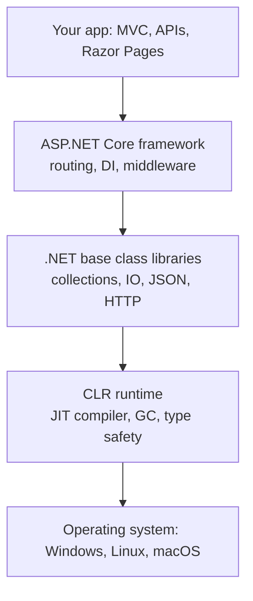

# Session 09: .NET Architecture, Kestrel and REST APIs

> Module: Building Robust Web Applications with ASP.NET Core MVC · Term 3 (HDSE I) · ⏱ ~2 hours

## 🎯 Learning Objectives

- Describe the layers of the .NET platform (runtime, libraries, SDK, ASP.NET Core)
- Trace what happens from `Main` to the first HTTP request
- Explain the role of the **Kestrel** web server and reverse proxies
- Describe the OWIN idea and how it shaped the middleware pipeline
- Design a **REST API** with correct verbs, URLs and status codes
- Compare REST APIs with GraphQL APIs

## 📖 Concepts Explained

### 1. The .NET Platform in Layers



- **CLR** runs your compiled code (IL) and turns it into machine code with the **JIT** compiler.
- The **SDK** (`dotnet` CLI) builds, runs, tests and publishes.
- ASP.NET Core is a set of libraries on top; there is no special "web runtime".

### 2. From `Main` to the First Request

| Step | Code | What happens |
|---|---|---|
| 1 | `Main(args)` | Process starts; top-level statements also compile into a hidden `Main` |
| 2 | `WebApplication.CreateBuilder` | Loads `appsettings.json`, environment variables, logging, DI container |
| 3 | `builder.Services.Add...` | You register services |
| 4 | `builder.Build()` | Creates the app and the service provider |
| 5 | `app.Use...` / `app.Map...` | You build the middleware pipeline and endpoints |
| 6 | `app.Run()` | Kestrel starts listening; the method blocks until shutdown |

### 3. Kestrel

**Kestrel** is the cross-platform, high-performance web server inside every ASP.NET Core app.

| Setup | Picture | When |
|---|---|---|
| Kestrel alone (edge) | Internet → Kestrel | Simple apps, containers, internal services |
| Behind a reverse proxy | Internet → IIS / Nginx / YARP → Kestrel | Production on Windows/Linux: TLS, load balancing, extra security |

Configure it in code (`ConfigureKestrel`) or in `appsettings.json` under `"Kestrel": { "Endpoints": ... }`.

### 4. OWIN

**OWIN** (Open Web Interface for .NET) was a 2010s standard that separated the web server from the application: the app is just a chain of functions that take a request environment and return a task. ASP.NET Core adopted this idea as its **middleware pipeline**, so you rarely use OWIN itself today (an adapter, `Microsoft.AspNetCore.Owin`, exists for old components).

### 5. REST Architecture

REST treats data as **resources** with URLs, and uses HTTP verbs as actions.

| Action | Verb + URL | Success code |
|---|---|---|
| List books | `GET /api/books` | 200 OK |
| Get one book | `GET /api/books/1` | 200 OK / 404 Not Found |
| Create | `POST /api/books` | 201 Created |
| Replace/update | `PUT /api/books/1` | 204 No Content |
| Delete | `DELETE /api/books/1` | 204 No Content |

REST rules of thumb: nouns in URLs (not `/getBooks`), stateless requests, JSON bodies, meaningful status codes, version when needed (`/api/v1/...`).

### 6. REST vs GraphQL

| | REST | GraphQL |
|---|---|---|
| Endpoints | Many (`/books`, `/authors`) | One (`/graphql`) |
| Who decides the shape | Server | Client asks for exact fields |
| Over/under-fetching | Common | Avoided |
| Caching | Easy with HTTP caching | Harder |
| Learning curve | Low | Higher (schema, resolvers) |

A GraphQL query looks like `{ book(id: 1) { title author { name } } }`. In .NET, libraries such as Hot Chocolate add GraphQL. For most beginner projects, REST is the right choice.

## 💻 Code Examples

Folder files: `RestKestrel.csproj`, `Program.cs`, `Models/Book.cs`, `requests.http`. Run `dotnet run` and watch the numbered console messages, then send the requests in `requests.http`.

### Example 1: Explicit `Main`, Kestrel and middleware (excerpt of `Program.cs`)

```csharp
var builder = WebApplication.CreateBuilder(args);
builder.WebHost.ConfigureKestrel(options =>
{
    options.ListenLocalhost(5050);
    options.Limits.MaxRequestBodySize = 1 * 1024 * 1024;
});
var app = builder.Build();
app.Use(async (context, next) =>
{
    Console.WriteLine($"--> {context.Request.Method} {context.Request.Path}");
    await next(context);
    Console.WriteLine($"<-- {context.Response.StatusCode}");
});
```

**How it works**: Kestrel listens on port 5050 and rejects bodies over 1 MB. The middleware prints every request on the way in and the status code on the way out.

### Example 2: A full REST resource (rest of `Program.cs`)

```csharp
var books = app.MapGroup("/api/books");
books.MapGet("/", () => Results.Ok(Books));
books.MapGet("/{id:int}", (int id) =>
{
    var book = Books.FirstOrDefault(b => b.Id == id);
    return book is null ? Results.NotFound() : Results.Ok(book);
});
books.MapPost("/", (Book book) => { /* add */ return Results.Created($"/api/books/{book.Id}", book); });
```

**How it works**: `MapGroup` shares the `/api/books` prefix. Each verb has its own handler and returns the correct status code. PUT and DELETE are in the file.

## 🧪 Lab Practice

1. Run the app and match each console line (1, 2, 3) to the code.
2. Send all five requests in `requests.http` and note each status code.
3. Move the Kestrel port into `appsettings.json` (`Kestrel:Endpoints:Http:Url`) and remove it from code.
4. Add a `GET /api/books/search?author=...` endpoint.
5. Add a second middleware that adds the header `X-Powered-By-Batch: HDSE` to every response.

## 📝 Assignment

Design (on paper or Markdown) a REST API for a hostel: rooms, students and bookings. List every URL, verb, request body and status code. Then write the same "get a room with its students" request as a GraphQL query.

## ❓ Quick Quiz

1. Which component turns IL into machine code?
2. What does `app.Run()` do?
3. Which status code should a successful POST return?
4. Name one reason to put a reverse proxy in front of Kestrel.
5. How many endpoints does a typical GraphQL API expose?

<details>
<summary>Show answers</summary>

1. The JIT compiler in the CLR.
2. Starts Kestrel and blocks while the app handles requests.
3. 201 Created
4. TLS termination, load balancing, port sharing or extra protection.
5. One (usually `/graphql`).

</details>

## 💼 Interview Questions

1. **What is Kestrel and do you need IIS?** Kestrel is the built-in server; IIS or Nginx is optional, used as a reverse proxy in many production setups.
2. **What makes an API RESTful?** Resource URLs, HTTP verbs, stateless calls, standard status codes and representations like JSON.
3. **When would you pick GraphQL over REST?** When many clients need different shapes of related data and you want to avoid many round trips.

## ✅ Summary

- .NET = CLR + libraries + SDK; ASP.NET Core sits on top as libraries.
- `Main` → builder → services → build → pipeline → `Run`.
- Kestrel serves requests, alone or behind a reverse proxy.
- OWIN's idea lives on as middleware.
- REST uses resources, verbs and status codes; GraphQL lets clients choose fields.

---

[⬅ Previous](../Session-08-Lab-Review-Advanced-MVC/README.md) · [🏠 Module Home](../README.md) · [Next ➡](../Session-10-Onion-Architecture-I/README.md)

Prepared by Zeeshan Abbas · Aptech Learning North Nazimabad
