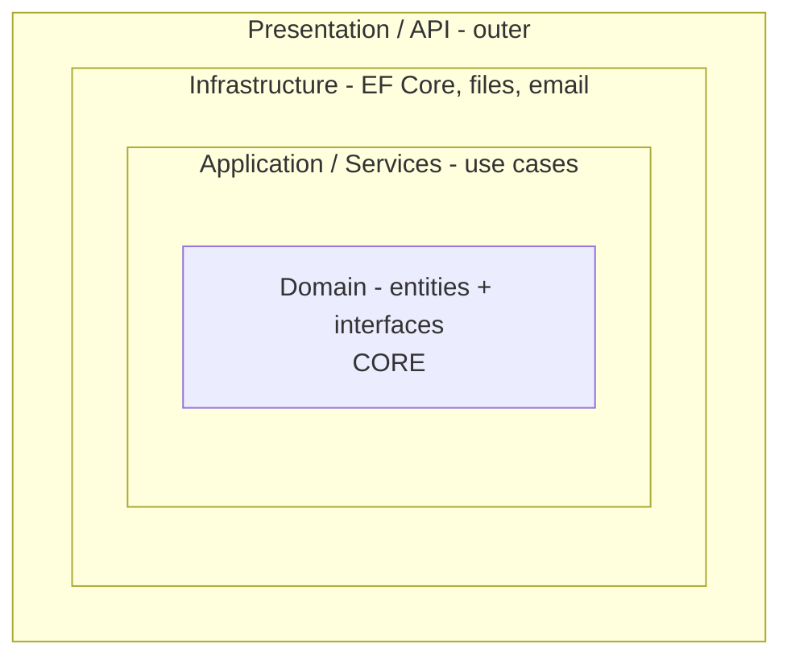

# Session 10: Onion Architecture I: Principles and Layers

> Module: Building Robust Web Applications with ASP.NET Core MVC · Term 3 (HDSE I) · ⏱ ~2 hours

## 🎯 Learning Objectives

- Explain **Inversion of Control (IoC)** and the **Dependency Inversion Principle (DIP)**
- Describe the layers of the **Onion Architecture** and the direction of dependencies
- Place entities, interfaces, services and repositories in the right layer
- Implement data access through a repository in the infrastructure layer
- List the advantages and costs of Onion Architecture

## 📖 Concepts Explained

### 1. The Problem: Tight Coupling

```csharp
public class StudentService
{
    private readonly SqlStudentRepository _repo = new SqlStudentRepository(); // tied to SQL Server!
}
```

The service cannot be tested without a database and cannot switch databases without editing it.

### 2. Dependency Inversion Principle (DIP)

> High-level modules should not depend on low-level modules. **Both should depend on abstractions** (interfaces).

| Without DIP | With DIP |
|---|---|
| `StudentService → SqlStudentRepository` | `StudentService → IStudentRepository ← SqlStudentRepository` |

Analogy: a phone charger. Your phone (high level) depends on the **USB-C standard** (abstraction), not on one specific charger brand (low level).

### 3. Inversion of Control (IoC)

Normally your class creates what it needs (`new`). With IoC, **someone else** (the DI container) creates objects and hands them in. Dependency injection is the most common way to do IoC in ASP.NET Core.

### 4. The Onion Layers



| Layer | Contains | May depend on |
|---|---|---|
| **Domain** (core) | Entities, business rules, repository interfaces | Nothing |
| **Application / Service** | Use cases (`StudentService`), DTOs | Domain |
| **Infrastructure** | Repositories with EF Core, email, file storage | Domain (implements its interfaces) |
| **Presentation** | Controllers, minimal APIs, views, `Program.cs` | Application (and Infrastructure only for wiring DI) |

**Golden rule:** dependencies always point **inward**. The core never knows about EF Core, SQL Server or ASP.NET.

### 5. Repositories in Infrastructure

The Domain says *"I need something that can `GetAll` and `Add` students"* (`IStudentRepository`). Infrastructure answers with an implementation: in-memory today, EF Core + SQL Server tomorrow. Changing the database means writing a new class and changing **one line** in `Program.cs`.

### 6. Advantages and Costs

| Advantages | Costs |
|---|---|
| Business logic is easy to unit test (use fake repositories) | More files and interfaces |
| Database/UI can be replaced with little change | Overkill for tiny CRUD apps |
| Clear place for every piece of code | Team must follow the rules |
| Teams can work on layers in parallel | Learning curve for beginners |

Related styles you will hear about: **Clean Architecture** and **Hexagonal (Ports and Adapters)**. They share the same core idea.

## 💻 Code Examples

Folder files: `OnionBasics.csproj`, `Program.cs`, `Domain/Entities/Student.cs`, `Domain/Interfaces/IStudentRepository.cs`, `Application/StudentService.cs`, `Infrastructure/InMemoryStudentRepository.cs`. This session keeps all layers in **one project with folders** so you can see the idea; Session 11 splits them into real projects.

### Example 1: Domain entity and interface

```csharp
namespace OnionBasics.Domain.Entities;

// CORE: a business entity. No EF, no ASP.NET, no database code here.
public class Student
{
    public int Id { get; set; }
    public string Name { get; set; } = "";
    public int Marks { get; set; }

    // Business rule lives with the entity
    public bool HasPassed() => Marks >= 50;
}
```

```csharp
using OnionBasics.Domain.Entities;

namespace OnionBasics.Domain.Interfaces;

// CORE defines WHAT it needs. Outer layers decide HOW.
public interface IStudentRepository
{
    List<Student> GetAll();
    Student? GetById(int id);
    void Add(Student student);
}
```

**How it works**: The entity holds data and a business rule. The interface describes data access without any technology.

### Example 2: Application service (`Application/StudentService.cs`)

```csharp
using OnionBasics.Domain.Entities;
using OnionBasics.Domain.Interfaces;

namespace OnionBasics.Application;

// APPLICATION layer: use cases. Depends only on the Domain interface.
public class StudentService
{
    private readonly IStudentRepository _repository;

    public StudentService(IStudentRepository repository)
    {
        _repository = repository;    // we do not know (or care) which database it is
    }

    public List<Student> GetPassedStudents()
    {
        return _repository.GetAll().Where(s => s.HasPassed()).ToList();
    }

    public Student Register(string name, int marks)
    {
        if (string.IsNullOrWhiteSpace(name))
            throw new ArgumentException("Name is required");

        var student = new Student { Name = name, Marks = marks };
        _repository.Add(student);
        return student;
    }
}
```

**How it works**: The service receives `IStudentRepository` in its constructor (DIP + IoC) and contains only use-case logic.

### Example 3: Infrastructure and wiring

```csharp
// Infrastructure/InMemoryStudentRepository.cs implements IStudentRepository
builder.Services.AddSingleton<IStudentRepository, InMemoryStudentRepository>();
builder.Services.AddScoped<StudentService>();
app.MapGet("/students/passed", (StudentService service) => service.GetPassedStudents());
```

**How it works**: `Program.cs` is the **composition root**: the one place that knows which implementation to use. Open `/students/passed` to see Areeba and Hira. POST `/students?name=Ali&marks=65` to add one.

## 🧪 Lab Practice

1. Draw the four layers and place each file of this folder in the right ring.
2. Add `GetTopper()` to `StudentService` that returns the highest-marks student.
3. Create `FileStudentRepository` that reads students from a JSON file and switch to it by changing one line in `Program.cs`.
4. Write a small console test: create `StudentService` with a fake repository containing two students and check `GetPassedStudents()`.
5. Find one place where a beginner might break the golden rule (e.g. using `DbContext` in the Domain) and explain why it is wrong.

## 📝 Assignment

Design the Onion layers for a "Clinic Appointment" system: list the entities, repository interfaces, services and infrastructure classes, and draw the dependency arrows.

## ❓ Quick Quiz

1. State DIP in one sentence.
2. Which layer has no dependencies?
3. Where does the EF Core repository class live?
4. What is the composition root?
5. Give one disadvantage of Onion Architecture.

<details>
<summary>Show answers</summary>

1. High-level and low-level modules both depend on abstractions, not on each other.
2. Domain (the core).
3. Infrastructure layer.
4. The single place (usually `Program.cs`) where services and implementations are registered and connected.
5. More code and structure than a small app needs.

</details>

## 💼 Interview Questions

1. **IoC vs DI vs DIP?** DIP is the design principle; IoC is the general idea of handing control of object creation to a framework; DI is the technique that does it by passing dependencies in.
2. **Why put repository interfaces in the Domain?** So the core owns the contract and infrastructure depends on it, keeping dependencies pointing inward.
3. **Onion vs traditional 3-tier?** In 3-tier the business layer depends on the data layer; in Onion the data layer depends on the core.

## ✅ Summary

- Tight coupling makes code hard to test and change.
- DIP + IoC/DI let high-level code depend on interfaces.
- Onion layers: Domain → Application → Infrastructure → Presentation, with dependencies pointing inward.
- Repositories in Infrastructure implement interfaces from the Domain.
- Use Onion for medium/large apps where testing and change matter.

---

[⬅ Previous](../Session-09-DotNet-Architecture-Kestrel-and-REST/README.md) · [🏠 Module Home](../README.md) · [Next ➡](../Session-11-Onion-Architecture-II/README.md)

Prepared by Zeeshan Abbas · Aptech Learning North Nazimabad
