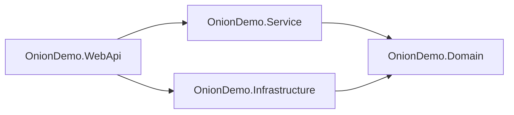

# Session 11: Onion Architecture II: Project Structure, Security and Monitoring

> Module: Building Robust Web Applications with ASP.NET Core MVC · Term 3 (HDSE I) · ⏱ ~2 hours

## 🎯 Learning Objectives

- Organise an Onion solution into four projects: Domain, Service, Infrastructure and Web API
- Set project references so dependencies point inward
- Implement each layer with EF Core and a controller-based Web API
- Apply key security settings (HTTPS, HSTS, headers, safe errors)
- Add logging, health checks and tracing for monitoring

## 📖 Concepts Explained

### 1. Four Projects, One Solution



| Project | Type | Holds | References |
|---|---|---|---|
| `OnionDemo.Domain` | classlib | `Product`, `IProductRepository` | none |
| `OnionDemo.Service` | classlib | `ProductService` (use cases) | Domain |
| `OnionDemo.Infrastructure` | classlib | `AppDbContext`, `ProductRepository` (EF Core) | Domain |
| `OnionDemo.WebApi` | webapi | Controllers, `Program.cs`, config | Service, Infrastructure |

Separate projects let the **compiler** enforce the rules: the Domain project simply cannot see EF Core.

### 2. Flow of One Request

`GET /api/products/1` → `ProductsController` → `ProductService.GetByIdAsync` → `IProductRepository` (implemented by `ProductRepository`) → `AppDbContext` → SQLite → back up the chain as JSON.

### 3. Security Considerations

| Concern | What to do |
|---|---|
| Transport | `UseHttpsRedirection`, `UseHsts` in production |
| Error details | `UseExceptionHandler` + `ProblemDetails`; never show stack traces to users |
| Secrets | Keep connection strings and keys in **User Secrets** (dev) or environment variables / Azure Key Vault (prod), not in Git |
| Input | Validate in DTOs and services; use EF Core parameters |
| Headers | `X-Content-Type-Options: nosniff`, `X-Frame-Options: DENY` |
| Access | `[Authorize]` and JWT (Session 14) |
| CORS | Allow only known front-end origins |

### 4. Monitoring and Tracing

| Tool | Answers | In code |
|---|---|---|
| **Logging** (`ILogger<T>`) | What happened? | `_logger.LogWarning("Product {ProductId} not found", id)` |
| **HTTP logging** | Which requests came in, how long? | `AddHttpLogging` / `UseHttpLogging` |
| **Health checks** | Is the app (and DB) alive? | `MapHealthChecks("/health")` |
| **Metrics** | How many requests, how fast? | `dotnet-counters monitor -n OnionDemo.WebApi` |
| **Distributed tracing** | Where did time go across services? | OpenTelemetry packages, viewed in Jaeger, Azure Monitor, etc. |

**Structured logging** keeps `{ProductId}` as a separate field, so log tools can search "all logs for product 7".

## 💻 Code Examples

Folder files: `create-solution.sh` and four project folders: `OnionDemo.Domain/`, `OnionDemo.Service/`, `OnionDemo.Infrastructure/`, `OnionDemo.WebApi/`. To run: `dotnet run --project OnionDemo.WebApi`, then open `/api/products` and `/health`.

### Example 1: Creating the structure (`create-solution.sh`, excerpt)

```bash
dotnet new sln -n OnionDemo
dotnet new classlib -n OnionDemo.Domain
dotnet new webapi   -n OnionDemo.WebApi --use-controllers
dotnet add OnionDemo.Service        reference OnionDemo.Domain
dotnet add OnionDemo.Infrastructure reference OnionDemo.Domain
dotnet add OnionDemo.WebApi         reference OnionDemo.Service OnionDemo.Infrastructure
```

**How it works**: The references draw the arrows of the diagram above. Adding a reference from Domain to Infrastructure would break the design, so never do it.

### Example 2: Infrastructure repository (`OnionDemo.Infrastructure/ProductRepository.cs`)

```csharp
using Microsoft.EntityFrameworkCore;
using OnionDemo.Domain;

namespace OnionDemo.Infrastructure;

// EF Core implementation of the Domain interface
public class ProductRepository : IProductRepository
{
    private readonly AppDbContext _db;

    public ProductRepository(AppDbContext db)
    {
        _db = db;
    }

    public Task<List<Product>> GetAllAsync() => _db.Products.AsNoTracking().ToListAsync();

    public Task<Product?> GetByIdAsync(int id) => _db.Products.FindAsync(id).AsTask();

    public async Task AddAsync(Product product)
    {
        _db.Products.Add(product);
        await _db.SaveChangesAsync();
    }
}
```

**How it works**: The class implements the Domain interface using EF Core. `AsNoTracking` makes read-only queries faster.

### Example 3: Composition root with security and monitoring (excerpt of `OnionDemo.WebApi/Program.cs`)

```csharp
builder.Services.AddScoped<IProductRepository, ProductRepository>();
builder.Services.AddScoped<ProductService>();
builder.Services.AddProblemDetails();
builder.Services.AddHealthChecks();
builder.Services.AddHttpLogging(o => { });
// ...
app.UseExceptionHandler();
app.UseHttpsRedirection();
app.UseHttpLogging();
app.MapHealthChecks("/health");
```

**How it works**: The Web API is the only project that knows both the Service and Infrastructure, so it wires them. Errors become standard ProblemDetails JSON; `/health` returns `Healthy`.

### Example 4: Controller with structured logging (`OnionDemo.WebApi/Controllers/ProductsController.cs`, excerpt)

```csharp
var product = await _service.GetByIdAsync(id);
if (product == null)
{
    _logger.LogWarning("Product {ProductId} not found", id);
    return NotFound();
}
return product;
```

**How it works**: The controller stays thin: it calls the service and logs. Business rules (price must be positive) live in `ProductService`.

## 🧪 Lab Practice

1. Run `create-solution.sh` commands in an empty folder, then copy in the code files and run the Web API.
2. POST a product with a negative price and look at the ProblemDetails response.
3. Add a database health check: install `Microsoft.Extensions.Diagnostics.HealthChecks.EntityFrameworkCore` and call `.AddDbContextCheck<AppDbContext>()`.
4. Move the connection string into User Secrets: `dotnet user-secrets init` and `dotnet user-secrets set "ConnectionStrings:Default" "Data Source=onion.db"`.
5. Run `dotnet-counters monitor -n OnionDemo.WebApi` while sending requests and note the request rate.

## 📝 Assignment

Add a `Category` entity with its own repository interface (Domain), EF implementation (Infrastructure), service and controller. Make sure no project reference points outward.

## ❓ Quick Quiz

1. Which project is allowed to reference Infrastructure?
2. What does `AddProblemDetails` give you?
3. Where should production secrets be stored?
4. What does structured logging mean?
5. What does HSTS tell the browser?

<details>
<summary>Show answers</summary>

1. Only the outer Web API project (for wiring DI).
2. A standard JSON error format (RFC 7807/9457) for API errors.
3. Environment variables or a secret store such as Azure Key Vault, never in source control.
4. Logging with named placeholders so values are stored as searchable fields.
5. Always use HTTPS for this site for a set period.

</details>

## 💼 Interview Questions

1. **How do you enforce layer rules in .NET?** Use separate projects with one-way references; optionally architecture tests (e.g. NetArchTest).
2. **What do you monitor in a production API?** Logs, error rates, response times, health checks and traces across services.
3. **Why keep controllers thin?** Logic in services is reusable, testable and independent of HTTP.

## ✅ Summary

- A real Onion solution uses separate projects for Domain, Service, Infrastructure and Web API.
- Project references enforce inward dependencies.
- HTTPS, HSTS, safe errors, secret storage and headers are basic security.
- Logging, health checks, metrics and tracing make problems visible early.

---

[⬅ Previous](../Session-10-Onion-Architecture-I/README.md) · [🏠 Module Home](../README.md) · [Next ➡](../Session-12-Lab-Review-Architecture/README.md)

Prepared by Zeeshan Abbas · Aptech Learning North Nazimabad
