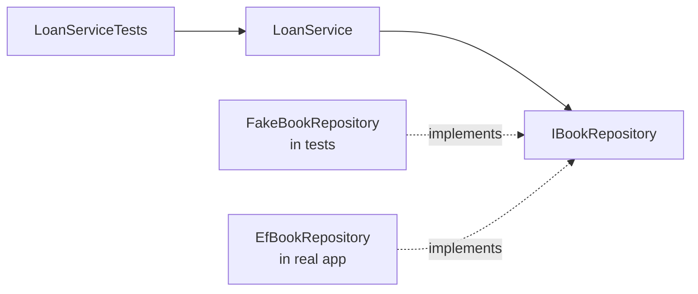

# Session 12: Lab and Review: Architecture

> Module: Building Robust Web Applications with ASP.NET Core MVC · Term 3 (HDSE I) · ⏱ ~2 hours

## 🎯 Learning Objectives

- Revise .NET architecture, Kestrel and REST design (Session 09)
- Revise DIP, IoC and the Onion layers (Sessions 10–11)
- Build a layered "Library" solution and keep dependencies pointing inward
- Prove the value of Onion by **unit testing** a service with a fake repository
- Expose the service through a REST API with proper status codes

## 📖 Concepts Explained

### 1. Revision Checklist

| Topic | You should be able to… |
|---|---|
| Start-up | Explain each step from `Main` to `app.Run()` |
| Kestrel | Change the port in code or `appsettings.json`; explain reverse proxies |
| REST | Choose the verb, URL and status code for any action |
| DIP / IoC | Explain why a service takes an interface in its constructor |
| Onion layers | Name the four projects and their references |
| Security / monitoring | Add HTTPS, ProblemDetails, logging and `/health` |

### 2. Why Testing Proves the Architecture

Because `LoanService` depends only on `IBookRepository`, a test can pass in a **fake** repository (a simple list). No database, no web server, tests run in milliseconds.



### 3. Arrange, Act, Assert

| Step | Meaning | In our test |
|---|---|---|
| Arrange | Prepare objects and data | Fake repo with one free book |
| Act | Call the method under test | `service.Borrow(1, "Ali")` |
| Assert | Check the result | Result is `"OK"` and the book is borrowed |

xUnit basics: `[Fact]` marks a test; `Assert.Equal`, `Assert.True`, `Assert.Throws<T>` check results; run with `dotnet test`.

## 💻 Code Examples

Folder files: `LibraryOnion.Domain/` (`Book.cs`, `IBookRepository.cs`), `LibraryOnion.Service/` (`LoanService.cs`), `LibraryOnion.Tests/` (`FakeBookRepository.cs`, `LoanServiceTests.cs`), each with its `.csproj`. Run `dotnet test LibraryOnion.Tests`.

### Example 1: The business rules (`LibraryOnion.Service/LoanService.cs`)

```csharp
using LibraryOnion.Domain;

namespace LibraryOnion.Service;

public class LoanService
{
    public const int MaxBooksPerMember = 3;
    private readonly IBookRepository _books;

    public LoanService(IBookRepository books)
    {
        _books = books;
    }

    // Returns a message instead of throwing, to keep the lab simple
    public string Borrow(int bookId, string member)
    {
        var book = _books.GetById(bookId);
        if (book == null) return "Book not found";
        if (book.IsBorrowed) return "Book is already borrowed";
        if (_books.CountBorrowedBy(member) >= MaxBooksPerMember) return "Limit reached";

        book.IsBorrowed = true;
        book.BorrowedBy = member;
        _books.Update(book);
        return "OK";
    }
}
```

**How it works**: Three rules: the book must exist, must not already be out, and a member can hold at most three books.

### Example 2: A fake repository (`LibraryOnion.Tests/FakeBookRepository.cs`)

```csharp
using LibraryOnion.Domain;

namespace LibraryOnion.Tests;

// A fake repository: no database needed to test the business rules
public class FakeBookRepository : IBookRepository
{
    public List<Book> Books { get; } = new();

    public Book? GetById(int id) => Books.FirstOrDefault(b => b.Id == id);

    public int CountBorrowedBy(string member) => Books.Count(b => b.BorrowedBy == member);

    public void Update(Book book) { /* list already holds the same object */ }
}
```

**How it works**: It implements the same interface as the real repository but keeps books in a list.

### Example 3: Unit tests (`LibraryOnion.Tests/LoanServiceTests.cs`, first test)

```csharp
[Fact]
public void Borrow_FreeBook_ReturnsOk()
{
    var repo = new FakeBookRepository();
    repo.Books.Add(new Book { Id = 1, Title = "C# Basics" });
    var service = new LoanService(repo);

    string result = service.Borrow(1, "Ali");

    Assert.Equal("OK", result);
    Assert.True(repo.Books[0].IsBorrowed);
}
```

**How it works**: Test names describe *method_situation_expected result*. The second test in the file checks that a borrowed book is rejected.

## 🧪 Lab Practice

1. **Run the tests**: `dotnet test LibraryOnion.Tests` and see 2 passing tests.
2. **Test the limit rule**: write `Borrow_FourthBook_ReturnsLimitReached` (add three books already borrowed by "Ali").
3. **Infrastructure**: add `LibraryOnion.Infrastructure` with `LibraryDbContext` (SQLite) and `EfBookRepository : IBookRepository`. It references only Domain.
4. **Web API**: add `LibraryOnion.WebApi` with `POST /api/books/{id}/borrow?member=Ali`. Return 200 for `"OK"`, 404 for "Book not found" and 409 Conflict for the other messages.
5. **Production touches**: add `/health`, ProblemDetails and a structured log line for every loan.

## 📝 Assignment

Add a `Return(int bookId)` use case with tests for: returning a borrowed book, returning a book that is not borrowed, and returning a missing book. Then expose it as `POST /api/books/{id}/return`.

## ❓ Quick Quiz

1. Why can `LoanService` be tested without a database?
2. What are the three parts of a unit test?
3. Which attribute marks an xUnit test?
4. Which status code fits "book is already borrowed"?
5. Which project references are allowed for `LibraryOnion.Infrastructure`?

<details>
<summary>Show answers</summary>

1. It depends on the `IBookRepository` interface, so a fake can be passed in.
2. Arrange, Act, Assert
3. `[Fact]` (or `[Theory]` for data-driven tests)
4. 409 Conflict
5. Only `LibraryOnion.Domain` (plus NuGet packages like EF Core).

</details>

## 💼 Interview Questions

1. **What is the difference between a fake and a mock?** A fake is a simple working implementation (in-memory list); a mock (e.g. Moq) records and verifies calls.
2. **How does layered architecture help testing?** Business logic is isolated behind interfaces, so it can be tested quickly without infrastructure.
3. **Where do validation rules belong in Onion?** Business rules in the Domain/Service; simple input format checks can also sit in API DTOs.

## ✅ Summary

- Sessions 09–11 build from platform basics to a full layered API.
- Onion's main pay-off is testable business logic.
- Fakes replace infrastructure in unit tests; xUnit runs them with `dotnet test`.
- Map service results to correct HTTP status codes in the outer layer.

---

[⬅ Previous](../Session-11-Onion-Architecture-II/README.md) · [🏠 Module Home](../README.md) · [Next ➡](../Session-13-Fluent-API-and-AutoMapper/README.md)

Prepared by Zeeshan Abbas · Aptech Learning North Nazimabad
