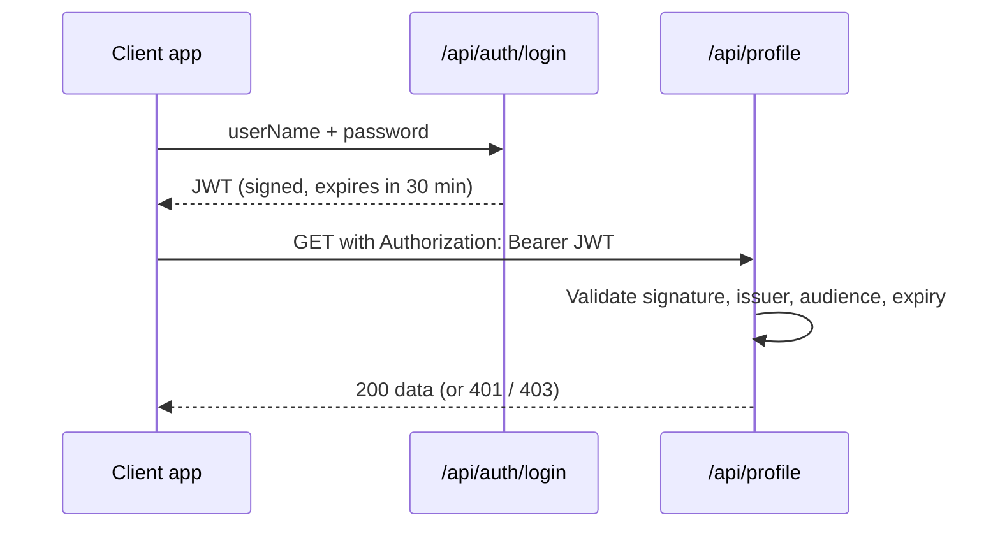

# Session 14: Token Authentication with JWT

> Module: Building Robust Web Applications with ASP.NET Core MVC · Term 3 (HDSE I) · ⏱ ~2 hours

## 🎯 Learning Objectives

- Explain **token-based authentication** and compare it with cookies
- Describe the three parts of a **JSON Web Token (JWT)**
- Generate and issue a signed JWT from a login endpoint
- Configure ASP.NET Core to **validate** tokens and protect endpoints
- Use roles inside tokens and call a protected API with a Bearer token
- Explain how tokens from identity providers (Entra ID, Auth0, Keycloak) are used

## 📖 Concepts Explained

### 1. Cookies vs Tokens

| | Cookie authentication | Token (JWT) authentication |
|---|---|---|
| Client | Browser sends cookie automatically | Client sends `Authorization: Bearer <token>` |
| Server state | Often a session on the server | **Stateless**: everything is inside the signed token |
| Best for | Server-rendered MVC sites | Web APIs, mobile apps, SPAs (React/Angular) |
| Cross-domain | Harder | Easy |

Analogy: a JWT is like a **cinema ticket** with a hologram. The gate staff do not phone the box office; they check the hologram (signature) and the show time (expiry).

### 2. The Flow



### 3. Inside a JWT

A JWT looks like `xxxxx.yyyyy.zzzzz` — three Base64URL parts:

| Part | Holds | Example |
|---|---|---|
| Header | Algorithm and type | `{"alg":"HS256","typ":"JWT"}` |
| Payload | Claims | `{"unique_name":"admin","role":"Admin","exp":1767225600}` |
| Signature | HMAC/RSA of header + payload with the secret key | Proves nobody changed it |

**Important:** the payload is only encoded, **not encrypted**. Anyone can read it at jwt.io, so never put passwords or private data in it.

### 4. Validation Settings

| Setting | Protects against |
|---|---|
| `ValidateIssuerSigningKey` + `IssuerSigningKey` | Forged or edited tokens |
| `ValidateIssuer` / `ValidIssuer` | Tokens made by someone else |
| `ValidateAudience` / `ValidAudience` | Tokens meant for another API |
| `ValidateLifetime` + `ClockSkew` | Expired tokens |

Status codes: **401 Unauthorized** = no or bad token; **403 Forbidden** = valid token but wrong role.

### 5. Tokens from Identity Providers

In big systems your API does not create tokens. A provider such as **Microsoft Entra ID**, **Auth0**, **Keycloak** or **Duende IdentityServer** logs users in (often with OAuth 2.0 / OpenID Connect) and issues the JWT. Your API just validates:

```csharp
.AddJwtBearer(options =>
{
    options.Authority = "https://login.example.com/";   // provider publishes its public keys here
    options.Audience = "my-api";
});
```

### 6. Good Practices

- Keep the signing key in User Secrets / environment variables, at least 32 random characters
- Short expiry (15–60 min) plus **refresh tokens** for long sessions
- Always use HTTPS so tokens cannot be sniffed
- Store tokens carefully in SPAs (memory or secure cookies, not careless `localStorage`)

## 💻 Code Examples

Folder files: `JwtDemo.csproj`, `appsettings.json`, `Program.cs`, `Services/TokenService.cs`, `Controllers/AuthController.cs`, `Controllers/ProfileController.cs`, `requests.http`.

### Example 1: Issuing a token (`Services/TokenService.cs`)

```csharp
using System.IdentityModel.Tokens.Jwt;
using System.Security.Claims;
using System.Text;
using Microsoft.IdentityModel.Tokens;

namespace JwtDemo.Services;

// Creates (issues) signed JWTs
public class TokenService
{
    private readonly IConfiguration _config;

    public TokenService(IConfiguration config)
    {
        _config = config;
    }

    public string CreateToken(string userName, string role)
    {
        // Step 1: the claims (facts) we put inside the token
        var claims = new List<Claim>
        {
            new Claim(ClaimTypes.Name, userName),
            new Claim(ClaimTypes.Role, role),
            new Claim(JwtRegisteredClaimNames.Jti, Guid.NewGuid().ToString())   // unique token id
        };

        // Step 2: the secret key and the signing algorithm
        var key = new SymmetricSecurityKey(Encoding.UTF8.GetBytes(_config["Jwt:Key"]!));
        var credentials = new SigningCredentials(key, SecurityAlgorithms.HmacSha256);

        // Step 3: build the token with issuer, audience and expiry
        var token = new JwtSecurityToken(
            issuer: _config["Jwt:Issuer"],
            audience: _config["Jwt:Audience"],
            claims: claims,
            expires: DateTime.UtcNow.AddMinutes(30),
            signingCredentials: credentials);

        // Step 4: turn it into the "xxxxx.yyyyy.zzzzz" string
        return new JwtSecurityTokenHandler().WriteToken(token);
    }
}
```

**How it works**: We add claims, sign them with HMAC-SHA256 using the secret key, set issuer, audience and expiry, then write the compact string.

### Example 2: Validating tokens (excerpt of `Program.cs`)

```csharp
builder.Services.AddAuthentication(JwtBearerDefaults.AuthenticationScheme)
    .AddJwtBearer(options =>
    {
        options.TokenValidationParameters = new TokenValidationParameters
        {
            ValidateIssuer = true,   ValidIssuer = jwt["Issuer"],
            ValidateAudience = true, ValidAudience = jwt["Audience"],
            ValidateLifetime = true,
            ValidateIssuerSigningKey = true,
            IssuerSigningKey = new SymmetricSecurityKey(Encoding.UTF8.GetBytes(jwt["Key"]!))
        };
    });
```

**How it works**: Every request with a Bearer header is checked against these rules before reaching `[Authorize]` actions.

### Example 3: Protected endpoints (`Controllers/ProfileController.cs`)

```csharp
using Microsoft.AspNetCore.Authorization;
using Microsoft.AspNetCore.Mvc;

namespace JwtDemo.Controllers;

[ApiController]
[Route("api/profile")]
[Authorize]                       // every action needs a valid token
public class ProfileController : ControllerBase
{
    // GET api/profile
    [HttpGet]
    public IActionResult Me()
    {
        var claims = User.Claims.Select(c => new { c.Type, c.Value });
        return Ok(new { name = User.Identity!.Name, claims });
    }

    // GET api/profile/admin  -> only the Admin role
    [HttpGet("admin")]
    [Authorize(Roles = "Admin")]
    public IActionResult AdminOnly() => Ok("Secret admin report");

    // GET api/profile/public -> no token needed
    [HttpGet("public")]
    [AllowAnonymous]
    public IActionResult Public() => Ok("Anyone can see this");
}
```

**How it works**: `[Authorize]` on the class protects all actions; `Roles = "Admin"` narrows one action; `[AllowAnonymous]` opens one.

## 🧪 Lab Practice

1. Run the app, log in as `admin` using `requests.http`, paste the token and call `/api/profile`.
2. Decode your token at https://jwt.io and find the `role` and `exp` claims.
3. Log in as `student` and call `/api/profile/admin`. Confirm you get 403.
4. Change one character in the token and call again. Confirm you get 401.
5. Set expiry to 1 minute, wait 2–3 minutes and call again to see the expired-token 401.

## 📝 Assignment

Add a `Teacher` role and an endpoint `GET /api/marks` that `Admin` and `Teacher` can read, while `POST /api/marks` is `Teacher` only. Show screenshots of 200, 401 and 403 responses.

## ❓ Quick Quiz

1. What are the three parts of a JWT?
2. Is the JWT payload encrypted?
3. What is the difference between 401 and 403?
4. Which header carries the token?
5. Why keep token lifetimes short?

<details>
<summary>Show answers</summary>

1. Header, payload, signature
2. No, only Base64URL-encoded; anyone can read it.
3. 401 = not authenticated (no/invalid token); 403 = authenticated but not allowed.
4. `Authorization: Bearer <token>`
5. A stolen token is useful only until it expires; JWTs are hard to revoke.

</details>

## 💼 Interview Questions

1. **Why are JWTs called stateless?** The server needs no session store; all needed claims and the signature are in the token.
2. **How do you log out a user with JWT?** Delete it on the client, keep lifetimes short, and use refresh-token revocation or a deny-list for urgent cases.
3. **Symmetric vs asymmetric signing?** HS256 uses one shared secret; RS256 signs with a private key and validates with a public key, which suits identity providers.

## ✅ Summary

- Token authentication suits APIs, mobile apps and SPAs.
- A JWT has header, payload (claims) and signature; it is signed, not encrypted.
- `TokenService` issues tokens; `AddJwtBearer` validates them.
- `[Authorize]`, roles and `[AllowAnonymous]` control access.
- Identity providers can issue tokens while your API only validates them.

---

[⬅ Previous](../Session-13-Fluent-API-and-AutoMapper/README.md) · [🏠 Module Home](../README.md) · [Next ➡](../Session-15-Lab-Review-Fluent-AutoMapper-JWT/README.md)

Prepared by Zeeshan Abbas · Aptech Learning North Nazimabad
