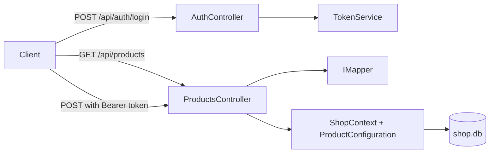

# Session 15: Lab and Review: Fluent API, AutoMapper and JWT

> Module: Building Robust Web Applications with ASP.NET Core MVC · Term 3 (HDSE I) · ⏱ ~2 hours

## 🎯 Learning Objectives

- Revise the Fluent API, DTOs and AutoMapper (Session 13)
- Revise issuing and validating JWTs (Session 14)
- Organise Fluent rules with `IEntityTypeConfiguration<T>`
- Build a product API where reads are public and writes need an Admin token
- Hide sensitive fields with DTOs and return correct status codes (201, 401, 403, 409)

## 📖 Concepts Explained

### 1. Revision Table

| Topic | Key API | Remember |
|---|---|---|
| Fluent API | `OnModelCreating`, `IEntityTypeConfiguration<T>` | Fluent rules beat annotations |
| Seed / defaults | `HasData`, `HasDefaultValueSql` | Run with `EnsureCreated` or migrations |
| DTOs | Input DTO + output DTO | Stop over-posting and data leaks |
| AutoMapper | `Profile`, `CreateMap`, `IMapper.Map` | `Map(src, dest)` for updates |
| JWT issuing | `JwtSecurityToken`, `SigningCredentials` | Payload is readable, not secret |
| JWT validation | `AddJwtBearer`, `TokenValidationParameters` | 401 vs 403 |

### 2. Architecture of the Lab API



### 3. One Configuration Class per Entity

As models grow, `OnModelCreating` gets huge. Put each entity's rules in its own class and load them all with one line:

```csharp
modelBuilder.ApplyConfigurationsFromAssembly(typeof(ShopContext).Assembly);
```

### 4. Status Codes This API Uses

| Situation | Code |
|---|---|
| Product created | 201 Created |
| Invalid DTO (e.g. price 0) | 400 Bad Request (automatic with `[ApiController]`) |
| No token on POST | 401 Unauthorized |
| Student token on POST | 403 Forbidden |
| Duplicate SKU | 409 Conflict |

## 💻 Code Examples

Folder files: `ShopApi.csproj`, `appsettings.json`, `Program.cs`, `Models/Product.cs`, `Data/ProductConfiguration.cs`, `Data/ShopContext.cs`, `Dtos/ProductDtos.cs`, `Mapping/ProductProfile.cs`, `Services/TokenService.cs`, `Controllers/AuthController.cs`, `Controllers/ProductsController.cs`. Token service and login are the same as Session 14.

### Example 1: Entity configuration class (`Data/ProductConfiguration.cs`)

```csharp
using Microsoft.EntityFrameworkCore;
using Microsoft.EntityFrameworkCore.Metadata.Builders;
using ShopApi.Models;

namespace ShopApi.Data;

// All Fluent API rules for Product in their own class
public class ProductConfiguration : IEntityTypeConfiguration<Product>
{
    public void Configure(EntityTypeBuilder<Product> builder)
    {
        builder.ToTable("Products");
        builder.Property(p => p.Name).IsRequired().HasMaxLength(100);
        builder.Property(p => p.Sku).IsRequired().HasMaxLength(20);
        builder.HasIndex(p => p.Sku).IsUnique();
        builder.Property(p => p.Price).HasPrecision(10, 2);
        builder.Property(p => p.CostPrice).HasPrecision(10, 2);
        builder.Property(p => p.CreatedAt).HasDefaultValueSql("CURRENT_TIMESTAMP");
    }
}
```

**How it works**: All rules for `Product` live in one small class. `HasDefaultValueSql` lets the database fill `CreatedAt`.

### Example 2: DTOs and profile (`Dtos/ProductDtos.cs`, `Mapping/ProductProfile.cs`)

```csharp
public record ProductDto(int Id, string Name, string Sku, decimal Price);   // no CostPrice

CreateMap<Product, ProductDto>();
CreateMap<SaveProductDto, Product>();
```

**How it works**: The output DTO leaves out `CostPrice`, so profit margins never leak. AutoMapper can map into records through their constructor.

### Example 3: Public reads, protected writes (`Controllers/ProductsController.cs`, excerpt)

```csharp
[HttpPost]
[Authorize(Roles = "Admin")]
public async Task<ActionResult<ProductDto>> Create(SaveProductDto dto)
{
    bool skuTaken = await _db.Products.AnyAsync(p => p.Sku == dto.Sku);
    if (skuTaken) return Conflict($"SKU {dto.Sku} already exists");
    var product = _mapper.Map<Product>(dto);
    _db.Products.Add(product);
    await _db.SaveChangesAsync();
    return Created($"/api/products/{product.Id}", _mapper.Map<ProductDto>(product));
}
```

**How it works**: The role check happens before the action runs. We check the SKU ourselves to return a clear 409 instead of a database error.

## 🧪 Lab Practice

1. Run the API. `GET /api/products` works without a token and returns `[]`.
2. Try `POST /api/products` without a token (401), with a `student` token (403) and with an `admin` token (201).
3. Post the same SKU again and confirm 409. Post `price: 0` and confirm 400.
4. Add `PUT /api/products/{id}` (Admin only) using `_mapper.Map(dto, product)`.
5. Add a `Category` entity with `CategoryConfiguration`, a one-to-many relation and `CategoryName` flattened into `ProductDto`.

## 📝 Assignment

Add a `GET /api/products/admin` endpoint (Admin only) that returns an `AdminProductDto` including `CostPrice` and a computed `Margin` (`Price - CostPrice`) configured with `ForMember` in the profile.

## ❓ Quick Quiz

1. Which interface holds Fluent rules for one entity?
2. Which line loads all configuration classes?
3. Why is `CostPrice` safe from clients here?
4. Which code do you get for a valid student token on POST?
5. What returns 400 automatically for an invalid DTO?

<details>
<summary>Show answers</summary>

1. `IEntityTypeConfiguration<T>`
2. `modelBuilder.ApplyConfigurationsFromAssembly(...)`
3. The output DTO has no `CostPrice` property, so it is never serialized.
4. 403 Forbidden
5. The `[ApiController]` attribute's automatic model validation.

</details>

## 💼 Interview Questions

1. **How do you organise EF Core configuration in a large project?** One `IEntityTypeConfiguration<T>` class per entity, applied from the assembly.
2. **Should controllers return entities directly?** No: return DTOs to avoid leaks, cycles and tight coupling to the database.
3. **How do you test a JWT-protected endpoint manually?** Log in to get a token, then send it in the `Authorization: Bearer` header (Postman, `.http` files, Swagger "Authorize").

## ✅ Summary

- `IEntityTypeConfiguration<T>` keeps Fluent rules organised.
- DTOs + AutoMapper shape input and output safely.
- JWT roles protect write operations while reads stay public.
- Clear status codes (201, 400, 401, 403, 409) make APIs easy to use.

---

[⬅ Previous](../Session-14-Token-Authentication-with-JWT/README.md) · [🏠 Module Home](../README.md) · [Next ➡](../Session-16-Repository-and-Unit-of-Work/README.md)

Prepared by Zeeshan Abbas · Aptech Learning North Nazimabad
