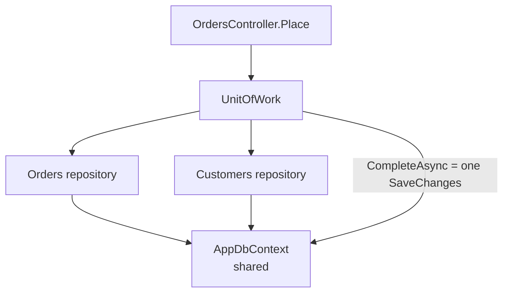

# Session 16: Repository and Unit of Work Patterns

> Module: Building Robust Web Applications with ASP.NET Core MVC · Term 3 (HDSE I) · ⏱ ~2 hours

## 🎯 Learning Objectives

- Describe the **Repository pattern** and its advantages
- Build a **generic repository** with EF Core
- Explain the **Unit of Work** pattern and how it differs from a plain repository
- Save changes from several repositories in **one transaction**
- Decide when these patterns help and when EF Core alone is enough

## 📖 Concepts Explained

### 1. Repository Pattern

A **repository** is a class that acts like an in-memory collection of entities and hides how data is stored.

Analogy: a **library counter**. You ask for "book 42"; you do not care which shelf or storeroom it comes from.

| Advantage | Why it matters |
|---|---|
| Hides data access details | Controllers/services do not write EF queries everywhere |
| One place for queries | Fix or optimise once |
| Testable | Replace with a fake in unit tests (Session 12) |
| Swappable storage | Change database or ORM behind the interface |

### 2. Generic Repository

Most entities need the same operations (get all, get by id, add, remove). A generic `IRepository<T>` writes them once:

```csharp
public interface IRepository<T> where T : class { Task<T?> GetByIdAsync(int id); Task AddAsync(T entity); ... }
```

Add **specific repositories** (e.g. `IOrderRepository : IRepository<Order>` with `GetOrdersForCustomer(...)`) when you need special queries.

### 3. The Problem: Who Calls SaveChanges?

If every repository saves on its own, placing an order could **add the order** but **fail to update the customer**, leaving data inconsistent.

### 4. Unit of Work

The **Unit of Work** tracks all changes made during one business operation and commits them **together**.



| | Repository only | Repository + Unit of Work |
|---|---|---|
| Saving | Each repository saves itself | One `CompleteAsync()` for all |
| Consistency | Partial saves possible | All-or-nothing |
| Shared context | Not guaranteed | All repositories share one `DbContext` |

### 5. Benefits of Unit of Work

- One transaction per business operation
- Fewer database round trips (changes are sent in one batch)
- Controllers/services see one simple object (`IUnitOfWork`)

### 6. An Honest Note

EF Core's `DbContext` **already is** a unit of work and each `DbSet` **already is** a repository. Many teams use EF Core directly for simple apps. The patterns pay off in larger, layered (Onion) apps where you want the Domain free of EF Core and you need easy testing. Know both views for interviews.

## 💻 Code Examples

Folder files: `UowDemo.csproj`, `Program.cs`, `Models/Customer.cs`, `Models/Order.cs`, `Data/AppDbContext.cs`, `Repositories/IRepository.cs`, `Repositories/Repository.cs`, `Persistence/IUnitOfWork.cs`, `Persistence/UnitOfWork.cs`, `Controllers/OrdersController.cs`.

### Example 1: Generic repository (`Repositories/Repository.cs`)

```csharp
using Microsoft.EntityFrameworkCore;
using UowDemo.Data;

namespace UowDemo.Repositories;

// Generic EF Core implementation. Notice: NO SaveChanges here!
public class Repository<T> : IRepository<T> where T : class
{
    protected readonly AppDbContext _db;
    private readonly DbSet<T> _set;

    public Repository(AppDbContext db)
    {
        _db = db;
        _set = db.Set<T>();
    }

    public Task<List<T>> GetAllAsync() => _set.ToListAsync();

    public async Task<T?> GetByIdAsync(int id) => await _set.FindAsync(id);

    public async Task AddAsync(T entity) => await _set.AddAsync(entity);

    public void Remove(T entity) => _set.Remove(entity);
}
```

**How it works**: `db.Set<T>()` gives the right table for any entity. The repository never calls `SaveChanges`; that is the Unit of Work's job.

### Example 2: Unit of Work (`Persistence/UnitOfWork.cs`)

```csharp
using UowDemo.Data;
using UowDemo.Models;
using UowDemo.Repositories;

namespace UowDemo.Persistence;

public class UnitOfWork : IUnitOfWork
{
    private readonly AppDbContext _db;

    public UnitOfWork(AppDbContext db)
    {
        _db = db;
        // Both repositories share the SAME DbContext
        Customers = new Repository<Customer>(db);
        Orders = new Repository<Order>(db);
    }

    public IRepository<Customer> Customers { get; }
    public IRepository<Order> Orders { get; }

    public Task<int> CompleteAsync() => _db.SaveChangesAsync();
}
```

**How it works**: Both repositories are built with the same `DbContext`, so their changes are tracked together. `CompleteAsync` commits everything in one transaction.

### Example 3: Using it (`Controllers/OrdersController.cs`, excerpt)

```csharp
await _uow.Orders.AddAsync(new Order { CustomerId = customer.Id, Amount = request.Amount });
customer.TotalSpent += request.Amount;
await _uow.CompleteAsync();
```

**How it works**: Two changes, one save. POST `{ "customerId": 1, "amount": 2500 }` to `/api/orders` twice and watch `TotalSpent` grow to 5000.

### Example 4: Registration (excerpt of `Program.cs`)

```csharp
builder.Services.AddScoped(typeof(IRepository<>), typeof(Repository<>));
builder.Services.AddScoped<IUnitOfWork, UnitOfWork>();
```

**How it works**: The open generic registration lets DI create `IRepository<Customer>`, `IRepository<Order>` and so on. Scoped = one per request, matching the `DbContext`.

## 🧪 Lab Practice

1. Run the app and place two orders for customer 1. Check `GET /api/orders`.
2. Add `IOrderRepository` with `GetForCustomerAsync(int customerId)` and expose it from the Unit of Work.
3. Place an order for customer 99 and confirm nothing is saved (404).
4. Add a `Product` entity with `Stock`; placing an order must reduce stock in the same `CompleteAsync()`.
5. Throw an exception after changing the customer but before `CompleteAsync` and prove no order row was saved.

## 📝 Assignment

Write a short Markdown note (with a diagram) comparing "EF Core directly in services" vs "Repository + Unit of Work" for a small shop app and for a large hospital system. Recommend one for each.

## ❓ Quick Quiz

1. What does a repository hide?
2. Why should repositories not call `SaveChanges` when using Unit of Work?
3. Which EF Core class already behaves like a unit of work?
4. How do you register an open generic repository in DI?
5. What is one benefit of saving in one batch?

<details>
<summary>Show answers</summary>

1. How and where data is stored and queried.
2. So all changes in one operation are committed together, all-or-nothing.
3. `DbContext`
4. `services.AddScoped(typeof(IRepository<>), typeof(Repository<>))`
5. Consistency (one transaction) and fewer round trips.

</details>

## 💼 Interview Questions

1. **Repository vs Unit of Work?** Repository manages access to one type of entity; Unit of Work coordinates several repositories and commits their changes as one transaction.
2. **Is a generic repository an anti-pattern?** It can be if it just re-wraps `DbSet` with no benefit; it helps when it keeps the Domain independent and makes testing simpler.
3. **How do you handle a transaction across two `SaveChanges` calls?** `using var tx = await db.Database.BeginTransactionAsync(); ... await tx.CommitAsync();`

## ✅ Summary

- Repositories hide data access behind interfaces.
- A generic repository removes repeated CRUD code.
- Unit of Work shares one context and saves everything at once.
- Use these patterns where layering and testing matter; EF Core alone is fine for small apps.

---

[⬅ Previous](../Session-15-Lab-Review-Fluent-AutoMapper-JWT/README.md) · [🏠 Module Home](../README.md) · [Next ➡](../Session-17-Identity-Session-and-Deployment/README.md)

Prepared by Zeeshan Abbas · Aptech Learning North Nazimabad
