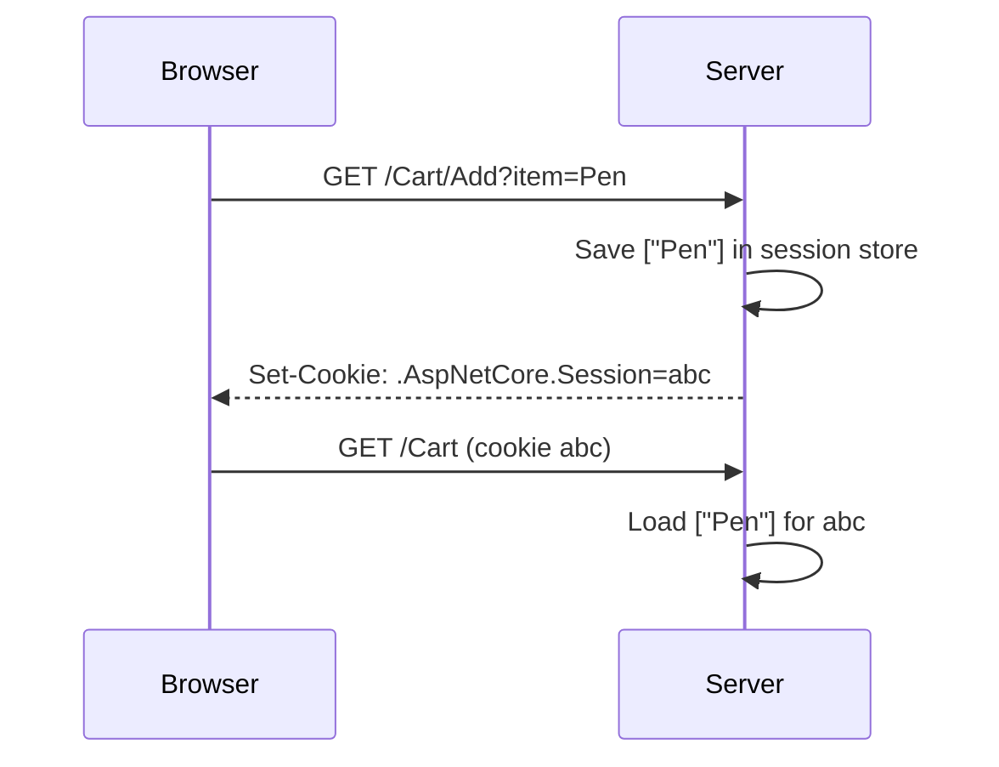

# Session 17: Identity, Session State and Deployment

> Module: Building Robust Web Applications with ASP.NET Core MVC · Term 3 (HDSE I) · ⏱ ~2 hours

## 🎯 Learning Objectives

- Add user registration and login with **ASP.NET Core Identity**
- Explain how Identity stores passwords safely (hashing, lockout, rules)
- Store per-user data with **session state**
- Compare web servers and hosting models for ASP.NET Core
- Publish an app from Visual Studio 2022 or the CLI
- Deploy to **IIS** with the .NET Hosting Bundle

## 📖 Concepts Explained

### 1. ASP.NET Core Identity

Identity is a ready-made membership system: users, passwords, roles, lockout, email confirmation, 2FA and external logins (Google, Microsoft).

| Class | Job |
|---|---|
| `IdentityUser` | A user row (`AspNetUsers` table) |
| `IdentityDbContext` | EF Core context with all Identity tables |
| `UserManager<T>` | Create, find, update users; add to roles |
| `SignInManager<T>` | Check passwords, sign in/out, lockout |
| `RoleManager<T>` | Create and manage roles |

Shortcut: Visual Studio's "Individual Accounts" template or scaffolding adds ready Identity UI pages. We write a small controller to see how it works.

### 2. Password Security

| Rule | How Identity helps |
|---|---|
| Never store plain passwords | Stores a **salted hash** (PBKDF2 with many iterations) |
| Strong passwords | `options.Password.RequiredLength`, `RequireDigit`, `RequireUppercase` |
| Stop guessing attacks | **Lockout** after N failed attempts |
| Prove email ownership | `RequireConfirmedEmail` + token providers |
| Extra protection | Two-factor authentication (authenticator apps) |

Analogy: a hash is like a **fingerprint** of the password. You can compare fingerprints, but you cannot rebuild the password from it.

### 3. Session State

HTTP is stateless. **Session** keeps small data for one user between requests (cart items, wizard steps).



| Storage | Lifetime | Good for |
|---|---|---|
| `TempData` | Until read | One-time messages |
| **Session** | Until idle timeout | Cart, small user state |
| Cookie | Set by you | Small, non-sensitive preferences |
| Database | Permanent | Orders, profiles |

Session stores strings/bytes, so we serialize lists with System.Text.Json. In a web farm use a distributed cache (Redis, SQL Server) instead of memory.

### 4. Web Servers and Hosting

| Option | Description |
|---|---|
| Kestrel | Built-in server, always present |
| IIS (Windows) | Hosts the app **in-process** through the ASP.NET Core Module |
| Nginx / Apache (Linux) | Reverse proxy in front of Kestrel |
| Azure App Service | Managed cloud hosting |
| Docker container | Same image runs anywhere |

### 5. Publishing

- **Visual Studio 2022**: right-click project → **Publish** → choose Folder, IIS, Azure or Docker → profile saved in `Properties/PublishProfiles` → **Publish**.
- **CLI**: `dotnet publish -c Release -o ./publish`
- **Framework-dependent** (needs .NET runtime on server, smaller) vs **self-contained** (`--self-contained -r win-x64`, bigger, no runtime needed).

### 6. Deploying to IIS: Checklist

1. Turn on Windows features: IIS Web Server and Management Console.
2. Install the **ASP.NET Core Hosting Bundle** (runtime + ASP.NET Core Module), then restart IIS.
3. Copy published files to a folder such as `C:\inetpub\MyApp`.
4. Create an **App Pool** with **No Managed Code**.
5. Create the website, bind a port/host name, point it at the folder.
6. Give the app pool identity permissions on folders it writes to.
7. Browse; if it fails, enable `stdoutLogEnabled` in `web.config` and read the logs.

Classic ASP.NET MVC 5 (Framework) apps deploy to IIS differently: the app pool uses **.NET CLR v4.0** and IIS runs the code itself (no Kestrel).

## 💻 Code Examples

Folder files: `IdentitySession.csproj`, `Program.cs`, `Data/AppDbContext.cs`, `Models/AccountModel.cs`, `Controllers/AccountController.cs`, `Controllers/CartController.cs`, `Views/...`, `deploy/publish.ps1`, `deploy/web.config`.

### Example 1: Identity + session setup (excerpt of `Program.cs`)

```csharp
builder.Services.AddIdentity<IdentityUser, IdentityRole>(options =>
{
    options.Password.RequiredLength = 8;
    options.Password.RequireDigit = true;
    options.Lockout.MaxFailedAccessAttempts = 5;
})
.AddEntityFrameworkStores<AppDbContext>()
.AddDefaultTokenProviders();

builder.Services.AddDistributedMemoryCache();
builder.Services.AddSession(o => o.IdleTimeout = TimeSpan.FromMinutes(20));
// pipeline: UseSession(); UseAuthentication(); UseAuthorization();
```

**How it works**: Identity uses EF Core to store users in `identity.db`. Session needs a cache to store its data.

### Example 2: Register and login (`Controllers/AccountController.cs`, excerpt)

```csharp
var user = new IdentityUser { UserName = model.Email, Email = model.Email };
var result = await _userManager.CreateAsync(user, model.Password);
// ...
var login = await _signInManager.PasswordSignInAsync(model.Email, model.Password,
                                                    isPersistent: false, lockoutOnFailure: true);
```

**How it works**: `CreateAsync` checks the password rules and stores only a hash. `PasswordSignInAsync` verifies the hash, counts failures and issues the auth cookie.

### Example 3: Session cart (`Controllers/CartController.cs`, excerpt)

```csharp
HttpContext.Session.SetString(CartKey, JsonSerializer.Serialize(items));   // save
string? json = HttpContext.Session.GetString(CartKey);                     // read
```

**How it works**: The list is turned into JSON text and kept in session. Each user has a separate session cookie.

### Example 4: IIS deployment script (`deploy/publish.ps1`)

```powershell
# 1. Build a Release version into the "publish" folder
dotnet publish ..\IdentitySession.csproj -c Release -o C:\inetpub\IdentitySession

# 2. (Run PowerShell as Administrator) turn on IIS
Enable-WindowsOptionalFeature -Online -FeatureName IIS-WebServerRole, IIS-WebServer, IIS-ManagementConsole -All

# 3. Install the ASP.NET Core 8 Hosting Bundle (download from the official .NET site), then restart IIS
net stop was /y
net start w3svc

# 4. Create an app pool (No Managed Code) and a website on port 8080
Import-Module WebAdministration
New-WebAppPool -Name "IdentitySessionPool"
Set-ItemProperty IIS:\AppPools\IdentitySessionPool -Name managedRuntimeVersion -Value ""
New-Website -Name "IdentitySession" -Port 8080 -PhysicalPath "C:\inetpub\IdentitySession" -ApplicationPool "IdentitySessionPool"

# 5. Give the app pool write access so SQLite can create identity.db
icacls "C:\inetpub\IdentitySession" /grant "IIS AppPool\IdentitySessionPool:(OI)(CI)M"
```

**How it works**: The script publishes, enables IIS, creates a No-Managed-Code app pool and a site, and grants write permission. The Hosting Bundle is installed manually from https://dotnet.microsoft.com/download/dotnet/8.0.

## 🧪 Lab Practice

1. Run the app, register with a weak password (`abc`) and read the errors. Register with `Karachi2026`.
2. Add items to your cart, log out, log in as a new user and confirm the carts are separate sessions.
3. Enter a wrong password five times and see the lockout message.
4. Seed an `Admin` role with `RoleManager` and protect a new `AdminController` with `[Authorize(Roles = "Admin")]`.
5. Publish with `dotnet publish -c Release -o ./publish` and list the files created (find `web.config`).

## 📝 Assignment

Deploy this app to IIS on your PC (or Azure App Service free tier). Submit screenshots of the app pool settings, the running site and your registered user in the `AspNetUsers` table.

## ❓ Quick Quiz

1. Which class signs users in and handles lockout?
2. How does Identity store passwords?
3. Which two calls are needed to enable session?
4. What must be installed on a server to host ASP.NET Core in IIS?
5. Which .NET CLR version should the IIS app pool use for ASP.NET Core?

<details>
<summary>Show answers</summary>

1. `SignInManager<TUser>`
2. As salted, iterated hashes (never plain text).
3. `builder.Services.AddSession()` (with a cache) and `app.UseSession()`
4. The ASP.NET Core Hosting Bundle
5. No Managed Code

</details>

## 💼 Interview Questions

1. **Session vs TempData vs cookies?** Session keeps user data on the server across requests; TempData lasts until read; cookies live in the browser and are sent with every request.
2. **Why hash instead of encrypt passwords?** Hashes are one-way; even with database access an attacker cannot reverse them.
3. **In-process vs out-of-process IIS hosting?** In-process runs the app inside the IIS worker process (faster); out-of-process forwards requests to Kestrel.

## ✅ Summary

- Identity provides users, hashed passwords, roles and lockout out of the box.
- Session stores small per-user data; use distributed caches for many servers.
- Publish with Visual Studio or `dotnet publish`.
- IIS needs the Hosting Bundle and a No-Managed-Code app pool.

---

[⬅ Previous](../Session-16-Repository-and-Unit-of-Work/README.md) · [🏠 Module Home](../README.md) · [Next ➡](../Session-18-Lab-Review-Patterns-Identity-Deployment/README.md)

Prepared by Zeeshan Abbas · Aptech Learning North Nazimabad
