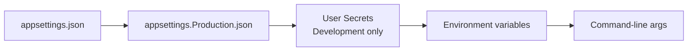
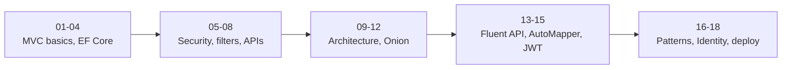

# Session 18: Lab and Review: Patterns, Identity and Deployment

> Module: Building Robust Web Applications with ASP.NET Core MVC · Term 3 (HDSE I) · ⏱ ~2 hours

## 🎯 Learning Objectives

- Revise Repository/Unit of Work, Identity, session state and deployment (Sessions 16–17)
- Seed roles and an admin user with `RoleManager` and `UserManager`
- Prepare an app for production with environment-specific settings
- Deploy to IIS or package the app as a Docker container
- Review the whole module and plan your eProject

## 📖 Concepts Explained

### 1. Revision Table

| Topic | Key idea | Check yourself |
|---|---|---|
| Repository | Hides data access per entity | Can you write `IRepository<T>`? |
| Unit of Work | One `SaveChanges` for many repositories | Why must repositories not save? |
| Identity | `UserManager`, `SignInManager`, hashed passwords | How is lockout configured? |
| Roles | `RoleManager`, `[Authorize(Roles=...)]` | How do you seed the first admin? |
| Session | `AddSession`, `UseSession`, `SetString` | Where is session data stored? |
| Publishing | `dotnet publish -c Release` | Framework-dependent vs self-contained? |
| IIS | Hosting Bundle + No Managed Code pool | What file tells IIS how to start the app? |

### 2. Environments and Configuration

ASP.NET Core loads settings in layers; **later sources win**:



- Set the environment with `ASPNETCORE_ENVIRONMENT=Production` (default when not set).
- Put **secrets** (connection strings, JWT keys) in environment variables, e.g. `ConnectionStrings__Default` (double underscore = `:`).

### 3. Seeding Roles

Roles and the first admin must exist before anyone can log in as admin. A seed method runs at start-up, checks what exists and creates only what is missing (safe to run many times).

### 4. Two Ways to Ship

| | IIS (Windows) | Docker container |
|---|---|---|
| Needs on server | IIS + Hosting Bundle | Docker / a container host |
| Package | Published folder + `web.config` | Image built from a `Dockerfile` |
| Good for | Company Windows servers | Cloud, Linux, consistent environments |

### 5. Module Journey



## 💻 Code Examples

Folder files: `SeedData.cs`, `appsettings.Production.json`, `Dockerfile`, `release-checklist.md`. They are designed to be **copied into the Session 17 project** (`IdentitySession`).

### Example 1: Seeding an admin (`SeedData.cs`)

```csharp
using Microsoft.AspNetCore.Identity;

namespace IdentitySession.Data;

// Creates the Admin role and a first admin user when the app starts.
// Call it from Program.cs:  await SeedData.CreateAdminAsync(app.Services);
public static class SeedData
{
    public static async Task CreateAdminAsync(IServiceProvider services)
    {
        using var scope = services.CreateScope();
        var roleManager = scope.ServiceProvider.GetRequiredService<RoleManager<IdentityRole>>();
        var userManager = scope.ServiceProvider.GetRequiredService<UserManager<IdentityUser>>();

        // Step 1: make sure the role exists
        if (!await roleManager.RoleExistsAsync("Admin"))
        {
            await roleManager.CreateAsync(new IdentityRole("Admin"));
        }

        // Step 2: make sure the admin user exists
        const string adminEmail = "admin@campus.local";
        var admin = await userManager.FindByEmailAsync(adminEmail);
        if (admin == null)
        {
            admin = new IdentityUser { UserName = adminEmail, Email = adminEmail, EmailConfirmed = true };
            // Read the password from configuration in real apps; this is a lab default
            await userManager.CreateAsync(admin, "Admin2026Pass");
        }

        // Step 3: put the user in the role
        if (!await userManager.IsInRoleAsync(admin, "Admin"))
        {
            await userManager.AddToRoleAsync(admin, "Admin");
        }
    }
}
```

**How it works**: Each step checks first, so running it again does nothing harmful. Add `await SeedData.CreateAdminAsync(app.Services);` in `Program.cs` after `EnsureCreated()` (top-level statements allow `await`).

### Example 2: Production settings (`appsettings.Production.json`)

```json
{
  "Logging": {
    "LogLevel": { "Default": "Warning", "Microsoft.AspNetCore": "Warning" }
  },
  "AllowedHosts": "mycampus.example.com"
}
```

**How it works**: In Production, these values override `appsettings.json`: less noisy logs and only your real host name is accepted.

### Example 3: Container build (`Dockerfile`)

```
# Stage 1: build and publish with the full SDK
FROM mcr.microsoft.com/dotnet/sdk:8.0 AS build
WORKDIR /src
COPY . .
RUN dotnet publish -c Release -o /app

# Stage 2: run with the small ASP.NET runtime image
FROM mcr.microsoft.com/dotnet/aspnet:8.0
WORKDIR /app
COPY --from=build /app .
ENV ASPNETCORE_URLS=http://+:8080
EXPOSE 8080
ENTRYPOINT ["dotnet", "IdentitySession.dll"]
```

**How it works**: A multi-stage build compiles with the SDK image, then copies only the output into the small runtime image. Build and run with `docker build -t campus .` and `docker run -p 8080:8080 campus`.

## 🧪 Lab Practice

1. **Seed roles**: copy `SeedData.cs` into the Session 17 project, call it from `Program.cs`, and log in as the seeded admin.
2. **Protect admin pages**: add `AdminController` with `[Authorize(Roles = "Admin")]` that lists all users from `_userManager.Users`.
3. **Unit of Work**: add an `Orders` feature using `IRepository<T>` + `IUnitOfWork` from Session 16; checkout must save the order and clear the session cart.
4. **Production run**: `dotnet run --environment Production` and confirm the friendly error page and quieter logs.
5. **Ship it**: deploy to IIS (Session 17 script) **or** build and run the Docker image; tick every line of `release-checklist.md`.

## 📝 Assignment

Finish the **Module Mini-Project** described on the module home page and submit the repository link, a short README with screenshots, and your completed release checklist.

## ❓ Quick Quiz

1. Which source wins: `appsettings.json` or an environment variable?
2. How do you write the key `ConnectionStrings:Default` as an environment variable?
3. Which class creates roles?
4. Why does the Dockerfile use two stages?
5. What should the first smoke test after deployment include?

<details>
<summary>Show answers</summary>

1. The environment variable
2. `ConnectionStrings__Default`
3. `RoleManager<IdentityRole>`
4. To build with the large SDK image but ship only the small runtime image.
5. Register, log in, use the main feature, log out, and check `/health` and the logs.

</details>

## 💼 Interview Questions

1. **How do you manage configuration across environments?** Layered providers: base `appsettings.json`, environment-specific files, secrets in User Secrets/env vars/Key Vault.
2. **How would you seed initial data safely?** Idempotent start-up code or EF Core `HasData`/migrations, with passwords read from configuration.
3. **IIS or containers for a new project?** Containers give portable, repeatable deployments; IIS fits existing Windows infrastructure.

## ✅ Summary

- Repository + Unit of Work, Identity and session combine into real features.
- Seed roles and the first admin with idempotent start-up code.
- Use environment-specific settings and keep secrets out of files.
- Ship via IIS or Docker, guided by a release checklist.
- You are ready for the .NET Web Application eProject.

---

[⬅ Previous](../Session-17-Identity-Session-and-Deployment/README.md) · [🏠 Module Home](../README.md) · [Next: eProject ➡](../../eProject/README.md)

Prepared by Zeeshan Abbas · Aptech Learning North Nazimabad
